<!-- Generated by scripts/build_spec.py from examples/gallery/ and docs/images/gallery/. Edit the source and regenerate; do not edit this file. -->

# Gallery

Every example the [playground](https://creatoan.github.io/scenet/playground/) offers, in its
menu's order, drawn as `scenet build` draws it. Each is a file under
[`examples/gallery/`](https://github.com/creatoan/scenet/tree/main/examples/gallery) that the
test suite compiles, and each picture is a golden output of that build, held to its digest, so
neither can drift from what the compiler does. Open an example in the playground to change it,
or read the page that explains it.

## Your first panel

Learn it in the tour: [Your first panel](tutorial/first_panel.md).

### A tour of Scenet

One page lettered over pictures in colour: posed puppets, figures a picture draws, a caption, a thought, a sound and an inset.


[Open in the playground](https://creatoan.github.io/scenet/playground/#example=38-tour.scene.yaml) · [Read about it](reference/language/index.md#the-layers)

<details>
<summary>Source</summary>

```yaml
# A tour of Scenet: one page, lettered over pictures in colour.
#
# Nothing on this page was drawn by a generative model, and nothing in this file is a
# coordinate. It says who is in each panel, what they do and what they say, and the
# compiler works out the rest: where everybody stands, how the camera frames them, and
# where every balloon, caption and sound goes so that the page reads in order.
#
# The pictures were painted elsewhere -- art/street.png and art/figures.png, beside this
# file. On the street, Alice and Bob are Scenet's own puppets, posed and staged in front
# of the picture. On the platform, Ana and Ben are people the picture draws: its artwork
# contract, art/figures.art.yaml, says where their faces and mouths are, and the
# balloons keep off them. A panel's cast is one or the other, never both.
#
# The small panel set into the street is an inset, read after the panel it sits in.
# Alice's sweat is emanata, drawn round her head; the sound is lettered as part of the
# picture; her worry is a thought, in a cloud.
#
# Pick another example from the menu, or press Next, to see each idea on its own.

page: {size: [1500, 2250], margin: 75, gutter: 30, tier_gutter: 45}

pages:
  - tiers:
      - height: 1.3
        panels:
          - use: street
            insets:
              - {use: worry, at: bottom_right, size: 0.33}
      - panels: [platform]

panels:
  street:
    camera: {shot: long_shot}
    setting: {image: art/street.png, fit: cover, time: dusk, weather: rain}
    cast:
      alice: {reference: alice, pose: pointing, at: left_third, marks: [plewds]}
      bob:   {reference: bob,   pose: arms_crossed, at: right_third, facing: left}
    staging:
      - alice left_of bob
      - alice looking_at bob
      - alice ground_shared_with bob
    script:
      - caption: {text: "Eight o'clock. Still raining.", kind: locale}
      - sfx: {text: VROOM, prefer: top_right, size: medium, rotate: -8}
      - say: {by: alice, text: "That was our bus!"}
      - say: {by: bob, text: "Then we take the train."}

  worry:
    camera: {shot: medium_close_up}
    setting: {image: art/street.png, fit: cover, time: dusk}
    cast:
      alice: {reference: alice, expression: scared, facing: left}
    script:
      - say: {by: alice, text: "We'll never make it.", kind: thought}

  platform:
    setting: {image: art/figures.png, fit: cover, time: night}
    cast:
      ana: {figure: ana}
      ben: {figure: ben}
    script:
      - caption: {text: "Platform 4. Ten past nine.", kind: locale}
      - say: {by: ana, text: "Is it always this late?"}
      - say: {by: ben, text: "Only when it rains somewhere else."}
```

</details>

### Two characters

The umbrella panel, which every page starts from: two actors, who stands where, who looks at whom, and two lines of dialogue.

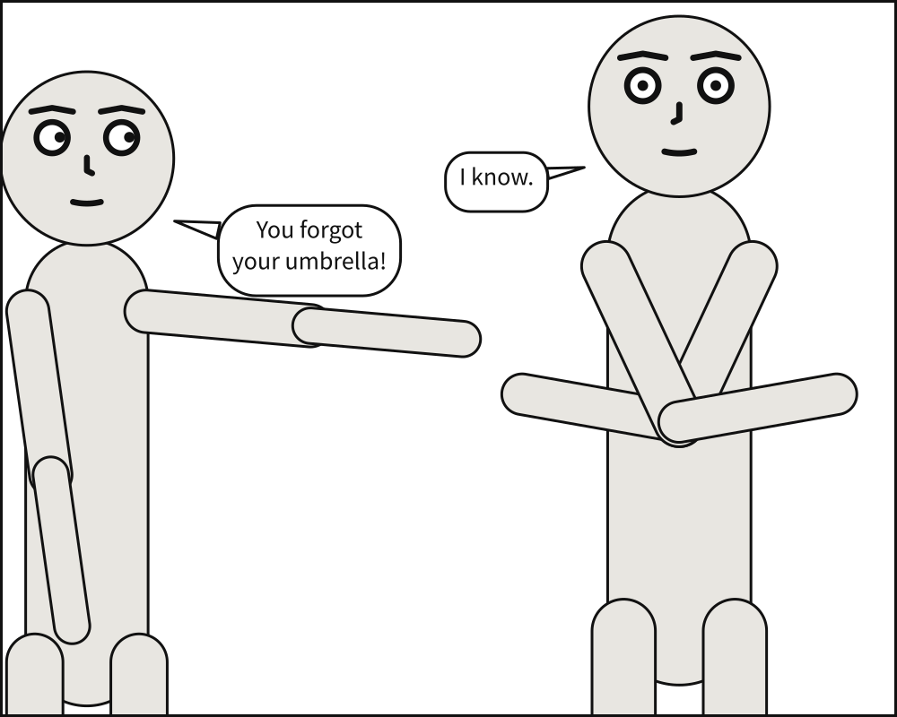

[Open in the playground](https://creatoan.github.io/scenet/playground/#example=01-two-characters.panel.yaml) · [Read about it](tutorial/first_panel.md)

<details>
<summary>Source</summary>

```yaml
# The umbrella panel, the example every page of the documentation starts from. Two
# actors, an ordering constraint, a gaze, a shared ground line, and two lines of dialogue.

panel:
  size: [1000, 800]

camera:
  shot: medium_shot

cast:
  alice: {reference: alice, pose: pointing,     at: left_third}
  bob:   {reference: bob,   pose: arms_crossed, at: right_third, facing: left}

staging:
  - alice left_of bob
  - alice looking_at bob
  - alice ground_shared_with bob

script:
  - say: {by: alice, text: "You forgot your umbrella!", prefer: top_left}
  - say: {by: bob,   text: "I know."}
```

</details>

### A complete panel

The language reference's complete example: a frame, a camera, a setting, a cast, their staging and a script, every layer at once.

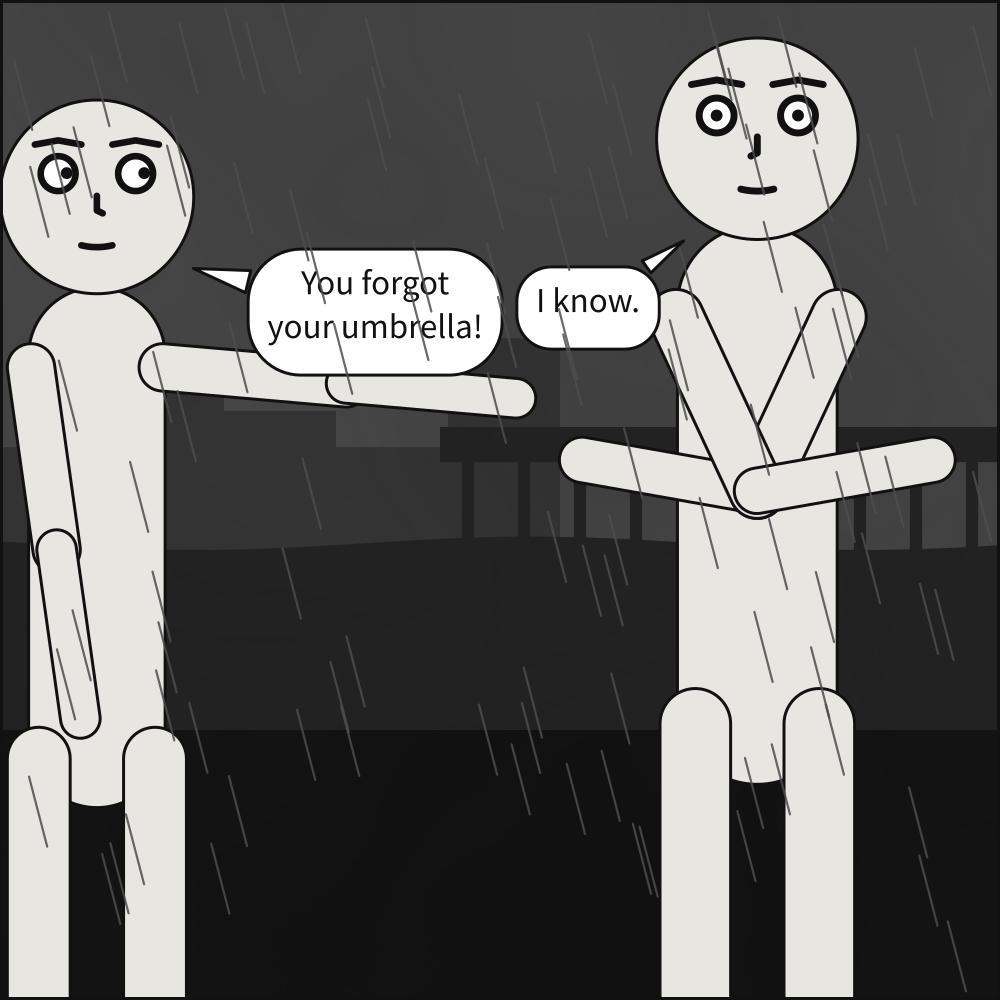

[Open in the playground](https://creatoan.github.io/scenet/playground/#example=71-a-complete-panel.panel.yaml) · [Read about it](reference/language/index.md#a-complete-example)

<details>
<summary>Source</summary>

```yaml
# A complete panel: every layer of the language at once. It is the umbrella panel, the
# gallery's first example, given a setting.
#
# This is the complete example in docs/reference/language/index.md, and a test keeps the two
# identical, so the reference shows what it compiles to. Each block is one layer:
#
# - `panel`, the frame: its size, in panel units.
# - `camera`, how the scene is framed: a shot named by where it cuts the body.
# - `setting`, where and when: a named place, an hour and the weather.
# - `cast` and `staging`, who is there and how they relate: an order, a look, one ground.
# - `script`, what is said, in the order it is read.
#
# Change one layer and the others stay as they are: try `shot: close_up`, or `time: day`.

panel:
  size: [1000, 800]

camera:
  shot: medium_shot

setting:
  place: docks
  time: night
  weather: rain

cast:
  alice: {reference: alice, pose: pointing,     at: left_third}
  bob:   {reference: bob,   pose: arms_crossed, at: right_third, facing: left}

staging:
  - alice left_of bob
  - alice looking_at bob
  - alice ground_shared_with bob

script:
  - say: {by: alice, text: "You forgot your umbrella!", prefer: top_left}
  - say: {by: bob,   text: "I know."}
```

</details>

## Camera and staging

Learn it in the tour: [Camera and staging](tutorial/camera_and_staging.md).

### The shot ladder

Every shot type from long shot to extreme close-up, each defined by where it crops the body and how much headroom it leaves.


[Open in the playground](https://creatoan.github.io/scenet/playground/#example=02-shot-ladder.scene.yaml) · [Read about it](reference/shot_types.md)

<details>
<summary>Source</summary>

```yaml
# Every shot type, on the same character, from widest to tightest.
#
# A shot type is a crop landmark plus headroom, measured in HEAD-HEIGHTS -- not as a
# fraction of panel height. Watch where the frame cuts the body as you go down: feet,
# feet, knees, mid-thigh, waist, chest, shoulders, chin, eyes.
#
# `wide` and `long_shot` are DELIBERATELY IDENTICAL. They are synonyms -- the literature
# uses them interchangeably -- and the language keeps both because writers reach for
# both. The two panels look the same because they are the same shot, not because
# something is broken.
#
# `medium_full` and `cowboy` are NOT synonyms, though they were briefly implemented as
# though they were. Medium full cuts at the knees; the cowboy shot cuts at mid-thigh,
# a framing that comes from 1930s Westerns needing the holster in frame.
#
# The two widest shots leave ground beneath the feet. That is footroom, and it is not
# decoration: the crop lands the FEET landmark on the frame edge, but the shin is drawn
# as a round-capped stroke that continues past it, so without footroom a long shot
# clipped the feet off.

panel: {size: [420, 560]}

cast:
  alice: {reference: alice, pose: pointing}

panels:
  long_shot:        {camera: {shot: long_shot}}
  wide:             {camera: {shot: wide}}          # same as long_shot, on purpose
  full_shot:        {camera: {shot: full_shot}}
  medium_full:      {camera: {shot: medium_full}}   # knees
  cowboy:           {camera: {shot: cowboy}}        # mid-thigh
  medium_shot:      {camera: {shot: medium_shot}}
  medium_close_up:  {camera: {shot: medium_close_up}}
  close_up:         {camera: {shot: close_up}}
  big_close_up:     {camera: {shot: big_close_up}}
  extreme_close_up: {camera: {shot: extreme_close_up}}
```

</details>

### Camera angles

The three camera heights at one shot type, told apart by the air they leave above the head.

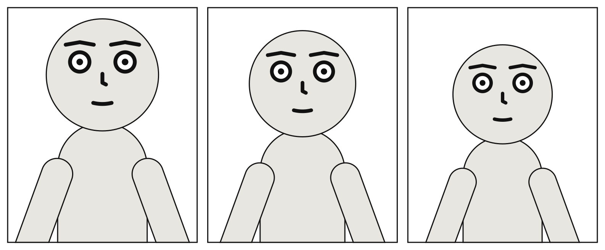

[Open in the playground](https://creatoan.github.io/scenet/playground/#example=03-camera-angles.scene.yaml) · [Read about it](reference/language/camera.md#cameraangle)

<details>
<summary>Source</summary>

```yaml
# The three camera heights, at one shot type.
#
# This compiler is orthographic, so an angle cannot foreshorten anything. What it
# changes is HEADROOM -- the air above the head -- which is the cue readers actually
# take from an angle, and one that survives being drawn flat.
#
# A low camera looks up and the subject looms, so headroom tightens. A high camera
# looks down and it opens out.

panel: {size: [500, 620]}
camera: {shot: medium_close_up}

cast:
  bob: {reference: bob, pose: hands_on_hips}

panels:
  low:       {camera: {angle: low}}
  eye_level: {camera: {angle: eye_level}}
  high:      {camera: {angle: high}}
```

</details>

### Gaze steers balloons

Who looks at whom moves nobody, only the balloons: the space in front of the eyes is costly to cover.

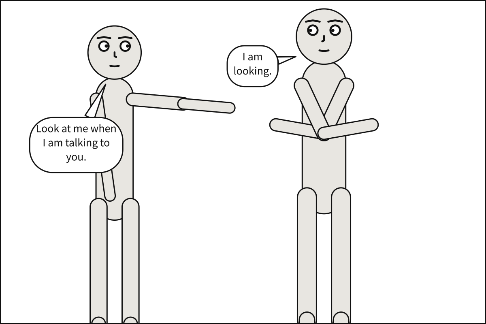

[Open in the playground](https://creatoan.github.io/scenet/playground/#example=07-gaze.panel.yaml) · [Read about it](reference/language/staging.md#staging)

<details>
<summary>Source</summary>

```yaml
# `looking_at` moves nothing. It gives a character a gaze vector, and the space in
# front of their eyes becomes expensive for a balloon to occupy -- because a balloon
# parked in somebody line of sight reads as an obstruction.
#
# Delete the `looking_at` lines and compile again. The figures do not move; the
# balloons do.

panel:
  size: [1200, 800]

camera:
  shot: medium_full

cast:
  alice: {reference: alice, pose: pointing,     at: left_third}
  bob:   {reference: bob,   pose: arms_crossed, at: right_third, facing: left}

staging:
  - alice left_of bob
  - alice looking_at bob
  - bob looking_at alice
  - alice ground_shared_with bob

script:
  - say: {by: alice, text: "Look at me when I am talking to you."}
  - say: {by: bob,   text: "I am looking."}
```

</details>

### Feet align, heads do not

Characters of different heights share a ground line, so their feet line up and their heads do not.

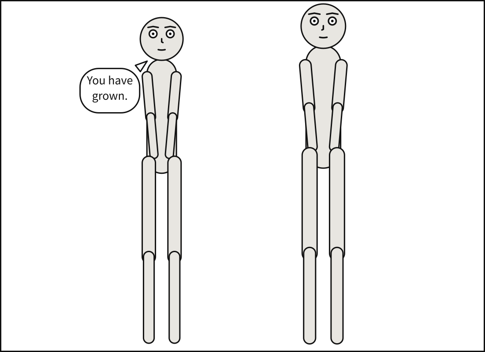

[Open in the playground](https://creatoan.github.io/scenet/playground/#example=08-ground-and-height.panel.yaml) · [Read about it](reference/language/staging.md#staging)

<details>
<summary>Source</summary>

```yaml
# `ground_shared_with` puts two characters on the same ground line -- their FEET,
# not their heads.
#
# Alice is 7.5 heads tall and Bob is taller, deliberately. Aligning heads would put
# them on a staircase. It also shows why there is one camera per panel and one scale:
# scaling each actor to its own crop landmark would make everybody the same apparent
# height and erase exactly the difference a comic uses to tell people apart.

panel:
  size: [1100, 800]

camera:
  shot: full_shot

cast:
  alice: {reference: alice, at: left_third}
  bob:   {reference: bob,   at: right_third, facing: left}

staging:
  - alice left_of bob
  - alice ground_shared_with bob

script:
  - say: {by: alice, text: "You have grown."}
```

</details>

### Depth and overlap

One character drawn in front of another, the depth that lets two figures share space on purpose.

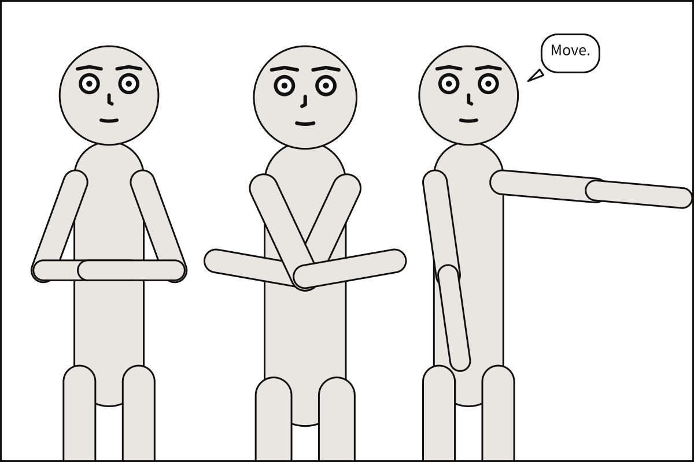

[Open in the playground](https://creatoan.github.io/scenet/playground/#example=09-depth.panel.yaml) · [Read about it](reference/language/staging.md#staging)

<details>
<summary>Source</summary>

```yaml
# Depth, and the two ways to say every ordering.
#
# `in_front_of` and `behind` set painter order, so one figure is drawn over another.
# Non-overlap is a REQUIRED constraint and the solver normally pushes actors apart;
# depth is what lets them share space on purpose.
#
# `left_of` and `right_of` are the same relation written from either end. Both are
# resolved into a single linear ordering at parse time, because Cassowary is a linear
# solver and cannot express the disjunction "A left of B OR B left of A". Any construct
# that reintroduces a disjunction has to be resolved in the frontend, not the solver.

panel:
  size: [1200, 800]

camera:
  shot: medium_shot

cast:
  back:  {reference: alice, pose: hands_on_hips, at: left_third}
  near:  {reference: bob,   pose: arms_crossed,  at: center, facing: left}
  far:   {reference: alice, pose: pointing,      at: right_third}

staging:
  - back left_of near
  - far right_of near
  - near in_front_of far
  - back behind near

script:
  - say: {by: far, text: "Move.", prefer: top_right}
```

</details>

### Poses and facing

All four shipped poses, facing either way, and one puppet cast as two characters.

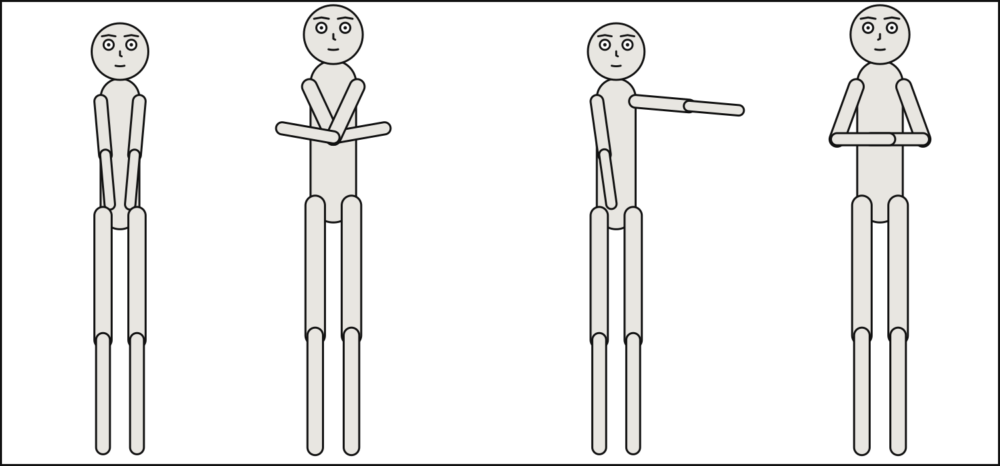

[Open in the playground](https://creatoan.github.io/scenet/playground/#example=11-poses.panel.yaml) · [Read about it](reference/language/cast.md#castidpose)

<details>
<summary>Source</summary>

```yaml
# A pose is a set of joint angles, not a drawing -- which is what avoids one image
# per pose per expression per facing direction.
#
# All four shipped poses. Note that `a` and `c` use the SAME puppet: the key in `cast`
# is the actor id, `reference` is which character gets drawn, and the two are
# independent. That is what lets one puppet play two parts.

panel:
  size: [1500, 700]

camera:
  shot: full_shot

cast:
  a: {reference: alice, pose: standing_neutral, at: left_edge}
  b: {reference: bob,   pose: arms_crossed,     at: left_third}
  c: {reference: alice, pose: pointing,         at: right_third}
  d: {reference: bob,   pose: hands_on_hips,    at: right_edge, facing: left}

staging:
  - a left_of b
  - b left_of c
  - c left_of d
  - a ground_shared_with b
  - b ground_shared_with c
  - c ground_shared_with d
```

</details>

### Staging, spelled out

Staging written as subject, predicate and object, the form a program writes, mixed with the sentence form it stands for.

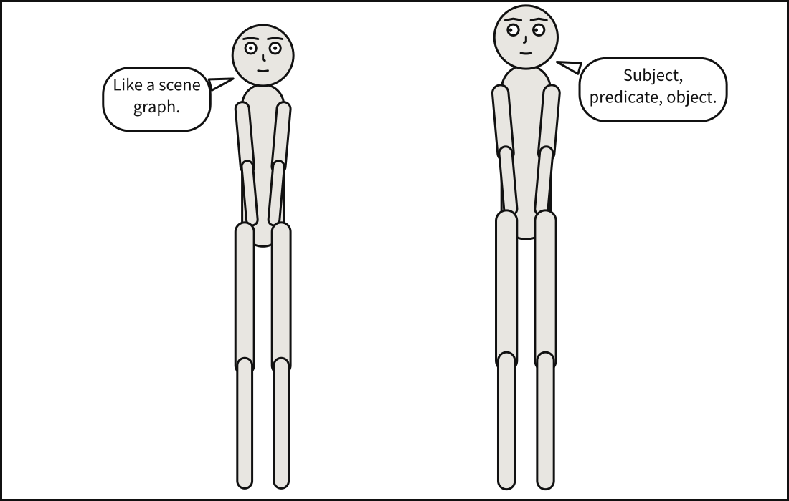

[Open in the playground](https://creatoan.github.io/scenet/playground/#example=46-staging-spelled-out.panel.yaml) · [Read about it](reference/language/staging.md#stagingsubject)

<details>
<summary>Source</summary>

```yaml
# Staging, spelled out.
#
# `alice left_of bob` is a convenience. Underneath, every relation is a subject, a
# predicate and an object, and it may be written that way: the form a program that writes
# Scenet finds easiest to produce. The two forms mix freely, and mean the same.

panel:
  size: [1100, 700]

camera:
  shot: full_shot

cast:
  alice: {reference: alice, at: left_third}
  bob:   {reference: bob,   at: right_third, facing: left}

staging:
  - {subject: alice, predicate: left_of, object: bob}
  - {subject: bob, predicate: looking_at, object: alice}
  - alice ground_shared_with bob

script:
  - say: {by: bob, text: "Subject, predicate, object."}
  - say: {by: alice, text: "Like a scene graph."}
```

</details>

## Balloons and captions

Learn it in the tour: [Balloons and captions](tutorial/balloons_and_captions.md).

### Every balloon kind

Speech, whisper, shout and thought, each with the outline a letterer would give it.

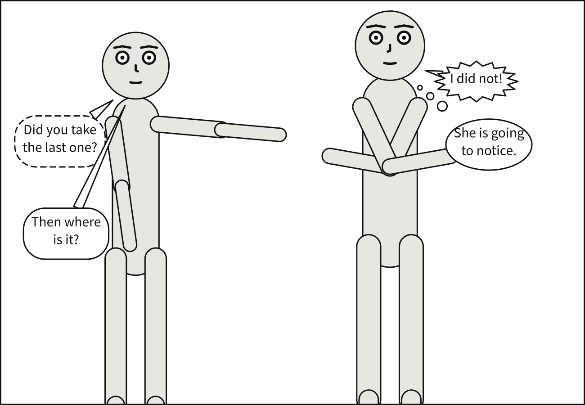

[Open in the playground](https://creatoan.github.io/scenet/playground/#example=04-balloon-kinds.panel.yaml) · [Read about it](reference/language/script.md#saykind)

<details>
<summary>Source</summary>

```yaml
# Four kinds of balloon: speech, thought, whisper, shout.
#
# The kind changes the outline and the tail, never the placement. A whisper obeys
# exactly the same face-avoidance and reading-order rules as a shout.

panel:
  size: [1300, 900]

camera:
  shot: medium_full

cast:
  alice: {reference: alice, pose: pointing,     at: left_third}
  bob:   {reference: bob,   pose: arms_crossed, at: right_third, facing: left}

staging:
  - alice left_of bob
  - alice ground_shared_with bob

script:
  - say: {by: alice, text: "Did you take the last one?", kind: whisper, prefer: top_left}
  - say: {by: bob,   text: "I did not!",                 kind: shout,   prefer: top_right}
  - say: {by: alice, text: "Then where is it?",          kind: speech,  prefer: bottom_left}
  - say: {by: bob,   text: "She is going to notice.",    kind: thought, prefer: bottom_right}
```

</details>

### Placement zones

A balloon may prefer one of nine zones, the weakest rule there is: the compiler overrules it before it covers a face.

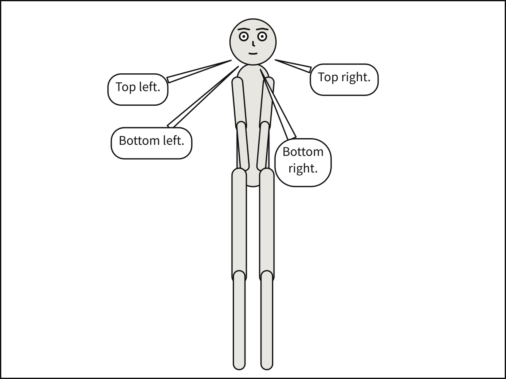

[Open in the playground](https://creatoan.github.io/scenet/playground/#example=05-placement-zones.panel.yaml) · [Read about it](reference/language/script.md#sayprefer)

<details>
<summary>Source</summary>

```yaml
# `prefer:` names one of nine zones -- top/middle/bottom crossed with
# left/center/right.
#
# It is the WEAKEST term in the whole system. Covering a face is illegal, overlapping
# another balloon is illegal, and breaking reading order is illegal; only after all of
# that does a preference get a vote. Change these and watch how often the compiler
# quietly overrules you.

panel:
  size: [1200, 900]

camera:
  shot: full_shot

cast:
  alice: {reference: alice, at: center}

script:
  - say: {by: alice, text: "Top left.",     prefer: top_left}
  - say: {by: alice, text: "Top right.",    prefer: top_right}
  - say: {by: alice, text: "Bottom left.",  prefer: bottom_left}
  - say: {by: alice, text: "Bottom right.", prefer: bottom_right}
```

</details>

### Reading order

Balloons are placed so the page reads in script order, as a hard rule rather than a preference.

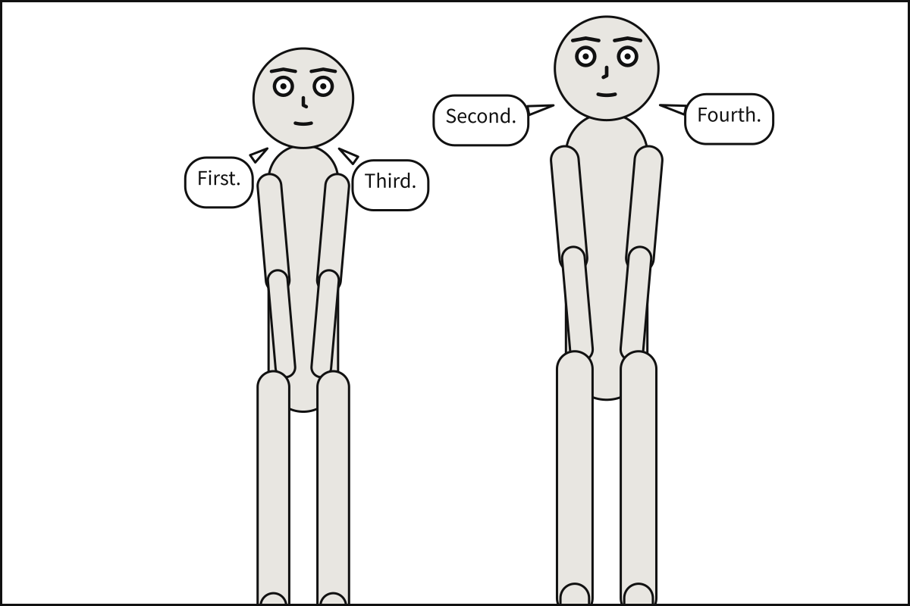

[Open in the playground](https://creatoan.github.io/scenet/playground/#example=06-reading-order.panel.yaml) · [Read about it](reference/language/script.md#script)

<details>
<summary>Source</summary>

```yaml
# Script order IS reading order, and it is enforced rather than preferred.
#
# A balloon may never sit above AND left of one that precedes it -- checked against
# every predecessor, not just the last one, because the relation is not transitive.
#
# Try reordering these four lines. The layout changes, but it never asks you to read
# up and to the left.

panel:
  size: [1200, 800]

camera:
  shot: medium_full

cast:
  alice: {reference: alice, at: left_third}
  bob:   {reference: bob,   at: right_third, facing: left}

staging:
  - alice left_of bob
  - alice ground_shared_with bob

script:
  - say: {by: alice, text: "First."}
  - say: {by: bob,   text: "Second."}
  - say: {by: alice, text: "Third."}
  - say: {by: bob,   text: "Fourth."}
```

</details>

### Captions

Locale, monologue, spoken and editorial captions, placed like balloons but drawn to the corners.


[Open in the playground](https://creatoan.github.io/scenet/playground/#example=16-captions.panel.yaml) · [Read about it](reference/language/script.md#captionkind)

<details>
<summary>Source</summary>

```yaml
# Four kinds of caption: locale, monologue, spoken and editorial.
#
# A caption is the panel speaking in its own voice, which is how a comic says where and
# when it happens without a character having to explain it out loud. The vocabulary is
# the letterers' own: three of the four are set in italic, and `spoken` -- somebody
# talking from off panel -- takes quotation marks instead.
#
# Captions are placed by the same machinery as balloons, so they never cover a face and
# they take their turn in reading order. What differs is the pull: a balloon mildly
# dislikes the panel edge, and a caption is looking for exactly that corner.

panel:
  size: [1400, 950]

camera:
  shot: medium_full

cast:
  alice: {reference: alice, pose: arms_crossed, at: left_third}
  bob:   {reference: bob,   pose: pointing,     at: right_third, facing: left}

staging:
  - alice left_of bob
  - alice ground_shared_with bob

script:
  - caption: {text: "Midnight. The docks.", kind: locale, prefer: top_left}
  - say: {by: alice, text: "You said he would be here."}
  - caption: {text: "He had said a great many things.", kind: monologue, prefer: middle_right}
  - caption: {text: "Put that down!", kind: spoken, by: harbourmaster, prefer: bottom_left}
  - caption: {text: "Continued next issue.", kind: editorial, prefer: bottom_right}
```

</details>

### Caption tones

Three caption tones, over the pale noon sky that shows why a caption box needs one.

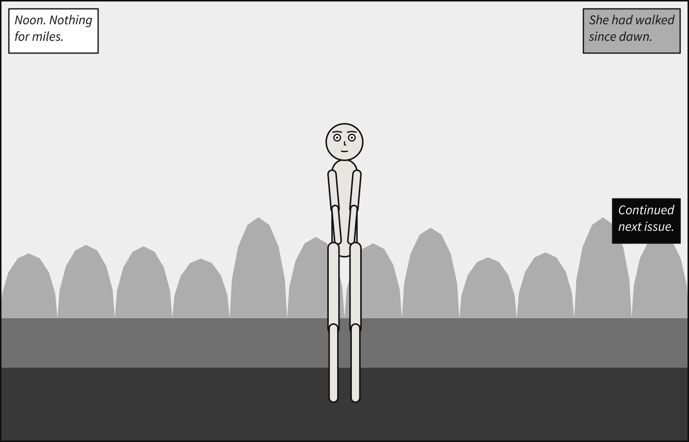

[Open in the playground](https://creatoan.github.io/scenet/playground/#example=22-caption-tones.panel.yaml) · [Read about it](reference/language/script.md#captiontone)

<details>
<summary>Source</summary>

```yaml
# Three caption tones, over the background that makes the point.
#
# A caption box is opaque, so its lettering was never at risk: the text sits on the fill
# whatever is behind it. What was at risk is the *box*. On a clear day the atmosphere is
# `#eeeeee`, and the white box that every caption has been since captions shipped is
# 1.16:1 against it -- legible, and invisible. Only the stroke separates it at all.
#
# So the failing case is the pale end, not the dark one, and this panel is that case:
# a noon sky, with the same three boxes tucked into three corners of it. `paper` all but
# vanishes into the sky, `pale` sits on it quietly, and `ink` reads at 17.16:1 -- which
# costs the lettering an inversion, because black type on a near-black box is not
# lettering, it is a filled rectangle.
#
# The values are rungs of the same ladder the backdrop uses, not a second palette.

panel:
  size: [1400, 900]

camera:
  shot: long_shot

setting:
  place: field
  horizon: low
  time: day

cast:
  alice: {reference: alice, pose: standing_neutral, at: center}

script:
  - caption: {text: "Noon. Nothing for miles.", kind: locale, tone: paper, prefer: top_left}
  - caption: {text: "She had walked since dawn.", kind: monologue, tone: pale, prefer: top_right}
  - caption: {text: "Continued next issue.", kind: editorial, tone: ink, prefer: bottom_right}
```

</details>

### Off-panel speech

Speech from somebody nobody draws, with a tail that runs to the edge of the frame.


[Open in the playground](https://creatoan.github.io/scenet/playground/#example=32-off-panel.scene.yaml) · [Read about it](reference/language/script.md#sayoff_panel)

<details>
<summary>Source</summary>

```yaml
# Off-panel speech: a voice from somebody nobody draws.
#
# `off_panel` on a `say` line names a speaker who is not in the cast. The balloon's tail
# ends on the frame, on the speaker's side -- "the tail of the balloon generally butts
# against the panel border" (Blambot) -- named, or, with `off_panel: true`, the nearer of
# left and right to where the balloon was put.
#
# Bob mutters his answer: `size: small` letters it smaller, in a balloon that keeps its room.

panel: {size: [900, 600]}
setting: {place: room, time: night}

panels:
  knock:
    camera: {shot: medium_shot}
    cast:
      bob: {reference: bob, pose: arms_crossed, at: center}
    script:
      - say: {by: caller, text: "Open up!", off_panel: left, kind: shout}
      - say: {by: bob, text: "Who is it?"}
      - say: {by: neighbour, text: "Keep it down in there.", off_panel: right}

  answer:
    over: knock
    camera: {shot: close_up}
    script:
      - say: {by: upstairs, text: "Is everything all right?", off_panel: top}
      - say: {by: bob, text: "Fine. Go back to sleep.", size: small}
      - say: {by: caller, text: "Then open the door.", off_panel: bottom}
      - say: {by: caller, text: "I know you're there.", off_panel: true}
```

</details>

### A yellow caption

The yellow locale caption in a tinted panel: a pale yellow with the value of a grey, which is what it becomes in monochrome.

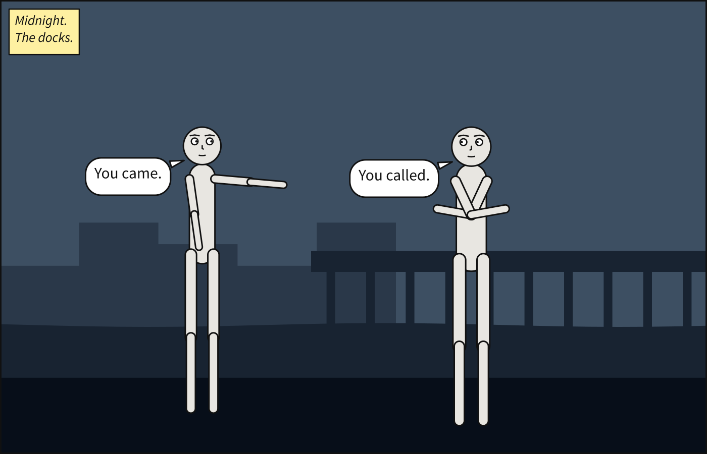

[Open in the playground](https://creatoan.github.io/scenet/playground/#example=39-warm-caption.panel.yaml) · [Read about it](reference/language/script.md#captiontone)

<details>
<summary>Source</summary>

```yaml
# The yellow locale caption, under the colour policy.
#
# `tone: warm` is the classic yellow caption that says where and when. Its value is a rung
# of the value ladder -- the `day` row's atmosphere, `#eeeeee` -- and its lettering is
# chosen on that grey, so it is set in ink. Under `palette: tinted` the box is drawn in the
# grey's twin, a pale yellow of the same lightness, and the docks at night take the blues
# of their hour.
#
# Delete the `palette:` line, or build with `--mono`, and the box is the grey: what a
# black-and-white reprint does to a yellow caption. Nothing else moves, because every
# decision was made on the grey.

palette: tinted

panel:
  size: [1400, 900]

camera:
  shot: long_shot

setting:
  place: docks
  horizon: low
  time: night

cast:
  alice: {reference: alice, pose: pointing, at: left_third, facing: right}
  bob: {reference: bob, pose: arms_crossed, at: right_third, facing: left}

staging:
  - alice left_of bob
  - alice looking_at bob
  - bob looking_at alice

script:
  - caption: {text: "Midnight. The docks.", kind: locale, tone: warm}
  - say: {by: alice, text: "You came."}
  - say: {by: bob, text: "You called."}
```

</details>

### The other five zones

The five zones between the corners, from the top center to the bottom center, each still only a wish.

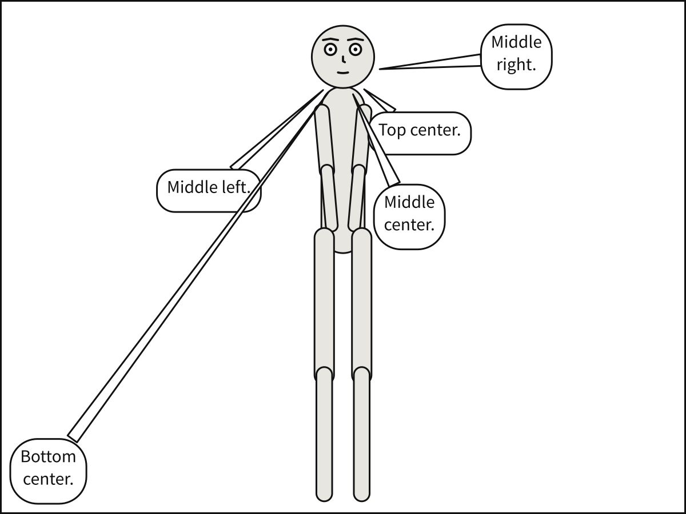

[Open in the playground](https://creatoan.github.io/scenet/playground/#example=44-the-other-zones.panel.yaml) · [Read about it](reference/language/script.md#sayprefer)

<details>
<summary>Source</summary>

```yaml
# The other five zones.
#
# `prefer:` names one of nine zones, top, middle or bottom crossed with left, center or
# right. The four corners have an example of their own; these are the five between them.
#
# A zone is still the weakest wish in the language. A balloon never covers a face, never
# overlaps another balloon and never breaks reading order, and only then does it get as
# close to its zone as it can.

panel:
  size: [1200, 900]

camera:
  shot: full_shot

cast:
  alice: {reference: alice, at: center}

script:
  - say: {by: alice, text: "Top center.",    prefer: top_center}
  - say: {by: alice, text: "Middle left.",   prefer: middle_left}
  - say: {by: alice, text: "Middle center.", prefer: middle_center}
  - say: {by: alice, text: "Middle right.",  prefer: middle_right}
  - say: {by: alice, text: "Bottom center.", prefer: bottom_center}
```

</details>

### A description

What the panel shows, in words, for a reader who cannot see it: read first, and never drawn from.

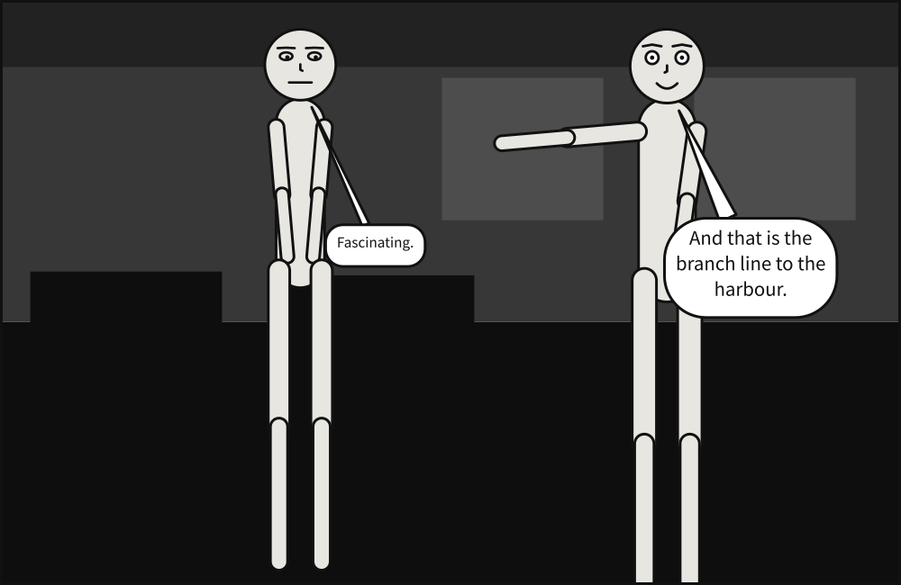

[Open in the playground](https://creatoan.github.io/scenet/playground/#example=45-a-description.panel.yaml) · [Read about it](reference/language/description.md#description)

<details>
<summary>Source</summary>

```yaml
# A description: what the panel shows, in words, for a reader who cannot see it.
#
# A screen reader says it first, before what is said in the panel. Nothing is drawn from it:
# Alice looks bored because of `expression: bored`, not because the description says so.
# Leave it out and Scenet describes the panel itself -- the shot, the setting, and who is
# where.
#
# Bob's line is lettered at `size: normal`, the default, written out here beside Alice's
# `size: small` to compare the two.

description: >-
  Late at night in a living room, Bob points at something off to the side, beaming. Alice
  watches him, bored stiff.

panel:
  size: [1000, 650]

camera:
  shot: full_shot

setting:
  place: room
  time: night

cast:
  alice: {reference: alice, at: left_third, expression: bored}
  bob:   {reference: bob,   at: right_third, facing: left, pose: pointing, expression: happy}

staging:
  - alice left_of bob
  - alice looking_at bob

script:
  - say: {by: bob, text: "And that is the branch line to the harbour.", size: normal}
  - say: {by: alice, text: "Fascinating.", size: small}
```

</details>

### Looking off panel

Somebody heard from off panel can be looked at: Bob turns toward the side the voice comes from.

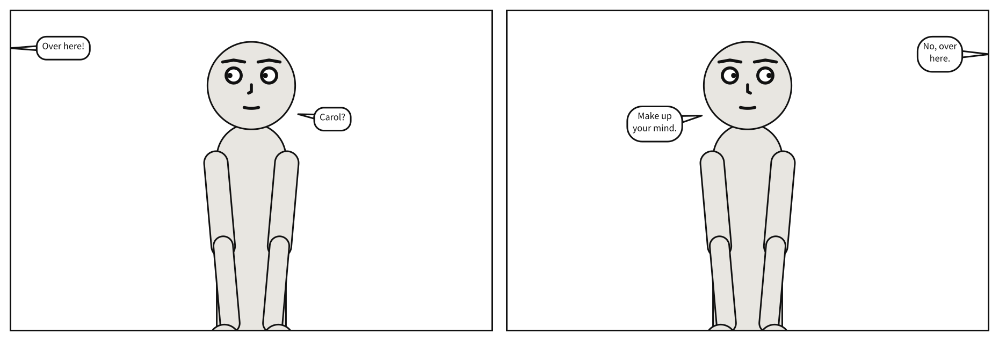

[Open in the playground](https://creatoan.github.io/scenet/playground/#example=50-looking-off-panel.scene.yaml) · [Read about it](reference/language/script.md#sayoff_panel)

<details>
<summary>Source</summary>

```yaml
# Looking at a voice from off panel.
#
# Somebody heard from off panel is nobody the panel draws, so nothing can be staged against
# them -- except a look. `bob looking_at carol` turns Bob toward the side Carol is heard
# from, and aims his eyes out of the frame. With `off_panel: true` and no side named, as in
# the second panel, she is heard from the side Bob faces, so the tail and his look agree.
#
# The panels have a margin. It keeps the balloons in, as always; an off-panel tail reaches
# past it to the frame itself.

panel: {size: [900, 600], margin: 40}
camera: {shot: medium_shot}

cast:
  bob: {reference: bob, at: center}

staging:
  - bob looking_at carol

panels:
  called:
    script:
      - say: {by: carol, text: "Over here!", off_panel: left}
      - say: {by: bob, text: "Carol?"}

  again:
    script:
      - say: {by: carol, text: "No, over here.", off_panel: true}
      - say: {by: bob, text: "Make up your mind."}
```

</details>

## Lettering and sound

Learn it in the tour: [Lettering and sound](tutorial/lettering_and_sound.md).

### How lines break

Long lines are broken where a letterer would break them, measured against the real font.

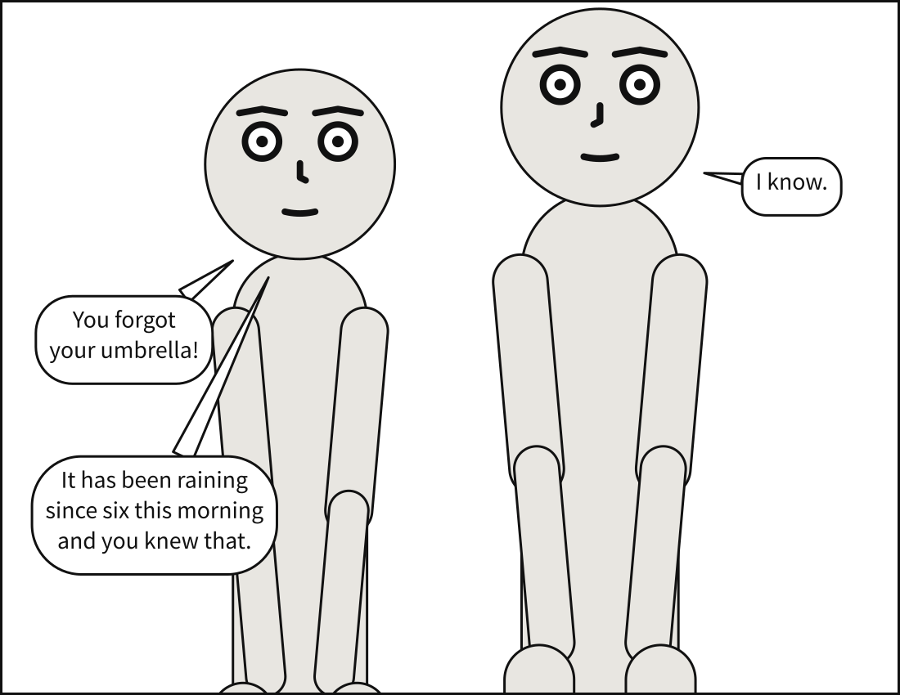

[Open in the playground](https://creatoan.github.io/scenet/playground/#example=14-lettering.panel.yaml) · [Read about it](reference/language/script.md#saytext)

<details>
<summary>Source</summary>

```yaml
# Never break lines yourself. Where text breaks is decided during compilation,
# measured against the real metrics of the real font, and scored on how close the
# resulting block comes to the shape a letterer would choose.
#
# Two rules the scoring exists to enforce: a phrase that fits on one line is not
# split, even where splitting scores marginally better on aspect ratio; and no line is
# left stranded far shorter than its neighbours.

panel:
  size: [1100, 850]

camera:
  shot: medium_shot

cast:
  alice: {reference: alice, at: left_third}
  bob:   {reference: bob,   at: right_third, facing: left}

staging:
  - alice left_of bob
  - alice ground_shared_with bob

script:
  - say: {by: alice, text: "You forgot your umbrella!", prefer: top_left}
  - say: {by: bob,   text: "I know."}
  - say: {by: alice, text: "It has been raining since six this morning and you knew that."}
```

</details>

### Emphasis

A stressed word lettered in bold italic, as letterers mark it.

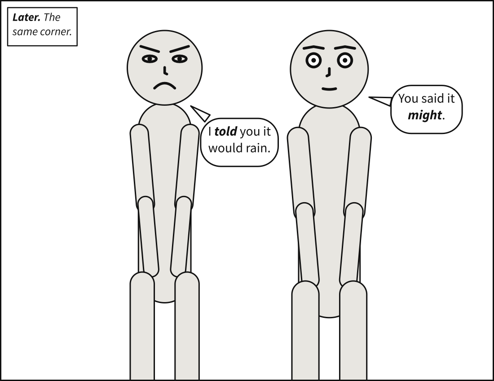

[Open in the playground](https://creatoan.github.io/scenet/playground/#example=28-emphasis.panel.yaml) · [Read about it](reference/language/script.md#saytext)

<details>
<summary>Source</summary>

```yaml
# A word between underscores is stressed, the way a script underlines it, and lettered
# in bold italic -- the letterers' convention for emphasis, in balloons and captions
# alike.
#
# The stressed word is measured in bold italic as well as drawn in it. Bold italic is
# wider than roman, so a stressed word widens its balloon by exactly as much as it is
# drawn wider. An underscore inside a word, as in file_name, is just an underscore.

panel:
  size: [1100, 850]

camera:
  shot: cowboy

cast:
  alice: {reference: alice, at: left_third, expression: angry}
  bob:   {reference: bob,   at: right_third, facing: left}

staging:
  - alice left_of bob

script:
  - caption: {text: "_Later._ The same corner.", kind: locale}
  - say: {by: alice, text: "I _told_ you it would rain."}
  - say: {by: bob,   text: "You said it _might_."}
```

</details>

### Type size

One type size set for the whole page, so a short tier and a tall one letter alike.

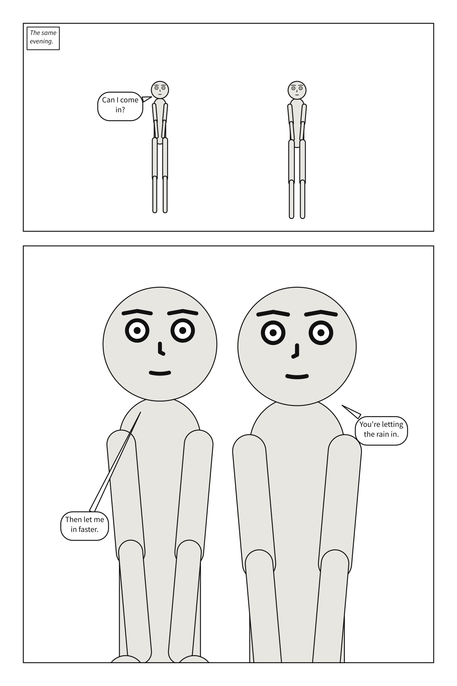

[Open in the playground](https://creatoan.github.io/scenet/playground/#example=29-type-size.scene.yaml) · [Read about it](reference/language/lettering.md#letteringsize)

<details>
<summary>Source</summary>

```yaml
# Type size: the one lettering measurement you set.
#
# Left alone, dialogue is lettered at 3.5% of the height a panel letters against -- on a
# page, one tier of a three-tier page. `lettering: {size: N}` chooses instead: the
# dialogue size, in the same units as the page and its panels. Captions keep their
# proportion to it.
#
# Set beside `panels:`, as here, every panel inherits it, so the whole page letters at
# one size: a short tier and a tall one alike. Set on one panel, it letters that panel
# alone.

lettering: {size: 26}

page: {size: [1500, 2250], margin: 75, gutter: 30, tier_gutter: 45}

cast:
  alice: {reference: alice, at: left_third}
  bob:   {reference: bob,   at: right_third, facing: left}

staging:
  - alice left_of bob

pages:
  - tiers:
      - panels: [door]
      - {height: 2, panels: [inside]}

panels:
  door:
    camera: {shot: wide}
    script:
      - caption: {text: "The same evening.", kind: locale}
      - say: {by: alice, text: "Can I come in?"}

  inside:
    camera: {shot: medium_shot}
    script:
      - say: {by: bob, text: "You're letting the rain in."}
      - say: {by: alice, text: "Then let me in faster."}
```

</details>

### Sound effects

Sounds lettered as part of the picture, turned, bent and hollow, with the balloons settling round them.

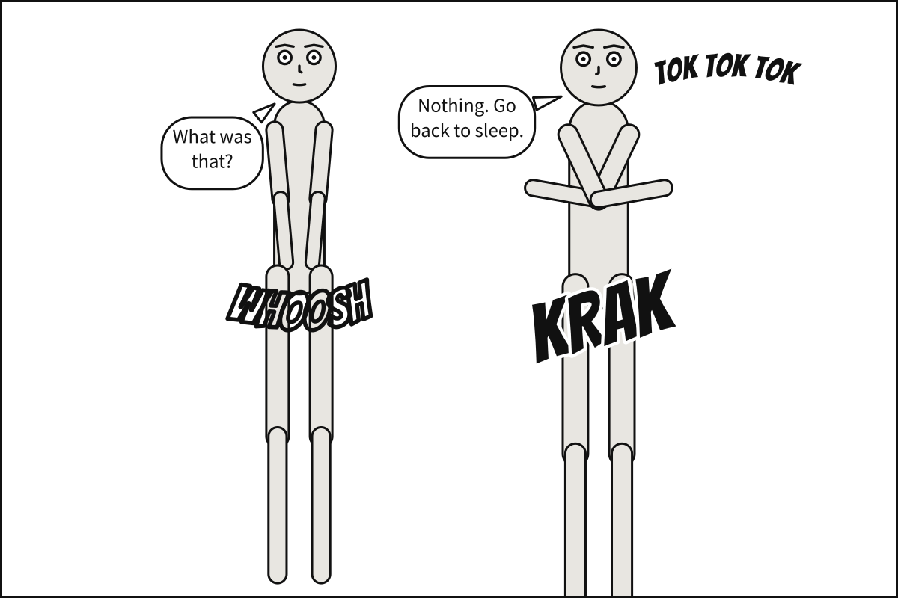

[Open in the playground](https://creatoan.github.io/scenet/playground/#example=30-sound-effects.panel.yaml) · [Read about it](reference/language/script.md#sfx)

<details>
<summary>Source</summary>

```yaml
# Sound effects: letters that are part of the picture.
#
# `- sfx:` letters a sound in the display face, Bangers, with no balloon. It goes near
# the actor it comes `from:`, or in the zone it prefers, chosen by candidate scoring like
# everything else -- never at a coordinate -- and it never covers a face. It can turn,
# bend along an arc, and be `hollow`: all outline, so the art shows through.
#
# It takes its turn in the script's reading order, but sits where the sound is. Balloons
# pay to cover it, so they settle around it; nobody moves for it. No exclamation mark is
# added: sound effects are not exclamations.

panel:
  size: [1200, 800]
  margin: 20

camera:
  shot: full_shot

cast:
  alice: {reference: alice, at: left_third}
  bob:   {reference: bob,   at: right_third, facing: left, pose: arms_crossed}

staging:
  - alice left_of bob

script:
  - sfx: {text: KRAK, from: bob, size: large, rotate: -14}
  - say: {by: alice, text: "What was that?"}
  - sfx: {text: tok tok tok, prefer: top_right, size: small, arc: 30}
  - sfx: {text: WHOOSH, from: alice, size: medium, arc: -40, hollow: true}
  - say: {by: bob, text: "Nothing. Go back to sleep."}
```

</details>

### Your own font

Lettering in a font you supply, Comic Neue: one file for every face, then a file each for dialogue, captions, a stressed word and a sound.


[Open in the playground](https://creatoan.github.io/scenet/playground/#example=42-your-own-font.scene.yaml) · [Read about it](reference/language/lettering.md#letteringfont)

<details>
<summary>Source</summary>

```yaml
# Your own font: lettering in a face you supply, instead of the one Scenet ships.
#
# A font is always a file you name, never one installed on the machine: what the compiler
# measures has to be the same everywhere. Paths are relative to this document -- these are
# in fonts/, beside it, and the playground writes them there for you.
#
# `font:` may name one file, which then letters every face, as in the first panel. Or it
# names a file for each face, as in the second: `regular` for dialogue, `italic` for
# captions, `bold_italic` for a stressed word, `display` for sound effects. The face is
# Comic Neue, under the SIL Open Font License, which is in fonts/OFL.txt.
#
# The second panel also sets its own type size. Written there, `size` letters that panel
# alone; written beside `panels:`, it would letter every panel.

panel: {size: [1000, 650]}
camera: {shot: full_shot}

cast:
  alice: {reference: alice, at: left_third}
  bob:   {reference: bob,   at: right_third, facing: left}

staging:
  - alice left_of bob
  - alice looking_at bob

panels:
  one-file:
    lettering: {font: fonts/ComicNeue-Regular.ttf}
    script:
      - say: {by: alice, text: "Is that a new font?"}
      - say: {by: bob, text: "One file, for everything I say."}

  four-faces:
    lettering:
      size: 30
      font:
        regular: fonts/ComicNeue-Regular.ttf
        italic: fonts/ComicNeue-Italic.ttf
        bold_italic: fonts/ComicNeue-BoldItalic.ttf
        display: fonts/ComicNeue-Bold.ttf
    script:
      - caption: {text: "Later, at the type foundry.", kind: locale}
      - say: {by: alice, text: "Now every face is _yours_."}
      - sfx: {text: CLUNK, from: bob, size: medium}
```

</details>

### A sound pulled to a zone

A sound placed by who makes it but pulled toward the zone it prefers, turned clockwise or the other way.

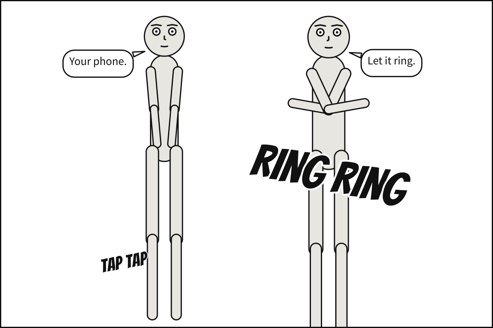

[Open in the playground](https://creatoan.github.io/scenet/playground/#example=43-sound-pulled-to-a-zone.panel.yaml) · [Read about it](reference/language/script.md#sfxprefer)

<details>
<summary>Source</summary>

```yaml
# A sound pulled toward a zone.
#
# A sound effect `from:` somebody is placed near them. Give it a `prefer:` too and the zone
# pulls it: still by its source, but on the side you asked for. With no source at all,
# `prefer:` alone says where it would like to sit.
#
# `rotate` turns it clockwise, in degrees from -45 to 45: positive leans its top to the
# right, negative to the left. Like everything about a sound, it is applied to the letters'
# outlines, so it comes out the same in every viewer.

panel: {size: [1200, 800]}
camera: {shot: full_shot}

cast:
  alice: {reference: alice, at: left_third}
  bob:   {reference: bob,   at: right_third, facing: left, pose: arms_crossed}

staging:
  - alice left_of bob

script:
  - sfx: {text: RING RING, from: bob, prefer: top_right, rotate: 12, size: large}
  - say: {by: alice, text: "Your phone."}
  - sfx: {text: tap tap, from: alice, prefer: bottom_left, rotate: -10, size: small}
  - say: {by: bob, text: "Let it ring."}
```

</details>

## Faces and marks

Learn it in the tour: [Faces and marks](tutorial/faces_and_marks.md).

### Ten expressions

Every expression the shipped puppets have, one panel each.

![A strip of 5 panels. Medium shot. Alice, left, arms crossed, angry, looking at Bob; Bob, right, hands on hips, shouting, looking at Alice. Medium shot. Alice, left, arms crossed, looking at Bob; Bob, right, hands on hips, surprised, looking at Alice. Medium shot. Alice, left, arms crossed, happy, looking at Bob; Bob, right, hands on hips, laughing, looking at Alice. Medium shot. Alice, left, arms crossed, coy, looking at Bob; Bob, right, hands on hips, bored, looking at Alice. Medium shot. Alice, left, arms crossed, sad, looking at Bob; Bob, right, hands on hips, scared, looking at Alice.](images/gallery/17-expressions.strip.svg)

[Open in the playground](https://creatoan.github.io/scenet/playground/#example=17-expressions.scene.yaml) · [Read about it](reference/language/cast.md#castidexpression)

<details>
<summary>Source</summary>

```yaml
# Ten expressions, which is every face the shipped puppets can make.
#
# An expression is to features what a pose is to joints: the puppet declares feature
# points that ride the head, declares named expressions as a state per feature, and the
# panel selects one by name. Nothing here touches the solver -- a face is still one disc
# that balloons may not cover, exactly as it was.
#
# The vocabulary is Comic Chat's emotion wheel plus `surprise`, which is to say it is a
# **drawing convention**: the small closed set of faces comics actually draw. It is not
# a claim that a person feeling anger produces this face.
#
# Watch the pupils. `looking_at` has always turned a figure toward its target and made
# the space in front of them expensive for a balloon; now it aims their eyes as well.

camera:
  shot: medium_shot

cast:
  alice: {reference: alice, pose: arms_crossed, at: left_third}
  bob:   {reference: bob,   pose: hands_on_hips, at: right_third, facing: left}

staging:
  - alice left_of bob
  - alice ground_shared_with bob
  - alice looking_at bob
  - bob looking_at alice

panels:
  confrontation:
    cast:
      alice: {expression: angry}
      bob:   {expression: shouting}

  surprised:
    cast:
      alice: {expression: neutral}
      bob:   {expression: surprise}

  delighted:
    cast:
      alice: {expression: happy}
      bob:   {expression: laughing}

  unimpressed:
    cast:
      alice: {expression: coy}
      bob:   {expression: bored}

  afraid:
    cast:
      alice: {expression: sad}
      bob:   {expression: scared}
```

</details>

### A face

A big close-up, where the head fills the panel and the face is drawn in full.

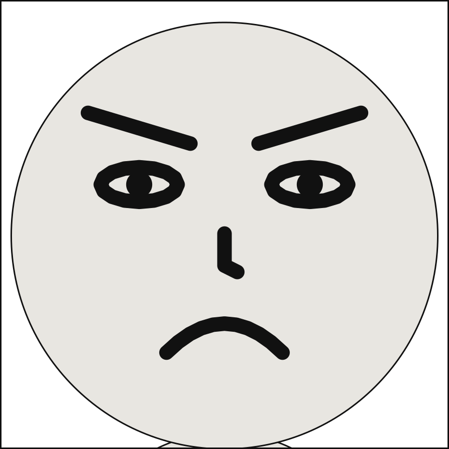

[Open in the playground](https://creatoan.github.io/scenet/playground/#example=18-a-face.panel.yaml) · [Read about it](reference/language/cast.md#castidexpression)

<details>
<summary>Source</summary>

```yaml
# A big close-up, which is the framing that pays for the face rig: the head fills the
# panel, and until expressions existed it was a circle.
#
# One character on purpose. A big close-up of two is not a big close-up for long -- the
# camera retreats to fit them both across the panel, and the note it prints says so.

panel:
  size: [900, 900]

camera:
  shot: big_close_up

cast:
  alice: {reference: alice, expression: angry}

# No lettering. At this framing the head fills the panel and there is nowhere a balloon
# could sit without covering the face, which the compiler refuses to do -- and a silent
# reaction panel is what a letterer would have drawn here anyway.
```

</details>

### Emanata

Sweat, dizziness, oaths and dust drawn round a character, and the balloons that make room for them.

![A strip of 4 panels. Medium shot. Alice, left, scared, sweating, looking at Bob; Bob, right, arms crossed, angry, looking at Alice. Bob: Where is my umbrella? Medium shot. Alice, left, angry, swearing, looking at Bob; Bob, right, arms crossed, angry, looking at Alice. Alice: It was hideous! Medium shot. Alice, left, sad, dizzy, looking at Bob; Bob, right, arms crossed, bored, looking at Alice. Alice: I spun it round. Very fast. Then it was gone. Full shot. Alice, left, surprised; Bob, centre, pointing, shouting, dashing off. Alice: Bob?](images/gallery/23-emanata.strip.svg)

[Open in the playground](https://creatoan.github.io/scenet/playground/#example=23-emanata.scene.yaml) · [Read about it](reference/language/cast.md#castidmarks)

<details>
<summary>Source</summary>

```yaml
# Emanata: what a comic draws around a character, rather than on them.
#
# Mort Walker named them in The Lexicon of Comicana, and four of his names are the
# vocabulary: `plewds` fly off a sweating head, `squeans` circle a dizzy one,
# `grawlixes` stand in for an oath, and `briffits` are the dust somebody leaves behind.
#
# They are a list, not a second `expression:`, because they compose -- Alice is scared
# *and* sweating, angry *and* swearing.
#
# Unlike a face, they are drawn outside the head, in the space balloons go, so they
# matter to the layout. How much is the decision this example shows: a balloon pays to
# cover them, so in `oath` Alice's line settles beside her grawlixes rather than on
# them. But they never move anybody. Strip every mark from this file and both
# characters stand exactly where they stand now.
#
# That cuts both ways. The camera frames by the body and makes no room for marks, so
# over the taller character's head, at this framing, they would run off the top of the
# panel -- which is why they are on Alice. Try them on Bob: `scenet build` says so, as
# the example "Marks cut off" shows.

panel:
  size: [1000, 700]

camera:
  shot: medium_shot

cast:
  alice: {reference: alice, at: left_third}
  bob:   {reference: bob,   pose: arms_crossed, at: right_third, facing: left}

staging:
  - alice left_of bob
  - alice ground_shared_with bob
  - alice looking_at bob
  - bob looking_at alice

panels:
  heat:
    cast:
      alice: {expression: scared, marks: [plewds]}
      bob:   {expression: angry}
    script:
      - say: {by: bob, text: "Where is my umbrella?"}

  oath:
    over: heat
    cast:
      alice: {expression: angry, marks: [grawlixes]}
    script:
      - say: {by: alice, text: "It was hideous!", prefer: top_left}

  dizzy:
    over: heat
    cast:
      alice: {expression: sad, marks: [squeans]}
      bob:   {expression: bored}
    script:
      - say: {by: alice, text: "I spun it round. Very fast. Then it was gone."}

  gone:
    camera: {shot: full_shot}
    cast:
      alice: {expression: surprise}
      bob:   {pose: pointing, expression: shouting, marks: [briffits], facing: right}
    staging:
      - alice left_of bob
      - alice ground_shared_with bob
    script:
      - say: {by: alice, text: "Bob?"}
```

</details>

## Setting and colour

Learn it in the tour: [Setting and colour](tutorial/setting_and_colour.md).

### Masses and planes

The masses a place is made of, written by hand, on planes whose value reads as distance.

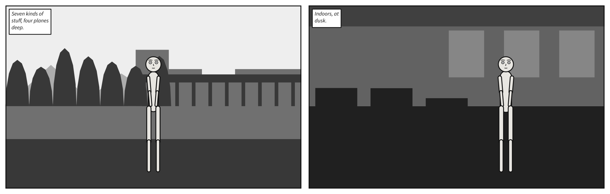

[Open in the playground](https://creatoan.github.io/scenet/playground/#example=19-setting.scene.yaml) · [Read about it](reference/language/setting.md#settingmasses)

<details>
<summary>Source</summary>

```yaml
# Masses, planes and the notan value ladder -- written out by hand.
#
# `place:` is the headline surface, and 20-places shows it. This is the layer
# underneath: the mass list a place expands into, which stays authorable when you want
# control. Every one of the twelve mass kinds appears across these two panels.
#
# Value comes from the *plane*, never from the kind. Reading front to back a mass never
# gets darker, which is aerial perspective as a parametric rule -- and it is why two
# masses at one distance read as one mass, which is the whole notan argument.

panel:
  size: [1000, 620]

camera:
  shot: long_shot

panels:
  # Outdoors: the seven exterior kinds, stacked back to front.
  outside:
    setting:
      horizon: mid
      masses:
        - {kind: sky,        plane: far}
        - {kind: solid,      plane: far,  spans: left}
        - {kind: building,   plane: mid,  spans: right}
        - {kind: water,      plane: mid}
        - {kind: structural, plane: near, spans: right}
        - {kind: plant,      plane: near, spans: left}
        - {kind: ground,     plane: near}
    cast:
      alice: {reference: alice, at: center}
    script:
      - caption: {text: "Seven kinds of stuff, four planes deep.", kind: editorial}

  # Indoors: the five interior kinds. A `window` is toned one plane *farther* than the
  # wall it is cut into, because a window is a hole showing a more distant plane.
  inside:
    setting:
      horizon: mid
      time: dusk
      masses:
        - {kind: wall,      plane: far}
        - {kind: window,    plane: far,  spans: right}
        - {kind: ceiling,   plane: mid}
        - {kind: floor,     plane: near}
        - {kind: furniture, plane: near, spans: left}
    cast:
      bob: {reference: bob, at: right_third, facing: left}
    script:
      - caption: {text: "Indoors, at dusk.", kind: locale}
```

</details>

### Ten places

The ten named places, one panel each, each a backdrop composed from masses.


[Open in the playground](https://creatoan.github.io/scenet/playground/#example=20-places.scene.yaml) · [Read about it](reference/language/setting.md#settingplace)

<details>
<summary>Source</summary>

```yaml
# The place library: all ten, one panel each.
#
# `place:` is the headline surface, because the thing an author wants to write is where
# the scene is, not a list of shapes. Each of these expands into exactly the mass list
# you could have typed yourself -- 19-setting shows that layer -- which is the rule that
# keeps a preset a library rather than a second, opaque format.
#
# Free prose is deliberately not offered. `setting: "a rainy street corner at midnight"`
# needs language understanding, and guessing produces panels that are confidently wrong.
# A named place is the honest middle: it reads like a description and resolves
# deterministically.

panel:
  size: [900, 560]

camera:
  shot: long_shot

cast:
  alice: {reference: alice, at: center}

panels:
  docks:    {setting: {place: docks,    time: night}}
  street:   {setting: {place: street}}
  alley:    {setting: {place: alley,    time: dusk}}
  room:     {setting: {place: room}}
  office:   {setting: {place: office,   horizon: high}}
  forest:   {setting: {place: forest,   time: dawn}}
  field:    {setting: {place: field,    horizon: low}}
  shore:    {setting: {place: shore,    time: dusk}}
  desert:   {setting: {place: desert}}
  mountain: {setting: {place: mountain, time: dawn}}
```

</details>

### Time and weather

One place at different times of day and in different weather.

![A strip of 4 panels. Long shot. The docks at night, in the rain. Alice, centre, arms crossed, looking at Bob; Bob, centre. Caption: Midnight. The docks. Alice: You said you would be here at ten. Bob, whispering: I was. Long shot. The docks at dawn, in fog. Alice, centre, arms crossed, looking at Bob; Bob, centre. Caption: Six hours later. Long shot. The docks by day. Alice, centre, arms crossed, looking at Bob; Bob, centre. Editor's note: It never rains at noon. Long shot. The docks at dusk, in the snow. Alice, centre, arms crossed, looking at Bob; Bob, centre. Caption: December.](images/gallery/21-atmosphere.strip.svg)

[Open in the playground](https://creatoan.github.io/scenet/playground/#example=21-atmosphere.scene.yaml) · [Read about it](reference/language/setting.md#settingtime)

<details>
<summary>Source</summary>

```yaml
# Time of day and weather, on one place.
#
# `time` does not tint a daytime panel. It supplies the two ends of the value ladder --
# the foreground and the atmosphere -- and the planes are spaced between them. So night
# is a darker, narrower ladder, which is what night actually does to a drawn scene, and
# the ladder stays monotonic in depth at every hour.
#
# `weather` adds a layer over that. Fog is a turbulence veil tinted with the atmosphere
# itself, because fog *is* the atmosphere arriving in the foreground. Rain and snow carry
# the same veil as cloud -- nearer, and so darker than the sky it covers -- and put
# falling marks over everything, because weather is between the reader and the figures
# rather than behind them. Rain flips to ink over a bright sky and to paper over a dark
# one; snow never flips, because snow is white.
#
# The determinism contract is on the **emitted SVG text**, which stays byte-identical.
# It has never been on pixels: `feTurbulence` is reproducible by specification -- the
# spec ships reference code and the seed is fixed -- and browsers still agree only
# approximately on what to paint from it. See docs/reference/language/index.md.

panel:
  size: [1100, 620]

camera:
  shot: long_shot

cast:
  alice: {reference: alice, at: left_third, pose: arms_crossed}
  bob:   {reference: bob,   at: right_third, facing: left}

staging:
  - alice left_of bob
  - alice looking_at bob
  - alice ground_shared_with bob

panels:
  midnight:
    setting: {place: docks, time: night, weather: rain}
    script:
      - caption: {text: "Midnight. The docks.", kind: locale, prefer: top_left}
      - say: {by: alice, text: "You said you would be here at ten."}
      - say: {by: bob, text: "I was.", kind: whisper}

  morning:
    setting: {place: docks, time: dawn, weather: fog}
    script:
      - caption: {text: "Six hours later.", kind: locale, prefer: top_left}

  noon:
    setting: {place: docks, time: day, weather: clear}
    script:
      - caption: {text: "It never rains at noon.", kind: editorial, prefer: top_right}

  winter:
    setting: {place: docks, time: dusk, weather: snow}
    script:
      - caption: {text: "December.", kind: locale, prefer: top_left}
```

</details>

### Every hour in colour

palette: tinted draws each value of the ladder in a colour with the same lightness: rose at dawn, blue at noon, orange at dusk, blue at night.


[Open in the playground](https://creatoan.github.io/scenet/playground/#example=40-tinted-hours.scene.yaml) · [Read about it](reference/language/palette.md#palette)

<details>
<summary>Source</summary>

```yaml
# The tinted palette: the value ladder in colour, at every hour.
#
# `palette: tinted`, written beside `panels:`, is a default every panel inherits. Each value
# on the ladder is drawn in its twin: a colour with the same lightness, on the same rung,
# at the same hour. Each hour has a shadow hue at the front and an atmosphere hue at the
# sky -- warm light and cool shadow, as painters put it -- and the planes between move from
# one to the other, so with distance colour drifts toward the colour of the air. Night is
# blue all the way back, and the dark end of the ladder holds almost no colour at all.
#
# Build it with `--mono`, or write `palette: mono`, and every panel is the grey one, value
# for value: colour never changes a value, so nothing moves.

palette: tinted

panel:
  size: [1100, 620]

camera:
  shot: long_shot

cast:
  alice: {reference: alice, at: left_third, pose: arms_crossed}
  bob:   {reference: bob,   at: right_third, facing: left}

staging:
  - alice left_of bob
  - alice looking_at bob
  - alice ground_shared_with bob

pages:
  - tiers:
      - panels: [dawn, noon]
      - panels: [dusk, midnight]

panels:
  dawn:
    setting: {place: docks, time: dawn, weather: fog}
    script:
      - caption: {text: "Dawn.", kind: locale, prefer: top_left}

  noon:
    setting: {place: docks, time: day}
    script:
      - caption: {text: "Noon.", kind: locale, prefer: top_left}

  dusk:
    setting: {place: docks, time: dusk}
    script:
      - caption: {text: "Dusk.", kind: locale, prefer: top_left}

  midnight:
    setting: {place: docks, time: night, weather: rain}
    script:
      - caption: {text: "Midnight.", kind: locale, prefer: top_left}
```

</details>

### A flashback in grey

A page in colour whose middle panel writes palette: mono for itself, the way a comic drops into grey for a memory.


[Open in the playground](https://creatoan.github.io/scenet/playground/#example=41-flashback.scene.yaml) · [Read about it](reference/language/palette.md#palette)

<details>
<summary>Source</summary>

```yaml
# A flashback in grey, on a page in colour.
#
# `palette: tinted` beside `panels:` colours every panel, and the middle one writes
# `palette: mono` for itself: the way a comic drops into grey for a memory. Unlike
# `direction`, which is the whole document's, a palette may be a panel's own. A page read
# two ways has no order a reader could follow; a page in two palettes is a convention.
#
# The yellow `warm` caption says where the story is now. In the grey panel the caption is
# `paper`, because a memory has no hour of its own to name.

palette: tinted

panel:
  size: [1100, 620]

camera:
  shot: medium_shot

setting: {place: street, time: dusk}

cast:
  alice: {reference: alice, at: left_third, facing: right}
  bob:   {reference: bob,   at: right_third, facing: left}

staging:
  - alice left_of bob
  - alice looking_at bob
  - bob looking_at alice

pages:
  - tiers:
      - panels: [now]
      - panels: [then]
      - panels: [again]

panels:
  now:
    script:
      - caption: {text: "The same street, years on.", kind: locale, tone: warm, prefer: top_left}
      - say: {by: alice, text: "You haven't changed."}

  then:
    palette: mono
    setting: {time: day}
    script:
      - caption: {text: "Ten years earlier.", kind: locale, prefer: top_left}
      - say: {by: bob, text: "Promise you'll come back."}

  again:
    script:
      - say: {by: bob, text: "Neither have you."}
```

</details>

### In front of the cast

A mass on the foreground plane, drawn over the cast like a doorway in silhouette, beside masses spanning the center and the full width.

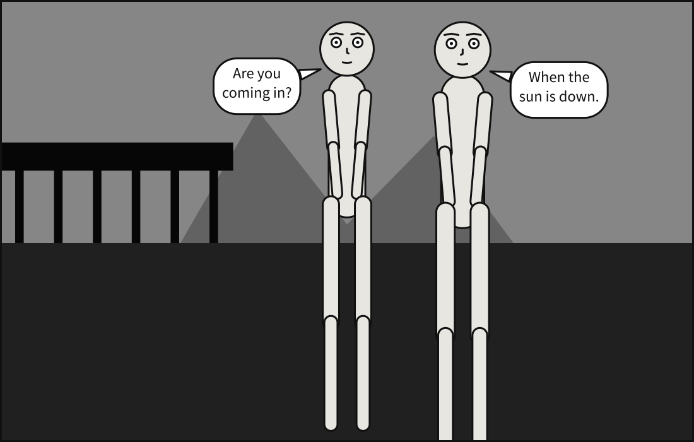

[Open in the playground](https://creatoan.github.io/scenet/playground/#example=47-in-front-of-the-cast.panel.yaml) · [Read about it](reference/language/setting.md#settingmassesplane)

<details>
<summary>Source</summary>

```yaml
# In front of the cast: a mass on the `foreground` plane.
#
# Masses on the `near`, `mid` and `far` planes stand behind everybody. One on `foreground`
# is drawn over the cast, the way a doorway in silhouette is, and darkest of all: reading
# front to back, a mass never gets darker. Here it is the edge of the door Alice is looking
# out of.
#
# `spans` says how much of the width a mass covers: `full`, the default, written out here,
# `left`, `right`, or `center` -- the hill in the distance.

panel:
  size: [1100, 700]

camera:
  shot: full_shot

setting:
  horizon: mid
  time: dusk
  masses:
    - {kind: sky,        plane: far,        spans: full}
    - {kind: solid,      plane: far,        spans: center}
    - {kind: ground,     plane: near,       spans: full}
    - {kind: structural, plane: foreground, spans: left}

cast:
  alice: {reference: alice, at: center, facing: right}
  bob:   {reference: bob,   at: right_third, facing: left}

staging:
  - alice left_of bob

script:
  - say: {by: alice, text: "Are you coming in?"}
  - say: {by: bob, text: "When the sun is down."}
```

</details>

### Three horizons

The same shore with its horizon high, in the middle and low: the one line every mass of the backdrop is composed against.


[Open in the playground](https://creatoan.github.io/scenet/playground/#example=72-three-horizons.scene.yaml) · [Read about it](reference/language/setting.md#settinghorizon)

<details>
<summary>Source</summary>

```yaml
# The horizon: one line for the whole panel, which every mass is composed against.
#
# Masses of the ground sort -- ground, floor, water -- start at the horizon and run down to
# the bottom edge; masses that stand in the world rise from it. A high horizon sits near the
# top of the frame, so more ground is in view; a low one gives the panel to the sky.
#
# The same shore three times, with nothing changed but `horizon`, which each caption names.
# Alice stands where she stands in each: the camera frames the cast, and the horizon moves
# only the backdrop.

panel:
  size: [900, 560]

camera:
  shot: long_shot

cast:
  alice: {reference: alice, at: left_third, facing: right}

panels:
  high:
    setting: {place: shore, horizon: high}
    script: [caption: {text: "A high horizon: more ground in view.", kind: editorial}]
  mid:
    setting: {place: shore, horizon: mid}
    script: [caption: {text: "A horizon in the middle.", kind: editorial}]
  low:
    setting: {place: shore, horizon: low}
    script: [caption: {text: "A low horizon: the panel is mostly sky.", kind: editorial}]
```

</details>

## Sequences

Learn it in the tour: [Sequences](tutorial/sequences.md).

### A sequence

Panels that follow one another, each written as what changes from the panel before.


[Open in the playground](https://creatoan.github.io/scenet/playground/#example=12-sequence.scene.yaml) · [Read about it](reference/language/scene.md#over)

<details>
<summary>Source</summary>

```yaml
# Consecutive panels share nearly everything. `over:` names a parent and states only
# the difference -- borrowed from OpenUSD composition arcs, where it means exactly
# this.
#
# Mappings merge recursively; lists replace wholesale. Anything alongside `panels:` is
# a default every panel inherits.

panel: {size: [700, 560]}

cast:
  alice: {reference: alice, pose: pointing,     at: left_third}
  bob:   {reference: bob,   pose: arms_crossed, at: right_third, facing: left}

staging:
  - alice left_of bob
  - alice ground_shared_with bob

panels:
  establishing:
    camera: {shot: full_shot}
    script:
      - say: {by: alice, text: "We need to talk."}

  reaction:
    over: establishing
    camera: {shot: medium_close_up}
    script:
      - say: {by: bob, text: "Do we.", kind: whisper}

  closer:
    over: reaction
    camera: {shot: close_up, angle: low}
    cast:
      bob: {pose: hands_on_hips}
    script:
      - say: {by: bob, text: "Fine. Talk.", kind: shout}
```

</details>

### Leaving someone out

A panel that takes away somebody it would inherit, with null.

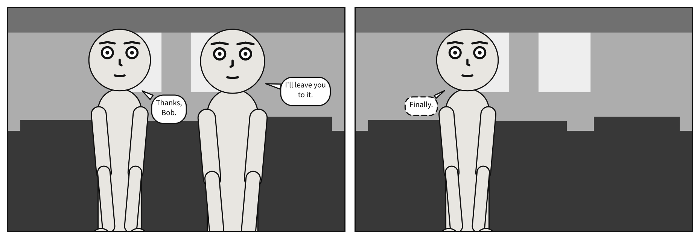

[Open in the playground](https://creatoan.github.io/scenet/playground/#example=49-leaving-someone-out.scene.yaml) · [Read about it](howto/compile_a_sequence.md#leaving-something-out)

<details>
<summary>Source</summary>

```yaml
# Leaving someone out of a panel that would inherit them.
#
# Everything beside `panels:` is a default every panel takes, and a panel `over:` another
# takes all of it. To take something away, write it as `null`: JSON Merge Patch's rule.
# Here Bob leaves, and `cast: {bob: null}` leaves him out of the last panel.
#
# A staging relation naming him would go with him, and `scenet check` would note it, as
# the example "A relation left out" shows. This scene places its cast with `at:` alone, so
# there is none to lose.

panel: {size: [900, 600]}
camera: {shot: medium_shot}
setting: {place: office, time: day}

cast:
  alice: {reference: alice, at: left_third}
  bob:   {reference: bob,   at: right_third, facing: left}

panels:
  meeting:
    script:
      - say: {by: bob, text: "I'll leave you to it."}
      - say: {by: alice, text: "Thanks, Bob."}

  alone:
    over: meeting
    cast:
      bob: null
    script:
      - say: {by: alice, text: "Finally.", kind: whisper}
```

</details>

## Pages and print

Learn it in the tour: [Pages and print](tutorial/pages_and_print.md).

### Margins and bleed

A margin keeps the lettering in, while the actors may bleed off the edge.

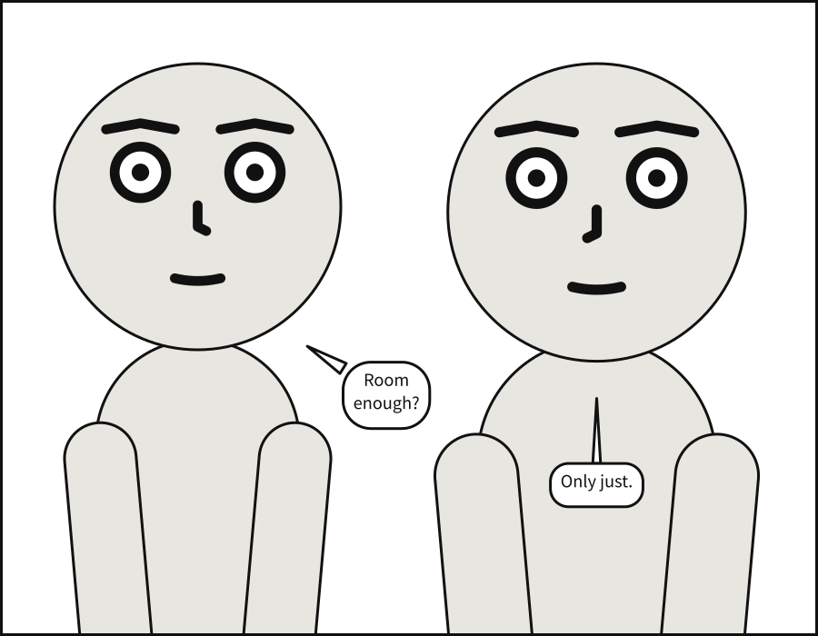

[Open in the playground](https://creatoan.github.io/scenet/playground/#example=15-margin.panel.yaml) · [Read about it](reference/language/panel.md#panelmargin)

<details>
<summary>Source</summary>

```yaml
# `margin` insets the usable area. Balloons are kept inside it; actors may bleed
# past it, which is ordinary comics practice.
#
# That asymmetry is deliberate. Panel bounds are a STRONG constraint on actors rather
# than a required one, so a crowded panel lets a figure run off the edge instead of
# refusing to compile. Lettering has no such licence: text that leaves the panel is
# text nobody can read.

panel:
  size: [900, 700]
  margin: 60

camera:
  shot: medium_close_up

cast:
  alice: {reference: alice, at: left_edge}
  bob:   {reference: bob,   at: right_edge, facing: left}

staging:
  - alice left_of bob

script:
  - say: {by: alice, text: "Room enough?"}
  - say: {by: bob,   text: "Only just."}
```

</details>

### A page in tiers

Panels laid out on a page in tiers, each panel compiled at the size of its frame.

![A page of 5 panels. Long shot. A street at night, in the rain. Alice, left, pointing, looking at Bob; Bob, right, arms crossed. Caption: Midnight. The corner of Fifth. Alice: You forgot your umbrella! Medium close-up. A street at night, in the rain. Bob, centre, arms crossed. Bob, whispering: I know. Full shot. A street at night, in the rain. Alice, left, pointing, looking at Bob; Bob, centre, arms crossed. Alice: You know? Then why did you leave it? Bob: So you would come after me. Close-up. A street at night, in the rain. Alice, centre, surprised. Alice: Oh. Close-up. A street at night, in the rain. Bob, centre, happy. Bob, whispering: Shall we?](images/gallery/24-page.page-1.svg)

[Open in the playground](https://creatoan.github.io/scenet/playground/#example=24-page.scene.yaml) · [Read about it](reference/language/page.md#pagestiers)

<details>
<summary>Source</summary>

```yaml
# A page: panels laid out in tiers, read left to right and top to bottom.
#
# `page:` sets the format; `pages:` lays panels out. A panel takes a share of its
# tier's width, and a tier a share of the page's height, by weight -- the way CSS
# Grid's `fr` tracks share a row. A panel named alone has a weight of 1.
#
# Each panel is still compiled on its own, at the size of its frame, so the page
# changes nothing about how a panel is composed -- except that every panel on it
# letters at one type size, as a letterer would.

page: {size: [1500, 2250], margin: 75, gutter: 30, tier_gutter: 45}
setting: {place: street, time: night, weather: rain}

pages:
  - tiers:
      - panels: [{use: establishing, width: 2}, reply]
      - {height: 1.2, panels: [closer]}
      - panels: [her, him]

panels:
  establishing:
    camera: {shot: long_shot}
    cast:
      alice: {reference: alice, pose: pointing, at: left_third}
      bob:   {reference: bob,   pose: arms_crossed, at: right_third, facing: left}
    staging:
      - alice left_of bob
      - alice looking_at bob
      - alice ground_shared_with bob
    script:
      - caption: {text: "Midnight. The corner of Fifth.", kind: locale}
      - say: {by: alice, text: "You forgot your umbrella!"}

  reply:
    camera: {shot: medium_close_up}
    cast:
      bob: {reference: bob, pose: arms_crossed, facing: left}
    script:
      - say: {by: bob, text: "I know.", kind: whisper}

  closer:
    over: establishing
    camera: {shot: full_shot}
    script:
      - say: {by: alice, text: "You know? Then why did you leave it?"}
      - say: {by: bob, text: "So you would come after me."}

  her:
    camera: {shot: close_up}
    cast:
      alice: {reference: alice, expression: surprise, facing: right}
    script:
      - say: {by: alice, text: "Oh."}

  him:
    camera: {shot: close_up}
    cast:
      bob: {reference: bob, expression: happy, facing: left}
    script:
      - say: {by: bob, text: "Shall we?", kind: whisper}
```

</details>

### Columns

A tall panel beside a stack of smaller ones.

![A page of 5 panels. Long shot. A street at dusk. Alice, left, pointing, shouting; Bob, centre. Alice: Bob! Don't move! Close-up. A street at dusk. Bob, centre, scared. Bob: Why? What is it? Medium shot. A street at dusk. Alice, left, pointing, shouting. Alice, shouting: Right behind you! Full shot. A street at dusk. Bob, centre, hands on hips, surprised. Bob: ...A puddle? Full shot. A street at dusk. Alice, centre, laughing, looking at Bob; Bob, centre, angry. Alice: Your new shoes, Bob! Bob: Very funny.](images/gallery/25-columns.page-1.svg)

[Open in the playground](https://creatoan.github.io/scenet/playground/#example=25-columns.scene.yaml) · [Read about it](reference/language/page.md#tierscolumns)

<details>
<summary>Source</summary>

```yaml
# A page with a tall panel beside a stack: columns.
#
# A tier can hold `columns:` in place of `panels:`. It is split across into columns
# by `width`, and each column down into its panels by `height`. A column of one
# panel spans the tier's whole height.
#
# The stack is read down before across -- `where`, then `behind`, then `turn` --
# because the tall panel beside it blocks the way across. That is what about nine
# readers in ten do with this layout (Cohn, 2013). Two stacks side by side block
# nothing, readers go across them, and they are refused.

page: {size: [1500, 2250], margin: 75, gutter: 30, tier_gutter: 45}
setting: {place: street, time: dusk}

pages:
  - tiers:
      - panels: [spotted]
      - height: 2
        columns:
          - {width: 3, panels: [where, {use: behind, height: 1.5}]}
          - {width: 2, panels: [turn]}
      - panels: [laugh]

panels:
  spotted:
    camera: {shot: long_shot}
    cast:
      alice: {reference: alice, pose: pointing, expression: shouting, at: left_third}
      bob:   {reference: bob,   at: right_third, facing: right}
    staging:
      - alice left_of bob
      - alice ground_shared_with bob
    script:
      - say: {by: alice, text: "Bob! Don't move!"}

  where:
    camera: {shot: close_up}
    cast:
      bob: {reference: bob, expression: scared, facing: left}
    script:
      - say: {by: bob, text: "Why? What is it?"}

  behind:
    camera: {shot: medium_shot}
    cast:
      alice: {reference: alice, pose: pointing, expression: shouting, facing: right}
    script:
      - say: {by: alice, text: "Right behind you!", kind: shout}

  turn:
    camera: {shot: full_shot}
    cast:
      bob: {reference: bob, pose: hands_on_hips, expression: surprise, facing: right}
    script:
      - say: {by: bob, text: "...A puddle?"}

  laugh:
    over: spotted
    camera: {shot: full_shot}
    cast:
      alice: {pose: standing_neutral, expression: laughing, facing: right}
      bob:   {expression: angry, facing: left}
    staging:
      - alice left_of bob
      - alice looking_at bob
      - alice ground_shared_with bob
    script:
      - say: {by: alice, text: "Your new shoes, Bob!"}
      - say: {by: bob, text: "Very funny."}
```

</details>

### Insets

A small panel set into the corner of another, read before it or after it as it says.

![A page of 5 panels. Close-up. A street by day. Bob, centre, bored. Caption: 9:14. Long shot. A street by day. Alice, centre, hands on hips; Bob, centre, arms crossed, looking at Alice. Caption: Outside the cinema. Bob: The film started at nine. Close-up. A street by day. Alice, centre, scared. Alice, whispering: Oops. Medium shot. A street by day. Alice, left, hands on hips; Bob, right, arms crossed, looking at Alice. Alice: I brought popcorn? Full shot. A street by day. Alice, centre, hands on hips; Bob, centre, arms crossed, laughing, looking at Alice. Bob: Then we watch the next one.](images/gallery/26-insets.page-1.svg)

[Open in the playground](https://creatoan.github.io/scenet/playground/#example=26-insets.scene.yaml) · [Read about it](reference/language/page.md#panelsinsets)

<details>
<summary>Source</summary>

```yaml
# Insets: a small panel set into the corner of another, and drawn over it.
#
# `insets:` on a placement sets panels into its corners, `at` one of top_left,
# top_right, bottom_left or bottom_right, a gutter in from both edges. `size` is the
# inset's width and height as a fraction of its parent's, at most 0.5. A ring of white
# a gutter wide separates it from the art beneath.
#
# Readers split about evenly over whether an inset comes before the panel it sits in
# or after it (Cohn, 2013), so it never guesses: it is read after its parent unless it
# says `read: before`. Here the clock is read first, then the street, then the face,
# and the page is written in that order; the street is cut around the clock, which is
# how the clock stays on top though it comes first.
#
# The street's art is drawn as if the insets were not there. Only its lettering moves:
# the caption would have sat where the clock is.

page: {size: [1500, 2250], margin: 75, gutter: 30, tier_gutter: 45}
setting: {place: street, time: day}

pages:
  - tiers:
      - height: 2
        panels:
          - use: street
            insets:
              - {use: clock, at: top_left, size: 0.22, read: before}
              - {use: worry, at: bottom_right, size: 0.35}
      - panels: [arrive, {use: shrug, width: 1.5}]

panels:
  clock:
    camera: {shot: close_up}
    cast:
      bob: {reference: bob, expression: bored, facing: right}
    script:
      - caption: {text: "9:14.", kind: locale}

  street:
    camera: {shot: long_shot}
    cast:
      alice: {reference: alice, pose: hands_on_hips, at: left_third}
      bob:   {reference: bob,   pose: arms_crossed, at: right_third, facing: left}
    staging:
      - alice left_of bob
      - bob looking_at alice
      - alice ground_shared_with bob
    script:
      - caption: {text: "Outside the cinema."}
      - say: {by: bob, text: "The film started at nine."}

  worry:
    camera: {shot: close_up}
    cast:
      alice: {reference: alice, expression: scared, facing: left}
    script:
      - say: {by: alice, text: "Oops.", kind: whisper}

  arrive:
    over: street
    camera: {shot: medium_shot}
    script:
      - say: {by: alice, text: "I brought popcorn?"}

  shrug:
    over: street
    camera: {shot: full_shot}
    cast:
      bob: {expression: laughing}
    script:
      - say: {by: bob, text: "Then we watch the next one."}
```

</details>

### Slanted tiers

Tiers whose gutters lean, and the panels cut to fit them.

![A page of 6 panels. Long shot. A street at night. Alice, centre, hands on hips, angry, looking at Bob; Bob, centre, arms crossed, coy. Bob: You wouldn't dare. Medium shot. A street at night. Alice, left, pointing, shouting. Alice, shouting: Watch me! Full shot. A street at night. Bob, centre, arms crossed, surprised. Medium shot. A street at night. Alice, centre, surprised. Full shot. A street at night. Bob, centre, hands on hips, laughing. Bob: Missed. Medium shot. A street at night. Alice, centre, angry.](images/gallery/27-slant.page-1.svg)

[Open in the playground](https://creatoan.github.io/scenet/playground/#example=27-slant.scene.yaml) · [Read about it](reference/language/page.md#tiersslant)

<details>
<summary>Source</summary>

```yaml
# Slanted tiers: gutters that lean, for a beat that should not sit square.
#
# `slant` on a tier of panels leans every gutter inside it by that many degrees, from
# -30 to 30; positive leans the top to the right. Each gutter tilts about its centre at
# the tier's mid-height, so neighbours share one cut and the weights still share the
# width out as they would upright. A gutter stays a gutter wide measured across the cut,
# and the tier's outer edges stay upright.
#
# A slanted panel is staged in its bounding box and cropped to its outline, like a
# margin; its lettering stays inside the outline. When the cut runs through a face, the
# compiler says so.

page: {size: [1500, 2250], margin: 75, gutter: 30, tier_gutter: 45}
setting: {place: street, time: night}

pages:
  - tiers:
      - panels: [standoff]
      - {height: 1.2, slant: 12, panels: [wind_up, {use: swing, width: 1.3}]}
      - {slant: -8, panels: [miss, {use: splash, width: 1.4}, look]}

panels:
  standoff:
    camera: {shot: long_shot}
    cast:
      alice: {reference: alice, pose: hands_on_hips, at: left_third, expression: angry}
      bob:   {reference: bob,   pose: arms_crossed, at: right_third, facing: left, expression: coy}
    staging:
      - alice left_of bob
      - alice looking_at bob
      - alice ground_shared_with bob
    script:
      - say: {by: bob, text: "You wouldn't dare."}

  wind_up:
    camera: {shot: medium_shot}
    cast:
      alice: {reference: alice, pose: pointing, expression: shouting, facing: right}
    script:
      - say: {by: alice, text: "Watch me!", kind: shout}

  swing:
    camera: {shot: full_shot}
    cast:
      bob: {reference: bob, pose: arms_crossed, expression: surprise, facing: left}

  miss:
    camera: {shot: medium_shot}
    cast:
      alice: {reference: alice, expression: surprise, facing: right}

  splash:
    camera: {shot: full_shot}
    cast:
      bob: {reference: bob, pose: hands_on_hips, expression: laughing, facing: left}
    script:
      - say: {by: bob, text: "Missed."}

  look:
    camera: {shot: medium_shot}
    cast:
      alice: {reference: alice, expression: angry, facing: left}
```

</details>

### Two pages

A document of two pages, laid side by side, its panels named by page and number, with an inset read after its panel.


[Open in the playground](https://creatoan.github.io/scenet/playground/#example=48-two-pages.scene.yaml) · [Read about it](reference/language/page.md#pages)

<details>
<summary>Source</summary>

```yaml
# Two pages: a document longer than one page.
#
# `pages:` is a list, and each page in it is laid out on its own, in the format `page:`
# gives them all. The playground and `scenet build` draw them side by side, in reading
# order: from the left, or from the right in a comic read right to left.
#
# A panel's name is text, so it can say where the panel is: `2-1` is the first panel of
# page two, the name a comic script gives a panel when its numbers start again on each
# page. Quoted, since YAML would read some such names as numbers.
#
# On page two, an inset sits in the top right corner of its panel and says `read: after`,
# which is the default written out: it is read after the panel it is set into.

page: {size: [1500, 2250], margin: 75, gutter: 30, tier_gutter: 45}
setting: {place: street, time: day}

cast:
  alice: {reference: alice, at: left_third}
  bob:   {reference: bob,   at: right_third, facing: left}

pages:
  - tiers:
      - panels: ['1-1', '1-2']
      - {height: 1.3, panels: ['1-3']}
  - tiers:
      - height: 1.5
        panels:
          - use: '2-1'
            insets: [{use: '2-2', at: top_right, size: 0.35, read: after}]
      - panels: ['2-3']

panels:
  '1-1':
    camera: {shot: long_shot}
    script:
      - caption: {text: "Page one.", kind: locale}
      - say: {by: alice, text: "Where does this street go?"}
  '1-2':
    camera: {shot: medium_shot}
    script:
      - say: {by: bob, text: "On to the next page."}
  '1-3':
    camera: {shot: full_shot}
    script:
      - say: {by: alice, text: "Then turn it."}
  '2-1':
    camera: {shot: long_shot}
    setting: {time: dusk}
    cast:
      alice: {at: center}
      bob: {at: left_third, facing: right}
    script:
      - caption: {text: "Page two. Much later."}
      - say: {by: bob, text: "Still walking."}
  '2-2':
    camera: {shot: close_up}
    cast:
      bob: null
    script:
      - say: {by: alice, text: "My feet.", kind: whisper}
  '2-3':
    camera: {shot: full_shot}
    setting: {time: night}
    script:
      - say: {by: alice, text: "Is this the end?"}
      - say: {by: bob, text: "Of the document, yes."}
```

</details>

### A page made for print

A US comic page with its bleed, printed as a PDF: lettering on the black plate, rich black at night, the picture's pixels unchanged.


[Open in the playground](https://creatoan.github.io/scenet/playground/#example=70-a-page-for-print.scene.yaml) · [Read about it](reference/language/page.md#pagesize)

<details>
<summary>Source</summary>

```yaml
# A page made for print: `scenet build --pdf`, or the Print tab.
#
# A page unit prints as a tenth of a millimetre, so this is a US comic's 6.625 x 10.25
# inches, and `bleed: 31.75` runs the printed sheet the 0.125 in past the trim that US
# printers ask for. The bleed is paper around the page: nothing on it moves.
#
# Print says everything in inks. Lettering, balloon borders and every line are 100% black
# and overprint, so type stays sharp when the colour plates drift; the paper knocks out;
# greys are black tints. A tinted palette prints in colour, each colour as its CMYK twin
# under GRACoL 2013, the night foreground included; `--mono` prints the greys every colour
# was chosen against. The picture goes in with its pixels unchanged. The notes say what print
# leaves out or changes.

page: {size: [1682.75, 2603.5], bleed: 31.75, margin: 90, gutter: 30, tier_gutter: 45}
palette: tinted

pages:
  - tiers:
      - panels: [{use: arrival, width: 2}, cold]
      - {height: 1.2, panels: [alley]}

panels:
  arrival:
    camera: {shot: long_shot}
    setting: {image: art/street.png, fit: cover, time: dusk}
    cast:
      alice: {reference: alice, pose: pointing, at: left_third}
      bob:   {reference: bob,   pose: arms_crossed, at: right_third, facing: left}
    staging:
      - alice left_of bob
      - alice looking_at bob
      - alice ground_shared_with bob
    script:
      - sfx: {text: HONK, prefer: top_right, size: medium, rotate: -6}
      - say: {by: alice, text: "Is that the press?"}

  cold:
    camera: {shot: medium_close_up}
    setting: {place: street, time: dusk}
    cast:
      bob: {reference: bob, expression: happy, facing: left}
    script:
      - caption: {text: "Printed in black, every word.", kind: editorial, tone: ink}
      - say: {by: bob, text: "The last one tonight."}

  alley:
    camera: {shot: full_shot}
    setting: {place: alley, time: night}
    cast:
      alice: {reference: alice, pose: standing_neutral, at: left_third}
      bob:   {reference: bob,   pose: arms_crossed, at: right_third, facing: left}
    script:
      - sfx: {text: CLANG, prefer: bottom_left, size: medium}
      - say: {by: bob, text: "Then it goes to the binders."}
      - say: {by: alice, text: "And the plates?"}
```

</details>

### Panels that bleed

Frames that run past the trim to the bleed line, with no border there: every edge they reach, or the sides they list, in tiers and in columns.


[Open in the playground](https://creatoan.github.io/scenet/playground/#example=73-panels-that-bleed.scene.yaml) · [Read about it](reference/language/page.md#panelsbleed)

<details>
<summary>Source</summary>

```yaml
# Panels that bleed: frames that run past the trim, out to the bleed line.
#
# `bleed: true` on a placement bleeds every side of its frame that reaches the page's margin;
# `bleed: [top, left]` bleeds those sides only. A bleeding side has no border, and the art
# runs on to the bleed line so the cutter has something to spare. The page needs a `bleed`
# of its own for that: here 30 units, 3 mm printed.
#
# The cast is staged and framed in what the reader sees, the frame out to the trim, so the
# trim never cuts a shot. The lettering keeps inside the frame as it was, inside the panel
# margin, where the page margin keeps it safe from the cutter.
#
# `wide` bleeds off the top and left; `look` off the top and right. In the tier below, `dock`
# bleeds off the left alone, `gull` off the left and bottom, and `far`, beside them, keeps its
# border on every side.

page: {size: [1600, 2400], margin: 80, gutter: 30, tier_gutter: 45, bleed: 30}
setting: {place: docks, time: dawn}

cast:
  alice: {reference: alice, at: left_third}
  bob:   {reference: bob,   at: right_third, facing: left}

pages:
  - tiers:
      - panels: [{use: wide, width: 2, bleed: [top, left]}, {use: look, bleed: true}]
      - height: 1.6
        columns:
          - panels: [{use: dock, bleed: [left]}, {use: gull, bleed: true}]
          - {width: 1.2, panels: [far]}

panels:
  wide:
    camera: {shot: long_shot}
    staging: [alice left_of bob]
    script:
      - caption: {text: "The docks, before the first ferry.", kind: locale}
      - say: {by: alice, text: "Nobody here yet."}
  look:
    camera: {shot: medium_close_up}
    cast:
      alice: null
    script:
      - say: {by: bob, text: "Give it a minute."}
  dock:
    camera: {shot: full_shot}
    cast:
      alice: {reference: alice, pose: pointing, at: center}
      bob: null
    script:
      - say: {by: alice, text: "There!"}
  gull:
    camera: {shot: medium_shot}
    setting: {place: shore, time: dawn}
    cast:
      alice: null
      bob: {reference: bob, expression: happy, at: center}
    script:
      - sfx: {text: SKREE, prefer: top_right, size: small}
  far:
    camera: {shot: long_shot}
    setting: {place: docks, time: day}
    staging: [alice left_of bob]
    script:
      - caption: {text: "This one keeps its border.", kind: editorial}
```

</details>

## Comic scripts

Learn it in the tour: [Comic scripts](tutorial/comic_scripts.md).

### A comic script

The same kind of panel written as a comic script, in the plain-text form writers already use.

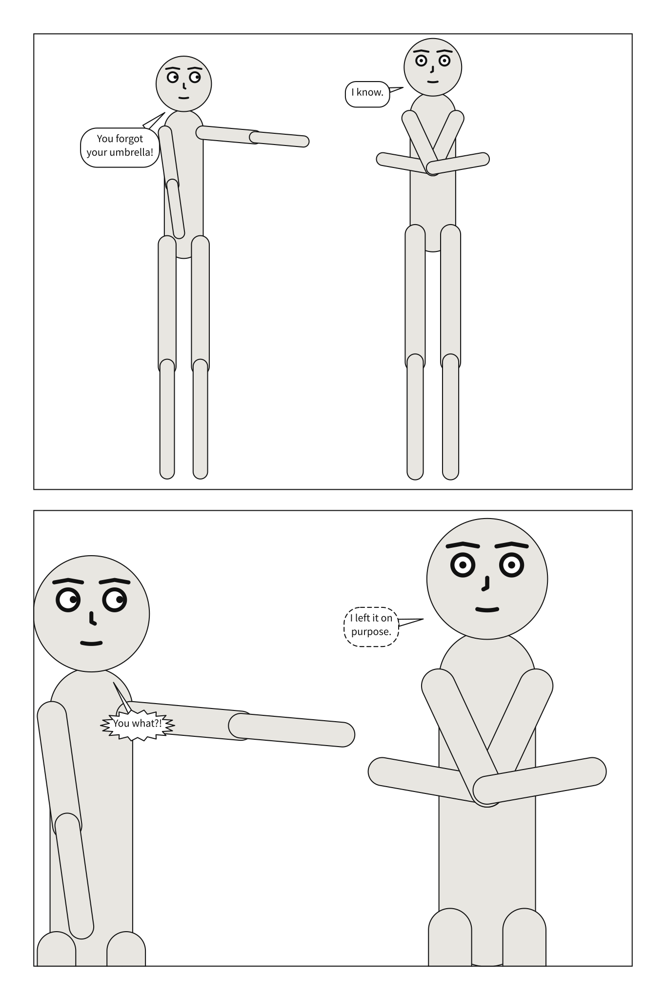

[Open in the playground](https://creatoan.github.io/scenet/playground/#example=13-comic-script.script) · [Read about it](howto/write_a_comic_script.md)

<details>
<summary>Source</summary>

```scenet-script
---
panel:
  size: [900, 640]
cast:
  ALICE: {reference: alice, pose: pointing,     at: left_third}
  BOB:   {reference: bob,   pose: arms_crossed, at: right_third, facing: left}
staging:
  - ALICE left_of BOB
  - ALICE looking_at BOB
  - ALICE ground_shared_with BOB
---

PAGE ONE

PANEL 1
@shot: full_shot
Alice and Bob face each other on a rainy street corner. She is exasperated.

ALICE
You forgot your umbrella!

BOB
I know.

PANEL 2
@shot: medium_close_up
Closer now. Bob will not meet her eye.

BOB (whisper)
I left it on purpose.

ALICE (shouting)
You what?!
```

</details>

### A Dark Horse script

A script in the format Dark Horse asks for: a title page, counts, and captions written CAP and CAP/NAME.

![A page of 3 panels. Dusk on the cliff path. Maya has climbed the last of the steps; Theo waits by the door. Caption: Port Ellis. The night the lamp went out. MAYA: Theo? The lamp is out -- THEO: -- because somebody forgot the oil. KEEPER, off panel: Who's up there? Closer. Maya points back down the path, furious. MAYA, shouting: Somebody! THEO, whispering: I was going to fetch it. Inside, the lamp blazes again. Both of them squint into the light. Sound effect, from THEO: FWOOMP. MAYA, off panel: -- and that was how the harbour got its light back.](images/gallery/31-dark-horse.page-1.svg)

[Open in the playground](https://creatoan.github.io/scenet/playground/#example=31-dark-horse.script) · [Read about it](howto/write_a_comic_script.md#a-script-as-publishers-ask-for-it)

<details>
<summary>Source</summary>

```scenet-script
---
panel:
  size: [900, 640]
cast:
  MAYA: {reference: alice, pose: pointing,     at: left_third}
  THEO: {reference: bob,   pose: arms_crossed, at: right_third, facing: left}
staging:
  - MAYA left_of THEO
  - MAYA looking_at THEO
  - MAYA ground_shared_with THEO
---
Margo Wren
14 Harbour Lane, Port Ellis

The Lighthouse, Issue 1

PAGE ONE (three panels)

Panel 1. Dusk on the cliff path. Maya has climbed the last of the steps; Theo waits by the door.
@shot: full_shot
@setting: {place: shore, time: dusk}

CAP:
Port Ellis. The night the lamp went out.

MAYA:
Theo? The lamp is out --

THEO:
-- because somebody forgot the oil.

KEEPER (OP):
Who's up there?

Panel 2. Closer. Maya points back down the path, furious.
@shot: medium_shot

1. MAYA (burst):
Somebody!

2. THEO (whisper): I was going to fetch it.

Panel 3. Inside, the lamp blazes again. Both of them squint into the light.
@shot: medium_close_up

SFX (THEO, large): FWOOMP

CAP/MAYA
“-- and that was how the harbour got its light back.”
```

</details>

### A French script

A script written in French: planche, cases, récitatif, pensée, hors champ and the échelle des plans.


[Open in the playground](https://creatoan.github.io/scenet/playground/#example=33-planche.script) · [Read about it](howto/write_a_comic_script.md#french-scripts)

<details>
<summary>Source</summary>

```scenet-script
---
panel:
  size: [900, 640]
cast:
  LÉA: {reference: alice, pose: pointing,     at: left_third}
  TOM: {reference: bob,   pose: arms_crossed, at: right_third, facing: left}
staging:
  - LÉA left_of TOM
  - LÉA looking_at TOM
  - LÉA ground_shared_with TOM
---
Claire Aubert
Le Phare, tome 1

PLANCHE 1 (trois cases)
@tiers: 2 1

CASE 1 : La falaise, le soir. Léa arrive en haut des marches ; Tom l'attend près de la porte.
@shot: plan d'ensemble
@setting: {place: shore, time: dusk}

RÉCITATIF : Port-Ellis, le soir où la lampe s'est éteinte.

LÉA :
« Tom ? La lampe est éteinte ! »

GARDIEN (hors champ) :
Qui est là-haut ?

CASE 2 : Plus près. Tom hausse les épaules.
@shot: plan américain
@angle: contre-plongée

TOM :
« Quelqu'un a oublié l'huile. »

CASE 3
@shot: plan rapproché poitrine

TOM (pensée)
Ce n'était pas moi.

ONOMATOPÉE : FLOP
```

</details>

### A script in Markdown

A script kept in Markdown, with headings after #, labels in bold, rules between panels, lower-case cast ids and a cover on no page.


[Open in the playground](https://creatoan.github.io/scenet/playground/#example=63-a-markdown-script.script) · [Read about it](howto/write_a_comic_script.md#a-script-kept-in-markdown)

<details>
<summary>Source</summary>

```scenet-script
---
# A comic script kept in Markdown, as many writers keep one: in a notes app, in a README,
# in any editor that shows it formatted. Headings start with #, a label may be in bold, a
# rule of three hyphens parts two panels, and a word to stress is written between
# underscores. Scenet takes the markers off and reads the convention under them; the text
# itself is never rewritten.
#
# The cast ids are in lower case, as YAML panels write them, so every line of dialogue is
# a name, a colon and the line. A name alone on its line is a cue only in capitals.
#
# The first panel is the cover. It comes before the first PAGE heading, so it is on no
# page, and @panel gives it a size of its own.
#
# A comic script has no comments of its own, so this one is in the front matter, which is
# YAML.
panel:
  size: [900, 640]
cast:
  alice: {reference: alice, pose: hands_on_hips, at: left_third}
  bob: {reference: bob, pose: standing_neutral, at: right_third, facing: left}
staging:
  - alice left_of bob
  - alice looking_at bob
  - alice ground_shared_with bob
setting: {place: street, time: dusk, weather: rain}
---

# The Umbrella

### PANEL 1
@panel: {size: [900, 1200]}
@shot: long_shot
@description: The cover: a street at dusk in the rain, Alice and Bob small on its corner.

**CAPTION:** The Umbrella.

## PAGE ONE

### PANEL 2
@shot: full_shot
**Alice** waits on the corner, soaked. Bob comes round it, dry, and empty-handed.

**alice:** You forgot your _umbrella_.

**bob:** I did not _forget_ it.

---

**PANEL 3**
@shot: full_shot
@angle: high
From above: the two of them, and the rain between them.

**alice:** Then where is it?

**bob:** Over the girl at the bus stop. She had further to go.
```

</details>

### A manga, right to left

A manga read right to left over two pages: a splash in colour, panels numbered again on page two, thoughts, shouts and sound effects.

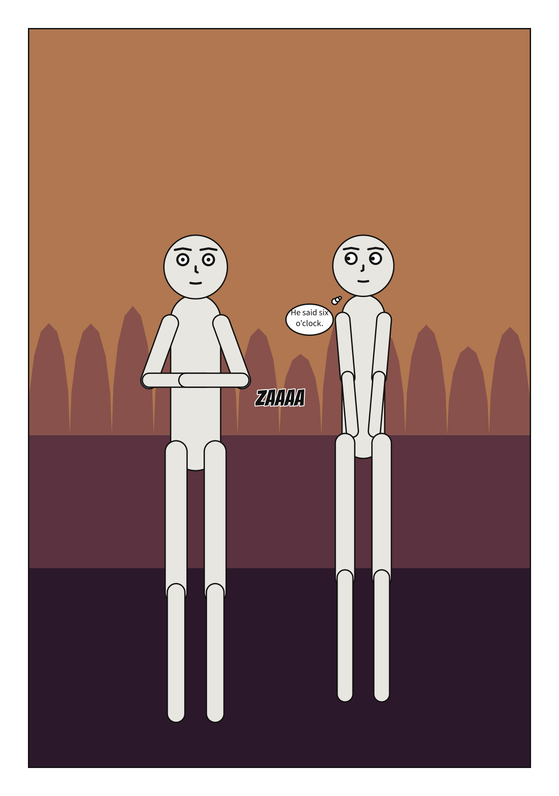


[Open in the playground](https://creatoan.github.io/scenet/playground/#example=64-a-manga-script.script) · [Read about it](howto/write_a_comic_script.md#a-manga-right-to-left)

<details>
<summary>Source</summary>

```scenet-script
---
# A manga script, read right to left. `direction: rtl` makes the whole script read from the
# top right, as a manga is read: the panels of a page, and the balloons of a panel. Nothing
# is mirrored -- Hana stands on the right because she is written there -- only what reading
# decides follows the direction.
#
# `page:` gives every page the same format, here a tankobon's proportions. The first page is
# a splash: its parenthetical is a note for the artist, not a count. Page two numbers its
# panels from 1 again, as manga scripts do, so its panels are named 2-1 to 2-4, and
# `@over: 1` there is panel 2-1.
#
# A chapter's first page is often printed in colour, so the splash writes `@palette: tinted`
# for itself. Manga letter a lot of sound, so most of it is SFX with no parenthetical; and a
# crowded panel sets its own type size with `@lettering`.
#
# A comic script has no comments of its own, so this one is in the front matter, which is
# YAML.
direction: rtl
page: {size: [1280, 1820], margin: 64, gutter: 24, tier_gutter: 36}
cast:
  HANA: {reference: alice, pose: standing_neutral, at: right_third, facing: left}
  REN: {reference: bob, pose: hands_on_hips, at: left_third, facing: right}
staging:
  - REN left_of HANA
  - HANA looking_at REN
setting: {place: field, time: dusk}
---

PAGE ONE (splash)

PANEL 1
@shot: long_shot
@palette: tinted
The field behind the school at dusk. Hana waits by the fence; Ren is running toward her.

HANA (thought)
He said six o'clock.

SFX: ZAAAA

PAGE TWO

PANEL 1
@shot: full_shot
Ren skids to a stop in front of her, out of breath.

REN (yell)
Hana! Wait!

SFX (medium): ZZAK

PANEL 2
@over: 1
@shot: cowboy
Closer. Hana does not turn round.

HANA (thinking)
Late. Again.

REN (small)
...sorry.

PANEL 3
@shot: cowboy
@lettering: {size: 18}
Ren bows low. Hana looks at him at last.

REN (shout)
I ran the whole way!

HANA (yelling)
You ran the wrong way!

PANEL 4
@shot: long_shot
They walk off along the fence together.

REN
Same time tomorrow?

HANA
Six. Not seven.
```

</details>

### French shots, abbreviated

A French planche of nine cases that walks the shot ladder in abbreviations, from PE to TGP, with French angles and delivery words.

![A page of 9 panels. La côte et le phare, vus de très haut. Une silhouette sur le chemin de la falaise. Caption: Port-Ellis, le soir où la lampe s'est éteinte. Léa en pied, au bas de l'escalier du phare. LÉA, whispering: Encore deux cents marches. Léa, coupée à mi-cuisse, la main sur la rampe. TOM, off panel: Léa ? C'est toi ? LÉA, shouting: J'arrive ! Léa, coupée à la taille. Elle reprend son souffle. TOM, off panel, shouting: La lampe ne s'allume plus ! Le même cadre. Elle lève les yeux vers le haut de l'escalier. LÉA, quietly: Évidemment. Léa, coupée à la poitrine, sort une burette d'huile de sa poche. LÉA, whispering: J'ai ce qu'il faut. Le même cadre, un temps. TOM, off panel, quietly: Tu as pensé à l'huile ? LÉA: Je pense toujours à l'huile. Le visage de Léa. Elle sourit, sans un mot. Son œil, décidé.](images/gallery/65-french-shots-abbreviated.page-1.svg)

[Open in the playground](https://creatoan.github.io/scenet/playground/#example=65-french-shots-abbreviated.script) · [Read about it](howto/write_a_comic_script.md#shots-and-angles-in-french)

<details>
<summary>Source</summary>

```scenet-script
---
# A French script, its shots abbreviated as a French découpage writes them: PE for plan
# d'ensemble, PM, PA, PRT, PMM, PRP, PR, GP and TGP for très gros plan. Case, accents and
# full stops do not matter, and each is the rung of the shot ladder its French name is.
#
# The nine cases of this planche walk the ladder from the farthest shot to the nearest, each
# abbreviation once, and the line under the PLANCHE heading says so: a line between a page's
# heading and its first case belongs to the page, and is kept, never read. The angles are in
# French too: plongée looks down, angle normal at eye level.
#
# The delivery words are French: (murmure) and (chuchoté) a whisper, (cri) and (crié) a
# shout, (à voix basse) and (voix basse) small type, and (off) somebody nobody draws.
#
# A comic script has no comments of its own, so this one is in the front matter, which is
# YAML.
cast:
  LÉA: {reference: alice, pose: standing_neutral, at: center}
setting: {place: shore, time: dusk}
---

PLANCHE 1 (neuf cases)
La montée au phare, du plus loin au plus près : de case en case, on descend l'échelle des plans.

CASE 1 : La côte et le phare, vus de très haut. Une silhouette sur le chemin de la falaise.
@shot: PE
@angle: plongée

NARRATIF : Port-Ellis, le soir où la lampe s'est éteinte.

CASE 2 : Léa en pied, au bas de l'escalier du phare.
@shot: PM
@angle: angle normal

LÉA (murmure) : Encore deux cents marches.

CASE 3 : Léa, coupée à mi-cuisse, la main sur la rampe.
@shot: PA

TOM (off) : Léa ? C'est toi ?

LÉA (cri) : J'arrive !

CASE 4 : Léa, coupée à la taille. Elle reprend son souffle.
@shot: PRT

TOM (off, crié) : La lampe ne s'allume plus !

CASE 5 : Le même cadre. Elle lève les yeux vers le haut de l'escalier.
@shot: PMM

LÉA (à voix basse) : Évidemment.

CASE 6 : Léa, coupée à la poitrine, sort une burette d'huile de sa poche.
@shot: PRP

LÉA (chuchoté) : J'ai ce qu'il faut.

CASE 7 : Le même cadre, un temps.
@shot: PR

TOM (off, voix basse) : Tu as pensé à l'huile ?

LÉA : « Je pense toujours à l'huile. »

CASE 8 : Le visage de Léa. Elle sourit, sans un mot.
@shot: GP

CASE 9 : Son œil, décidé.
@shot: TGP
```

</details>

### French shots, in full

A French planche of eight vignettes, each shot named in full, from plan moyen to très gros plan, with a cartouche for Tom's thoughts.

![A page of 8 panels. La salle de la lanterne, la nuit. Tom, en pied, devant la lampe éteinte. Caption, inner voice: Trente ans que cette lampe brille chaque nuit. Tom, coupé à la taille. Il frappe la lampe du plat de la main. TOM: Allez, ma vieille. Pas ce soir. Le même cadre. Rien ne se passe. Caption, inner voice: Et ce soir, plus rien. Tom, coupé à la poitrine. Il se gratte la tête. TOM: Qui a oublié l'huile ? Tom, coupé aux épaules. Il comprend. TOM: Ah. Moi. Le même cadre. Il soupire. Le visage de Tom, les yeux fermés. Ses yeux qui se rouvrent : on monte l'escalier.](images/gallery/66-french-shots-in-full.page-1.svg)

[Open in the playground](https://creatoan.github.io/scenet/playground/#example=66-french-shots-in-full.script) · [Read about it](howto/write_a_comic_script.md#shots-and-angles-in-french)

<details>
<summary>Source</summary>

```scenet-script
---
# A French script written vignette by vignette, its shots named in full: plan moyen, plan
# mi-moyen and plan rapproché taille, plan rapproché, plan rapproché épaule and plan épaule,
# gros plan, très gros plan. Two names for one rung are both read, and each is the rung of
# the shot ladder it names in French.
#
# VIGNETTE is a panel heading as CASE is, and the page counts its vignettes. CARTOUCHE is a
# caption, as RÉCITATIF and NARRATIF are; its parenthetical says what the box does, here a
# character's thoughts, (monologue).
#
# The nearest shots letter nothing: the head fills the panel, and no balloon may cover a
# face.
#
# A comic script has no comments of its own, so this one is in the front matter, which is
# YAML.
cast:
  TOM: {reference: bob, pose: arms_crossed, at: left_third, facing: right}
setting: {place: room, time: night}
---

PLANCHE UNE (huit vignettes)

VIGNETTE 1 : La salle de la lanterne, la nuit. Tom, en pied, devant la lampe éteinte.
@shot: plan moyen

CARTOUCHE (monologue) : Trente ans que cette lampe brille chaque nuit.

VIGNETTE 2 : Tom, coupé à la taille. Il frappe la lampe du plat de la main.
@shot: plan mi-moyen

TOM : Allez, ma vieille. Pas ce soir.

VIGNETTE 3 : Le même cadre. Rien ne se passe.
@shot: plan rapproché taille

CARTOUCHE (monologue) : Et ce soir, plus rien.

VIGNETTE 4 : Tom, coupé à la poitrine. Il se gratte la tête.
@shot: plan rapproché

TOM : Qui a oublié l'huile ?

VIGNETTE 5 : Tom, coupé aux épaules. Il comprend.
@shot: plan rapproché épaule

TOM : Ah. Moi.

VIGNETTE 6 : Le même cadre. Il soupire.
@shot: plan épaule

VIGNETTE 7 : Le visage de Tom, les yeux fermés.
@shot: gros plan

VIGNETTE 8 : Ses yeux qui se rouvrent : on monte l'escalier.
@shot: très gros plan
```

</details>

### Written like a screenplay

A script written as a screenwriter writes: sluglines, voices over and off screen, and a last panel recast with directives.

![A strip of 3 panels. INT. LIGHTHOUSE, THE LAMP ROOM - NIGHT. Maya and Theo by the dead lamp, in the dark. MAYA, off panel: Nobody had climbed those stairs in thirty years. KEEPER, off panel: Who's up there? MAYA, whispering: Don't answer him. Theo at the window. Far below, a lantern swings on the path. THEO: He has a lantern. RADIO, off panel: ...harbour patrol, do you read... MAYA: Then he has oil. INT. THE LAMP ROOM - LATER. Theo has gone. The keeper fills the doorway, his lantern raised. Off panel: Theo had gone for help. He took the long way. KEEPER: Thirty years. Who let you in? MAYA, off panel: I let myself in.](images/gallery/67-written-like-a-screenplay.strip.svg)

[Open in the playground](https://creatoan.github.io/scenet/playground/#example=67-written-like-a-screenplay.script) · [Read about it](howto/write_a_comic_script.md#written-like-a-screenplay)

<details>
<summary>Source</summary>

```scenet-script
---
# A comic script written the way a screenwriter writes one: a slugline opens each scene, and
# a cue is a name in capitals alone on its line, with the screenplay's extensions after it.
# (V.O.), or VOICE OVER in full, is a voice over, lettered as a caption by the speaker, and
# CAPTION (V.O.) one nobody is named for. (O.S.), and the older (O.C.), is somebody heard
# from off screen -- here off panel -- on the side the parenthetical names. (CONT'D), like
# any word Scenet does not letter by, is a note for the artist.
#
# One habit does not carry over. A screenplay puts a parenthetical such as (whispering) on
# the line under the cue, and in a comic script the line under a cue is what is said, so it
# goes on the cue's own line. A slugline in capitals alone on its line would look like a cue
# too, so the panel's description follows it on the same line.
#
# In the last panel Theo has gone: @cast takes him out with null and casts the keeper,
# @staging stages the two who are left, and @camera sets the shot and the angle at once.
#
# A comic script has no comments of its own, so this one is in the front matter, which is
# YAML.
panel:
  size: [900, 640]
cast:
  MAYA: {reference: alice, pose: pointing, at: left_third}
  THEO: {reference: bob, pose: arms_crossed, at: right_third, facing: left}
staging:
  - MAYA left_of THEO
  - MAYA looking_at THEO
  - MAYA ground_shared_with THEO
setting: {place: room, time: night}
---

PANEL 1
INT. LIGHTHOUSE, THE LAMP ROOM - NIGHT. Maya and Theo by the dead lamp, in the dark.
@shot: full_shot

MAYA (V.O.)
Nobody had climbed those stairs in thirty years.

KEEPER (O.S., left)
Who's up there?

MAYA (whispering)
Don't answer him.

PANEL 2
Theo at the window. Far below, a lantern swings on the path.
@shot: full_shot

THEO
He has a lantern.

RADIO (O.C., right)
...harbour patrol, do you read...

MAYA (CONT'D)
Then he has oil.

PANEL 3
INT. THE LAMP ROOM - LATER. Theo has gone. The keeper fills the doorway, his lantern raised.
@cast: {THEO: null, KEEPER: {reference: bob, pose: hands_on_hips, at: right_third, facing: left}}
@staging: [MAYA left_of KEEPER, MAYA looking_at KEEPER]
@camera: {shot: full_shot, angle: low}

CAPTION (V.O.): Theo had gone for help. He took the long way.

KEEPER
Thirty years. Who let you in?

MAYA (VOICE OVER)
I let myself in.
```

</details>

### A letterer's script

A script as a letterer reads it: numbered items, every kind of caption, voices off panel from above and below, and sounds with their size.

![A page of 3 panels. The harbour wall at night, in fog. Theo walks alone under the lamps. Caption: Port Ellis harbour. Two in the morning. Off panel: I told him not to wait. MAYA, off panel: Theo! Up here! Theo stops and looks up at the lighthouse. THEO, quietly: Maya? Sound effect: KREEEK. FERRYMAN, off panel: She's been up there all night, lad. Theo at the foot of the lighthouse stairs. Caption, inner voice: Two hundred steps. I counted them once. Sound effect: tik tik tik. MAYA, off panel: Bring the oil. Editor's note: See The Lighthouse, issue 1.](images/gallery/68-a-letterers-script.page-1.svg)

[Open in the playground](https://creatoan.github.io/scenet/playground/#example=68-a-letterers-script.script) · [Read about it](howto/write_a_comic_script.md#a-letterers-script)

<details>
<summary>Source</summary>

```scenet-script
---
# A script as a letterer reads it, after Blambot's comic script basics: every item to letter
# in a panel is numbered in reading order -- 1. or 2) -- so that writer and letterer can
# talk about balloon 3. The number is set aside.
#
# Each caption says in parentheses what it does: (locale) a place and a time, (monologue) a
# character's thoughts, (spoken) somebody's speech set in a box, (editorial) an editor's
# note. Blambot's CAPTION (VOICE OVER) is the spoken kind. A balloon says what it is: (OFF)
# is a voice from outside the panel, beside the side it comes from, and (WEAK) a line said
# faintly, in smaller type. A sound is listed where it happens: SFX: with the sound on the
# line under it, as Dark Horse writes it, and its size in parentheses.
#
# A comic script has no comments of its own, so this one is in the front matter, which is
# YAML.
cast:
  THEO: {reference: bob, pose: standing_neutral, at: center}
setting: {place: docks, time: night, weather: fog}
---

PAGE ONE

PANEL 1
The harbour wall at night, in fog. Theo walks alone under the lamps.
@shot: long_shot

1. CAPTION (locale): Port Ellis harbour. Two in the morning.
2. CAPTION (VOICE OVER): I told him not to wait.
3. MAYA (OFF, top):
Theo! Up here!

PANEL 2
Theo stops and looks up at the lighthouse.
@shot: full_shot

1) THEO (WEAK): Maya?
2) SFX:
KREEEK
3) FERRYMAN (off-panel, bottom):
She's been up there all night, lad.

PANEL 3
Theo at the foot of the lighthouse stairs.
@shot: medium_shot

1. CAP (monologue): Two hundred steps. I counted them once.
2. SFX (small): tik tik tik
3. CAPTION/MAYA (spoken): "Bring the oil."
4. CAPTION (editorial): See The Lighthouse, issue 1.
```

</details>

## Your own art and characters

Learn it in the tour: [Your own art and characters](tutorial/your_own_art.md).

### A picture behind the cast

A picture painted elsewhere behind the puppets, fitted to cover the panel or contained in it.


[Open in the playground](https://creatoan.github.io/scenet/playground/#example=34-supplied-art.scene.yaml) · [Read about it](howto/letter_over_your_own_art.md)

<details>
<summary>Source</summary>

```yaml
# A picture drawn elsewhere, behind the cast.
#
# `image` names a PNG or JPEG beside this document -- art/street.png, painted by
# scripts/make_gallery_art.py -- and the cast is drawn in front of it and lettered by the
# same rules as on any other backdrop. The compiler reads the picture's size and nothing
# else: it does not know there is a road, so a balloon pays nothing to sit on it.
#
# `fit` says how the picture fills the panel, keeping its proportions: `cover` fills it
# and crops what overhangs, equally top and bottom here; `contain` shows the whole
# picture, and the panel shows round it. Weather is drawn over the picture as over masses.
#
# A link by default -- the SVG names art/street.png, as written -- or the picture's own
# bytes with `scenet build --embed-images`, which the playground always uses.

camera:
  shot: long_shot

cast:
  alice: {reference: alice, at: left_third, pose: pointing}
  bob:   {reference: bob,   at: right_third, facing: left}

staging:
  - alice left_of bob
  - alice looking_at bob
  - alice ground_shared_with bob

setting: {image: art/street.png, time: dusk}

panels:
  arrival:
    panel: {size: [1200, 600]}
    setting: {fit: cover, weather: rain}
    script:
      - caption: {text: "Eight o'clock. Still raining.", kind: locale, prefer: top_left}
      - say: {by: alice, text: "You painted every one of those windows?"}
      - say: {by: bob, text: "Every one. Twice."}

  framed:
    over: arrival
    panel: {size: [700, 700]}
    camera: {shot: full_shot}
    setting: {fit: contain, weather: clear}
    script:
      - say: {by: alice, text: "It looks smaller from here."}
```

</details>

### Figures a picture draws

People the picture draws, lettered from its artwork contract: balloons keep off their faces and tails find their mouths.

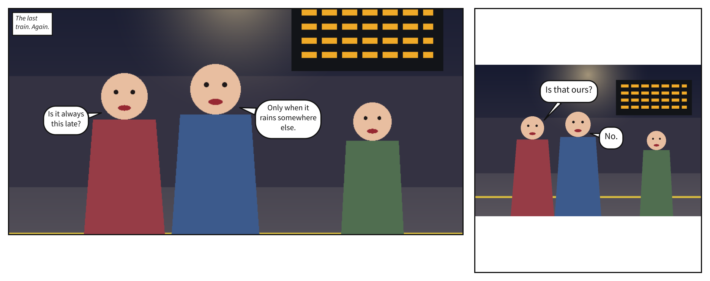

[Open in the playground](https://creatoan.github.io/scenet/playground/#example=35-figures.scene.yaml) · [Read about it](howto/letter_the_figures_in_your_art.md)

<details>
<summary>Source</summary>

```yaml
# Figures a picture draws, lettered over.
#
# The people are in the picture -- art/figures.png, painted by
# scripts/make_gallery_figures.py -- so the cast names them with `figure:` instead of
# posing puppets. Where each face, mouth and body is lives in the picture's artwork
# contract, art/figures.art.yaml, beside it and named after it; this document writes no
# coordinate. Balloons keep off every declared face, Carl's too though nobody cast him,
# tails aim at each speaker's mouth, and the timetable board is a keep-out: lettering
# pays to cover it, and does not.
#
# Nobody is posed, placed or framed: the artist did all of that, so there is no camera
# and no staging. `fit` maps the contract through the same transform as the picture.

cast:
  ana: {figure: ana}
  ben: {figure: ben}

setting: {image: art/figures.png, time: night}

panels:
  platform:
    panel: {size: [1200, 600]}
    setting: {fit: cover}
    script:
      - caption: {text: "The last train. Again.", kind: locale}
      - say: {by: ana, text: "Is it always this late?"}
      - say: {by: ben, text: "Only when it rains somewhere else."}

  waiting:
    over: platform
    panel: {size: [600, 700]}
    setting: {fit: contain}
    script:
      - say: {by: ana, text: "Is that ours?"}
      - say: {by: ben, text: "No."}
```

</details>

### From puppets to figures

Two puppets in a street, then the same two people drawn by a picture, the place, camera and puppets taken away with null.

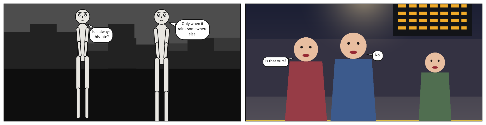

[Open in the playground](https://creatoan.github.io/scenet/playground/#example=51-puppets-to-figures.scene.yaml) · [Read about it](reference/language/cast.md#castidfigure)

<details>
<summary>Source</summary>

```yaml
# From puppets to figures: the same two people, drawn first by Scenet, then by a picture.
#
# In the first panel Ana and Ben are puppets in a named place. The second is `over:` it, and
# takes everything it does not take away with `null`:
#
# - `place: null` beside its `image`, since a picture is a backdrop of its own;
# - `camera: null`, since the artist already framed the picture;
# - `reference: null` beside each `figure`, and every key that posed the puppet -- `at`,
#   `facing` -- since a member is a puppet or a figure, never both.
#
# The picture's artwork contract, art/figures.art.yaml, says where each face and mouth is.

panels:
  waiting:
    panel: {size: [1200, 600]}
    camera: {shot: full_shot}
    setting: {place: street, time: night}
    cast:
      ana: {reference: alice, at: left_third}
      ben: {reference: bob,   at: right_third, facing: left}
    script:
      - say: {by: ana, text: "Is it always this late?"}
      - say: {by: ben, text: "Only when it rains somewhere else."}

  platform:
    over: waiting
    camera: null
    setting: {place: null, image: art/figures.png, fit: cover}
    cast:
      ana: {reference: null, figure: ana, at: null}
      ben: {reference: null, figure: ben, at: null, facing: null}
    script:
      - say: {by: ana, text: "Is that ours?"}
      - say: {by: ben, text: "No."}
```

</details>

### A JPEG behind the cast

A photograph supplied as a JPEG, read as a PNG is: by its first bytes, and for its size alone.

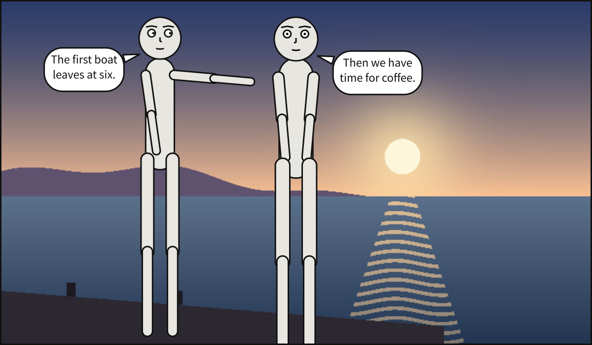

[Open in the playground](https://creatoan.github.io/scenet/playground/#example=52-a-jpeg.panel.yaml) · [Read about it](reference/language/setting.md#settingimage)

<details>
<summary>Source</summary>

```yaml
# A JPEG behind the cast.
#
# A supplied picture may be a PNG or a JPEG, the two raster formats every SVG viewer must
# draw. The compiler tells them apart by their first bytes, not by the file's name, and
# reads nothing but the size from either. This one, art/harbour.jpg, was painted and
# encoded by scripts/make_gallery_photo.py.
#
# `time: dawn` changes nothing in the picture, whose values are the artist's: over a
# picture, the hour only tints weather, and there is none.

panel:
  size: [1200, 700]

camera:
  shot: full_shot

setting:
  image: art/harbour.jpg
  fit: cover
  time: dawn

cast:
  alice: {reference: alice, at: left_third, pose: pointing}
  bob:   {reference: bob,   at: center, facing: left}

staging:
  - alice left_of bob
  - alice looking_at bob

script:
  - say: {by: alice, text: "The first boat leaves at six."}
  - say: {by: bob, text: "Then we have time for coffee."}
```

</details>

### A puppet of your own

Pip, a child five heads tall, is drawn from a puppet file beside the gallery, which the cast names by its path.

![A page of 5 panels. Full shot. The docks at dusk. Alice, centre; Pip, centre, looking at Alice. Pip: Is that our boat? Alice: Not yet. Cowboy shot. The docks at dusk. Pip, centre, waving, happy. Pip: Hello, boat! Cowboy shot. The docks at dusk. Pip, centre, arms up, surprised. Pip: It's enormous! Cowboy shot. The docks at dusk. Pip, centre, scared. Pip, whispering: And so loud. Full shot. The docks at dusk. Alice, centre, happy; Pip, centre, sad, looking at Alice. Pip: It's going without us. Alice: That one wasn't ours.](images/gallery/69-a-puppet-of-your-own.page-1.svg)

[Open in the playground](https://creatoan.github.io/scenet/playground/#example=69-a-puppet-of-your-own.scene.yaml) · [Read about it](reference/language/cast.md#castidreference)

<details>
<summary>Source</summary>

```yaml
# A puppet of your own: pip, a child five heads tall, at the docks with alice.
#
# Scenet ships two puppets, alice and bob, and pip is not one of them. Its file,
# pip.puppet.yaml, is in puppets/, beside this document, and the cast names it by that path:
# relative to the folder the document is in, as a font or a picture is named. The
# playground writes it there for you, and Puppet... adds one of your own the same way.
#
# A puppet file says what a character is made of -- landmarks, joints, the parts drawn, a
# face -- and the poses and expressions it can take, by name. Pip's are its own: it waves
# and throws its arms up, where alice points and crosses hers. This page draws every pose
# and every expression pip has.
#
# Pip is five heads tall to alice's seven and a half. The camera frames each shot by the
# landmarks a puppet declares, counted in heads, so pip fills a panel of its own at the
# shot asked for. Beside alice, `ground_shared_with` stands them on one ground, and pip
# comes up to her chest; without it, each would be framed alone, head under the top of the
# panel, and pip would float.

page: {size: [1500, 2100], margin: 60, gutter: 30, tier_gutter: 40}
setting: {place: docks, time: dusk}

cast:
  alice: {reference: alice, at: left_third}
  pip: {reference: puppets/pip.puppet.yaml, at: right_third, facing: left}

pages:
  - tiers:
      - panels: [quay]
      - {height: 1.2, panels: [wave, enormous, loud]}
      - panels: [gone]

panels:
  quay:
    camera: {shot: full_shot}
    staging: [alice left_of pip, pip looking_at alice, alice ground_shared_with pip]
    script:
      - say: {by: pip, text: "Is that our boat?"}
      - say: {by: alice, text: "Not yet."}

  wave:
    camera: {shot: cowboy}
    cast:
      alice: null
      pip: {pose: waving, expression: happy, at: center}
    script:
      - say: {by: pip, text: "Hello, boat!"}

  enormous:
    camera: {shot: cowboy}
    cast:
      alice: null
      pip: {pose: arms_up, expression: surprise, at: center}
    script:
      - say: {by: pip, text: "It's enormous!"}

  loud:
    camera: {shot: cowboy}
    cast:
      alice: null
      pip: {expression: scared, at: center}
    script:
      - say: {by: pip, text: "And so loud.", kind: whisper}

  gone:
    camera: {shot: full_shot}
    cast:
      alice: {expression: happy}
      pip: {expression: sad}
    staging: [alice left_of pip, pip looking_at alice, alice ground_shared_with pip]
    script:
      - say: {by: pip, text: "It's going without us."}
      - say: {by: alice, text: "That one wasn't ours."}
```

</details>

## Right to left

Learn it in the tour: [Right to left](tutorial/right_to_left.md).

### A manga page, right to left

A page read from the top right, as manga are, where reading order decides everything and the art is never mirrored.

![A page of 8 panels. Long shot. A street at night, in the rain. Hana, right, pointing, looking at Ken; Ken, left. Caption: Shinjuku. Ten past midnight. Hana: You came. Ken: You called. Medium close-up. A street at night, in the rain. Ken, centre. Ken, whispering: Is anybody else coming? Close-up. A street at night, in the rain. Hana, centre. Hana: Only us. Close-up. A street at night, in the rain. Ken, centre, surprised. Ken: Then why the umbrella? Full shot. A street at night, in the rain. Hana, centre; Ken, centre. Sound effect: KRAK. Hana: Because it is raining. Ken: It always is, here. Long shot. A street at night, in the rain. Ken, centre, sad. Caption: 00:10. Medium shot. A street at night, in the rain. Hana, centre. Mother, off panel: Hana? Where are you? Hana: Nearly home. Medium shot. A street at night, in the rain. Ken, centre, arms crossed. Ken: Go. I will wait.](images/gallery/36-right-to-left.page-1.svg)

[Open in the playground](https://creatoan.github.io/scenet/playground/#example=36-right-to-left.scene.yaml) · [Read about it](reference/language/direction.md#direction)

<details>
<summary>Source</summary>

```yaml
# A manga page, read from the top right.
#
# `direction: rtl` is the whole document's, written once beside `panels:`. The panels are
# written in reading order, as on any page, and read right to left: `arrival` is top right,
# the stack beside the tall street is read down before across, and the last tier ends at
# the bottom left. In each panel the balloons are read the same way -- never above and right
# of one before -- and the caption, given no zone, sits where reading starts.
#
# Nothing in the picture is mirrored: Hana stands where `at:` puts her and faces the way
# `facing:` says, the clock is in the corner its `at:` names, and the sound sits where the
# sound is. 37-left-to-right.scene.yaml is this page read left to right, figure for figure.

direction: rtl
page: {size: [1500, 2250], margin: 75, gutter: 30, tier_gutter: 45}
setting: {place: street, time: night, weather: rain}

pages:
  - tiers:
      - panels: [{use: arrival, width: 2}, door]
      - height: 1.4
        columns:
          - {panels: [asks, answers]}
          - width: 1.2
            panels:
              - use: street
                insets: [{use: clock, at: bottom_left, size: 0.4}]
      - panels: [phone, wait]

panels:
  arrival:
    camera: {shot: long_shot}
    cast:
      hana: {reference: alice, pose: pointing, at: right_third, facing: left}
      ken: {reference: bob, at: left_third}
    staging: [ken left_of hana, hana looking_at ken]
    script:
      - caption: {text: "Shinjuku. Ten past midnight."}
      - say: {by: hana, text: "You came."}
      - say: {by: ken, text: "You called."}

  door:
    camera: {shot: medium_close_up}
    cast:
      ken: {reference: bob, at: center}
    script:
      - say: {by: ken, text: "Is anybody else coming?", kind: whisper}

  asks:
    camera: {shot: close_up}
    cast:
      hana: {reference: alice, at: center, facing: left}
    script:
      - say: {by: hana, text: "Only us."}

  answers:
    camera: {shot: close_up}
    cast:
      ken: {reference: bob, expression: surprise, at: center}
    script:
      - say: {by: ken, text: "Then why the umbrella?"}

  street:
    camera: {shot: full_shot}
    cast:
      hana: {reference: alice, at: right_third, facing: left}
      ken: {reference: bob, at: left_third}
    staging: [ken left_of hana]
    script:
      - sfx: {text: KRAK, size: medium, prefer: top_center}
      - say: {by: hana, text: "Because it is raining."}
      - say: {by: ken, text: "It always is, here."}

  clock:
    camera: {shot: long_shot}
    cast:
      ken: {reference: bob, expression: sad, at: right_third}
    script:
      - caption: {text: "00:10"}

  phone:
    camera: {shot: medium_shot}
    cast:
      hana: {reference: alice, at: center, facing: left}
    script:
      - say: {by: mother, text: "Hana? Where are you?", off_panel: true}
      - say: {by: hana, text: "Nearly home."}

  wait:
    camera: {shot: medium_shot}
    cast:
      ken: {reference: bob, pose: arms_crossed, at: center}
    script:
      - say: {by: ken, text: "Go. I will wait."}
```

</details>

### The same page, left to right

The right-to-left page read the other way, figure for figure, to compare the two.

![A page of 8 panels. Long shot. A street at night, in the rain. Ken, left; Hana, right, pointing, looking at Ken. Caption: Shinjuku. Ten past midnight. Hana: You came. Ken: You called. Medium close-up. A street at night, in the rain. Ken, centre. Ken, whispering: Is anybody else coming? Close-up. A street at night, in the rain. Hana, centre. Hana: Only us. Close-up. A street at night, in the rain. Ken, centre, surprised. Ken: Then why the umbrella? Full shot. A street at night, in the rain. Ken, centre; Hana, centre. Sound effect: KRAK. Hana: Because it is raining. Ken: It always is, here. Long shot. A street at night, in the rain. Ken, centre, sad. Caption: 00:10. Medium shot. A street at night, in the rain. Hana, centre. Mother, off panel: Hana? Where are you? Hana: Nearly home. Medium shot. A street at night, in the rain. Ken, centre, arms crossed. Ken: Go. I will wait.](images/gallery/37-left-to-right.page-1.svg)

[Open in the playground](https://creatoan.github.io/scenet/playground/#example=37-left-to-right.scene.yaml) · [Read about it](reference/language/direction.md#direction)

<details>
<summary>Source</summary>

```yaml
# The manga page of 36-right-to-left.scene.yaml, read left to right.
#
# The same document with `direction: ltr`, which is also what a page with no `direction`
# reads as. Put the two side by side: every panel draws the same figures, staged the same
# way, at the same size -- only where each panel sits on the page, and where its lettering
# sits in it, follows the direction.

direction: ltr
page: {size: [1500, 2250], margin: 75, gutter: 30, tier_gutter: 45}
setting: {place: street, time: night, weather: rain}

pages:
  - tiers:
      - panels: [{use: arrival, width: 2}, door]
      - height: 1.4
        columns:
          - {panels: [asks, answers]}
          - width: 1.2
            panels:
              - use: street
                insets: [{use: clock, at: bottom_left, size: 0.4}]
      - panels: [phone, wait]

panels:
  arrival:
    camera: {shot: long_shot}
    cast:
      hana: {reference: alice, pose: pointing, at: right_third, facing: left}
      ken: {reference: bob, at: left_third}
    staging: [ken left_of hana, hana looking_at ken]
    script:
      - caption: {text: "Shinjuku. Ten past midnight."}
      - say: {by: hana, text: "You came."}
      - say: {by: ken, text: "You called."}

  door:
    camera: {shot: medium_close_up}
    cast:
      ken: {reference: bob, at: center}
    script:
      - say: {by: ken, text: "Is anybody else coming?", kind: whisper}

  asks:
    camera: {shot: close_up}
    cast:
      hana: {reference: alice, at: center, facing: left}
    script:
      - say: {by: hana, text: "Only us."}

  answers:
    camera: {shot: close_up}
    cast:
      ken: {reference: bob, expression: surprise, at: center}
    script:
      - say: {by: ken, text: "Then why the umbrella?"}

  street:
    camera: {shot: full_shot}
    cast:
      hana: {reference: alice, at: right_third, facing: left}
      ken: {reference: bob, at: left_third}
    staging: [ken left_of hana]
    script:
      - sfx: {text: KRAK, size: medium, prefer: top_center}
      - say: {by: hana, text: "Because it is raining."}
      - say: {by: ken, text: "It always is, here."}

  clock:
    camera: {shot: long_shot}
    cast:
      ken: {reference: bob, expression: sad, at: right_third}
    script:
      - caption: {text: "00:10"}

  phone:
    camera: {shot: medium_shot}
    cast:
      hana: {reference: alice, at: center, facing: left}
    script:
      - say: {by: mother, text: "Hana? Where are you?", off_panel: true}
      - say: {by: hana, text: "Nearly home."}

  wait:
    camera: {shot: medium_shot}
    cast:
      ken: {reference: bob, pose: arms_crossed, at: center}
    script:
      - say: {by: ken, text: "Go. I will wait."}
```

</details>

## What Scenet tells you

Learn it in the tour: [What Scenet tells you, and publishing](tutorial/what_scenet_tells_you.md).

### The camera retreats

Four characters too wide for a close-up make the camera step back, and a note says by how much.

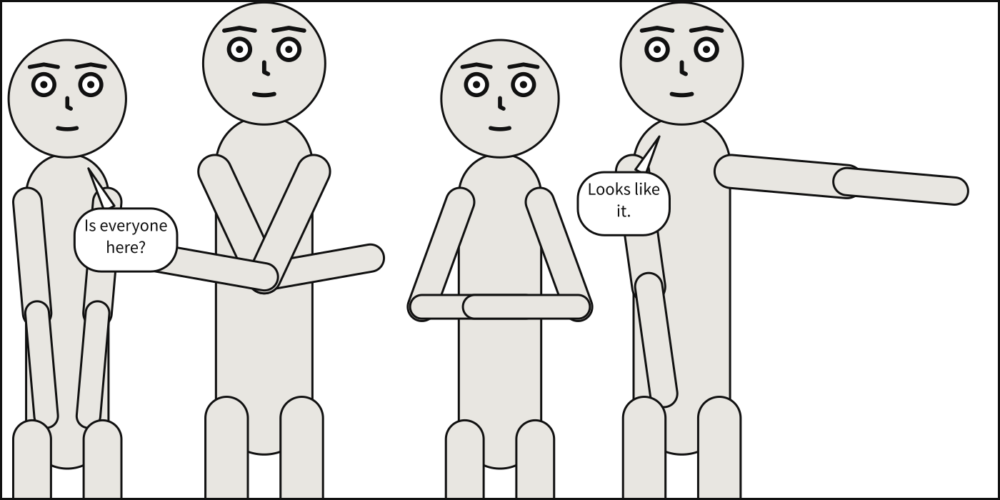

[Open in the playground](https://creatoan.github.io/scenet/playground/#example=10-crowd-pullback.panel.yaml) · [Read about it](reference/language/camera.md#camerashot)

<details>
<summary>Source</summary>

```yaml
# Four characters at a close-up cannot fit side by side. A real camera operator
# would step backwards, so that is what happens: everybody gets smaller and more of
# the body comes into view.
#
# The requested shot is an UPPER BOUND ON TIGHTNESS, not a promise -- and the retreat
# is reported rather than done silently, because a panel that is quietly not the shot
# you asked for is a panel you cannot debug. Look at the note under the picture:
# `camera-retreated`. To make it go away, widen the panel or ask for a looser shot.
#
# A retreat is a compromise the compiler can make. Constraints that cannot all hold are
# not: the last line shows one.

panel:
  size: [1400, 700]

camera:
  shot: close_up

cast:
  alice: {reference: alice}
  bob:   {reference: bob,   pose: arms_crossed}
  carol: {reference: alice, pose: hands_on_hips}
  dave:  {reference: bob,   pose: pointing}

script:
  - say: {by: alice, text: "Is everyone here?"}
  - say: {by: dave,  text: "Looks like it."}

staging:
  - alice left_of bob
  - bob left_of carol
  - carol left_of dave
  - alice ground_shared_with bob
  - bob ground_shared_with carol
  - carol ground_shared_with dave

# Try this: delete the "# " that starts the last line. Dave left of Alice closes a loop
# that no order can satisfy: the error `ordering-cycle`, on that line.
#   - dave left_of alice
```

</details>

### Too many words

A balloon of 34 words still compiles, and the checker notes that Dark Horse asks for about 25 at most.


[Open in the playground](https://creatoan.github.io/scenet/playground/#example=53-too-many-words.panel.yaml) · [Read about it](reference/diagnostics.md#word-limit)

<details>
<summary>Source</summary>

```yaml
# Too many words for one balloon: a note, not an error.
#
# Dark Horse's script format asks for "approximately 25 words per balloon, and about 50
# words per panel, max". Bob's answer holds 34, so `scenet check` notes it, on its line,
# under the rule `word-limit`. It is a limit a letterer works to, not a contradiction: the
# panel compiles all the same, and the balloon is lettered as large as it has to be.
#
# Words are counted as they are lettered: `--` and an ellipsis are no words, and the
# underscores around a stressed word add none.
#
# To make the note go away, split the balloon in two -- a second `say:` by Bob, which is
# what a letterer would do -- or carry the rest of the words to the next panel.

panel: {size: [1000, 700]}
camera: {shot: full_shot}

cast:
  alice: {reference: alice, at: left_third}
  bob:   {reference: bob,   pose: arms_crossed, at: right_third, facing: left}

staging:
  - alice left_of bob
  - alice looking_at bob

script:
  - say: {by: alice, text: "So what happened?"}
  - say: {by: bob, text: "Well, I got up late, missed the bus, walked all the way, lost my keys on the way, found them again, and then the door was locked anyway, so I just came back here."}

# Try this: delete the "# " that starts the last line. Alice opens a stressed word with
# an underscore and never closes it: the error `unbalanced-emphasis`, on that line.
#   - say: {by: alice, text: "You _walked?"}
```

</details>

### A page miscounted

A script whose page says three panels where two follow: it compiles, and the checker notes the count.

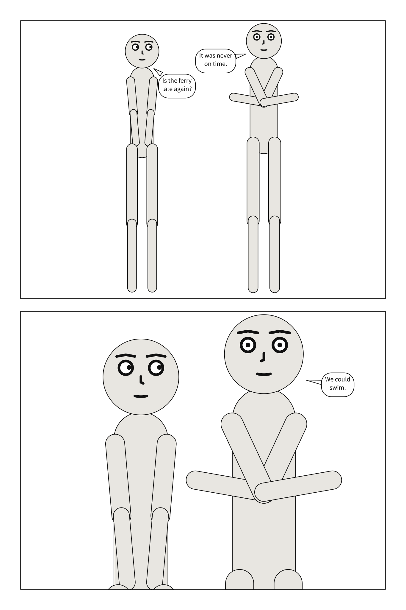

[Open in the playground](https://creatoan.github.io/scenet/playground/#example=54-a-page-miscounted.script) · [Read about it](reference/diagnostics.md#panel-count)

<details>
<summary>Source</summary>

```scenet-script
---
# A page that says how many panels it holds, and miscounts: a note, not an error.
#
# Dark Horse's format labels each page with its count, as PAGE ONE (three panels) does
# below, and Scenet holds the page to it. Only two panels follow, so `scenet check` notes
# the PAGE line, `panel-count`: a heading may have been missed, or written so that it
# reads as prose. The two panels compile all the same.
#
# A comic script has no comments of its own, so this one is in the front matter, which is
# YAML. To make the note go away, correct the count, or write the third panel.
panel:
  size: [900, 640]
staging:
  - MAYA left_of THEO
  - MAYA looking_at THEO
  - MAYA ground_shared_with THEO
cast:
  MAYA: {reference: alice, at: left_third}
  THEO: {reference: bob, pose: arms_crossed, at: right_third, facing: left}
# Try this: delete the "# " that starts the next line. Scenet ships two puppets, alice and
# bob, and no `nell`: the error `unknown-puppet`, on that line.
#   NELL: {reference: nell, at: center}
---

PAGE ONE (three panels)

PANEL 1
@shot: full_shot
Maya and Theo on the harbour wall, at dusk.

MAYA
Is the ferry late again?

THEO
It was never on time.

PANEL 2
@shot: medium_shot
Theo shrugs.

THEO
We could swim.
```

</details>

### Not read as dialogue

A speaker's name misspelled in a script makes the line prose, not dialogue, and the checker points at it.

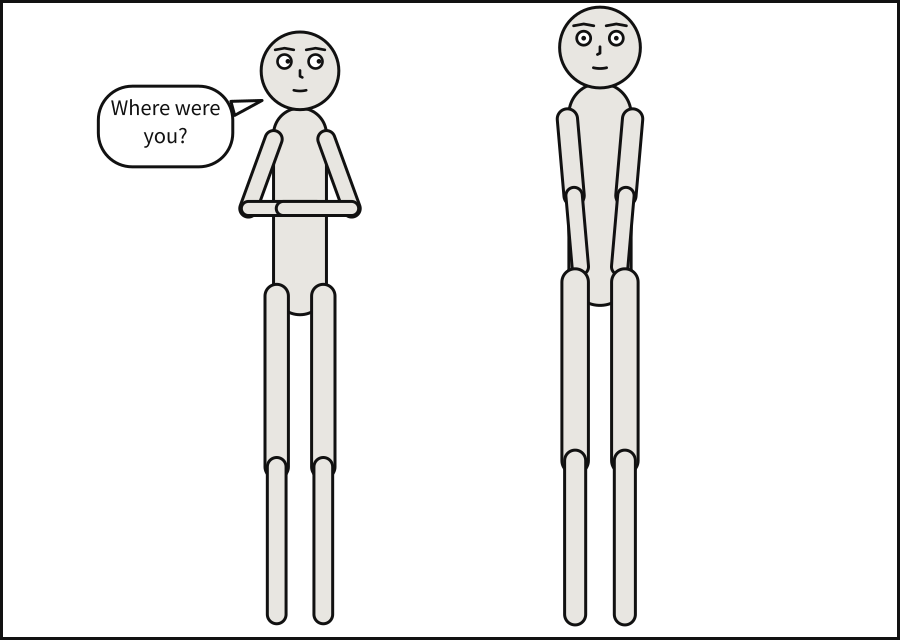

[Open in the playground](https://creatoan.github.io/scenet/playground/#example=55-not-read-as-dialogue.script) · [Read about it](reference/diagnostics.md#looks-like-dialogue)

<details>
<summary>Source</summary>

```scenet-script
---
# A line set like dialogue that is not read as dialogue: a note, not an error.
#
# THOE: in the panel below is a typo for THEO. A name in capitals with a colon looks like
# a speaker's line, but nobody called THOE is in the cast, so the line is read as what it
# would be otherwise: prose, which is the panel's description and is never lettered. A
# writer's NOTE: line is read the same way, and is no mistake -- but a misspelled speaker
# looks exactly like one, so `scenet check` points at it, `looks-like-dialogue`, and
# leaves the call to you.
#
# A comic script has no comments of its own, so this one is in the front matter, which is
# YAML. To make the note go away, spell the name as the cast does.
panel:
  size: [900, 640]
staging:
  - MAYA left_of THEO
  - MAYA looking_at THEO
  - MAYA ground_shared_with THEO
cast:
  MAYA: {reference: alice, pose: hands_on_hips, at: left_third}
  THEO: {reference: bob, at: right_third, facing: left}
# Try this: delete the "# " that starts the next line. The alice puppet has no `sleepy`
# face: the error `unknown-expression`, on that line.
#   NELL: {reference: alice, at: center, expression: sleepy}
---

PANEL 1
@shot: full_shot
Maya waits at the door; Theo comes down the stairs at last.

MAYA: Where were you?

THOE: Asleep, mostly.
```

</details>

### A relation left out

A panel that leaves Bob out with null leaves out the relation naming him too, and the checker notes it.


[Open in the playground](https://creatoan.github.io/scenet/playground/#example=56-a-relation-left-out.scene.yaml) · [Read about it](reference/diagnostics.md#dropped-relation)

<details>
<summary>Source</summary>

```yaml
# A relation left out with the actor it names: a note, not an error.
#
# Everything beside `panels:` is a default every panel takes -- here Alice, Bob, and
# `alice left_of bob`. The second panel leaves Bob out with `cast: {bob: null}`, and a
# relation naming somebody who is not drawn cannot hold, so it goes with him. That changes
# what the panel stages, so `scenet check` notes it where he is left out:
# `dropped-relation`. Alice stands where her `at:` puts her, with nobody to be left of.
#
# A look is the one relation that stays: `alice looking_at bob` would still hold while
# Bob is heard from off panel, since Alice can look toward his voice.
#
# To make the note go away, place the cast with `at:` alone, as "Leaving someone out"
# does, or write the relation only in the panels that draw them both.

panel: {size: [900, 600]}
camera: {shot: medium_shot}
setting: {place: office, time: day}

cast:
  alice: {reference: alice, at: left_third}
  bob:   {reference: bob,   at: right_third, facing: left}

staging:
  - alice left_of bob

panels:
  meeting:
    script:
      - say: {by: bob, text: "Back in a minute."}

  alone:
    cast:
      bob: null
    script:
      - say: {by: alice, text: "Take your time.", kind: whisper}

  back:
    script:
      - say: {by: bob, text: "Did I miss anything?"}

# Try this: delete the "# " that starts the last line. Bob is drawn in this panel, so he
# cannot speak in it from off panel: the error `off-panel-speaker`, on that line.
#       - say: {by: bob, text: "Only me.", off_panel: true}
```

</details>

### A tail that bends

A voice from the left with its balloon on the right: the tail bends around Bob's face, and a note says so.

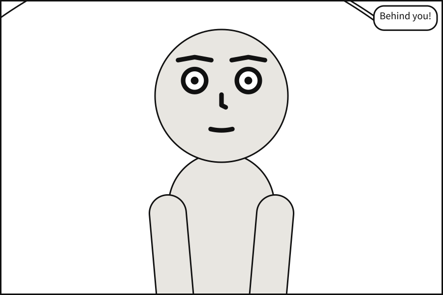

[Open in the playground](https://creatoan.github.io/scenet/playground/#example=57-a-tail-that-bends.panel.yaml) · [Read about it](reference/diagnostics.md#curved-tail)

<details>
<summary>Source</summary>

```yaml
# A tail that bends around a face: a note, not an error.
#
# Carol is heard from off panel, on the left, and her balloon asks for the top right. A
# straight tail from there to the left edge of the frame would run through Bob's head, so
# it bends around it, and the compiler says so: `curved-tail`, "balloon b0 needed a
# curved tail to clear a face". A bent tail is a sign the panel is crowded, or a balloon
# is far from its speaker -- worth a second look, never a reason to refuse the panel.
#
# To make the note go away, let the balloon sit on the side the voice comes from: drop
# `prefer: top_right`, or have Carol heard from the right.

panel: {size: [900, 600]}
camera: {shot: medium_close_up}

cast:
  bob: {reference: bob, at: center}

script:
  - say: {by: carol, text: "Behind you!", off_panel: left, prefer: top_right}

# Try this: delete the "# " that starts the last line. A balloon may prefer one of the
# nine zones, and `top` is none of them: the error `invalid-field`, on that line.
#   - say: {by: bob, text: "Where?", prefer: top}
```

</details>

### A mouth cropped away

A picture fitted to cover a tall panel crops Ana's mouth away, so her tail stops on the frame, and a note says so.

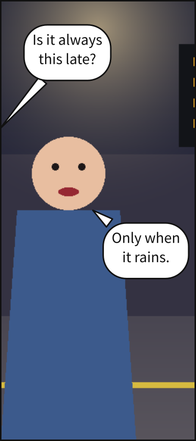

[Open in the playground](https://creatoan.github.io/scenet/playground/#example=58-a-mouth-cropped-away.panel.yaml) · [Read about it](reference/diagnostics.md#cropped-mouth)

<details>
<summary>Source</summary>

```yaml
# A mouth the picture's fit crops away: a note, not an error.
#
# The people are in the picture -- art/figures.png, with its artwork contract beside it --
# and `fit: cover` fills this tall, narrow panel with it, so the picture overhangs on both
# sides and is cropped there. Ana stands on the left, and her mouth is cropped away. Her
# balloon still points at it: the tail stops on the frame, aimed where she is, and the
# compiler says so, `cropped-mouth`.
#
# To make the note go away, write `fit: contain`, which shows the whole picture, or make
# the panel wide enough to hold her.

panel: {size: [400, 900]}
setting: {image: art/figures.png, fit: cover, time: night}

cast:
  ana: {figure: ana}
  ben: {figure: ben}

script:
  - say: {by: ana, text: "Is it always this late?"}
  - say: {by: ben, text: "Only when it rains."}

# Try this: delete the "# " that starts the last line. Carl is in the picture, but nobody
# cast him, so nobody can speak as him: the error `unknown-actor`, on that line.
#   - say: {by: carl, text: "Mind the gap."}
```

</details>

### Marks cut off

Sweat drops over the taller character run off the top, since the camera makes no room for marks, and a note says so.

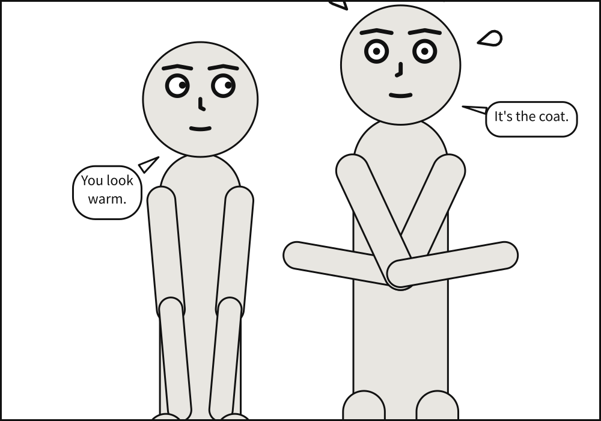

[Open in the playground](https://creatoan.github.io/scenet/playground/#example=59-marks-cut-off.panel.yaml) · [Read about it](reference/diagnostics.md#cropped-marks)

<details>
<summary>Source</summary>

```yaml
# Marks cut off by the frame: a note, not an error.
#
# Emanata are drawn outside the head, in the space balloons go, and they never move
# anybody: the camera frames by the body and makes no room for them. That cuts both ways.
# Bob is the taller of the two, and at this framing his plewds run off the top of the
# panel, so the compiler says so -- `cropped-marks` -- rather than let them vanish without
# a word.
#
# To make the note go away, ask for a looser shot, which shows them whole, or give the
# marks to Alice, whose head is lower.

panel: {size: [1000, 700]}
camera: {shot: medium_shot}

cast:
  alice: {reference: alice, at: left_third}
  bob:   {reference: bob,   pose: arms_crossed, at: right_third, facing: left, marks: [plewds]}

staging:
  - alice left_of bob
  - alice ground_shared_with bob
  - alice looking_at bob

script:
  - say: {by: alice, text: "You look warm."}
  - say: {by: bob, text: "It's the coat."}

# Try this: delete the "# " that starts the last line. A line with nothing said is no line
# at all: `text` is required, and leaving it out is the error `missing-field`, there.
#   - say: {by: alice}
```

</details>

### An inset over a face

An inset set into the corner where Bob's face is covers it, since the art does not move for an inset, and a note says so.

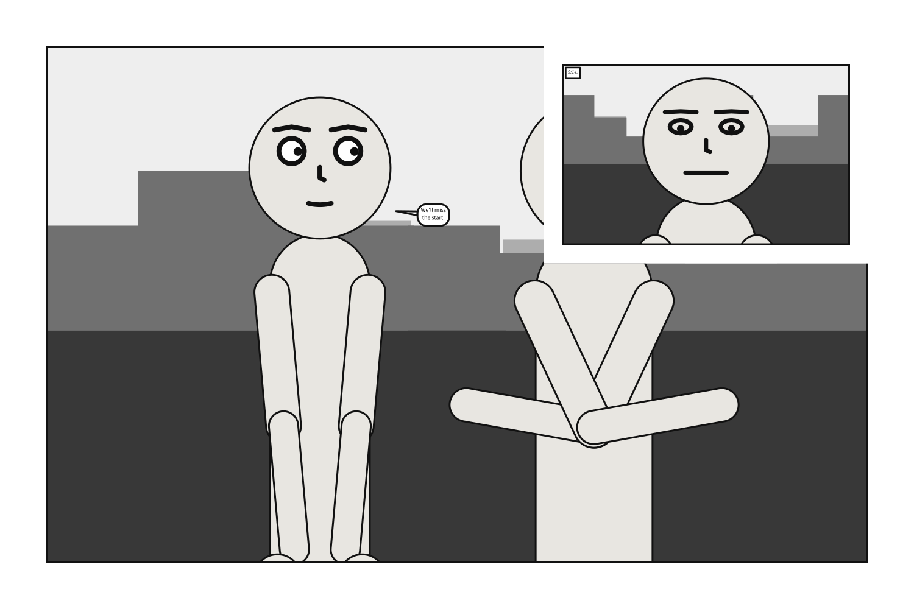

[Open in the playground](https://creatoan.github.io/scenet/playground/#example=60-an-inset-over-a-face.scene.yaml) · [Read about it](reference/diagnostics.md#inset-covers-face)

<details>
<summary>Source</summary>

```yaml
# An inset over a face: a note, not an error.
#
# An inset is drawn over its panel, and the art beneath does not move for it: the street is
# staged and framed as if the clock were not there, and only its lettering keeps clear.
# The clock is set into the top right corner, which is where Bob's face is, so the
# compiler says so: `inset-covers-face`.
#
# To make the note go away, set the inset into another corner -- the top left is clear --
# make it smaller, or frame the street so that nobody's face is in that corner.

page: {size: [1500, 1000], margin: 75, gutter: 30, tier_gutter: 45}
setting: {place: street, time: day}

panels:
  street:
    camera: {shot: medium_shot}
    cast:
      alice: {reference: alice, at: left_third}
      bob:   {reference: bob,   pose: arms_crossed, at: right_third, facing: left}
    staging:
      - alice left_of bob
      - alice looking_at bob
    script:
      - say: {by: alice, text: "We'll miss the start."}

  clock:
    camera: {shot: close_up}
    cast:
      bob: {reference: bob, expression: bored}
    script:
      - caption: {text: "9:14.", kind: locale}

pages:
  - tiers:
      - panels:
          - use: street
            insets:
              - {use: clock, at: top_right, size: 0.35}

# Try this: delete the "# " that starts the last line. A panel is placed on a page once,
# and the clock already is: the error `page-layout`, on that line.
#               - {use: clock, at: bottom_left, size: 0.25}
```

</details>

### A slant through a face

A slanted gutter cuts across Bob's face in a close-up, since the camera does not know the cut is there, and a note says so.

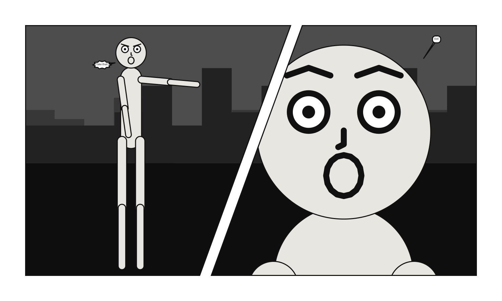

[Open in the playground](https://creatoan.github.io/scenet/playground/#example=61-a-slant-through-a-face.scene.yaml) · [Read about it](reference/diagnostics.md#slant-cuts-face)

<details>
<summary>Source</summary>

```yaml
# A slant through a face: a note, not an error.
#
# A slanted tier leans the gutters between its panels, and each panel is staged and framed
# in its bounding box as usual, then cut to its outline, as a margin would cut it. The
# camera does not know the cut is there. Here the close-up of Bob is cut right across his
# face, so the compiler says so: `slant-cuts-face`.
#
# To make the note go away, lean the tier less, or frame the shot so that the face is
# clear of the cut: a looser shot, or the face further from the slanted side.

page: {size: [1500, 900], margin: 75, gutter: 30, tier_gutter: 45}
setting: {place: street, time: night}

panels:
  swing:
    camera: {shot: full_shot}
    cast:
      alice: {reference: alice, pose: pointing, expression: shouting, facing: right}
    script:
      - say: {by: alice, text: "Take that!", kind: shout}

  hit:
    camera: {shot: close_up}
    cast:
      bob: {reference: bob, expression: surprise, facing: left}
    script:
      - say: {by: bob, text: "Oof."}

pages:
  - tiers:
      - {slant: 20, panels: [swing, hit]}

# Try this: delete the "# " that starts the last line. A slant leans the gutters between
# panels, so a tier of one has none to lean: the error `page-layout`, on that line.
#       - {slant: 10, panels: [swing]}
```

</details>

### A face standing in

Comic Neue Regular named alone stands in for the italic and the bold italic faces, and a note says so for each.

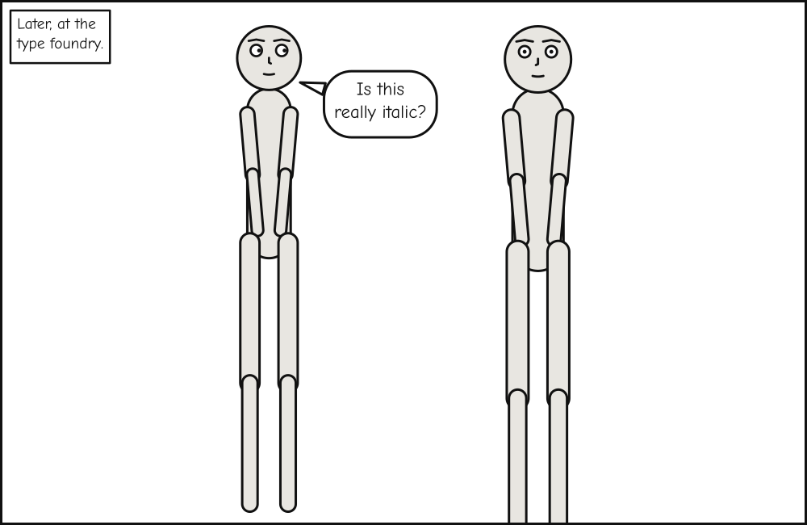

[Open in the playground](https://creatoan.github.io/scenet/playground/#example=62-a-face-standing-in.panel.yaml) · [Read about it](reference/diagnostics.md#italic-stand-in)

<details>
<summary>Source</summary>

```yaml
# A face standing in for one the document did not name: two notes, not errors.
#
# `lettering.font` names Comic Neue Regular, and no other face. Every caption but a
# `spoken` one is set in italic, and a stressed word in bold italic -- so for those the
# regular face stands in: the caption is set upright, and so is the stressed word. The
# compiler says so once for each face, `italic-stand-in` and `bold-italic-stand-in`. It is
# your face that stands in, not the shipped italic: a family mixing your face with
# another would not be one family.
#
# To make the notes go away, name the two faces, which are beside the regular one in
# fonts/: `italic: fonts/ComicNeue-Italic.ttf` and
# `bold_italic: fonts/ComicNeue-BoldItalic.ttf`. Comic Neue is under the SIL Open Font
# License, in fonts/OFL.txt.

panel: {size: [1000, 650]}
camera: {shot: full_shot}

lettering:
  font: {regular: fonts/ComicNeue-Regular.ttf}

cast:
  alice: {reference: alice, at: left_third}
  bob:   {reference: bob,   at: right_third, facing: left}

staging:
  - alice left_of bob
  - alice looking_at bob

script:
  - caption: {text: "Later, at the type foundry.", kind: locale}
  - say: {by: alice, text: "Is this _really_ italic?"}

# Try this: delete the "# " that starts the last line. Only a `spoken` caption is said by
# somebody, so a locale caption naming Bob is the error `caption-speaker`, on that line.
#   - caption: {text: "Meanwhile.", kind: locale, by: bob}
```

</details>
