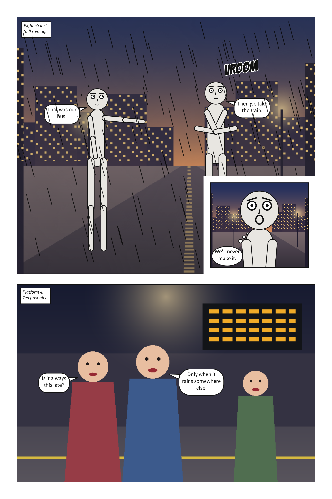
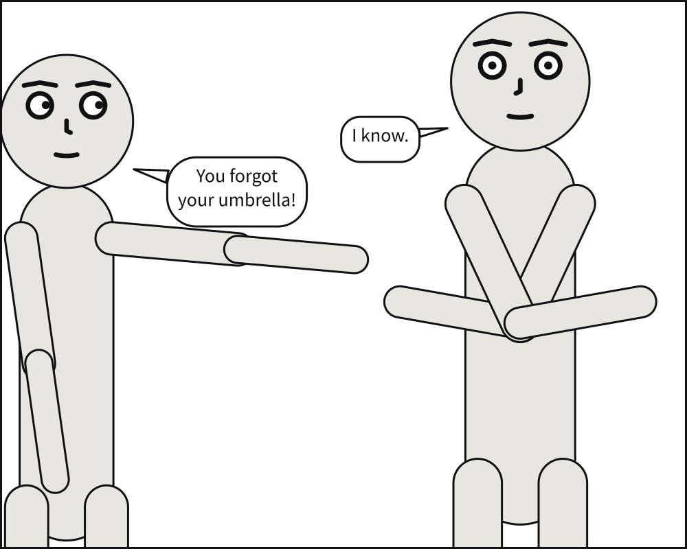

# Scenet

**Write what is in a comic panel. Scenet works out where everything goes, and draws it.**



*The gallery's [tour](gallery.md#a-tour-of-scenet), exactly as `scenet build` draws it from one YAML file.*

Scenet compiles a written description of a comic, whether a panel, a sequence, a page or a
whole comic script, into SVG, and from 0.13 into a PDF for print: it frames each shot, stages
the cast, sizes, places and tails every balloon in reading order, letters over your own art,
reads right to left, writes pictures a screen reader can read, and exports each panel for
image models, all without an image model of its own.

:::{div} scenet-hero-buttons
```{button-link} https://creatoan.github.io/scenet/playground/
:color: primary
:shadow:

Try the playground
```

```{button-ref} gallery
:ref-type: doc
:color: secondary
:outline:

See the gallery
```

```{button-ref} howto/install
:ref-type: doc
:color: secondary
:outline:

Install
```
:::

:::{div} scenet-notice
**This project is deliberately AI-generated.** This project is, by design, almost entirely
generated by AI. It exists as a personal training ground for learning to work with AI coding
tools. The architecture, code, tests and documentation are overwhelmingly AI-authored, under
human direction and review. Treat it accordingly: an experiment first, a usable tool second.
:::

## See it work

You write what is in the panel, and no coordinates:

```yaml
panel:
  size: [1000, 800]

camera:
  shot: medium_shot

cast:
  alice: {reference: alice, pose: pointing,     at: left_third}
  bob:   {reference: bob,   pose: arms_crossed, at: right_third, facing: left}

staging:
  - alice left_of bob
  - alice looking_at bob
  - alice ground_shared_with bob

script:
  - say: {by: alice, text: "You forgot your umbrella!", prefer: top_left}
  - say: {by: bob,   text: "I know."}
```

And this is what it compiles to: not an illustration of the idea, but the file
`scenet build` writes for that document.



The compiler decides how large each figure is for a medium shot, where they stand and which
way they face, how big each balloon must be for its words, where it can sit without covering a
face, and how its tail reaches the speaker's mouth.

```{button-link} https://creatoan.github.io/scenet/playground/#src=XZBBboQwDEX3OYXLmlZ0V3GDHqGqqsiAgWgAI8doSivuXoeMqmmziv39X_yz4kJT7QBi-KIa3p-rqirhpao-nGtxJsFTHFlrmKkL2-xTkcSoScIptGb8FupJaEn3s1XCytGKlcOiYRlKSAcNM1GvXscg3WH-hpvahHu_tdJ09qPM0bfCMVJXnn4Jw3gDlNBja_AMPZyLikOqDfyY98jPcZ-o913miw161H_CILwtnYVEoc5fg47ngIuthFUzOOJuiZv9N6rSpy1WvPEGPcvACjtvAtvcCE0TPhT2G2fAGpRXn5f9S7qFvpFe4bLw9ak43A8
:color: primary
:shadow:

Open this panel in the playground, and change it
```

## Where to start

::::{grid} 1 1 2 3
:gutter: 3

:::{grid-item-card} Discover
:link: gallery
:link-type: doc

Every example in [the gallery](gallery.md), drawn beside its source; the
[playground](https://creatoan.github.io/scenet/playground/), to change one; and
[what Scenet does today](explanation/status.md).
:::

:::{grid-item-card} Write comics
:link: tutorial/index
:link-type: doc

[The author's tour](tutorial/index.md), twelve chapters from a first panel to a printed page;
[the guides](howto/index.md) for each job; and [the language](reference/language/index.md), key
by key.
:::

:::{grid-item-card} Build with Python
:link: tutorial/python/index
:link-type: doc

[Learn Scenet from Python](tutorial/python/index.md), five chapters from `pip install` to a
build in CI; then [the Python API](reference/api/index.md), name by name.
:::

:::{grid-item-card} Drive from a model
:link: howto/drive_from_a_model
:link-type: doc

[The spec pack, the Agent Skill and `scenet mcp`](howto/drive_from_a_model.md): the language
handed to a chat model, an agent or an MCP client, which reads its own errors and fixes them.
:::

:::{grid-item-card} Contribute
:link: maintainer/index
:link-type: doc

[How the project is built and tested](maintainer/index.md), and
[the contributor's guide](https://github.com/creatoan/scenet/blob/main/CONTRIBUTING.md).
:::
::::

## Why it exists

Music has a score, which says what is played and leaves the sound to a performer. Scenet is a
score for comics. [Why Scenet](explanation/why.md) says what that buys, and
[What's new](explanation/whats_new.md) what each release changed.

Scenet is [0BSD](https://github.com/creatoan/scenet/blob/main/LICENSE), and its language is
free to implement.

```{toctree}
:hidden:
:maxdepth: 2

Learn <tutorial/index>
Guides <howto/index>
Language <reference/index>
Python API <reference/api/index>
Gallery <gallery>
Playground <https://creatoan.github.io/scenet/playground/>
About <explanation/index>
```
