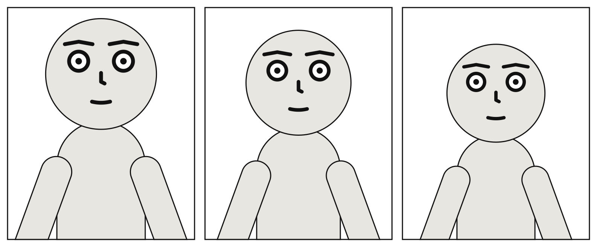
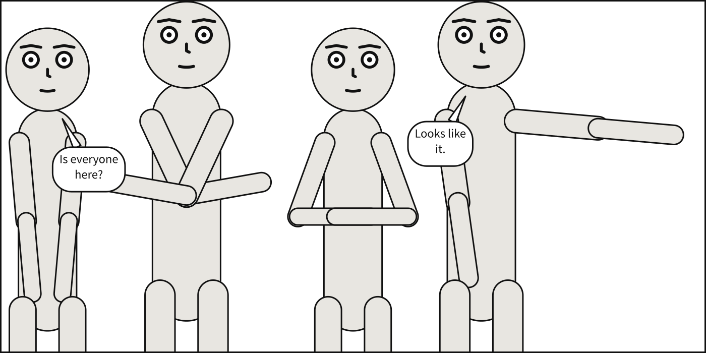

# `camera`

<!-- facts: camera -->
How the cast is framed: the shot, and the camera's height.

| | |
|---|---|
| Where | A `.panel.yaml`; a panel under `panels:`; beside `panels:`, for every panel. In a comic script: `@shot:` and `@angle:` in a panel; `camera:` in the front matter |
| Type | a mapping |
| Default | each key's own |
| Since | 0.1 |
| Diagnostics | `invalid-field`, `unknown-key`, `duplicate-key`, `figure-staging` |
<!-- /facts -->

There is exactly **one camera per panel**, and every {term}`actor` is drawn at the scale it
implies. That is what keeps body differences readable: a short character stays shorter than a
tall one, because both are framed by one shot.



A cast of {term}`figures <figure>` a picture draws has no camera: the picture is already framed,
and a `camera:` beside them is refused as `figure-staging`. A panel that inherits one writes
`camera: null`.

```{scenet-example}
camera: {shot: full_shot, angle: high}
cast: {bob: {reference: bob}}
```

**See also:** [Shot types](../shot_types.md), which is normative; [`cast.<id>.at`](cast.md#castidat).

## `camera.shot`

<!-- facts: camera.shot -->
How tightly the camera frames the cast, named by where the frame cuts the body, from `long_shot` to `extreme_close_up`. The tightest it may go: the camera steps back when the cast does not fit.

| | |
|---|---|
| Where | A `.panel.yaml`; a panel under `panels:`; beside `panels:`, for every panel. In a comic script: `@shot: close_up` in a panel, or a French *échelle des plans* name |
| Type | a name |
| Values | `long_shot`, `wide`, `full_shot`, `medium_full`, `cowboy`, `medium_shot`, `medium_close_up`, `close_up`, `big_close_up`, `extreme_close_up` |
| Default | `medium_shot` |
| Since | 0.1 |
| Diagnostics | `invalid-field` |
| In the gallery | [The camera retreats](../../gallery.md#the-camera-retreats) |
<!-- /facts -->

`shot` decides the **scale** of every actor, by naming where the frame cuts the body rather than
what fraction of the panel a figure fills: `medium_shot` cuts at the waist, `close_up` at the
shoulders. It is the single most consequential value in a panel. What each shot frames, in head
heights, is in [Shot types](../shot_types.md); `wide` is another name for `long_shot`.

**The camera retreats.** The shot is the tightest the camera may go, not a promise. When the
cast does not fit across the panel at that framing, the camera moves back just far enough for
it to: everyone is drawn smaller, by one factor, and more of each body comes into view.
`scenet build` says so in a `camera-retreated` note, and Panel Core records the factor as the
camera's `pullback`. Non-overlap is required and the shot is not, so the shot is what gives way.



```{scenet-example}
camera: {shot: close_up}
cast:
  alice: {reference: alice, at: left_third}
  bob: {reference: bob, at: right_third, facing: left}
```

**See also:** [`camera.angle`](#cameraangle), [When constraints conflict](index.md#when-constraints-conflict).

## `camera.angle`

<!-- facts: camera.angle -->
The camera's height: `low` looks up, leaving little air above the head; `high` looks down, leaving more.

| | |
|---|---|
| Where | A `.panel.yaml`; a panel under `panels:`; beside `panels:`, for every panel. In a comic script: `@angle: low` in a panel |
| Type | a name |
| Values | `low`, `eye_level`, `high` |
| Default | `eye_level` |
| Since | 0.1 |
| Diagnostics | `invalid-field` |
| In the gallery | [Camera angles](../../gallery.md#camera-angles) |
<!-- /facts -->

The angle changes **headroom**, not perspective. Scenet is a flat, orthographic compiler, so a
tilted camera foreshortens nothing; what it changes is how much air sits above the head, which
is the cue a reader takes from an angle and one that survives being drawn flat. A `low` camera
looks up, and the head rides high with little above it; a `high` camera looks down, and more
space opens above. The factors are in [Shot types](../shot_types.md#angle).

```{scenet-example}
camera: {shot: medium_close_up, angle: low}
cast: {bob: {reference: bob}}
```

**See also:** [`camera.shot`](#camerashot).
