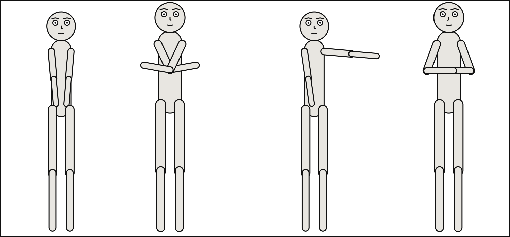
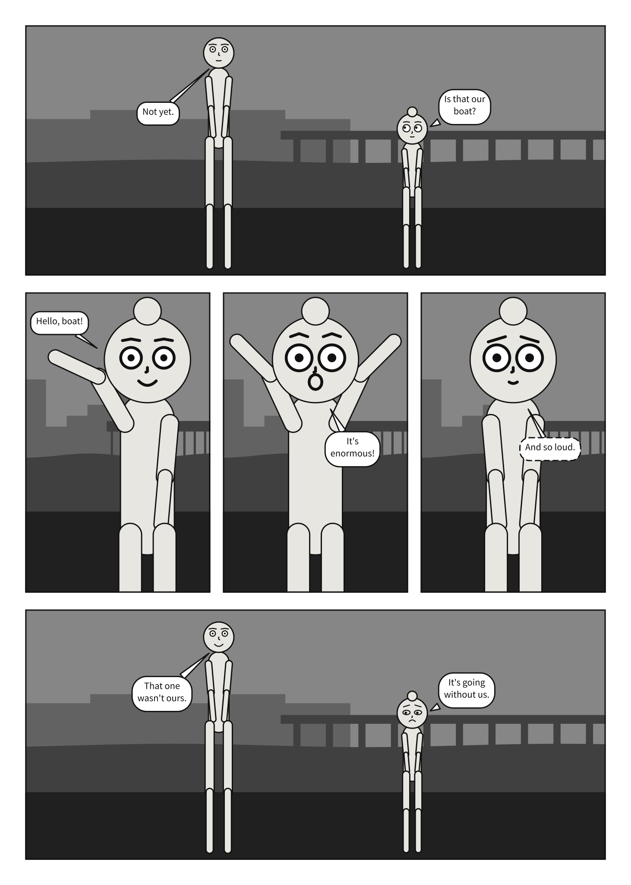
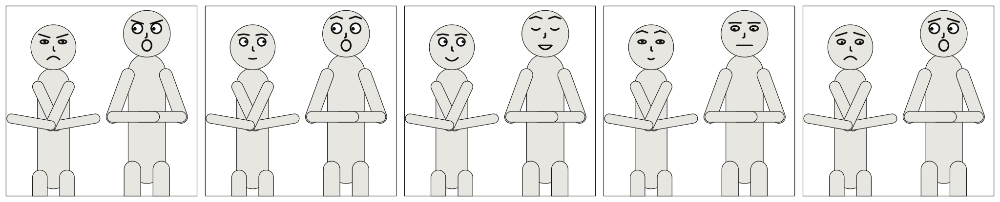
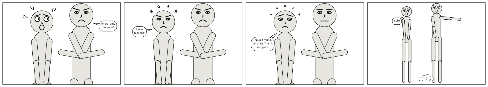
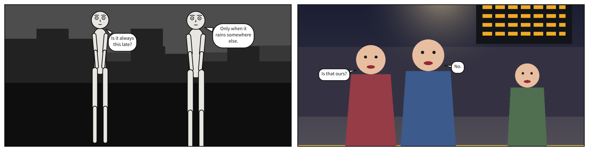

# `cast`

<!-- facts: cast -->
Who is in the panel: each actor id, chosen by the author, and the puppet that plays them or the figure a picture draws. Their order means nothing.

| | |
|---|---|
| Where | A `.panel.yaml`; a panel under `panels:`; beside `panels:`, for every panel. In a comic script: `@cast:` in a panel, or `cast:` in the front matter |
| Type | a mapping |
| Default | none |
| Since | 0.1 |
| Diagnostics | `invalid-field`, `unknown-key`, `duplicate-key`, `conflicting-cast`, `layout` |
<!-- /facts -->

A mapping of actor id to who plays them. The ids are the author's -- `alice`, `guard_left`,
`ALICE` -- and every other block names the cast by them: the {term}`staging`, the script, a sound's source.
Ids are case-sensitive, and their order means nothing: [`staging`](staging.md#staging) and
[`at`](#castidat) decide who stands where.



A {term}`cast member` is one of two things, never both, and a cast is all of one:

- **a {term}`puppet`**, which Scenet poses and draws: `reference:` names it, and `pose`,
  `expression`, `marks`, `at` and `facing` say how it stands;
- **a {term}`figure`** a supplied picture already draws: `figure:` names it, and nothing else
  applies, since the artist framed, posed and staged it.

A cast that mixes the two is `conflicting-cast`: staging and the camera would place a puppet over
a painted face they cannot see. In a scene, `cast: {bob: null}` leaves a member out of a panel
that would inherit them, and every relation that names them goes too; see
[`null`](scene.md#null-leaves-something-out). The split between id and `reference` is what lets one
puppet play two people:

```{scenet-example}
cast:
  guard_left: {reference: bob, pose: arms_crossed, at: left_third}
  guard_right: {reference: bob, at: right_third, facing: left}
```

**See also:** [`staging`](staging.md#staging), [`say.by`](script.md#sayby).

## `cast.<id>.reference`

<!-- facts: cast.<id>.reference -->
The puppet to draw: a shipped puppet's name, or the path of a `.puppet.yaml` file, relative to the document. Written instead of `figure`.

| | |
|---|---|
| Where | A `.panel.yaml`; a panel under `panels:`; beside `panels:`, for every panel. In a comic script: `@cast:` in a panel, or `cast:` in the front matter |
| Type | text |
| Default | none |
| Since | 0.1 |
| Diagnostics | `invalid-field`, `unknown-puppet`, `puppet-file`, `conflicting-cast` |
| In the gallery | [A puppet of your own](../../gallery.md#a-puppet-of-your-own) |
<!-- /facts -->

`alice` and `bob` ship with Scenet. A character of your own is a `*.puppet.yaml` file -- a
skeleton, the parts drawn on it, a face, and the poses and expressions it can take -- and a
member names it by its path. Every key of such a file is on the [puppet files](puppet.md) page.



- **A `reference` that ends in `.puppet.yaml` is a file**; any other names a shipped puppet. A
  path is never a name, so no file shadows `alice` or `bob`.
- **The path is read as a font's is**: relative to the folder the document is in, wherever
  `scenet` was run from, with `/` between folders, never absolute -- so a document and its
  puppets travel together, and `../puppets/` reads a folder of characters several documents
  share. Text compiled with no file behind it names a puppet only when its caller says which
  folder it belongs to, or hands the file over with it.
- **Only what the cast names is read**, once however many members it draws.
- **A puppet of another height shares the ground only when staging says so**, with
  [`ground_shared_with`](staging.md#staging): framed alone, each figure's head is under the top
  of the panel.
- **Panel Core records the reference as written**, for the actor and for the camera composed on
  it. Nothing else of the file reaches the output but the figure drawn.

A name the library lacks is `unknown-puppet`, naming the ones it has. A file that is absolute,
missing or not a puppet is `puppet-file`: in the puppet file, at the key that is wrong, when the
document is checked as a file, and on the line naming it otherwise. In the
[playground](https://creatoan.github.io/scenet/playground/), **Puppet…** adds a file to the
document's `puppets/` folder for as long as the tab is open; over MCP it is sent in `files`.

```{scenet-example}
:beside: examples/gallery
:playground: 69-a-puppet-of-your-own.scene.yaml

cast:
  alice: {reference: alice, at: left_third}
  pip: {reference: puppets/pip.puppet.yaml, pose: waving, at: right_third, facing: left}
staging: [alice ground_shared_with pip]
```

**See also:** [Puppet files](puppet.md), [Add your own character](../../howto/add_your_own_character.md).

## `cast.<id>.pose`

<!-- facts: cast.<id>.pose -->
A pose the puppet declares, by name.

| | |
|---|---|
| Where | A `.panel.yaml`; a panel under `panels:`; beside `panels:`, for every panel. In a comic script: `@cast:` in a panel, or `cast:` in the front matter |
| Type | text |
| Default | `standing_neutral` |
| Since | 0.1 |
| Diagnostics | `invalid-field`, `unknown-pose`, `conflicting-cast` |
| In the gallery | [Poses and facing](../../gallery.md#poses-and-facing) |
<!-- /facts -->

A pose is a named set of joint angles the puppet declares. `alice` and `bob` declare
`standing_neutral`, `arms_crossed`, `pointing` and `hands_on_hips`; a puppet file declares its
own, and `standing_neutral` is required of every puppet, since it is what a member gets unasked.
A name the puppet does not declare is `unknown-pose`, listing the ones it does: a misspelt pose
is a perfectly good string to the grammar, so only the library can tell `pointing` from
`smirking`.

```{scenet-example}
cast:
  alice: {reference: alice, pose: hands_on_hips}
```

**See also:** [`cast.<id>.expression`](#castidexpression), [`poses`](puppet.md#poses).

## `cast.<id>.expression`

<!-- facts: cast.<id>.expression -->
An expression the puppet declares, by name.

| | |
|---|---|
| Where | A `.panel.yaml`; a panel under `panels:`; beside `panels:`, for every panel. In a comic script: `@cast:` in a panel, or `cast:` in the front matter |
| Type | text |
| Default | `neutral` |
| Since | 0.5 |
| Diagnostics | `invalid-field`, `unknown-expression`, `conflicting-cast` |
| In the gallery | [Ten expressions](../../gallery.md#ten-expressions), [A face](../../gallery.md#a-face) |
<!-- /facts -->

`expression` is selected by name exactly as `pose` is, because a face is the same kind of thing as
a body: a small closed set of arrangements a character can be in. The shipped puppets declare ten
-- `neutral`, `happy`, `laughing`, `coy`, `bored`, `scared`, `sad`, `angry`, `shouting`,
`surprise`. They are a **drawing convention**, the small closed set of faces comics actually draw,
and not a claim about what a person feeling anger looks like. A name the puppet does not declare
is `unknown-expression`.



A character's pupils follow whoever they are `looking_at`. Nothing else about the face depends on
the rest of the panel, and nothing about the face changes the layout: to the solver a face is one
disc that balloons may not cover. What a face is made of is in the
[asset contract](../asset_contract.md#faces).

```{scenet-example}
camera: {shot: close_up}
cast: {alice: {reference: alice, expression: laughing}}
```

**See also:** [`expressions`](puppet.md#expressions), [`cast.<id>.marks`](#castidmarks).

## `cast.<id>.marks`

<!-- facts: cast.<id>.marks -->
Emanata drawn around the character -- `plewds`, `squeans`, `grawlixes`, `briffits` -- in any order, each once. They compose with the expression.

| | |
|---|---|
| Where | A `.panel.yaml`; a panel under `panels:`; beside `panels:`, for every panel. In a comic script: `@cast:` in a panel, or `cast:` in the front matter |
| Type | a list of names |
| Values | `plewds`, `squeans`, `grawlixes`, `briffits` |
| Default | none |
| Since | 0.8 |
| Diagnostics | `invalid-field`, `conflicting-cast` |
| In the gallery | [Emanata](../../gallery.md#emanata) |
<!-- /facts -->

{term}`Emanata` are what a comic draws *around* a character rather than on them. The vocabulary is
Mort Walker's, from *The Lexicon of Comicana*, and it is closed:



| Mark | What is drawn | What it says |
|---|---|---|
| `plewds` | Droplets flying off the head, mostly off the back | sweating: effort, heat, nerves |
| `squeans` | Little starbursts and circles in an arc over the head | dizzy, drunk, or sick |
| `grawlixes` | A spiral, a star, a bolt and a `#` over the head | swearing |
| `briffits` | Puffs of dust at the feet, behind the figure | gone, fast |

They are a **list**, not a second `expression:`, because they compose: a character can be angry
*and* sweating. Order does not matter, and a mark listed twice is an error. They need nothing from
the puppet -- every mark is placed from the face circle, the facing and the feet -- so every
character can have every mark. In a scene, `marks: []` under `over:` clears the ones a panel
inherited, because lists replace rather than merge.

Emanata are drawn **outside** the head, in the space balloons are placed in, so unlike a face they
matter to the layout -- but only softly:

- **They never move anybody.** Staging, the camera and every figure are exactly where they would
  be without them.
- **A balloon prefers not to cover them.** Each mark has a zone the solver reads as a cost,
  weighted above covering a body. A crowded panel still compiles: a balloon covers a mark before
  it fails.
- **The camera makes no room for them.** It frames by body landmarks, so a tight shot can crop
  marks over the head, and a shot that cuts at the waist leaves briffits below the frame.
  `scenet build` reports any mark that runs off the panel.

At a wide framing a plewd is a dot: below a head size, each mark collapses to a dot where it
would have been drawn, and a character too small to have a face has no marks at all. An oath
written in a balloon -- `"@#$%!"` -- is dialogue, and already works; `grawlixes` is the other
convention, the symbols over a head.

```{scenet-example}
camera: {shot: medium_close_up}
cast: {alice: {reference: alice, expression: angry, marks: [grawlixes, plewds]}}
```

**See also:** [Emanata in the asset contract](../asset_contract.md#emanata).

## `cast.<id>.at`

<!-- facts: cast.<id>.at -->
Where along the panel's width the figure would like to stand. A preference: non-overlap and `left_of` override it.

| | |
|---|---|
| Where | A `.panel.yaml`; a panel under `panels:`; beside `panels:`, for every panel. In a comic script: `@cast:` in a panel, or `cast:` in the front matter |
| Type | a name |
| Values | `left_edge`, `left_third`, `center`, `right_third`, `right_edge` |
| Default | `center` |
| Since | 0.1 |
| Diagnostics | `invalid-field`, `conflicting-cast` |
<!-- /facts -->

Where along the panel's width the figure would like to stand, horizontally only: figures stand on
the ground, and their height comes from the camera. It is a **weak preference, not a command**.
Non-overlap and declared ordering are required and override it without complaint: two actors both
asked to stand at `center` are pushed apart around it. Where staging gives no order, `at` decides
it, and two at the same anchor stand in the order of their actor ids; see
[Why ordering must be explicit](staging.md#why-ordering-must-be-explicit).

```{scenet-example}
cast:
  alice: {reference: alice, at: left_edge}
  bob: {reference: bob, at: right_third, facing: left}
```

**See also:** [`staging`](staging.md#staging), [When constraints conflict](index.md#when-constraints-conflict).

## `cast.<id>.facing`

<!-- facts: cast.<id>.facing -->
Which way the figure is turned, `left` or `right`, gaze and all.

| | |
|---|---|
| Where | A `.panel.yaml`; a panel under `panels:`; beside `panels:`, for every panel. In a comic script: `@cast:` in a panel, or `cast:` in the front matter |
| Type | a name |
| Values | `left`, `right` |
| Default | `right` |
| Since | 0.1 |
| Diagnostics | `invalid-field`, `conflicting-cast` |
<!-- /facts -->

Facing mirrors the whole puppet, its gaze included. It defaults to `right`, so a cast written
left to right faces into the panel from the left; give the one on the right `facing: left`. A
`looking_at` relation turns its subject toward the object whatever `facing` says.

```{scenet-example}
cast:
  alice: {reference: alice, at: left_third}
  bob: {reference: bob, at: right_third, facing: left}
```

**See also:** [`staging[].predicate`](staging.md#stagingpredicate).

## `cast.<id>.figure`

<!-- facts: cast.<id>.figure -->
A figure the panel's picture draws, by the name its artwork contract gives it. Written instead of `reference`, and with none of the keys that pose or place a puppet.

| | |
|---|---|
| Where | A `.panel.yaml`; a panel under `panels:`; beside `panels:`, for every panel. In a comic script: `@cast:` in a panel, or `cast:` in the front matter |
| Type | text |
| Default | none |
| Since | 0.12 |
| Diagnostics | `invalid-field`, `unknown-figure`, `conflicting-cast`, `artwork-contract` |
| In the gallery | [From puppets to figures](../../gallery.md#from-puppets-to-figures) |
<!-- /facts -->

A picture can draw its own people. Cast them with `figure:` in place of `reference:`, and Scenet
letters them as it letters puppets -- balloons in reading order, never over a face, tails to the
mouth -- while drawing nothing of them: the picture already has.



Where each face, mouth and body is, the panel does not say -- it never writes a coordinate. The
picture's [artwork contract](artwork.md) does: a file beside the picture, named after it,
`art/p01-street.art.yaml`, measured once in the picture's own pixels and committed with it.
`figure:` names a figure it declares. The contract is read only for a panel whose cast names a
figure, and its geometry goes through the picture's `fit`, so a face is excluded exactly where the
picture draws it, under `cover` and `contain` alike.

**Everybody the contract declares is in the picture.** A face nobody cast is as forbidden to
lettering as a speaker's, and a body as costly to cover. The other way round, a cast figure the
panel's picture does not draw is simply not in that panel -- as a member written `(OP)` is not --
so a script's front matter or a scene's defaults can cast every figure of a chapter, and each panel
holds those its own picture draws. A line spoken by one it does not draw is `unknown-figure`,
listing who the picture does draw; so is a figure in a panel with no picture.

**What does not apply.** The artist already framed, posed and staged everybody in the picture:

- **No camera.** `camera:` on a panel whose cast is all figures is `figure-staging`; a panel that
  inherits one writes `camera: null`. A generated description says no shot.
- **No staging.** A relation naming a figure is `figure-staging`.
- **No posing.** `pose`, `expression`, `marks`, `at` and `facing` are a puppet's, and refused
  beside `figure`, as is `reference` (`conflicting-cast`). A member inherited as a puppet becomes a
  figure with `reference: null` beside its `figure`.
- **No gaze.** A contract declares none, so nothing keeps a balloon out of a figure's line of sight.

```{scenet-example}
:beside: examples/gallery
:playground: 35-figures.scene.yaml

panel: {size: [900, 600]}
setting: {image: art/figures.png}
cast:
  ana: {figure: ana}
  ben: {figure: ben}
script:
  - say: {by: ana, text: "Is it always this late?"}
  - say: {by: ben, text: "Only when it rains somewhere else."}
```

**See also:** [Artwork contracts](artwork.md), [`setting.image`](setting.md#settingimage),
[Letter the figures in your art](../../howto/letter_the_figures_in_your_art.md).
