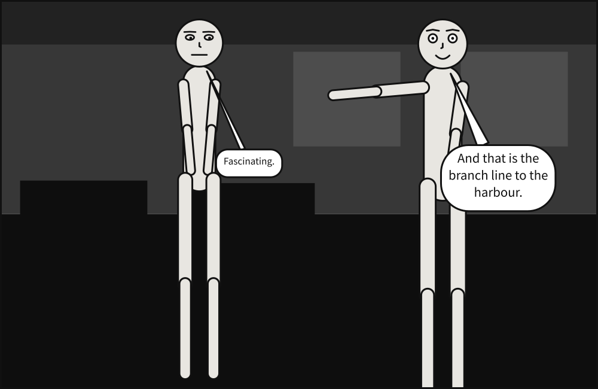

# `description`

What the panel shows, in words, for a reader who cannot see it.



**In the gallery:** [A description](../../gallery.md#a-description).

```yaml
cast:
  alice: {reference: alice, at: left_third}
  bob:   {reference: bob,   at: right_third, facing: left}
description: Alice and Bob face each other on a rainy street corner. She is exasperated.
```

| Key | Type | Meaning |
|---|---|---|
| `description` | text | One paragraph of prose. Runs of whitespace, line breaks included, are read as one space |

**It is carried, never interpreted.** Nothing is drawn from it — the rain comes from `setting`, the
exasperation from `expression` — exactly as a comic script's prose is never read by the compiler.
What it is for is accessible output: it is the first thing a screen reader says about the panel,
before what is said in it.

In a [comic script](../../howto/write_a_comic_script.md#prose-is-never-interpreted) a panel's prose is
its description, unless an `@description:` directive says something else. Left out, accessible
output says what the panel holds — the shot, the setting, and who is where, doing what.

**It describes one panel**, so it is never inherited:

- written beside `panels:`, where every panel would inherit it, it is refused as `unknown-key`;
- a panel drawn `over:` another does not take its parent's. It is a different picture, and the
  parent's words would be wrong to exactly the reader who cannot see that they are.

An empty one is refused, since it would describe the panel with nothing; leave it out instead. Like
dialogue, it may not hold a character an SVG cannot hold.
