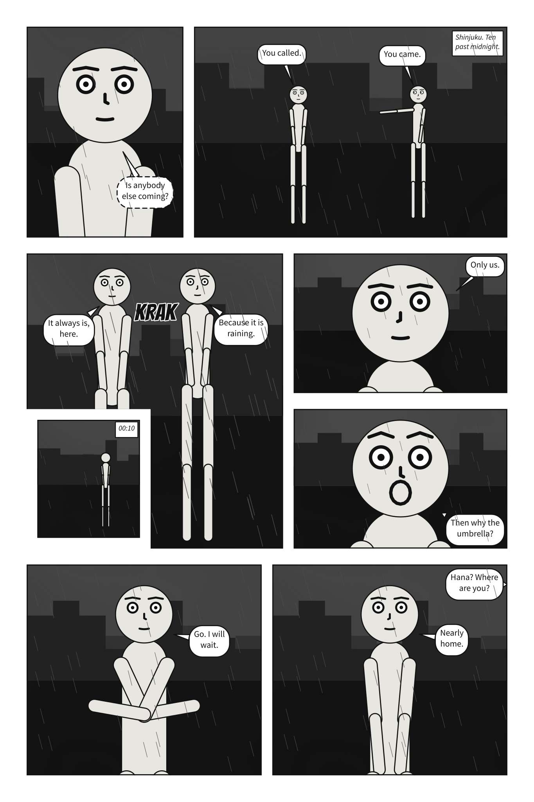

# `direction`

<!-- facts: direction -->
Which way the comic is read: `ltr` from the top left, `rtl` from the top right, as manga are -- panels, pages and the balloons in a panel. Its progression, not its text: the words in a balloon still read left to right. Written once for the whole document; the scene is never mirrored.

| | |
|---|---|
| Where | A `.panel.yaml`; beside `panels:`, for every panel. In a comic script: the front matter only |
| Type | a name |
| Values | `ltr`, `rtl` |
| Default | `ltr` |
| Since | 0.12 |
| Diagnostics | `invalid-field`, `panel-direction` |
| In the gallery | [Right to left](../../gallery.md#right-to-left), [The same page, left to right](../../gallery.md#the-same-page-left-to-right) |
<!-- /facts -->

Which way the comic is read: `ltr`, from the top left, as Western comics are, or `rtl`, from the
top right, as manga are. It is the comic's **progression**, not the direction of its text: a manga
translated into English still reads right to left, while the words in each balloon read left to
right. Vertical Japanese lettering is not part of it.



The words are EPUB's, whose `page-progression-direction` says the same thing about a book. Like
EPUB's, it is said **once, for the whole document**: at the top of a single panel, beside
`panels:` in a scene, where every panel inherits it, or in a comic script's front matter. A panel
may not have one of its own — a page read one way holding a panel read the other has no order a
reader could follow — so a panel under `panels:` that writes `direction`, even the document's
own, and a script's `@direction:` are reported as `panel-direction`.

Only what reading decides follows it. **The scene is never mirrored**: figures, gaze, staging, the
camera, tails and sound effects stay exactly as staged, and every word that names a place on the
panel means the same place either way — `at:`, `left_of`, `facing:`, `prefer:`, a side for
`off_panel`, an inset's corner. Panel Core and Page Core record `direction` when it is `rtl`.

What follows it, in a panel:

- **[Reading order](script.md#script)**: a box may never sit above and
  *right* of one before it.
- **Where an unplaced box would rather start**: a caption with no `prefer`, and a voice from
  [off panel](script.md#sayoff_panel) with no side named, go top right — where reading starts.
- **Every tiebreak reading decides.** When two places cost exactly the same, the one tried first
  wins, and right to left they are tried in the mirrored order. So the mirror image of a panel,
  read right to left, is lettered as the exact mirror of the original read left to right.
- **The description** names the cast in reading order, from the right; "left" and "right" still
  say where each one stands.

And on a [page](page.md#page-and-pages): each tier's panels from the right, the pages of a document side
by side from the right, and a strip from the right — each still written in reading order, the
order a screen reader follows.

```{scenet-example}
direction: rtl
cast:
  hana: {reference: alice, at: right_third, facing: left}
  ken: {reference: bob, at: left_third}
script:
  - say: {by: hana, text: You came.}
  - say: {by: ken, text: You called.}
```

**See also:** [A manga, right to left](../../howto/write_a_comic_script.md#a-manga-right-to-left),
the {term}`reading order` of a [script](script.md#script).
