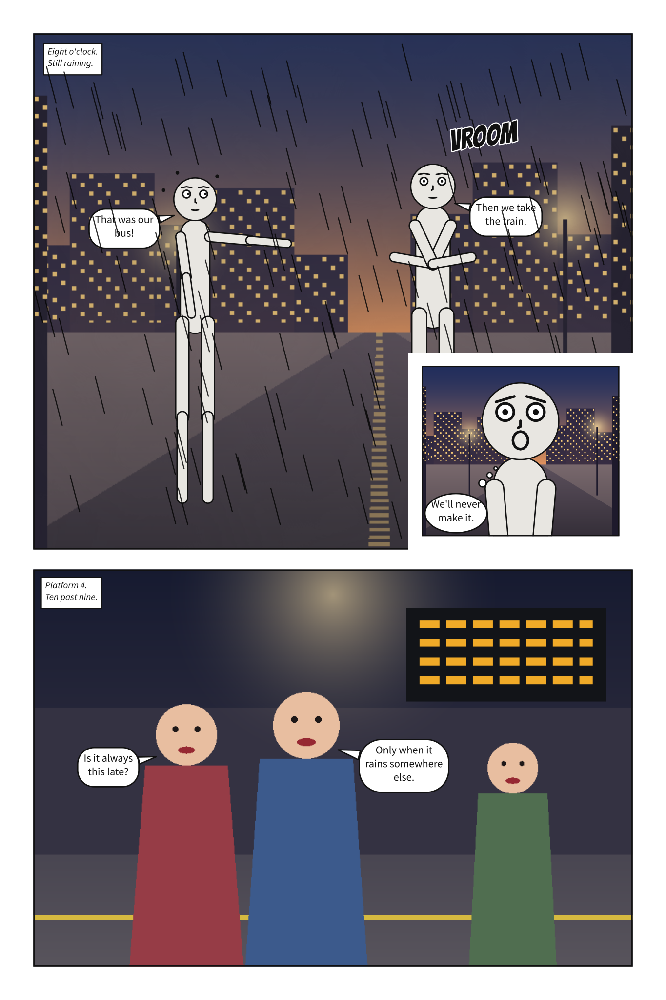
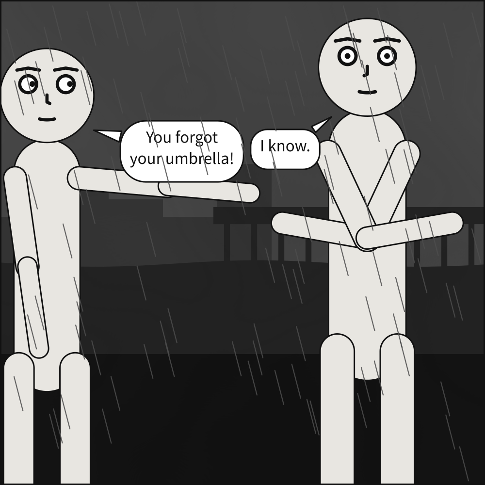

# The Scenet language

> **Status:** this is the specification. It is not a report of what is implemented — see
> [implementation status](../../explanation/status.md#implementation-status), which is authoritative on
> what actually runs. Panels, sequences and pages of tiers compile end to end today; the style
> layer does not exist yet.

A panel source is a YAML document describing **what is in a panel**, never **where things are drawn**.
Coordinates do not appear anywhere in the language; producing them is the compiler's entire job.

It is read strictly. An unknown key is an error rather than ignored, and so is a key written twice
in one mapping, such as two cast members called `alice`. YAML requires keys to be unique, but the
usual Python parser keeps the last and drops the first without a word, which would quietly lose a
character or a panel. A merge key's override (`<<: *base`, then the key again) is not a repeat.

## The layers

A panel is written in blocks, each saying one kind of thing about it. What the compiler
makes of them — every coordinate, then the picture — is computed and emitted, never written.



**In the gallery:** [A tour of Scenet](../../gallery.md#a-tour-of-scenet).

| Block | What it says |
|---|---|
| [`panel`](panel.md#panel) | The size and margin of the panel |
| [`camera`](camera.md#camera) | How the cast is framed |
| [`setting`](setting.md#setting) | Where and when it happens |
| [`cast`](cast.md#cast), [`staging`](staging.md#staging) | Who is present, and how they stand to each other |
| [`script`](script.md#script) | What is said and heard, in the order it is read |
| [`lettering`](lettering.md#lettering) | The type size, and the font files |
| [`palette`](palette.md#palette) | Whether the panel is drawn in grey or in colour |
| [`direction`](direction.md#direction) | Which way the comic is read: the whole document's, never one panel's |
| [`description`](description.md#description) | What the panel shows, in words, for a reader who cannot see it. Nothing is drawn from it |

A [scene document](scene.md) holds several panels under `panels:`, and lays them out with
[`page` and `pages`](page.md#page-and-pages). Two more kinds of file sit beside a document and are
named by it: a [puppet file](puppet.md), a character of your own, and an
[artwork contract](artwork.md), which says where the people in a supplied picture are.

Every key has a card on its block's page: where it is written, its type, its values and default,
the release it appeared in, the findings it can give, what it means and how it resolves against
everything else, and a document that shows it, compiled. [All keys, A to Z](keys.md) lists them in
one table, and the [glossary](../glossary.md) says what the words the cards use mean.

Blocks are separable on purpose. Changing `camera.shot` re-frames the same scene without touching
anything else, exactly as transposing a score changes its key without rewriting the melody.

## A complete example

```yaml
panel:
  size: [1000, 1000]

camera:
  shot: medium_shot
  angle: eye_level

setting:
  place: docks
  time: night
  weather: rain

cast:
  alice: {reference: alice, pose: pointing,     at: left_third,  facing: right}
  bob:   {reference: bob,   pose: arms_crossed, at: right_third, facing: left}

staging:
  - alice left_of bob
  - alice looking_at bob
  - alice ground_shared_with bob

script:
  - say: {by: alice, text: "You forgot your umbrella!", prefer: top_left}
  - say: {by: bob,   text: "I know."}
```



**In the gallery:** [A complete panel](../../gallery.md#a-complete-panel).

## When constraints conflict

Placement values are preferences of differing strength, and the solver resolves conflicts by
priority rather than by failing:

| Strength | Examples |
|---|---|
| **Required** | Actors never overlap; declared `left_of` / `right_of` ordering holds; balloons never cover a face; reading order holds |
| **Strong** | Actors stay inside the panel, but may bleed past its edge when the cast does not fit, which is ordinary comics practice |
| **Weak** | `at:` anchors, `prefer:` balloon hints |

The shot is a bound, not a constraint: when the cast does not fit across the panel at the framing
asked for, [the camera retreats](camera.md#camerashot) until it does, and says so.

So two actors both asked to stand at `center` will be pushed apart rather than overlapping: the
required non-overlap wins and the weak anchors yield. This is why `at` is documented as a
preference. If you need a guarantee, express it as a relation in `staging`.

## Determinism

The same source always compiles to byte-identical output. No wall-clock time, no unseeded
randomness, no dependence on mapping iteration order. This is what makes a panel description a
durable artifact rather than a prompt: it will render the same in five years as it does today.

It is the same on every platform too. Every text file Scenet writes, and every document it
prints for redirecting into one, is UTF-8 with LF line endings, on Windows as on Linux. The print
PDF is bytes, not text, and is byte-identical in the same way: no date, nothing compressed, an
`/ID` taken from its content.

Backdrop silhouettes are generated, so they are seeded — from the declared setting and the panel
size, through a content hash. Never a clock, and never Python's `hash()`, which is salted per
process and would agree with itself all day while disagreeing with tomorrow's build.

### The contract is on the SVG text, not on pixels

Worth stating explicitly, because it is exactly the kind of assumption that rots silently.

> **The determinism contract is on the emitted SVG text, which stays byte-identical. It has never
> been on pixels.**

The `feTurbulence` filter that draws fog and cloud is reproducible *by definition* — SVG has Perlin
noise built in, the specification includes reference code, and the `seed` is fixed by the compiler
— so the emitted document is identical every time. In practice browsers agree only
[approximately](https://tympanus.net/codrops/2019/02/19/svg-filter-effects-creating-texture-with-feturbulence/)
on what to paint from it. That is fine, and it was already true of every glyph outline and every
antialiased edge in the file.

Print has no such filter, so it computes the same noise from that reference code and carries it
in the PDF as an image; the PDF's bytes are a contract like the SVG's text, and what a
viewer paints from them is not.

Golden-file tests therefore target Panel Core, SVG **text** and the print PDF's bytes, never a
raster. The print plates Ghostscript renders from the PDF are checked for which ink lands where,
and never kept as goldens. If a raster check is
ever wanted, [resvg](https://github.com/linebender/resvg) is the candidate: it supports
`feTurbulence`, aims at the whole specification rather than the common cases, and ships around 1600
SVG-to-PNG regression tests — which matters because the W3C SVG test suite was abandoned long ago,
making resvg's the practical conformance reference.

```{toctree}
:hidden:

panel
camera
setting
cast
staging
script
description
lettering
direction
palette
scene
page
puppet
artwork
keys
```
