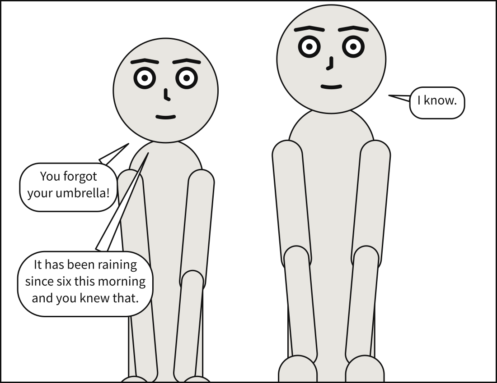
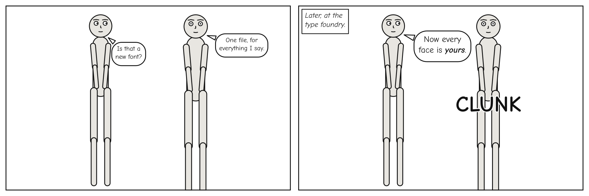

# `lettering`

How the lettering is set: its size, and the face it is set in.



**In the gallery:** [How lines break](../../gallery.md#how-lines-break) and [Type size](../../gallery.md#type-size).

```{code-block} yaml
:caption: Part of a panel beside fonts/

lettering:
  size: 30
  font: {regular: fonts/Comic-Regular.ttf, italic: fonts/Comic-Italic.ttf}
```

| Key | Type | Meaning |
|---|---|---|
| `size` | number above 0 | The dialogue type size, in panel units. Captions keep their proportion to it, 30 parts in 35 |
| `font` | path, or `regular`, `italic`, `bold_italic`, `display` | The font files to letter in, relative to the document |

Left out, dialogue is lettered at 3.5% of the height the panel letters against and captions at
3% — the panel's own height alone, one tier of a three-tier page on a page. That is a good default
and a bad only choice: a page of tight panels wants smaller type, a children's comic larger, and
neither is something the compiler should guess.

`size` is in the same units as `panel.size`, which on a page are the page's, since a panel there is
compiled at its frame's size. Set beside `panels:`, it is a default every panel inherits, which is
how a whole page letters at one size you chose. Set on one panel, it letters that panel alone. In a
comic script, put it in the front matter for every panel, or in an `@lettering:` directive for one.

The type is measured at exactly this size, so it decides how big every balloon is. A size too large
for the panel leaves a balloon nowhere to go, which `scenet check --deep` reports as
`balloon-placement`.

## `font`

Scenet letters in Source Sans Pro unless you name a face of your own. A font is always a **file you
name**, never a font installed on the machine: what is measured has to be the same everywhere, or the
same document would letter differently on two computers.



**In the gallery:** [Your own font](../../gallery.md#your-own-font).

```{code-block} yaml
:caption: Part of a panel beside fonts/

lettering: {font: fonts/Comic-Regular.ttf}           # one file for every face
```

Or a file for each face:

```{code-block} yaml
:caption: Part of a panel beside fonts/

lettering:
  font:
    regular: fonts/Comic-Regular.ttf                 # dialogue, and spoken captions
    italic: fonts/Comic-Italic.ttf                   # every other caption kind
    bold_italic: fonts/Comic-BoldItalic.ttf          # emphasis
    display: fonts/Shout.ttf                         # sound effects
```

- **Paths are relative to the document**, the way a link in a web page is: `fonts/x.ttf` is the
  `fonts` folder beside the file, wherever `scenet` was run from, and `../fonts/x.ttf` climbs out of
  it. An absolute path is refused, so a document and its fonts move together, and a server compiling
  documents it is sent cannot be pointed at its own files. Folders are separated by `/`, never `\`,
  which only Windows reads as a separator: a backslash is refused, so a document finds its files
  on every system or on none. Text compiled with no file behind it — by
  the MCP server, say — has no folder, so it can name a font only when its caller says which
  folder it belongs to, or sends the file with it.
- **A face you do not name stands in from one you do.** Italic captions are set in `regular`;
  emphasis in `italic`, or in `regular` when there is no italic. A family from one file stays one
  family, rather than mixing your face with the shipped one. When a stand-in is actually used, the
  compiler says so.
- **TrueType or OpenType**, with a Unicode character map, since every line is measured against it
  — kerning included. A path that is absolute, missing, or not such a font is reported as
  `font-file`, at the face that names it.

Panel Core records each face by its family, style and a digest of its bytes, never by where the file
was; see [Panel Core](../panel_core.md). Rendering needs the same files, and refuses a panel whose
fonts it was not given rather than draw its lettering in a face it was not measured in. `scenet
build` and the playground hand them over for you. `--live-text` names your font's family.

The faces letterers use are mostly commercial, or free only on their own terms. You can name one;
Scenet can only ship a face whose licence allows it, which is why Source Sans Pro, under the SIL
Open Font License, is the default. In the [playground](https://creatoan.github.io/scenet/playground/),
**Font…** adds a file to the document's `fonts/` folder for as long as the tab is open.

## Capitals are yours to set

Comics are conventionally lettered in capitals, and Scenet sets exactly what you type. It does not
uppercase for you, because doing it well is not a case conversion: the personal pronoun "I" takes a
crossbar that every other capital I does not, and choosing between the two needs a font with both
forms and the contextual substitution that picks one, which only a full text shaper performs.
Scenet applies no glyph substitution at all, so a face that picks its crossbar "I" contextually will
not pick it here either. Write in capitals if you want them.
