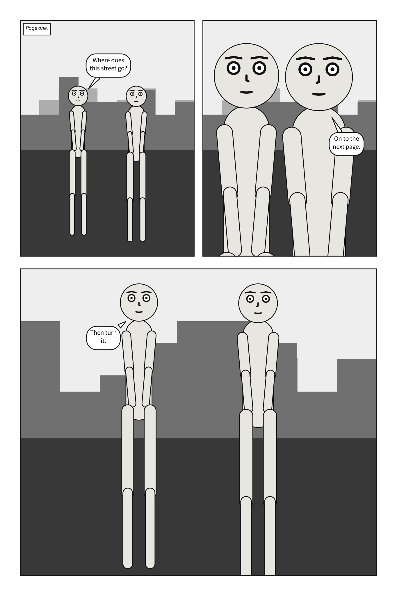
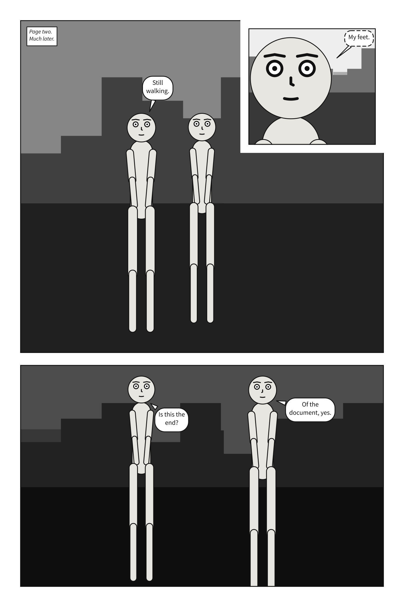
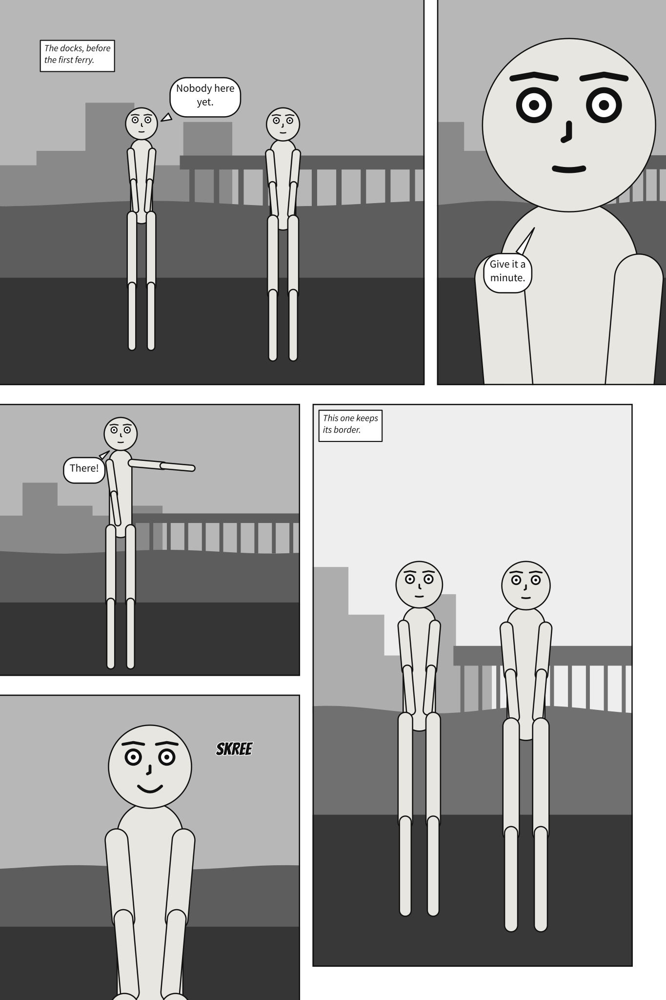

# `page` and `pages`

A scene can lay its panels out on pages. `pages:` is a list of pages; each page is a list of
**tiers**, top to bottom; each tier is a list of panels, in reading order — left to right, or right
to left for a comic read that way. `page:` is the
format they share.




**In the gallery:** [Two pages](../../gallery.md#two-pages), [A page made for print](../../gallery.md#a-page-made-for-print) and [Panels that bleed](../../gallery.md#panels-that-bleed).

A comic script's pages are its `PAGE` headings instead; its front matter takes `page:` but
not `pages:`. See [Write a panel as a comic script](../../howto/write_a_comic_script.md#pages).

A panel's name, its key under `panels:`, is text, as a cast member's id is. YAML reads an
unquoted `1:` as a number, so a panel named by its number is written `'1':`.

```{code-block} yaml
:caption: Part of a scene document

page: {size: [1500, 2250], margin: 75, gutter: 30, tier_gutter: 45}
pages:
  - tiers:
      - panels: [{use: establishing, width: 2}, reply]
      - {height: 1.2, panels: [closer]}
      - panels: [her, him]
panels:
  establishing: {...}
  reply: {...}
```

| Key | Means | Default |
|---|---|---|
| `page.size` | Width and height, in the units a panel uses: the trim, the size the printed page is cut to | `[2000, 3000]` |
| `page.margin` | The blank border inside the page edge | `100` |
| `page.gutter` | The gap between two panels side by side in a tier | `40` |
| `page.tier_gutter` | The gap between two tiers; wider than `gutter`, as in print | `60` |
| `page.bleed` | How far the printed sheet runs past the trim on every side, so art reaching the edge can be cut cleanly | `0` |
| `tiers[].height` | The tier's share of the page's height, relative to the other tiers | `1` |
| `panels[].use` | The name of a panel under `panels:`; writing the name alone means `{use: name}` | |
| `panels[].width` | The panel's share of its tier's width, relative to its neighbours | `1` |
| `tiers[].columns` | In place of `panels`: columns side by side, each a stack of panels | |
| `tiers[].slant` | How far the gutters between its panels lean, in degrees, -30 to 30; positive leans the top right | `0` |
| `columns[].width` | The column's share of its tier's width | `1` |
| `columns[].panels[].height` | The panel's share of its column's height | `1` |
| `insets[].use` | On any panel in a tier or column: a panel set into one of its corners | |
| `insets[].at` | `top_left`, `top_right`, `bottom_left` or `bottom_right` | |
| `insets[].size` | Its width and height, as a fraction of its parent's; above 0, at most 0.5 | |
| `insets[].read` | `after` its parent, or `before` it | `after` |
| `panels[].bleed`, `columns[].panels[].bleed` | Run the frame past the trim to the bleed line, with no border there: `true` on every side that reaches the page's margin, or a list of sides, such as `[top, left]` | `false` |

Shares work like CSS Grid's `fr` tracks: what the margin and gutters leave is divided in
proportion to the weights. A splash page is one tier holding one panel.

**Printed, a unit is a tenth of a millimetre.** The default page prints at 200 × 300 mm; a US
comic's 6.625 × 10.25 inches is `size: [1682.75, 2603.5]`, and a tankōbon's B6 is
`size: [1280, 1820]`. `bleed` is in the same units: `30` is 3 mm, `31.75` is the 0.125 in US
printers ask for. It is paper around the page and moves nothing on it: the PDF's TrimBox is the
page, its BleedBox the page grown by `bleed` on every side. The SVG page is drawn at its trim, as
before.

**A panel can bleed**: its frame runs past the trim, out to the bleed line, and has no
border on that side, so its art goes to the edge of the cut page.



```{code-block} yaml
:caption: Part of a scene document

page: {size: [1600, 2400], margin: 80, bleed: 30}
pages:
  - tiers:
      - panels: [{use: wide, width: 2, bleed: [top, left]}, {use: look, bleed: true}]
      - columns:
          - panels: [{use: dock, bleed: [left]}, {use: gull, bleed: true}]
          - {panels: [far]}
```

`bleed: true` bleeds every side of the frame that reaches the page's margin; a list bleeds those
sides only, and a listed side that does not reach the margin is a `page-layout` error. The sides
are the page's, `top`, `bottom`, `left` and `right`, whichever way it is read: the page is never
mirrored. An inset sits inside its parent, so it cannot bleed.

A bleeding panel is three boxes. Its **frame** runs to the bleed line: that is its size in its
Core, and what its art, picture, veil and weather cover. What the reader sees stops at the trim,
so its cast is staged and its camera framed in **the frame out to the trim**, and the trim never
cuts a shot. Its lettering keeps inside **the frame as it was** before bleeding, inside the panel
margin, so the page margin stays the safe area for words. Its insets stay where they were. The SVG
page is drawn at its trim, as it will look once cut; its debug view shows the whole sheet, the trim
and each bleeding panel's lettering box.

A page needs a `bleed` of its own for its panels to bleed into; with `bleed: 0`, they stop at the
trim, and print says so.

A tier holds `panels` or `columns`, never both. **Columns** are how a tall panel beside a stack
of short ones is written: the tier is split across into columns, and each column down into its
panels, with `tier_gutter` between them.

```{code-block} yaml
:caption: Part of a scene's tiers

- height: 2
  columns:
    - {width: 2, panels: [above, {use: below, height: 2}]}
    - {width: 1, panels: [falling]}   # spans the tier's whole height
```

A tier of columns is read column by column and top to bottom in each: `above`, `below`, then
`falling`. That is the order readers take when a panel spanning the tier blocks the way across
(about nine in ten of them, in Cohn's 2013 experiments). Two stacks side by side have nothing
between them blocking the way, and readers go across those instead, so they are refused as
`page-layout`; write them as tiers, or put a panel that spans the tier between them.

An **inset** is a small panel set into a corner of another and drawn over it:

```{code-block} yaml
:caption: Part of a scene's tiers

- panels:
    - use: street
      insets:
        - {use: clock, at: top_left, size: 0.2, read: before}
        - {use: face, at: bottom_right, size: 0.3}
```

It sits a gutter in from both edges of its corner, ringed by a gutter's width of white. Readers
split about evenly over whether an inset comes before the panel it sits in or after it (Cohn,
2013), so it is never guessed: an inset is read right after its parent unless it says
`read: before`. Here that is `clock`, `street`, `face` — and that is the order the page's SVG writes
them in, which is the order a screen reader follows. The parent is cut around each inset's ring
rather than painted under it, so an inset read first is still on top.

The parent's art is drawn exactly as if the inset were not there; only its lettering moves, since
words under an inset could not be read. When an inset covers a character's face, the compiler
notes it. Two insets in one panel must stay a gutter clear of each other, and an inset, a gutter
in from its corner, must fit inside its panel.

A tier of panels can **slant**, for a beat that should not sit square:

```{code-block} yaml
:caption: Part of a scene's tiers

- {slant: 12, panels: [wind_up, {use: swing, width: 1.3}]}
```

Every gutter in the tier leans by that many degrees about its centre at the tier's mid-height, so
the weights share the width out exactly as they would upright, and neighbours share one cut. A
gutter stays a gutter wide measured across the cut, as paneling tools keep it, and the tier's outer
edges stay upright. Each frame is then a four-sided shape, convex by construction.

A slanted panel is staged and framed in its bounding box, as a rectangle would be, and cropped to
its outline the way a margin crops; its lettering stays inside the outline. When the cut runs
through a character's face, the compiler notes it. A slant needs gutters to lean, so a tier of
columns, a tier of one panel, and a slanted panel with insets are refused, as is a slant so steep
that a panel would have no width left at its top or bottom.

**A panel on a page is compiled at its frame's size**, exactly as it would be compiled alone at that
size: the page decides how big the frame is and nothing about what goes in it. The one other thing
it decides is **type size**. Alone, a panel letters at a fixed fraction of its own height; on a page
every panel letters at the same size, as if each were one tier of a three-tier page, because no
letterer sets a short panel and a tall one at different sizes. A size you set with
[`lettering`](lettering.md#lettering) takes its place.

A page is read tier by tier, left to right, and down each column, so the order panels are written
in is the order they are read in; that holds by construction. A panel can be on one page once. A panel
on no page is allowed, and compiles as it always did; it may exist only to be inherited from with
`over:`. A placement naming a panel `panels:` does not define, a panel placed twice, a tier with
both `panels` and `columns` or neither, two stacks side by side, two insets that overlap, an inset
too big for its panel, a slant that cannot apply or is too steep, a bleed on a side that does not
reach the page's margin, or margins and gutters that leave no room are reported as `page-layout`.

**Read right to left.** With [`direction: rtl`](direction.md#direction), the same page is read from the top
right. Panels are still written in reading order, so the first panel of a tier is at its right and
the last at its left; the first column of a tier of columns is at the right, and each column is
still read top to bottom — a stack beside a tall panel is read down before across, on the right.
Each frame is exactly the one a left-to-right page gives that panel with the tier written the other
way round, so every panel keeps its size, and its art is the art it has read left to right. What
names a place on the page keeps naming it: an inset's `at:` is a corner of its parent, and a
positive `slant` leans the top of each gutter right, as written, and a `bleed` names the page's
own sides, so `bleed: [left]` on a tier's first panel, which right to left is at the right, is
refused. Any other layout one direction refuses, the other refuses too.

Not yet: frames of any other shape, such as round panels or ones without borders.
