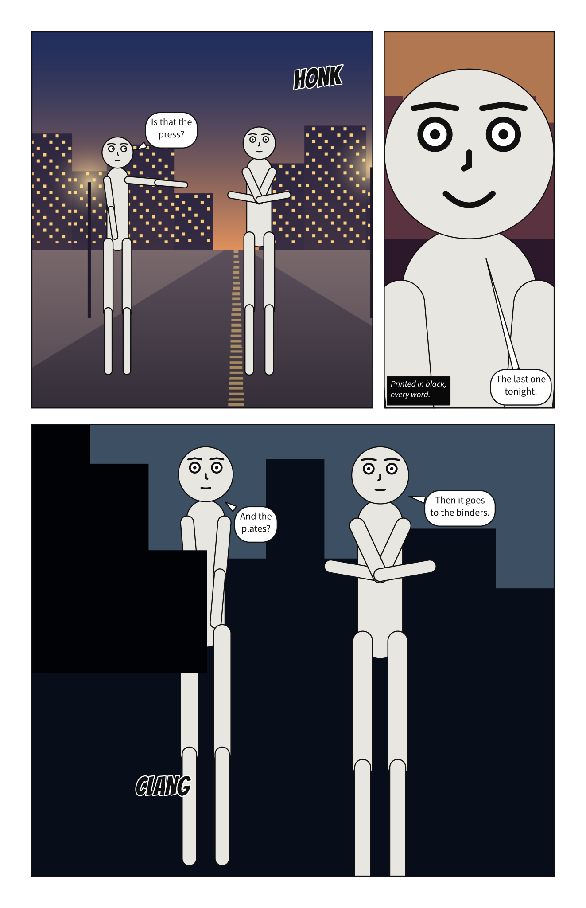
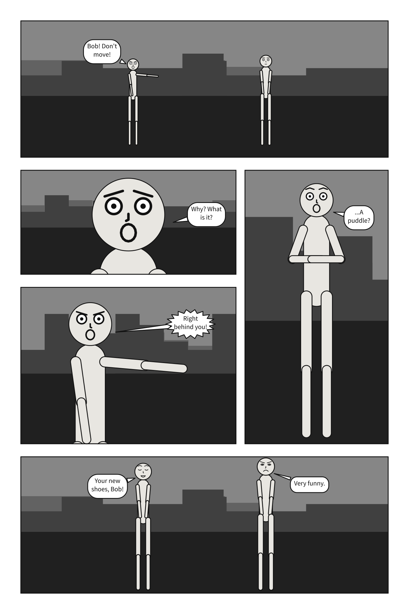
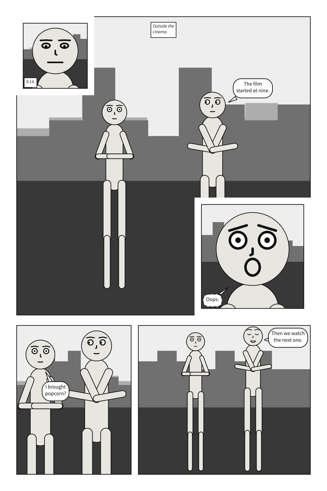

# `page` and `pages`

A scene can lay its panels out on pages. `pages:` is a list of pages; each page is a list of
{term}`tiers <tier>`, top to bottom; each tier is a list of panels, in reading order -- left to
right, or right to left for a comic read that way. `page:` is the format they share.


A comic script's pages are its `PAGE` headings instead; its front matter takes `page:` but not
`pages:`. See [Write a panel as a comic script](../../howto/write_a_comic_script.md#pages).

Shares work like CSS Grid's `fr` tracks: what the margin and {term}`gutters <gutter>` leave is
divided in proportion to the weights. A splash page is one tier holding one panel.

**A panel on a page is compiled at its frame's size**, exactly as it would be compiled alone at
that size: the page decides how big the frame is and nothing about what goes in it. The one other
thing it decides is **type size**. Alone, a panel letters at a fixed fraction of its own height; on
a page every panel letters at the same size, as if each were one tier of a three-tier page, because
no letterer sets a short panel and a tall one at different sizes. A size you set with
[`lettering`](lettering.md#lettering) takes its place.

A page is read tier by tier, left to right, and down each column, so the order panels are written
in is the order they are read in; that holds by construction. A panel can be on one page once. A
panel on no page is allowed, and compiles as it always did; it may exist only to be inherited from
with `over:`. Everything a page cannot lay out is `page-layout`, naming what and where.

Not yet: frames of any other shape, such as round panels or ones without borders.

## `page`

<!-- facts: page -->
The format every page shares: its size, margin, gutters and bleed.

| | |
|---|---|
| Where | A `.scene.yaml`. In a comic script: `page:` in the front matter |
| Type | a mapping |
| Default | each key's own |
| Since | 0.10 |
| Diagnostics | `invalid-field`, `unknown-key`, `duplicate-key`, `page-layout` |
<!-- /facts -->

The format is the document's: written once beside `panels:`, it is every page's. It is not a
panel's default, so a panel under `panels:` does not write it.

```{scenet-example}
page: {size: [1000, 700], margin: 50}
cast: {alice: {reference: alice}}
panels: {one: {}, two: {}}
pages:
  - tiers:
      - panels: [one, two]
```

**See also:** [`pages`](#pages), [Compose a page](../../howto/compose_a_page.md).

## `page.size`

<!-- facts: page.size -->
The page's width and height: the trim, the size the printed page is cut to, in the units a panel uses. Printed, a unit is a tenth of a millimetre.

| | |
|---|---|
| Where | A `.scene.yaml`. Not in a comic script |
| Type | `[number, number]` |
| Default | `[2000, 3000]` |
| Since | 0.10 |
| Diagnostics | `invalid-field`, `page-layout` |
| In the gallery | [A page made for print](../../gallery.md#a-page-made-for-print) |
<!-- /facts -->

**Printed, a unit is a tenth of a millimetre.** The default page prints at 200 × 300 mm; a US
comic's 6.625 × 10.25 inches is `size: [1682.75, 2603.5]`, and a tankōbon's B6 is
`size: [1280, 1820]`. It is the trim: the size the printed page is cut to. The SVG page is drawn at
its trim.



```{scenet-example}
page: {size: [1280, 1820]}
cast: {alice: {reference: alice}}
panels: {splash: {}}
pages:
  - tiers:
      - panels: [splash]
```

**See also:** [`page.bleed`](#pagebleed), [Print a comic](../../howto/print_a_comic.md).

## `page.margin`

<!-- facts: page.margin -->
The blank border inside the page's edge, on all four sides.

| | |
|---|---|
| Where | A `.scene.yaml`. Not in a comic script |
| Type | a number |
| Values | 0 or more |
| Default | `100` |
| Since | 0.10 |
| Diagnostics | `invalid-field`, `page-layout` |
<!-- /facts -->

The blank border inside the page's edge. Panels are laid out inside it, and it is the safe area
for words: a panel that [bleeds](#panelsbleed) keeps its lettering inside it.

```{scenet-example}
page: {size: [1000, 700], margin: 120}
cast: {alice: {reference: alice}}
panels: {one: {}}
pages:
  - tiers:
      - panels: [one]
```

**See also:** [`panel.margin`](panel.md#panelmargin), a panel's own.

## `page.gutter`

<!-- facts: page.gutter -->
The gap between two panels, or two columns, side by side in a tier.

| | |
|---|---|
| Where | A `.scene.yaml`. Not in a comic script |
| Type | a number |
| Values | 0 or more |
| Default | `40` |
| Since | 0.10 |
| Diagnostics | `invalid-field`, `page-layout` |
<!-- /facts -->

The gap between two panels side by side, or between two columns. An {term}`inset` sits a gutter in
from its corner, ringed by a gutter's width of white, and a slanted gutter stays a gutter wide
measured across the cut.

```{scenet-example}
page: {size: [1000, 700], gutter: 80}
cast: {alice: {reference: alice}}
panels: {one: {}, two: {}}
pages:
  - tiers:
      - panels: [one, two]
```

**See also:** [`page.tier_gutter`](#pagetier_gutter).

## `page.tier_gutter`

<!-- facts: page.tier_gutter -->
The gap between two tiers, and between two panels stacked in a column. Wider than `gutter`, as in print, so a tier reads as one row.

| | |
|---|---|
| Where | A `.scene.yaml`. Not in a comic script |
| Type | a number |
| Values | 0 or more |
| Default | `60` |
| Since | 0.10 |
| Diagnostics | `invalid-field`, `page-layout` |
<!-- /facts -->

The gap between two tiers, and between two panels stacked in a column. Wider than `gutter` by
default, as it usually is in print: a narrower gap within a tier binds its panels into one row,
which is the direction they are read in.

```{scenet-example}
page: {size: [800, 1000], tier_gutter: 100}
cast: {alice: {reference: alice}}
panels: {top: {}, bottom: {}}
pages:
  - tiers:
      - panels: [top]
      - panels: [bottom]
```

**See also:** [`page.gutter`](#pagegutter).

## `page.bleed`

<!-- facts: page.bleed -->
How far the printed sheet runs past the trim on every side, so art that reaches the edge can be cut cleanly: 30 is 3 mm. Paper around the page; nothing on it moves.

| | |
|---|---|
| Where | A `.scene.yaml`. Not in a comic script |
| Type | a number |
| Values | 0 or more |
| Default | `0` |
| Since | 0.13 |
| Diagnostics | `invalid-field` |
<!-- /facts -->

`bleed` is in the units of the page: `30` is 3 mm, `31.75` is the 0.125 in US printers ask for. It
is paper around the page and moves nothing on it: the PDF's TrimBox is the page, its BleedBox the
page grown by `bleed` on every side. A page needs a bleed of its own for its panels to
[bleed](#panelsbleed) into; with `bleed: 0`, they stop at the trim, and print says so.

```{scenet-example}
page: {size: [1000, 700], margin: 60, bleed: 30}
cast: {alice: {reference: alice}}
panels: {wide: {}}
pages:
  - tiers:
      - panels: [{use: wide, bleed: true}]
```

**See also:** [`panels[].bleed`](#panelsbleed), [Print a comic](../../howto/print_a_comic.md).

## `pages`

<!-- facts: pages -->
The pages, in order, each a list of tiers top to bottom.

| | |
|---|---|
| Where | A `.scene.yaml`. In a comic script: the script's `PAGE` headings, and `@tiers: 2 1 2` under each |
| Type | a list of mappings |
| Default | none |
| Since | 0.10 |
| Diagnostics | `invalid-field`, `page-layout` |
| In the gallery | [Two pages](../../gallery.md#two-pages) |
<!-- /facts -->

The pages, in order. A document of several pages is drawn as a spread, side by side -- from the
right in a comic read right to left -- and each page is a page of the print PDF.

A panel's name, its key under `panels:`, is text, as a cast member's id is. YAML reads an unquoted
`1:` as a number, so a panel named by its number is written `'1':`. A placement naming a panel
`panels:` does not define, or a panel placed twice, is `page-layout`.

```{scenet-example}
page: {size: [800, 600]}
cast: {alice: {reference: alice}}
panels: {first: {}, second: {}}
pages:
  - tiers:
      - panels: [first]
  - tiers:
      - panels: [second]
```

**See also:** [`panels`](scene.md#panels), [Compose a page](../../howto/compose_a_page.md).

## `pages[].tiers`

<!-- facts: pages[].tiers -->
The page's tiers, top to bottom.

| | |
|---|---|
| Where | A `.scene.yaml`. In a comic script: `@tiers: 2 1 2` under a `PAGE` heading |
| Type | a list of mappings |
| Default | none |
| Since | 0.10 |
| Diagnostics | `invalid-field`, `page-layout` |
| In the gallery | [A page in tiers](../../gallery.md#a-page-in-tiers) |
<!-- /facts -->

The tiers of one page, top to bottom; a page has at least one. Margins and tier gutters that leave
no height for the tiers are `page-layout`.

```{scenet-example}
cast: {alice: {reference: alice}}
panels: {a: {}, b: {}, c: {}}
pages:
  - tiers:
      - panels: [a, b]
      - panels: [c]
```

**See also:** [`tiers[].height`](#tiersheight).

## `tiers[].height`

<!-- facts: tiers[].height -->
The tier's share of the page's height, relative to the other tiers.

| | |
|---|---|
| Where | A `.scene.yaml`. Not in a comic script |
| Type | a number |
| Values | above 0 |
| Default | `1` |
| Since | 0.10 |
| Diagnostics | `invalid-field` |
<!-- /facts -->

A tier's share of the page's height: two tiers of `height: 2` and `1` take two thirds and one
third of what the margins and tier gutters leave.

```{scenet-example}
cast: {alice: {reference: alice}}
panels: {tall: {}, short: {}}
pages:
  - tiers:
      - {height: 2, panels: [tall]}
      - panels: [short]
```

**See also:** [`panels[].width`](#panelswidth).

## `tiers[].panels`

<!-- facts: tiers[].panels -->
The panels in the tier, in reading order: left to right, or right to left for a comic read that way.

| | |
|---|---|
| Where | A `.scene.yaml`. In a comic script: `@tiers:`, which counts each tier's panels from the top |
| Type | a list, each text or a mapping |
| Default | none |
| Since | 0.10 |
| Diagnostics | `invalid-field`, `page-layout` |
<!-- /facts -->

The panels of a tier, in reading order: left to right, or right to left for a comic read that way.
Each is a panel's name, or a mapping that names it with `use` and gives it a share, insets or a
bleed. A tier holds `panels` or `columns`, never both and never neither.

```{scenet-example}
cast: {alice: {reference: alice}}
panels: {one: {}, two: {}}
pages:
  - tiers:
      - panels: [one, {use: two, width: 2}]
```

**See also:** [`tiers[].columns`](#tierscolumns).

## `tiers[].columns`

<!-- facts: tiers[].columns -->
In place of `panels`: columns side by side, each a stack of panels read top to bottom before the next.

| | |
|---|---|
| Where | A `.scene.yaml`. Not in a comic script |
| Type | a list of mappings |
| Default | none |
| Since | 0.10 |
| Diagnostics | `invalid-field`, `page-layout` |
| In the gallery | [Columns](../../gallery.md#columns) |
<!-- /facts -->

**Columns** are how a tall panel beside a stack of short ones is written: the tier is split across
into columns, and each column down into its panels, with `tier_gutter` between them. A tier of
columns is read column by column and top to bottom in each. That is the order readers take when a
panel spanning the tier blocks the way across (about nine in ten of them, in Cohn's 2013
experiments). Two stacks side by side have nothing between them blocking the way, and readers go
across those instead, so they are refused as `page-layout`; write them as tiers, or put a panel
that spans the tier between them.



```{scenet-example}
cast: {alice: {reference: alice}}
panels: {above: {}, below: {}, falling: {}}
pages:
  - tiers:
      - columns:
          - {panels: [above, below]}
          - {panels: [falling]}
```

**See also:** [`columns[].width`](#columnswidth), [A tall panel beside a stack](../../howto/compose_a_page.md#a-tall-panel-beside-a-stack).

## `tiers[].slant`

<!-- facts: tiers[].slant -->
How far the gutters between the tier's panels lean, in degrees, from -30 to 30. Positive leans the top of each gutter to the right.

| | |
|---|---|
| Where | A `.scene.yaml`. Not in a comic script |
| Type | a number |
| Values | -30 to 30 |
| Default | `0` |
| Since | 0.10 |
| Diagnostics | `invalid-field`, `page-layout` |
| In the gallery | [Slanted tiers](../../gallery.md#slanted-tiers) |
<!-- /facts -->

A tier of panels can {term}`slant`, for a beat that should not sit square. Every gutter in the tier
leans by that many degrees about its centre at the tier's mid-height, so the weights share the
width out exactly as they would upright, and neighbours share one cut. A gutter stays a gutter wide
measured across the cut, and the tier's outer edges stay upright. Each frame is then a four-sided
shape, convex by construction.

A slanted panel is staged and framed in its bounding box, as a rectangle would be, and cropped to
its outline the way a margin crops; its lettering stays inside the outline. When the cut runs
through a character's face, the compiler notes it. A slant needs gutters to lean, so a tier of
columns, a tier of one panel, and a slanted panel with insets are `page-layout`, as is a slant so
steep that a panel would have no width left at its top or bottom.

```{scenet-example}
cast: {alice: {reference: alice}}
panels: {wind_up: {}, swing: {}}
pages:
  - tiers:
      - {slant: 12, panels: [wind_up, {use: swing, width: 1.3}]}
```

**See also:** [A slanted tier](../../howto/compose_a_page.md#a-slanted-tier).

## `panels[].use`

<!-- facts: panels[].use -->
The name of a panel under `panels:`. Writing the name alone means `{use: name}`.

| | |
|---|---|
| Where | A `.scene.yaml`. Not in a comic script |
| Type | text |
| Default | none |
| Since | 0.10 |
| Diagnostics | `invalid-field`, `page-layout` |
<!-- /facts -->

The panel a placement puts on the page, by its name under `panels:`. Writing the name alone, `one`,
means `{use: one}`; the mapping is for a share, insets or a bleed. In a column, the same key names
a panel stacked in it.

```{scenet-example}
cast: {alice: {reference: alice}}
panels: {one: {}}
pages:
  - tiers:
      - panels: [{use: one}]
```

**See also:** [`panels`](scene.md#panels).

## `panels[].width`

<!-- facts: panels[].width -->
The panel's share of its tier's width, relative to its neighbours.

| | |
|---|---|
| Where | A `.scene.yaml`. Not in a comic script |
| Type | a number |
| Values | above 0 |
| Default | `1` |
| Since | 0.10 |
| Diagnostics | `invalid-field` |
<!-- /facts -->

A panel's share of its tier's width, relative to its neighbours: `width: 2` beside a panel of the
default `1` takes two thirds of what the gutters leave.

```{scenet-example}
cast: {alice: {reference: alice}}
panels: {establishing: {}, reply: {}}
pages:
  - tiers:
      - panels: [{use: establishing, width: 2}, reply]
```

**See also:** [`tiers[].height`](#tiersheight).

## `panels[].bleed`

<!-- facts: panels[].bleed -->
Run the frame past the trim to the bleed line, with no border there: `true` on every side that reaches the page's margin, or a list of those sides.

| | |
|---|---|
| Where | A `.scene.yaml`. Not in a comic script |
| Type | `true` or `false`, or a list of names |
| Values | `left`, `right`, `top`, `bottom` |
| Default | `false` |
| Since | 0.13 |
| Diagnostics | `invalid-field`, `page-layout` |
| In the gallery | [Panels that bleed](../../gallery.md#panels-that-bleed) |
<!-- /facts -->

**A panel can bleed**: its frame runs past the trim, out to the bleed line, and has no border on
that side, so its art goes to the edge of the cut page. `bleed: true` bleeds every side of the
frame that reaches the page's margin; a list bleeds those sides only, and a listed side that does
not reach the margin is a `page-layout` error. The sides are the page's, `top`, `bottom`, `left`
and `right`, whichever way it is read: the page is never mirrored. An inset sits inside its parent,
so it cannot bleed.


A bleeding panel is three boxes. Its **frame** runs to the bleed line: that is its size in its
Core, and what its art, picture, veil and weather cover. What the reader sees stops at the trim, so
its cast is staged and its camera framed in **the frame out to the trim**, and the trim never cuts
a shot. Its lettering keeps inside **the frame as it was** before bleeding, inside the panel margin,
so the page margin stays the safe area for words. Its insets stay where they were. The SVG page is
drawn at its trim, as it will look once cut; its debug view shows the whole sheet, the trim and
each bleeding panel's lettering box.

```{scenet-example}
page: {size: [1600, 2400], margin: 80, bleed: 30}
cast: {alice: {reference: alice}}
panels: {wide: {}, look: {}, far: {}}
pages:
  - tiers:
      - panels: [{use: wide, width: 2, bleed: [top, left]}, {use: look, bleed: true}]
      - panels: [far]
```

**See also:** [`page.bleed`](#pagebleed), the {term}`bleed` itself.

## `panels[].insets`

<!-- facts: panels[].insets -->
Panels set into its corners, and drawn over it.

| | |
|---|---|
| Where | A `.scene.yaml`. Not in a comic script |
| Type | a list of mappings |
| Default | none |
| Since | 0.10 |
| Diagnostics | `invalid-field`, `page-layout` |
| In the gallery | [Insets](../../gallery.md#insets) |
<!-- /facts -->

An **inset** is a small panel set into a corner of another and drawn over it. It sits a gutter in
from both edges of its corner, ringed by a gutter's width of white. The parent is cut around each
inset's ring rather than painted under it, so an inset read first is still on top. The parent's art
is drawn exactly as if the inset were not there; only its lettering moves, since words under an
inset could not be read. When an inset covers a character's face, the compiler notes it.



Two insets in one panel must stay a gutter clear of each other, and an inset, a gutter in from its
corner, must fit inside its panel; either is `page-layout` otherwise.

```{scenet-example}
cast: {alice: {reference: alice}}
panels: {street: {}, clock: {}}
pages:
  - tiers:
      - panels:
          - use: street
            insets:
              - {use: clock, at: top_left, size: 0.3}
```

**See also:** [`insets[].read`](#insetsread).

## `columns[].width`

<!-- facts: columns[].width -->
The column's share of its tier's width, relative to the other columns.

| | |
|---|---|
| Where | A `.scene.yaml`. Not in a comic script |
| Type | a number |
| Values | above 0 |
| Default | `1` |
| Since | 0.10 |
| Diagnostics | `invalid-field` |
<!-- /facts -->

A column's share of its tier's width, relative to the other columns, as a panel's `width` is in a
tier of panels.

```{scenet-example}
cast: {alice: {reference: alice}}
panels: {above: {}, below: {}, falling: {}}
pages:
  - tiers:
      - columns:
          - {width: 2, panels: [above, below]}
          - {width: 1, panels: [falling]}
```

**See also:** [`tiers[].columns`](#tierscolumns).

## `columns[].panels`

<!-- facts: columns[].panels -->
The panels in the column, read top to bottom.

| | |
|---|---|
| Where | A `.scene.yaml`. Not in a comic script |
| Type | a list, each text or a mapping |
| Default | none |
| Since | 0.10 |
| Diagnostics | `invalid-field` |
<!-- /facts -->

The panels of a column, read top to bottom, each a name or a mapping, as a tier's panels are; a
column holds at least one.

```{scenet-example}
cast: {alice: {reference: alice}}
panels: {above: {}, below: {}, falling: {}}
pages:
  - tiers:
      - columns:
          - {panels: [above, {use: below}]}
          - {panels: [falling]}
```

**See also:** [`columns[].panels[].height`](#columnspanelsheight).

## `columns[].panels[].height`

<!-- facts: columns[].panels[].height -->
The panel's share of its column's height, relative to the others in it.

| | |
|---|---|
| Where | A `.scene.yaml`. Not in a comic script |
| Type | a number |
| Values | above 0 |
| Default | `1` |
| Since | 0.10 |
| Diagnostics | `invalid-field` |
<!-- /facts -->

A panel's share of its column's height, relative to the others in it.

```{scenet-example}
cast: {alice: {reference: alice}}
panels: {above: {}, below: {}, falling: {}}
pages:
  - tiers:
      - columns:
          - {panels: [above, {use: below, height: 2}]}
          - {panels: [falling]}
```

**See also:** [`tiers[].height`](#tiersheight).

## `insets[].use`

<!-- facts: insets[].use -->
The name of a panel under `panels:`, set into this one.

| | |
|---|---|
| Where | A `.scene.yaml`. Not in a comic script |
| Type | text |
| Default | none |
| Since | 0.10 |
| Diagnostics | `invalid-field`, `page-layout` |
<!-- /facts -->

The panel set into the corner, by its name under `panels:`. Like any panel on a page, it is placed
once.

```{scenet-example}
cast: {alice: {reference: alice}}
panels: {street: {}, face: {}}
pages:
  - tiers:
      - panels: [{use: street, insets: [{use: face, at: bottom_right, size: 0.3}]}]
```

**See also:** [`panels[].insets`](#panelsinsets).

## `insets[].at`

<!-- facts: insets[].at -->
The corner of its parent the inset sits in, a gutter in from both edges.

| | |
|---|---|
| Where | A `.scene.yaml`. Not in a comic script |
| Type | a name |
| Values | `top_left`, `top_right`, `bottom_left`, `bottom_right` |
| Default | none |
| Since | 0.10 |
| Diagnostics | `invalid-field` |
<!-- /facts -->

The corner of its parent. The corner is the parent's whichever way the page is read: an inset's
`at` is never mirrored.

```{scenet-example}
cast: {alice: {reference: alice}}
panels: {street: {}, clock: {}}
pages:
  - tiers:
      - panels: [{use: street, insets: [{use: clock, at: top_right, size: 0.25}]}]
```

**See also:** [`insets[].size`](#insetssize).

## `insets[].size`

<!-- facts: insets[].size -->
The inset's width and height, as a fraction of its parent's: above 0, at most 0.5.

| | |
|---|---|
| Where | A `.scene.yaml`. Not in a comic script |
| Type | a number |
| Values | above 0, at most 0.5 |
| Default | none |
| Since | 0.10 |
| Diagnostics | `invalid-field`, `page-layout` |
<!-- /facts -->

The inset's width and height, as one fraction of its parent's: `0.25` is a quarter as wide and a
quarter as tall. More than half would leave the parent covered rather than inset.

```{scenet-example}
cast: {alice: {reference: alice}}
panels: {street: {}, clock: {}}
pages:
  - tiers:
      - panels: [{use: street, insets: [{use: clock, at: top_left, size: 0.45}]}]
```

**See also:** [`insets[].at`](#insetsat).

## `insets[].read`

<!-- facts: insets[].read -->
When the inset is read: `after` its parent, or `before` it.

| | |
|---|---|
| Where | A `.scene.yaml`. Not in a comic script |
| Type | a name |
| Values | `before`, `after` |
| Default | `after` |
| Since | 0.10 |
| Diagnostics | `invalid-field` |
<!-- /facts -->

Readers split about evenly over whether an inset comes before the panel it sits in or after it
(Cohn, 2013), so it is never guessed: an inset is read right after its parent unless it says
`read: before`. That is the order the page's SVG writes them in, which is the order a screen reader
follows.

```{scenet-example}
cast: {alice: {reference: alice}}
panels: {street: {}, clock: {}}
pages:
  - tiers:
      - panels: [{use: street, insets: [{use: clock, at: top_left, size: 0.25, read: before}]}]
```

**See also:** the {term}`reading order` of a page, [`pages`](#pages).

## Read right to left

With [`direction: rtl`](direction.md#direction), the same page is read from the top right. Panels
are still written in reading order, so the first panel of a tier is at its right and the last at its
left; the first column of a tier of columns is at the right, and each column is still read top to
bottom -- a stack beside a tall panel is read down before across, on the right. Each frame is
exactly the one a left-to-right page gives that panel with the tier written the other way round, so
every panel keeps its size, and its art is the art it has read left to right. What names a place on
the page keeps naming it: an inset's `at:` is a corner of its parent, a positive `slant` leans the
top of each gutter right, as written, and a `bleed` names the page's own sides, so `bleed: [left]`
on a tier's first panel, which right to left is at the right, is refused. Any other layout one
direction refuses, the other refuses too.
