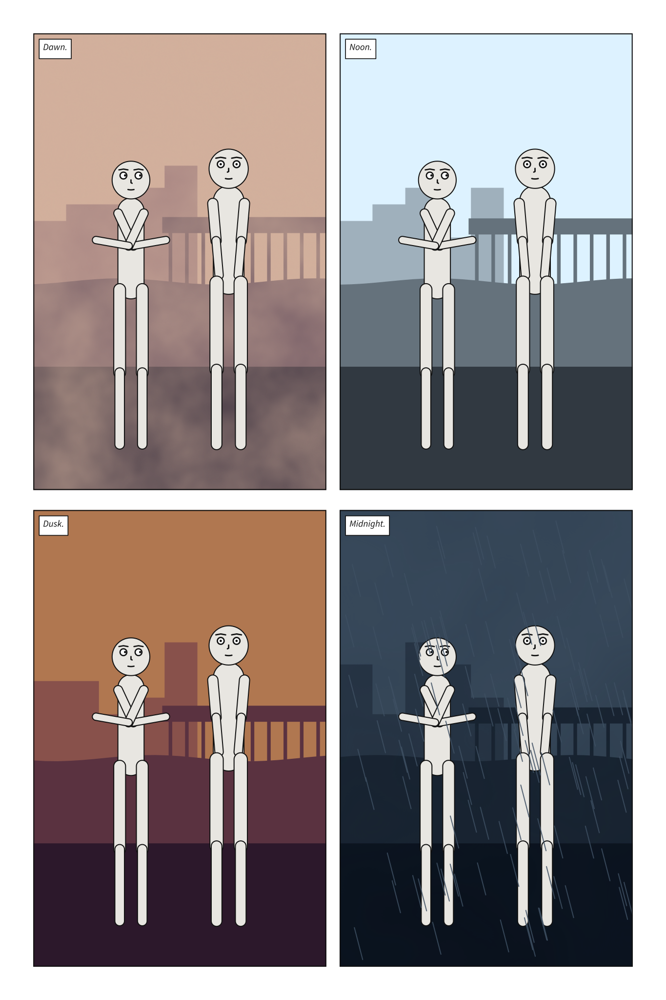
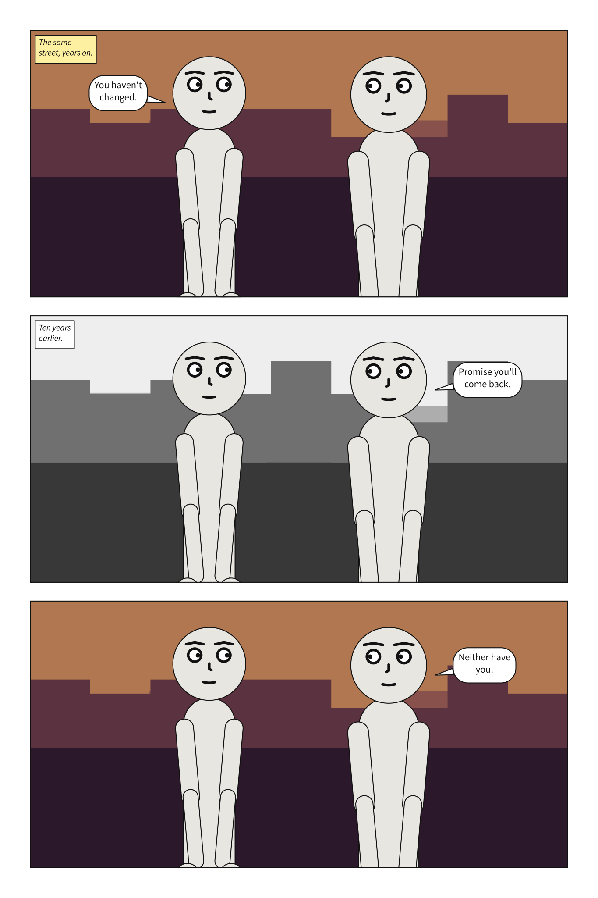

# `palette`

What a panel is drawn in: the value ladder in grey, as every panel has always been, or in colour.

```yaml
cast: {alice: {reference: alice}}
palette: tinted
setting: {place: docks, time: dusk}
```

| Key | Means | Default |
|---|---|---|
| `palette` | `mono` or `tinted` | `mono` |



**In the gallery:** [Every hour in colour](../../gallery.md#every-hour-in-colour) and [A flashback in grey](../../gallery.md#a-flashback-in-grey).

**Colour is a twin of value, never a replacement.** Under `tinted`, every value on the
[ladder](setting.md#time-and-weather) is drawn in a colour with the same OKLab lightness, on the same rung, at
the same hour. In monochrome a tinted panel is the mono one, value for value: the ladder stays
monotonic in depth, and every contrast floor still holds — checked on the colours themselves, which
weigh a little less than their greys in WCAG's luminance.

Each hour has two hues: the shadow's, at the foreground, and the atmosphere's, at the sky. The
planes between move from one to the other, the hue the short way round the circle and the chroma in
a straight line, so with distance colour drifts toward the colour of the air. It is aerial
perspective in colour as well as in value, and the painters' warm light and cool shadow:

| `time` | Shadow | Atmosphere |
|---|---|---|
| `dawn` | blue violet | rose gold |
| `day` | blue grey | sky blue |
| `dusk` | violet | orange |
| `night` | blue | blue |

Chroma is capped at what a screen can show at each lightness, and that cap, not a tuning, is what
drains the colour out of the dark end of night and out of a noon sky.

**What it tints:** the masses of a setting, the veil of fog or cloud, falling rain, and the box of a
[`warm` caption](script.md#caption). **What it never tints:** snow, which is white by convention, the paper, the
puppets, a supplied picture, and all lettering — balloons, the words in captions, and sound effects.
Lettering stays on the black plate a printer wants it on.

**Every decision is made on the grey.** Which rung a mass takes, whether rain is inked or papered,
where a balloon goes and what a caption is lettered in are all settled before the palette is
consulted, so a palette moves nothing. [Panel Core](../panel_core.md) keeps each grey where it always
was and adds the colour beside it. `scenet build --mono` draws the greys and ignores the colours: a
black-and-white edition of a book in colour, byte for byte what `palette: mono` writes, made without
editing a document. The [exports for image models](../../howto/export_for_image_models.md) are the same
in every palette, except that the semantics names one that is not `mono`.

It is written where [`lettering`](lettering.md#lettering) is: at the top of a panel, beside `panels:` in a
scene, where every panel inherits it, or in a comic script's front matter. Unlike
[`direction`](direction.md#direction), **a panel may have its own**, in a scene or as a script's `@palette:`.
A page read two ways has no order a reader could follow, but a page in two palettes is a
convention: the flashback in grey.



A palette with nothing to tint — no `setting`, or a supplied picture under a clear sky — is not a
mistake and is not reported: it is a choice for the whole document, and changing it never makes a
document invalid.

**`mono` is the default**, so no panel written before palettes existed draws any differently.
**There is no free-form colour.** `palette` is a closed set of names for the same reason `tone` is:
an open colour would be the language's one open vocabulary, and would let a value break the ladder.
