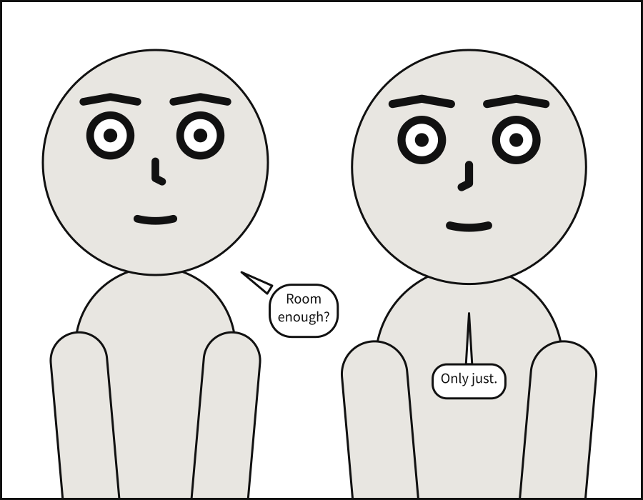

# `panel`

<!-- facts: panel -->
The panel's frame: its size and margin, in panel units.

| | |
|---|---|
| Where | A `.panel.yaml`; a panel under `panels:`; beside `panels:`, for every panel. In a comic script: `@panel:` in a panel, or `panel:` in the front matter |
| Type | a mapping |
| Default | each key's own |
| Since | 0.1 |
| Diagnostics | `invalid-field`, `unknown-key`, `duplicate-key` |
<!-- /facts -->

The frame everything else is measured against. A panel has a size and a margin, in
{term}`panel units <panel unit>`, and nothing in it is ever given a coordinate: the size says
what a unit is, and the compiler works out the rest.



On a [page](page.md#page-and-pages), a panel is compiled at the size of its frame, and its own
`size` is not used: the page decides how big the frame is and nothing about what goes in it.
Its margin is kept, and a margin the frame has no room for is a `page-layout` error.

```{scenet-example}
panel: {size: [1200, 600]}
cast: {alice: {reference: alice}}
```

**See also:** [`camera`](camera.md#camera), which frames the cast inside the panel;
[`page.size`](page.md#pagesize), the size of a page of panels.

## `panel.size`

<!-- facts: panel.size -->
The panel's width and height, `[width, height]`, in panel units: everything else is measured against them. Printed, a unit is a tenth of a millimetre.

| | |
|---|---|
| Where | A `.panel.yaml`; a panel under `panels:`; beside `panels:`, for every panel. In a comic script: `@panel:` in a panel, or `panel:` in the front matter |
| Type | `[number, number]` |
| Default | `[1000, 1000]` |
| Since | 0.1 |
| Diagnostics | `invalid-field`, `panel-geometry` |
<!-- /facts -->

Panel units are arbitrary and consistent: every length in the language -- a margin, a type size,
a gutter -- is in them, and they become the SVG's user units. Printed, a unit is a tenth of a
millimetre, so the default panel prints as a square 10 cm on a side.

A size must be positive in both directions. A long, low panel and a tall, narrow one are both
ordinary; what changes is how much of the cast the camera can fit across, so a narrow panel
may make the camera step back from the shot it was asked for.

```{scenet-example}
panel: {size: [1400, 500]}
cast:
  alice: {reference: alice, at: left_third}
  bob: {reference: bob, at: right_third, facing: left}
```

**See also:** [`panel.margin`](#panelmargin), [`camera.shot`](camera.md#camerashot).

## `panel.margin`

<!-- facts: panel.margin -->
An inset on all four sides, in panel units. Balloons, captions and sound effects keep inside it; figures may run past it, as comics let them.

| | |
|---|---|
| Where | A `.panel.yaml`; a panel under `panels:`; beside `panels:`, for every panel. In a comic script: `@panel:` in a panel, or `panel:` in the front matter |
| Type | a number |
| Values | 0 or more |
| Default | `0` |
| Since | 0.1 |
| Diagnostics | `invalid-field`, `panel-geometry` |
| In the gallery | [Margins and bleed](../../gallery.md#margins-and-bleed) |
<!-- /facts -->

The margin is where lettering stops. Every balloon, caption and sound effect keeps inside it,
and so does each tail. Figures do not: a figure framed tightly runs past the margin, and past
the frame itself, which is ordinary comics practice -- the frame crops it.

A margin may not leave the panel without an inside: twice the margin must be less than the
shorter side, or the panel is refused as `panel-geometry`.

```{scenet-example}
panel: {size: [1000, 700], margin: 60}
camera: {shot: medium_close_up}
cast:
  alice: {reference: alice, at: left_third}
  bob: {reference: bob, at: right_third, facing: left}
script:
  - say: {by: alice, text: "Inside the margin."}
  - say: {by: bob, text: "Every word of it."}
```

**See also:** [`panel.size`](#panelsize), [`panels[].bleed`](page.md#panelsbleed), a frame
that runs past the page's trim.
