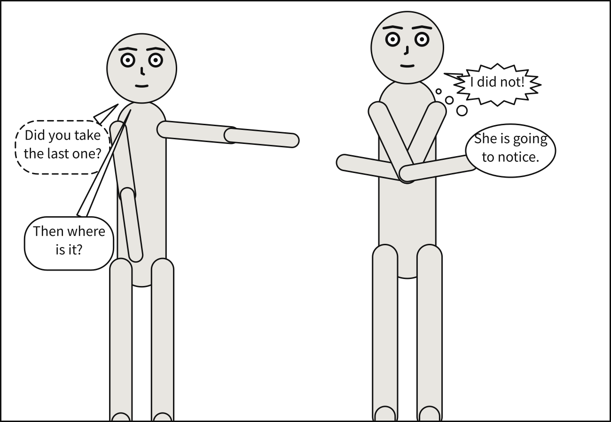
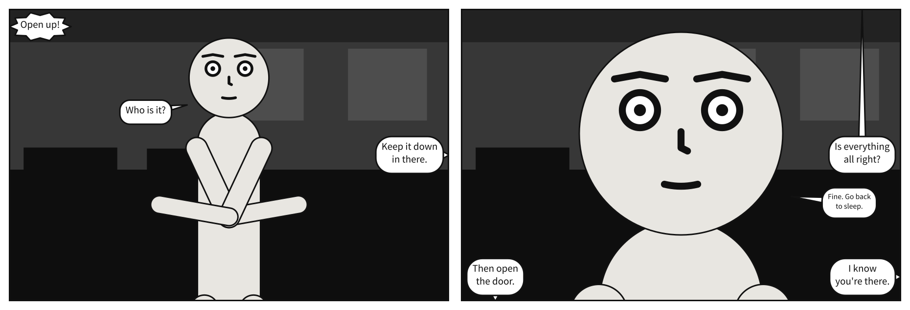
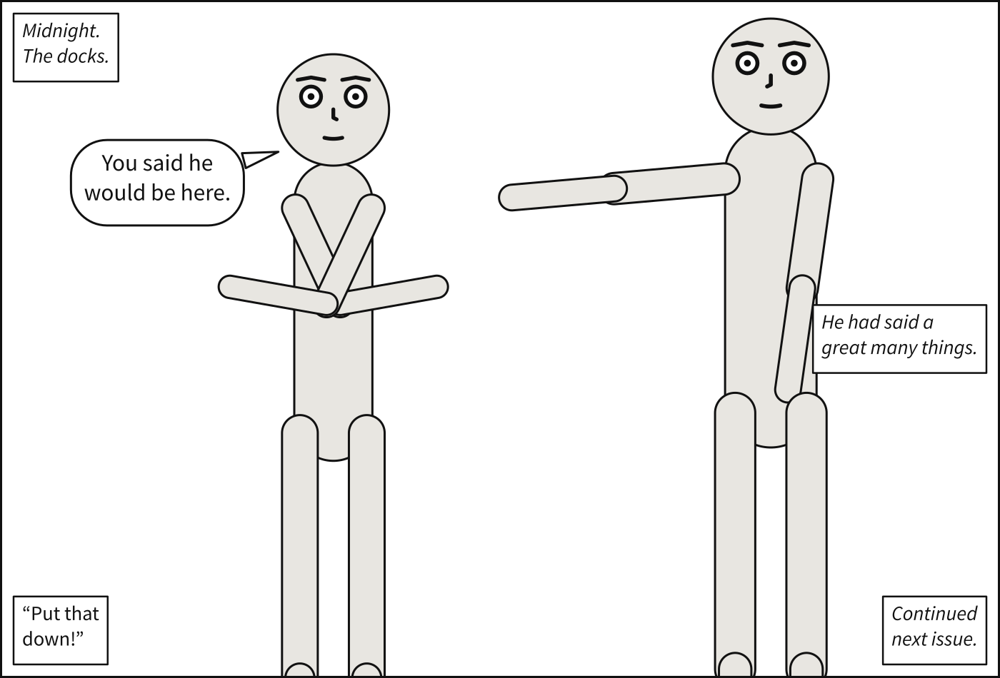
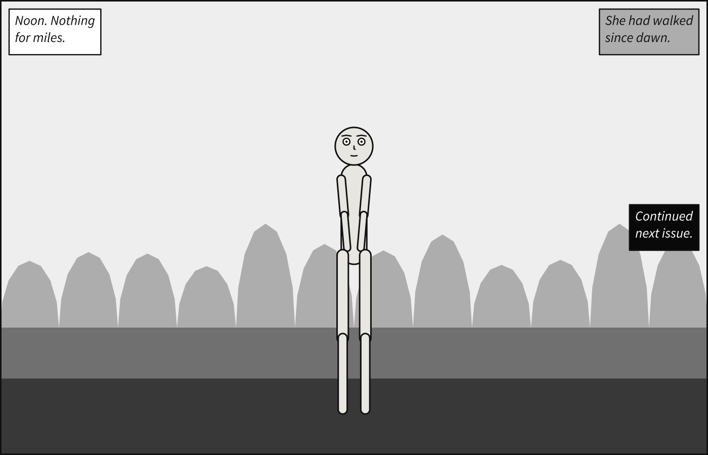
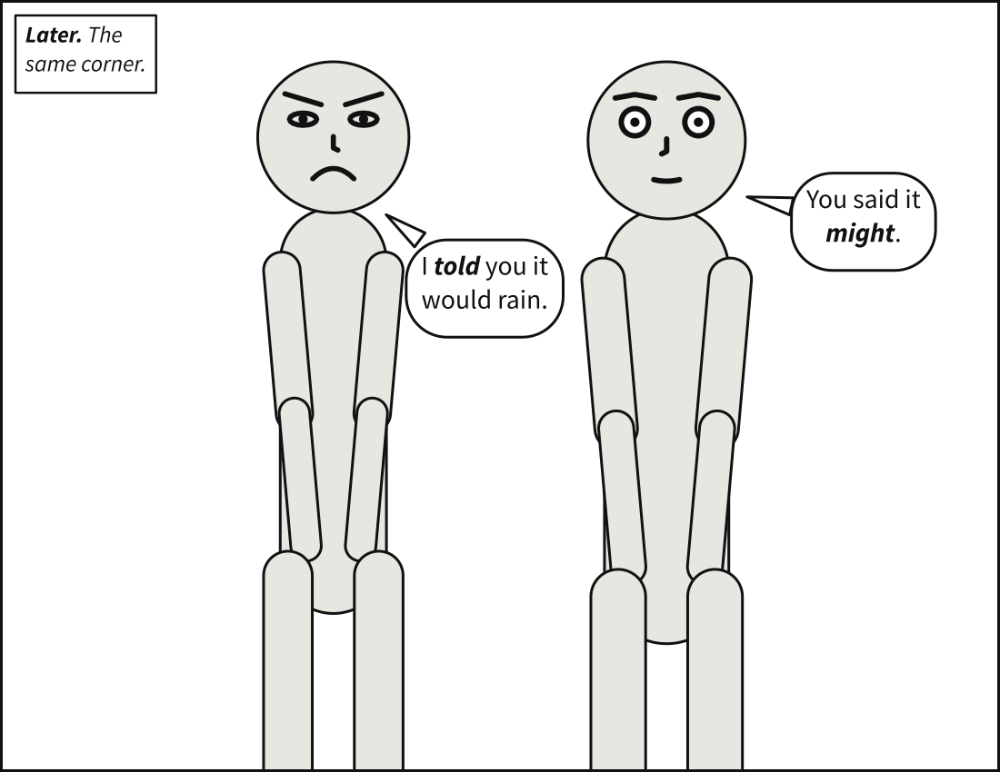
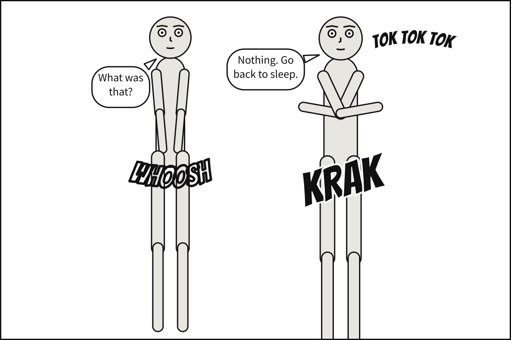
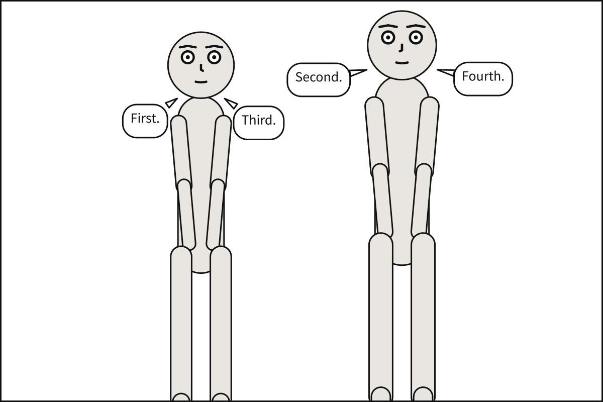

# `script`

An ordered list of narrative events, each tagged by a verb. **Order is meaningful**: it is the order
the reader reads them, and it constrains where the boxes may be placed.

There are three verbs. `say` puts a line in a balloon; `caption` puts one in a box; `sfx`
letters a sound effect into the picture.

```yaml
cast:
  alice: {reference: alice, at: left_third}
  bob:   {reference: bob,   at: right_third, facing: left}
script:
  - caption: {text: "Midnight. The docks.", kind: locale, prefer: top_left}
  - say: {by: alice, text: "You forgot your umbrella!", prefer: top_left}
  - say: {by: bob,   text: "I know.", kind: whisper}
```

## `say`

| Key | Type | Meaning |
|---|---|---|
| `by` | actor id | Who speaks; the tail points at this actor's mouth. With `off_panel`, the name of somebody nobody draws |
| `text` | string | The dialogue. Line breaking is computed, not authored. `_word_` stresses a word; see [Emphasis](#emphasis) |
| `prefer` | zone | A hint about placement, honoured when possible |
| `kind` | `speech`, `thought`, `whisper`, `shout` | Balloon styling |
| `size` | `normal`, `small` | `small` for a line muttered or said weakly: smaller type, in a balloon that keeps its room |
| `off_panel` | `true`, or `left`, `right`, `top`, `bottom` | The speaker is outside the panel; the tail ends on the frame. See [Off-panel speech](#off-panel-speech) |



**In the gallery:** [Every balloon kind](../../gallery.md#every-balloon-kind), [Placement zones](../../gallery.md#placement-zones) and [The other five zones](../../gallery.md#the-other-five-zones).

`text` is never pre-wrapped by the author. Wrapping is computed from real font metrics during
compilation, because a balloon's size determines whether it fits where it is wanted — so the
compiler must decide the line breaks before it can place anything.

A double dash, a dash or an ellipsis written as a word of its own — `out --`, `... maybe` — is
never a place to break. [Blambot](https://blambot.com/articles_grammar.shtml) sets one with no
space before or after it, so it belongs to its word: it stays on the line of the word before
it, or of the word after it when it opens the balloon. The space is still lettered as written.

A line of text, a caption and an actor id may not contain a control character other than tab, line
feed and carriage return. Each one is written into the SVG, and XML has no way to write those
characters at all, not even escaped, so a panel holding one is refused with the character named.

## Off-panel speech

```yaml
cast:
  bob: {reference: bob}
script:
  - say: {by: caller, text: "Open up!", off_panel: left}
  - say: {by: bob, text: "Who is it?"}
```



**In the gallery:** [Off-panel speech](../../gallery.md#off-panel-speech) and [Looking off panel](../../gallery.md#looking-off-panel).

A speaker who is not drawn has no mouth to point at, so their balloon's tail ends on the frame,
on their side — Blambot: "the tail of the balloon generally butts against the panel border". Name
the side, or write `off_panel: true` and the compiler takes the nearer of left and right to where it
put the balloon — which it puts high on the side reading starts from, top left, or top right in a
comic read right to left. A side you name is a side of the panel, whichever way it is read. Top and bottom are only ever named: balloons sit high, so "the nearest edge" would
aim most tails at the top border, which reads as a speaker above.

An off-panel speaker is somebody nobody draws, so `by` is any name and must **not** be in the
panel's cast: a line marked `off_panel` by somebody who is drawn is `off-panel-speaker`. The
balloon is placed as a caption is — no mouth to stay near — under the same rules: never over a
face, inside the margin, in reading order. Its tail reaches past the margin to the frame itself, or
to the panel's outline when it is slanted.

**Somebody heard from off panel may be looked at**, and by `looking_at` only — nothing else can be
staged against a figure nobody draws. `bob looking_at carol` turns Bob toward Carol's side of the
frame, left or right, and aims his eyes straight out of it, up or down for `top` and `bottom`. With
`off_panel: true` and no side named, Carol is heard from the side Bob faces, so the tail and his
look agree.

```yaml
cast:
  bob: {reference: bob, at: center}
staging: [bob looking_at carol]
script:
  - say: {by: carol, text: Over here!, off_panel: left}
```

A panel that shares a cast, through `over:` or a scene's defaults, leaves a member out with
`null`: `cast: {carol: null}`, and Carol is not drawn there — so she may speak from off panel in it.
Of the relations the panel shares that name her, `bob looking_at carol` still holds while she does,
and her `off_panel: true` ends on the side she was written to stand on, `at: left_third` being the
left, unless her line names one; every other relation goes. See
[Leaving something out](../../howto/compile_a_sequence.md#leaving-something-out). A comic script does
it with `(OP)`.

## `caption`

A caption is the panel speaking in its own voice. It is what lets a panel say *where* and *when* it
happens without a character having to explain it out loud — which is the thing writers are told not
to do. Comics solved this long before they had reliable backgrounds.



**In the gallery:** [Captions](../../gallery.md#captions).

| Key | Type | Meaning |
|---|---|---|
| `text` | string | What the box says. Line breaking is computed, as for dialogue |
| `kind` | `locale`, `monologue`, `spoken`, `editorial` | What the box is doing |
| `tone` | `paper`, `pale`, `ink`, `warm` | What the box is filled with. Defaults to `paper` |
| `prefer` | zone | Where it would like to sit. Unwritten, where reading starts: `top_left`, or `top_right` read right to left |
| `by` | any name | Who is speaking, for a `spoken` caption only |

The four kinds are the letterers' own vocabulary, taken from Blambot's *Comic Book Grammar &
Tradition* rather than invented — for the same reason the predicates were taken from Visual Genome.
Note that "narration", the obvious guess, is not one of them.

| Kind | What it is | How it is set |
|---|---|---|
| `locale` | Location and time — "Midnight. The docks." | Italic |
| `monologue` | A character's inner voice | Italic |
| `spoken` | Off-panel dialogue | Roman, in quotation marks |
| `editorial` | The voice of the writer or editor | Italic |

`monologue` has largely replaced the thought balloon in modern comics, so a panel has two ways to
render an inner voice: a `monologue` caption and a `thought` balloon. Both are correct. They are
different eras of the same convention, not a duplication.

**Quotation marks are applied by the compiler**, not by you. In a run of consecutive `spoken`
captions by one speaker, each opens with a quote and only the last one closes — the run is one
continuous line of off-panel speech, and closing every box would read as a series of interruptions.
A change of speaker (`by`) ends the run, so each speaker's last box closes, as Blambot asks: end
quotes "should appear as each speaker finishes". Write the words; the marks are lettering.

**`by` is the one place an actor id is allowed not to resolve.** Everywhere else, naming somebody
who is not in `cast` is an error. A `spoken` caption's speaker is *off panel* by definition, so
requiring them to be cast would defeat the purpose. It is accepted only on `spoken`; on any other
kind it is a mistake and is rejected.

### `tone`



**In the gallery:** [Caption tones](../../gallery.md#caption-tones) and [A yellow caption](../../gallery.md#a-yellow-caption).

A caption box is opaque, so its lettering is never the thing at risk — the text sits on the fill
whatever is behind it. What a tone changes is whether the **box** reads. Against the value ladder
the `setting` block produces, a white box on a noon sky is 1.16:1: legible, and invisible.

| Tone | Fill | Where it comes from | Lettered in |
|---|---|---|---|
| `paper` | `#ffffff` | the paper the panel is printed on — **the default** | ink |
| `pale` | `#adadad` | the `day` row of the value ladder, far plane | ink |
| `ink` | `#090909` | the `day` row of the value ladder, foreground | paper |
| `warm` | `#eeeeee` | the `day` row of the value ladder, atmosphere — yellow under `tinted` | ink |

Three of the four are rungs of the ladder in `solve/backdrop.py`, taken by index rather than restated
as literals, so lettering and backdrop cannot drift apart as either is tuned. A tone is **fixed, not
a function of the panel's `time`**: a caption's value is a property of the caption, and letting it
follow the hour would make the table below a function of the panel.

`ink` produces what letterers call reversed type. **The inversion is decided by the compiler**, by
contrast, and travels in Panel Core as a resolved value — the same rule and the same reason as
falling rain, which is inked over a bright sky and papered over a dark one.

Two floors, and only the first is a rule every tone must meet:

- **Lettering, 4.5:1.** A caption's text against its own fill, WCAG AA for body text. This is the
  contrast a reader actually gets, and every tone in the palette clears it with room — 18.9:1,
  8.4:1, 19.9:1 and 16.3:1 respectively, and `warm` 16.4:1 on its yellow.
- **Separation, 3:1.** The box against the plane behind it. *No tone is required to clear this on
  every rung*, and the default does not: white on a noon sky is the case that motivated the feature.
  What the palette owes you is an escape from every background the compiler can produce — at least
  one tone above 3:1 for every rung of every hour — and that is what the test suite checks.

`warm` is the classic yellow `locale` caption. Its value is a rung of the ladder like the others,
and its lettering is chosen on that grey; under [`palette: tinted`](palette.md#palette) its box is drawn in the
grey's twin, the pale yellow `#fef0a1`, of the same lightness. In `mono` it is the grey, which is
what a black-and-white reprint does to a yellow caption. `paper`, `pale` and `ink` stay neutral in
every palette. There is no free-form `fill:`: an open colour field would be this language's one open
vocabulary and would let you produce an unreadable box.

**Text is set flush left.** This is a *convention*, not a rule the way reading order is: the
lettering references describe left alignment as the norm while calling it a house preference. It is
the default because it is what letterers do, and it is recorded here as a choice rather than a law —
unlike `shot_types.md`, which is normative. Balloons, by contrast, centre their text. Both hold
in a comic read right to left: its text still reads left to right.

Captions are placed by the same machinery as balloons — the same face avoidance, the same silhouette
occlusion cost, the same hard reading-order rule — because the placement principles for floating
text are the ones the balloon solver already implements. What differs is the pull toward the frame:
a balloon mildly dislikes hugging the panel edge, and a caption is looking for exactly that corner.

## Emphasis

A word written between underscores is stressed, and lettered in **bold italic**:

```yaml
cast: {alice: {reference: alice}}
script:
  - caption: {text: "_Later._ The same corner.", kind: locale}
  - say: {by: alice, text: "I _told_ you it would rain."}
```



**In the gallery:** [Emphasis](../../gallery.md#emphasis).

Bold italic is the letterers' convention for a stressed word: Blambot's *Comic Book Grammar &
Tradition* notes there is almost no plain bold in comics dialogue. The underscore stands in for
the underline a script uses, as Dark Horse's script format asks. It works the same in `say` and
`caption`, in YAML and in a comic script; in an italic caption the stressed word is bold italic
too.

The stressed word is **measured** in bold italic, not just drawn in it. Bold italic is wider than
roman, so a stressed word widens its balloon, or pushes the next word onto another line, by
exactly as much as it is drawn wider. Bold italic is a real font file of the same family, never a
slant applied to the roman, for the reason the italic caption face is one.

The rules are Markdown's for an underscore:

- An underscore **opens** emphasis when nothing alphanumeric is before it and something other
  than a space is after it. Inside emphasis, one **closes** it when something other than a space
  is before it and nothing alphanumeric is after it. A span may run across words: `_told you_`.
- Any other underscore is just an underscore, so `file_name` and `__init__` are lettered as
  written, and `\_` writes one anywhere. In a double-quoted YAML string `\_` is YAML's own escape
  for a no-break space, so write `\\_` there, or use single quotes.
- Emphasis opened and never closed is refused as `unbalanced-emphasis`, located at the line,
  rather than guessed at.

Panel Core keeps each line as the plain text it reads as, and records where the face changes
beside it; see [Panel Core](../panel_core.md).

**Why not `*told*`.** Markdown's other marker starts an alias when it opens a YAML value:
`text: *told* you` does not parse at all. A document that trips on it is told to quote the value
and use underscores, but `*` is never read as emphasis, because it is also what a typed grawlix
such as `@#*%!` is made of.

## `sfx`

A sound effect is letters treated as picture. `BLAM` is not dialogue: comics letter sound big,
angled and outlined, near where it happens, with no balloon.



**In the gallery:** [Sound effects](../../gallery.md#sound-effects) and [A sound pulled to a zone](../../gallery.md#a-sound-pulled-to-a-zone).

```yaml
cast:
  alice: {reference: alice, at: left_third}
  bob:   {reference: bob,   at: right_third, facing: left}
script:
  - say: {by: alice, text: "Get down!"}
  - sfx: {text: BLAM, from: bob, size: large, rotate: -14}
  - sfx: {text: tok tok tok, prefer: top_right, size: small, arc: 30}
```

| Key | Type | Meaning |
|---|---|---|
| `text` | string | The sound, lettered exactly as written |
| `from` | actor id | Who or what it comes from; it is placed near them |
| `prefer` | zone | Where it would like to sit, with no source, or as a pull with one |
| `size` | `small`, `medium`, `large` | How loud: 1.6, 2.6 or 4 times the dialogue type size. Defaults to `medium` |
| `rotate` | degrees, -45 to 45 | Turned clockwise. Defaults to level |
| `arc` | degrees, -120 to 120 | Bent along a curve: positive bows the middle up, negative down |
| `hollow` | `true` or `false` | All outline and no fill, so the art shows through |

It is lettered in the **display face**, Bangers, which ships with Scenet; `lettering.font` can name
another as `display:`. A solid effect is ink with a paper outline around every letter, so it reads
over light art and dark alike; a hollow one is the outline alone, in ink. The arc and the rotation
are applied to the glyph outlines, not handed to a renderer, so they come out the same everywhere.

**It is placed, never positioned.** As with every box, the compiler tries candidate positions —
around the actor it comes from, around the zone it prefers, the middle of every zone — and keeps the
cheapest. It **never covers a face**, never leaves the panel or lies under an inset, and two effects
never overlap; it may cover a figure, and prefers its own source's to anyone else's. When nothing
fits, it is reported as `sfx-placement`.

**Balloons pay to cover it, and nobody moves for it.** Effects are placed before any balloon or
caption, since they are part of the picture; a balloon or caption then pays to cover one, exactly as
it pays to cover emanata, and is never forbidden to. No figure and no framing changes.

Size is a multiple of the type size, not of the figure, so an effect reads at a long shot as well as
at a close-up. Nothing is added to the text: no exclamation mark, since sound effects are not
exclamations, and no emphasis — an underscore here is just an underscore.

## Reading order is enforced, not suggested

Balloons and captions are placed in script order, in one pass, and a box may never sit
above-and-left of the one before it — above-and-*right*, in a comic read right to left (see
[`direction`](direction.md#direction)). Violating this is not a cosmetic flaw: it makes the panel read
in the wrong order, which is a correctness bug in a comic. The constraint is therefore hard, and a
panel whose boxes cannot be placed without breaking it is rejected rather than rendered wrongly.



**In the gallery:** [Reading order](../../gallery.md#reading-order).

Captions take their turn in that sequence rather than being placed first as a layer. A caption
written between two lines of dialogue is read between them; one written last is read last.

A sound effect takes its number in the same sequence — which is the order a reader of the text, or a
screen reader, follows — but is exempt from the geometric rule. A sound sits where the sound is, and
holding it to above-and-left would make many panels impossible to letter. Read right to left, it
stays exempt, and stays where it was: a sound is part of the picture, which is not mirrored.

That sequence is what a screen reader hears. Every SVG names each panel with its
[description](description.md#description) and then every balloon, caption and sound effect in this order —
`Caption: Midnight. Alice: You forgot your umbrella! Bob, whispering: I know.` — whatever order
they are painted in; see [accessible output](../../howto/make_accessible_output.md).
