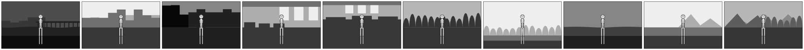
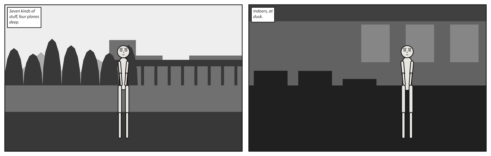
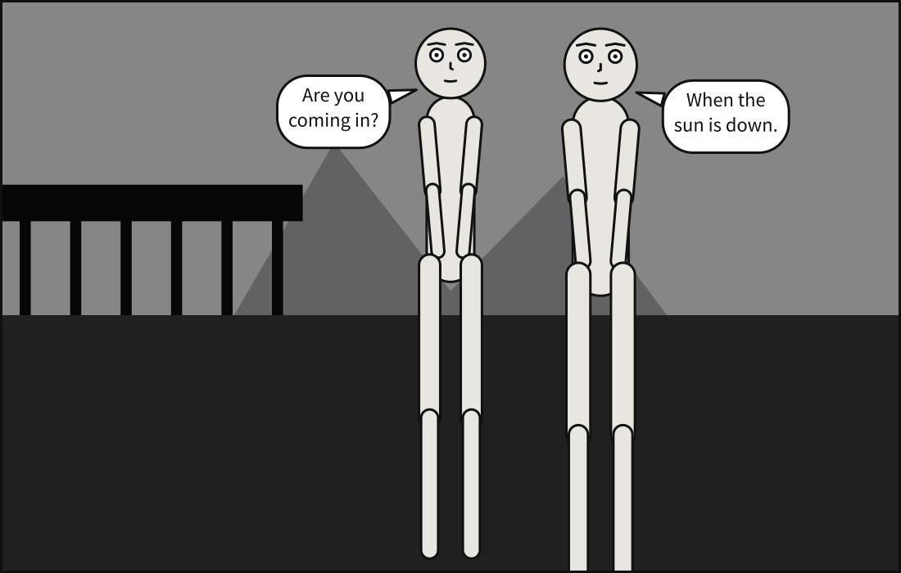
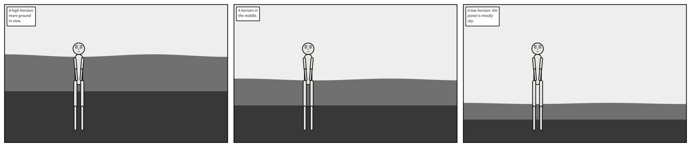
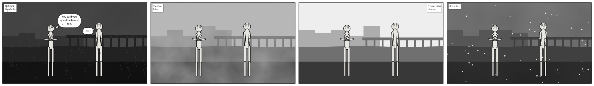
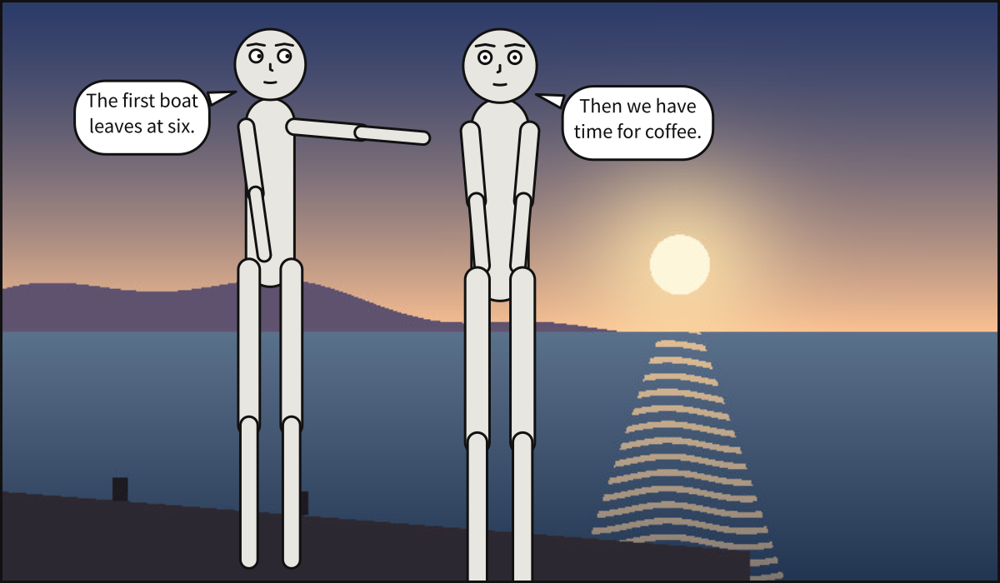

# `setting`

<!-- facts: setting -->
Where and when the panel happens: a named place, tonal masses or a picture behind the cast, with the time of day and the weather.

| | |
|---|---|
| Where | A `.panel.yaml`; a panel under `panels:`; beside `panels:`, for every panel. In a comic script: `@setting:` in a panel, or `setting:` in the front matter |
| Type | a mapping |
| Default | each key's own |
| Since | 0.6 |
| Diagnostics | [`invalid-field`](../diagnostics.md#invalid-field), [`unknown-key`](../diagnostics.md#unknown-key), [`duplicate-key`](../diagnostics.md#duplicate-key) |
<!-- /facts -->

Where and when the panel happens, drawn as **tonal masses** rather than as geometry, or as a
picture drawn elsewhere. A panel with no `setting` renders exactly as it always did: figures on
white.



What is behind the cast is said once, in one of three ways, and never two of them: a named
[`place`](#settingplace), a list of [`masses`](#settingmasses), or an [`image`](#settingimage).
`scenet check` reports two of them together as `conflicting-setting`, at the key other than
`image`. A panel that inherits one of them, from a scene's defaults or from the panel it is
`over`, leaves it out with `null`: `place: null` beside its own `image`. The
[`horizon`](#settinghorizon) composes masses, so it goes with a place or masses, and never with a
picture, which has its own. [`time`](#settingtime) and [`weather`](#settingweather) go with any of
them.

```{scenet-example}
setting: {place: docks, horizon: mid, time: night, weather: rain}
cast: {alice: {reference: alice}}
```

**See also:** [Letter over your own art](../../howto/letter_over_your_own_art.md),
[`palette`](palette.md#palette).

## Backdrops are never author-drawn

Two reasons, and the first is structural. Crisp architecture needs a vanishing point, and this is
deliberately a flat, orthographic compiler -- a tilted camera does not foreshorten anything -- so
drawn buildings would fight the compiler's own model. Soft tonal masses have no perspective to get
wrong.

The second is that this is how comics actually establish place:

- **[Notan](https://mitchalbala.com/the-wisdom-of-notan/)**, the Japanese light/dark mass
  principle, which entered Western art teaching through Arthur Wesley Dow's *Composition* (1899):
  place is read from the *arrangement of masses*, not from rendered detail.
- **Layered silhouette depth**: foreground near-black, each receding plane paler.
- **[Aerial perspective](https://en.wikipedia.org/wiki/Aerial_perspective)** supplies the
  parametric rule for free -- with distance, value contrast drops toward the atmosphere. Two
  numbers per hour, monotonic in depth. That is notation, not interpretation, which is why it
  belongs in a compiler.

**Received art is another matter.** The rule is about *drawing* a backdrop in the language, not
about receiving one. A picture drawn elsewhere -- painted, pencilled, photographed, rendered -- can
stand behind the cast with [`image`](#settingimage). Its perspective is the artist's, and the
compiler neither reads nor imitates it: what it takes from the file is its size, so the solver
still never sees artwork, and the [asset contract](../asset_contract.md)'s promise -- the same
layout whatever draws it -- holds.

## `setting.place`

<!-- facts: setting.place -->
A named place, which stands for the list of masses it expands into. Write this, `masses` or `image`, never two of them.

| | |
|---|---|
| Where | A `.panel.yaml`; a panel under `panels:`; beside `panels:`, for every panel. In a comic script: `@setting:` in a panel, or `setting:` in the front matter |
| Type | a name |
| Values | `alley`, `desert`, `docks`, `field`, `forest`, `mountain`, `office`, `room`, `shore`, `street` |
| Default | none |
| Since | 0.6 |
| Diagnostics | [`invalid-field`](../diagnostics.md#invalid-field), [`unknown-place`](../diagnostics.md#unknown-place), [`conflicting-setting`](../diagnostics.md#conflicting-setting) |
| In the gallery | [Ten places](../../gallery.md#ten-places) |
<!-- /facts -->

The headline surface, because the thing an author wants to write is *where the scene is*, not a
list of shapes. Each place expands into masses, which are what a {term}`plane` and a
{term}`mass` mean:

| Place | Expands into |
|---|---|
| `alley` | sky·far, building·near·left, building·near·right, ground·near, building·foreground·left |
| `desert` | sky·far, solid·far·right, ground·mid, ground·near |
| `docks` | sky·far, building·far·left, water·mid, structural·mid·right, ground·near |
| `field` | sky·far, plant·far, ground·mid, ground·near |
| `forest` | sky·far, plant·far, plant·near·left, plant·near·right, ground·near |
| `mountain` | sky·far, solid·far, solid·mid·left, plant·mid·right, ground·near |
| `office` | wall·far, window·far·center, ceiling·mid, floor·near, furniture·near |
| `room` | wall·far, window·far·right, ceiling·mid, floor·near, furniture·near·left |
| `shore` | sky·far, water·mid, ground·near |
| `street` | sky·far, building·far, building·mid·left, building·mid·right, ground·near |

**The rule that keeps `place:` honest**: a preset expands into a mass list the author could have
written themselves, and is never a second opaque format. The expansion happens in the frontend,
exactly as `alice left_of bob` is expanded into a relation -- so by the time anything downstream
sees a backdrop, there is one representation of it.

**Free prose is deliberately not offered.** `setting: "a rainy street corner at midnight"` needs
language understanding, and guessing produces panels that are confidently wrong. A named place is
the honest middle: it reads like a description and resolves deterministically. `scenet check`
reports an unmatched name as `unknown-place`, listing the ones that exist.

```{scenet-example}
setting: {place: forest}
cast: {alice: {reference: alice}}
```

**See also:** [`setting.masses`](#settingmasses), what a place is made of.

## `setting.masses`

<!-- facts: setting.masses -->
The backdrop as tonal masses, back to front: what a `place` expands into, written out. Write this, `place` or `image`, never two of them.

| | |
|---|---|
| Where | A `.panel.yaml`; a panel under `panels:`; beside `panels:`, for every panel. In a comic script: `@setting:` in a panel, or `setting:` in the front matter |
| Type | a list of mappings |
| Default | none |
| Since | 0.6 |
| Diagnostics | [`invalid-field`](../diagnostics.md#invalid-field), [`conflicting-setting`](../diagnostics.md#conflicting-setting) |
| In the gallery | [Masses and planes](../../gallery.md#masses-and-planes) |
<!-- /facts -->

A place is a convenience. Underneath it is a list of masses, which stays authorable whenever you
want control -- and which is *exactly* what a place expands into. Each mass is a kind of stuff, on
a plane, across a span of the panel; they are drawn back to front.



One authored mass may resolve to **several polygons**: furniture is a few separate blocks, a wall
holds several windows. Backdrop silhouettes are generated, and seeded from the setting and the
panel's size, so the same masses always draw the same shapes.

```{scenet-example}
setting:
  horizon: mid
  masses:
    - {kind: building, plane: far, spans: full}
    - {kind: plant, plane: mid, spans: left}
    - {kind: ground, plane: near, spans: full}
cast: {alice: {reference: alice}}
```

**See also:** [`setting.place`](#settingplace).

## `setting.masses[].kind`

<!-- facts: setting.masses[].kind -->
What the mass is made of, which decides its silhouette: seven outdoor kinds of stuff and five indoor.

| | |
|---|---|
| Where | A `.panel.yaml`; a panel under `panels:`; beside `panels:`, for every panel. In a comic script: `@setting:` in a panel, or `setting:` in the front matter |
| Type | a name |
| Values | `building`, `ceiling`, `floor`, `furniture`, `ground`, `plant`, `sky`, `solid`, `structural`, `wall`, `water`, `window` |
| Default | none: required |
| Since | 0.6 |
| Diagnostics | [`invalid-field`](../diagnostics.md#invalid-field), [`missing-field`](../diagnostics.md#missing-field) |
<!-- /facts -->

**`kind`** is subsetted from the *supercategories* of
[COCO-Stuff](https://arxiv.org/pdf/1612.03716), the canonical taxonomy of **stuff** -- "amorphous
background regions" as opposed to *things* with a well-defined shape. Twelve of them, seven outdoor
and five indoor:

| | Kinds |
|---|---|
| Outdoor | `building` `ground` `plant` `sky` `solid` `structural` `water` |
| Indoor | `ceiling` `floor` `furniture` `wall` `window` |

Deliberately *not* COCO-Stuff's leaf names. Its actual classes are `building-other`, `sky-other`,
`wall-brick`, `water-other`; the `-other` suffix marks the catch-all inside a supercategory, and
`building-other` is not a word anyone should have to type. Its `textile`, `food` and `rawmaterial`
supercategories are left out: drapery and objects, not scene-defining masses.

A kind decides the **shape** a mass takes, never its value, which is the plane's. Two kinds sit off
their own plane's rung, and both stay on the ladder rather than beside it: `sky` is at infinite
distance, so it always takes the atmosphere's value, and `window` is a hole showing a more distant
plane, so it takes the rung one step farther back.

```{scenet-example}
setting:
  masses:
    - {kind: wall, plane: far}
    - {kind: window, plane: far, spans: center}
    - {kind: floor, plane: near}
cast: {alice: {reference: alice}}
```

**See also:** [`setting.masses[].plane`](#settingmassesplane).

## `setting.masses[].plane`

<!-- facts: setting.masses[].plane -->
How far back the mass sits, which decides its value and its draw order. A `foreground` mass is drawn over the cast.

| | |
|---|---|
| Where | A `.panel.yaml`; a panel under `panels:`; beside `panels:`, for every panel. In a comic script: `@setting:` in a panel, or `setting:` in the front matter |
| Type | a name |
| Values | `foreground`, `near`, `mid`, `far` |
| Default | `mid` |
| Since | 0.6 |
| Diagnostics | [`invalid-field`](../diagnostics.md#invalid-field) |
| In the gallery | [In front of the cast](../../gallery.md#in-front-of-the-cast) |
<!-- /facts -->

**`plane`** decides two things at once, and neither is a new mechanism. It maps onto the same
integer painter's order `in_front_of` uses -- the three backdrop planes take negative depths, and
`foreground` takes one above the frontmost actor, so a foreground mass draws over the cast the way
a silhouetted doorway does. And it decides **value**: reading front to back, a mass never gets
darker.



Value comes from the plane and from **nothing else** -- not from the kind. That is what keeps the
notan reading literal: masses at one distance read as one mass, and their arrangement is what
carries the place. A **nearer plane is also drawn larger**, which is size perspective alongside
aerial perspective: a near hill is not merely darker than a far one, it is bigger.

```{scenet-example}
setting:
  masses:
    - {kind: sky, plane: far}
    - {kind: building, plane: foreground, spans: left}
cast: {alice: {reference: alice, at: right_third}}
```

**See also:** [`setting.time`](#settingtime), which sets the ladder the planes are spaced on.

## `setting.masses[].spans`

<!-- facts: setting.masses[].spans -->
How much of the panel's width the mass covers: all of it, or its `left`, `center` or `right` part.

| | |
|---|---|
| Where | A `.panel.yaml`; a panel under `panels:`; beside `panels:`, for every panel. In a comic script: `@setting:` in a panel, or `setting:` in the front matter |
| Type | a name |
| Values | `full`, `left`, `center`, `right` |
| Default | `full` |
| Since | 0.6 |
| Diagnostics | [`invalid-field`](../diagnostics.md#invalid-field) |
<!-- /facts -->

**`spans`** is an absolute extent, and that is not cosmetic. Any construct that would reintroduce
a left/right *disjunction* has to resolve it before the solver -- see
[why ordering must be explicit](staging.md#why-ordering-must-be-explicit). A span is an extent
rather than a relation, which is what stops masses becoming an unordered `beside`. `left` and
`right` overlap slightly in the middle so that using both leaves no seam down the centre of the
panel.

```{scenet-example}
setting:
  masses:
    - {kind: plant, plane: mid, spans: left}
    - {kind: plant, plane: mid, spans: right}
cast: {alice: {reference: alice}}
```

**See also:** [`setting.masses[].kind`](#settingmasseskind).

## `setting.horizon`

<!-- facts: setting.horizon -->
Where the ground meets what is behind it, which every mass is composed against: `high` shows more ground, `low` less.

| | |
|---|---|
| Where | A `.panel.yaml`; a panel under `panels:`; beside `panels:`, for every panel. In a comic script: `@setting:` in a panel, or `setting:` in the front matter |
| Type | a name |
| Values | `high`, `mid`, `low` |
| Default | `mid` |
| Since | 0.6 |
| Diagnostics | [`invalid-field`](../diagnostics.md#invalid-field), [`conflicting-setting`](../diagnostics.md#conflicting-setting) |
| In the gallery | [Three horizons](../../gallery.md#three-horizons) |
<!-- /facts -->

One line for the whole panel, which every mass is composed against: masses of the ground sort
start at it and run down, masses that stand in the world rise from it. A **high** horizon sits
nearer the top of the frame, so more ground is in view. Named rather than given as a number for the
reason `at:` is: the author says how the panel is composed, not where a line goes.



Ground, floor and water all run to the bottom edge, so a near quayside drawn from the horizon would
bury the water behind it. Each starts lower than the plane behind it, and that stack of receding
bands is the depth cue. The exception is the *farthest* one in a panel, which meets the horizon
itself: there is nothing behind it to reveal. A picture has a horizon of its own, so a `horizon`
beside an `image` is `conflicting-setting`.

```{scenet-example}
setting: {place: shore, horizon: high}
cast: {alice: {reference: alice}}
```

**See also:** [`setting.masses`](#settingmasses).

## `setting.time`

<!-- facts: setting.time -->
When the panel happens, which sets the two ends of the value ladder: the foreground's value and the atmosphere's.

| | |
|---|---|
| Where | A `.panel.yaml`; a panel under `panels:`; beside `panels:`, for every panel. In a comic script: `@setting:` in a panel, or `setting:` in the front matter |
| Type | a name |
| Values | `dawn`, `day`, `dusk`, `night` |
| Default | `day` |
| Since | 0.6 |
| Diagnostics | [`invalid-field`](../diagnostics.md#invalid-field) |
| In the gallery | [Time and weather](../../gallery.md#time-and-weather) |
<!-- /facts -->

`time` sets a panel's values. It supplies the two ends of the value ladder -- the value of the
foreground and the value of the atmosphere -- and the planes are spaced evenly between them in
[OKLab](https://bottosson.github.io/posts/oklab/) lightness, which predicts perceived lightness
well. So `night` is a darker, *narrower* ladder, which is what night does to a drawn scene, and the
ladder stays monotonic in depth at every hour by construction rather than by tuning. In `mono` it
adds no colour; under [`palette: tinted`](palette.md#palette) each value takes the hour's colour
without changing.



Over a picture, `time` chooses the tint of the veil and of falling weather, and whether rain is
inked or papered; the value ladder has nothing to apply to, since a picture's values are the
artist's.

```{scenet-example}
setting: {place: street, time: dusk}
cast: {alice: {reference: alice}}
```

**See also:** [`setting.weather`](#settingweather), [`caption.tone`](script.md#captiontone).

## `setting.weather`

<!-- facts: setting.weather -->
What the air is doing: `fog` veils the backdrop; `rain` and `snow` veil it as cloud, and fall over everything, the cast included.

| | |
|---|---|
| Where | A `.panel.yaml`; a panel under `panels:`; beside `panels:`, for every panel. In a comic script: `@setting:` in a panel, or `setting:` in the front matter |
| Type | a name |
| Values | `clear`, `rain`, `fog`, `snow` |
| Default | `clear` |
| Since | 0.6 |
| Diagnostics | [`invalid-field`](../diagnostics.md#invalid-field) |
<!-- /facts -->

`weather` adds a layer over the backdrop. `clouds` and `fog` are first-class stuff in COCO-Stuff,
so this vocabulary did not have to be invented either:

| `weather` | What it does |
|---|---|
| `clear` | Nothing. The panel has no atmosphere layer at all |
| `fog` | A dense, low-frequency noise veil, tinted with the atmosphere itself |
| `rain` | The same veil as cloud -- nearer, so darker than the sky -- plus slanted streaks |
| `snow` | The same veil, plus flecks |

The veil sits over the backdrop and *under* the cast: fog between the reader and the figures would
be the more literal reading and would bury them. Falling weather goes over everything, because it
**is** between the reader and the panel -- which is why it crosses the figures.

Rain flips to ink over a bright sky and to paper over a dark one, as inkers do, because a white
streak over noon is invisible and a black one over midnight is too. Snow never flips: snow is
white, and the overcast veil is what gives it something to read against. Over a picture, the veil
and falling weather are drawn exactly as over masses.

```{scenet-example}
setting: {place: shore, time: day, weather: snow}
cast: {alice: {reference: alice}}
```

**See also:** [`setting.time`](#settingtime), [Determinism](index.md#determinism), on how the
noise is drawn.

## `setting.image`

<!-- facts: setting.image -->
A picture drawn elsewhere, behind the cast: a PNG or JPEG file, relative to the document. Only its size is read. Written instead of `place` and `masses`.

| | |
|---|---|
| Where | A `.panel.yaml`; a panel under `panels:`; beside `panels:`, for every panel. In a comic script: `@setting:` in a panel, or `setting:` in the front matter |
| Type | text |
| Default | none |
| Since | 0.12 |
| Diagnostics | [`invalid-field`](../diagnostics.md#invalid-field), [`image-file`](../diagnostics.md#image-file), [`conflicting-setting`](../diagnostics.md#conflicting-setting), [`artwork-contract`](../diagnostics.md#artwork-contract) |
| In the gallery | [A JPEG behind the cast](../../gallery.md#a-jpeg-behind-the-cast) |
<!-- /facts -->

`image` names a picture drawn elsewhere -- painted, pencilled, photographed or rendered -- and the
cast is drawn in front of it, lettered by the same rules as on any other backdrop.



- **The path is read as a font's is**: relative to the folder the document is in, wherever
  `scenet` was run from, with `/` between folders. An absolute path is refused. Text compiled with
  no file behind it has no folder, so it names a picture only when its caller says which folder it
  belongs to, or hands the file over with it.
- **PNG or JPEG**, the two raster formats SVG 2 requires every viewer to draw, told apart by their
  first bytes rather than by the file's name.
- **Only the size is read.** The compiler takes from the file how many pixels it has across and
  down, from its header, and decodes nothing: the solver never sees artwork, here as everywhere.
  Only the print PDF carries the pixels, unchanged, into the file it writes.
- **A picture its EXIF says to turn is refused.** Renderers disagree on obeying that tag --
  Chromium turns an SVG `<image>` by it, others do not -- so such a picture would be upright in
  one viewer and on its side in the next. Save it with the pixels turned instead.

`scenet check` reports every way a picture cannot be read as `image-file`, at the line it is named
on, without running the solver. In the [playground](https://creatoan.github.io/scenet/playground/),
**Image…** adds a picture to the document's `art/` folder for as long as the tab is open.

**Nothing else moves.** The picture costs a balloon nothing. The compiler does not know what is in
it, so a balloon may sit anywhere on it; the cast's faces are what lettering keeps clear of. The
camera frames the cast exactly as it would in front of masses. When the people are in the picture,
its artwork contract says where -- see [`cast.<id>.figure`](cast.md#castidfigure).

**Linked or embedded.** The SVG names the picture by the path exactly as written, percent-encoded,
so it is found when the SVG sits beside the document -- which is where `scenet build` writes it.
`scenet build --embed-images` writes the picture's bytes in as a `data:` URI instead, which an SVG
shown as an ``, turned into a PNG or written anywhere else needs; the playground always
embeds. Either is byte-identical for the same picture. The link is `xlink:href` rather than SVG 2's
plain `href`, because Inkscape still does not load a resource named by plain `href`; see
[prior art](../../explanation/prior_art.md#image-in-svg-renderers-and-editors).

**Read aloud.** The picture is part of the panel's one image, `role="img"`, so it adds nothing to
the accessible name and has no title of its own. A generated description names neither the place
nor the hour over a picture -- the compiler has not seen it -- only the weather it drew. Write
[`description`](description.md#description) to say what the picture shows.

```{scenet-example}
:beside: examples/gallery
:playground: 52-a-jpeg.panel.yaml

setting: {image: art/harbour.jpg, weather: rain}
cast: {alice: {reference: alice}}
```

**See also:** [`setting.fit`](#settingfit), [Letter over your own art](../../howto/letter_over_your_own_art.md).

## `setting.fit`

<!-- facts: setting.fit -->
How the picture fills the panel: `cover` fills it and crops what overhangs, equally on both sides; `contain` shows the whole picture. Left out, `cover`.

| | |
|---|---|
| Where | A `.panel.yaml`; a panel under `panels:`; beside `panels:`, for every panel. In a comic script: `@setting:` in a panel, or `setting:` in the front matter |
| Type | a name |
| Values | `cover`, `contain` |
| Default | none |
| Since | 0.12 |
| Diagnostics | [`invalid-field`](../diagnostics.md#invalid-field), [`cropped-mouth`](../diagnostics.md#cropped-mouth) |
<!-- /facts -->

The picture is centred either way and never stretched: its shape is a fact about it, and a figure
drawn into it would be stretched with it. `cover` fills the panel and crops what overhangs, equally
on both sides; `contain` shows the whole picture, the panel showing round it where their shapes
differ -- SVG's `slice` and `meet`. A `fit` with no `image` is `invalid-field`; in a scene, the
image may be inherited and the fit given alone.

A `cover` crop can push a figure's face or mouth out of the panel. Lettering stays inside the panel
as always; a tail to a mouth cropped away ends on the frame, aimed at it, and `scenet build` says
so in a note.

```{scenet-example}
:beside: examples/gallery
:playground: 34-supplied-art.scene.yaml

panel: {size: [700, 900]}
setting: {image: art/street.png, fit: contain}
cast: {alice: {reference: alice}}
```

**See also:** [`setting.image`](#settingimage).
