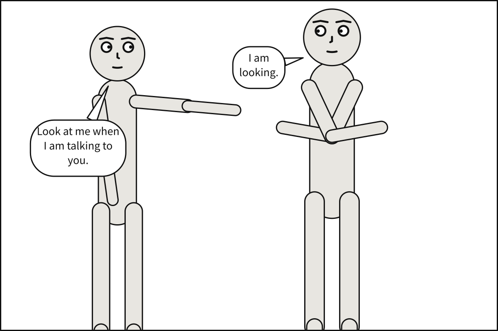

# `staging`

A list of relations between actors, written `subject predicate object`. This is a scene graph: the
cast are nodes, these are the edges. Predicates come from the spatial subset of the Visual Genome
vocabulary rather than being invented here, so a Scenet scene remains convertible to and from the
scene-graph representations used elsewhere in computer vision.

**In the gallery:** [Gaze steers balloons](../../gallery.md#gaze-steers-balloons), [Feet align, heads do not](../../gallery.md#feet-align-heads-do-not), [Depth and overlap](../../gallery.md#depth-and-overlap) and [Staging, spelled out](../../gallery.md#staging-spelled-out).

| Predicate | Effect |
|---|---|
| `left_of`, `right_of` | Fixes horizontal ordering |
| `in_front_of`, `behind` | Fixes draw order and occlusion |
| `looking_at` | Sets the subject's gaze vector toward the object — who may be somebody heard [from off panel](script.md#off-panel-speech) |
| `ground_shared_with` | Places both actors on the same ground line |

## Why ordering must be explicit

`left_of` looks redundant next to `at: left_third`, but it is not. The layout engine is a **linear**
constraint solver, and "A and B must not overlap" is a *disjunction*: A is left of B, **or** B is
left of A. Linear solvers cannot express that choice.

So the language resolves it instead. By the time the solver runs, ordering is already decided, and
what reaches the solver is a linear system it can always solve. A `left_of` or `right_of` in
`staging` decides first. Where staging says nothing, figures stand in the order of their `at:`
anchors, and two at the same anchor by actor id, in code-point order, so `Bob` stands left of
`alice`. That is the same on every run, but seldom what was meant: when the order matters, state it
with `left_of`. This is the reason there is no unordered `beside` predicate, and why any future construct
must resolve its own ordering in the frontend.
