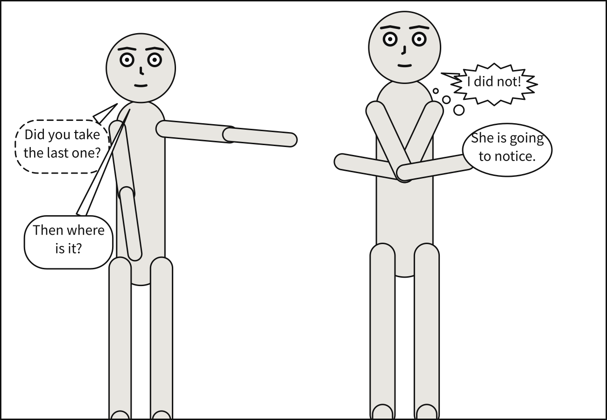
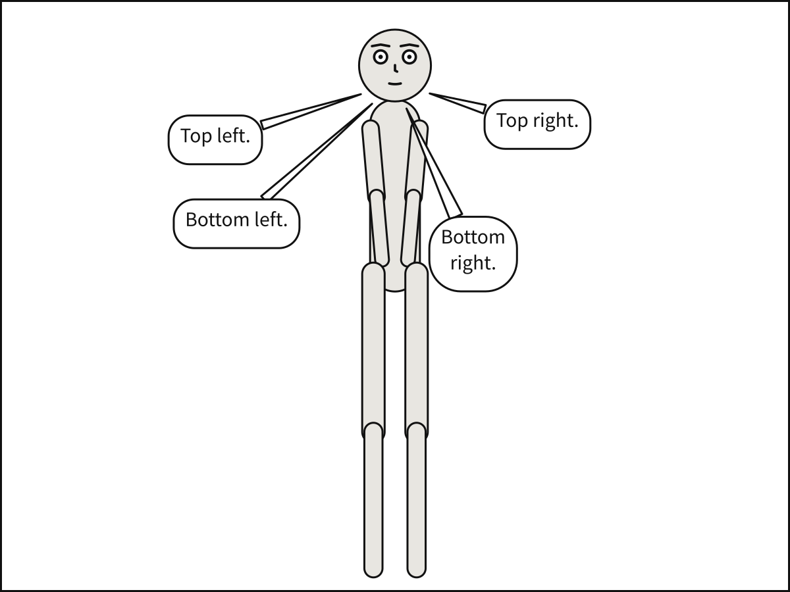
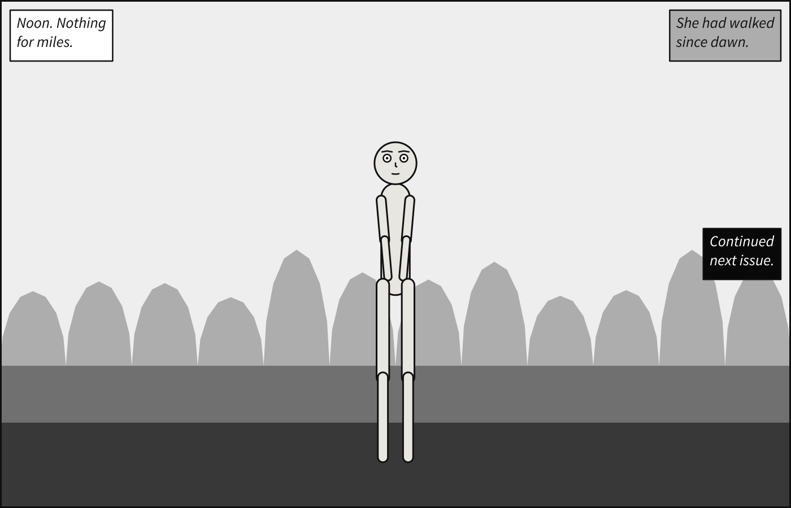
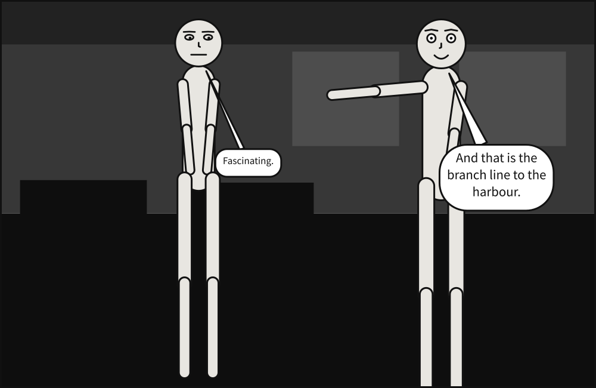

# Balloons and captions

Everything a panel says is in its [`script`](../reference/language/script.md), in the order it
is read. This chapter covers the two kinds of thing a script holds that are lettered in a
box: balloons, which a character speaks, and captions, in which the panel speaks for
itself. It ends on the words a reader who cannot see the picture hears.

## What you will make


A place and a time in the top corner, a line of dialogue, a thought nobody speaks aloud, a
voice from somebody nobody draws, and an editor's note. Five things lettered, and you will
not say where any of them goes.

## Balloon kinds

A [`say`](../reference/language/script.md#say) line has a
[`kind`](../reference/language/script.md#saykind): `speech`, the default, `whisper`, `shout`
or `thought`. The kind changes the outline and the tail, never where the balloon is put.

```{code-block} yaml
:caption: kinds.panel.yaml

# Four kinds of balloon: speech, thought, whisper, shout.
#
# The kind changes the outline and the tail, never the placement. A whisper obeys
# exactly the same face-avoidance and reading-order rules as a shout.

panel:
  size: [1300, 900]

camera:
  shot: medium_full

cast:
  alice: {reference: alice, pose: pointing,     at: left_third}
  bob:   {reference: bob,   pose: arms_crossed, at: right_third, facing: left}

staging:
  - alice left_of bob
  - alice ground_shared_with bob

script:
  - say: {by: alice, text: "Did you take the last one?", kind: whisper, prefer: top_left}
  - say: {by: bob,   text: "I did not!",                 kind: shout,   prefer: top_right}
  - say: {by: alice, text: "Then where is it?",          kind: speech,  prefer: bottom_left}
  - say: {by: bob,   text: "She is going to notice.",    kind: thought, prefer: bottom_right}
```



## Zones, and reading order

[`prefer`](../reference/language/script.md#sayprefer) names one of nine zones, top, middle or
bottom crossed with left, center or right. It is the weakest wish there is: a balloon never
covers a face, never overlaps another balloon and never breaks reading order, and only then
does it get as close to its zone as it can.

```{code-block} yaml
:caption: zones.panel.yaml

# `prefer:` names one of nine zones -- top/middle/bottom crossed with
# left/center/right.
#
# It is the WEAKEST term in the whole system. Covering a face is illegal, overlapping
# another balloon is illegal, and breaking reading order is illegal; only after all of
# that does a preference get a vote. Change these and watch how often the compiler
# quietly overrules you.

panel:
  size: [1200, 900]

camera:
  shot: full_shot

cast:
  alice: {reference: alice, at: center}

script:
  - say: {by: alice, text: "Top left.",     prefer: top_left}
  - say: {by: alice, text: "Top right.",    prefer: top_right}
  - say: {by: alice, text: "Bottom left.",  prefer: bottom_left}
  - say: {by: alice, text: "Bottom right.", prefer: bottom_right}
```



The four corners above; the five between them are `top_center`, `middle_left`,
`middle_center`, `middle_right` and `bottom_center`:

```{code-block} yaml
:caption: other-zones.panel.yaml

# The other five zones.
#
# `prefer:` names one of nine zones, top, middle or bottom crossed with left, center or
# right. The four corners have an example of their own; these are the five between them.
#
# A zone is still the weakest wish in the language. A balloon never covers a face, never
# overlaps another balloon and never breaks reading order, and only then does it get as
# close to its zone as it can.

panel:
  size: [1200, 900]

camera:
  shot: full_shot

cast:
  alice: {reference: alice, at: center}

script:
  - say: {by: alice, text: "Top center.",    prefer: top_center}
  - say: {by: alice, text: "Middle left.",   prefer: middle_left}
  - say: {by: alice, text: "Middle center.", prefer: middle_center}
  - say: {by: alice, text: "Middle right.",  prefer: middle_right}
  - say: {by: alice, text: "Bottom center.", prefer: bottom_center}
```

Leave `prefer` out and the compiler chooses. What it never does is break **reading order**:
a balloon may not sit above and to the left of any balloon that comes before it in the
script. Reorder these four lines and the layout changes, but never asks you to read up and
to the left.

```{code-block} yaml
:caption: order.panel.yaml

# Script order IS reading order, and it is enforced rather than preferred.
#
# A balloon may never sit above AND left of one that precedes it -- checked against
# every predecessor, not just the last one, because the relation is not transitive.
#
# Try reordering these four lines. The layout changes, but it never asks you to read
# up and to the left.

panel:
  size: [1200, 800]

camera:
  shot: medium_full

cast:
  alice: {reference: alice, at: left_third}
  bob:   {reference: bob,   at: right_third, facing: left}

staging:
  - alice left_of bob
  - alice ground_shared_with bob

script:
  - say: {by: alice, text: "First."}
  - say: {by: bob,   text: "Second."}
  - say: {by: alice, text: "Third."}
  - say: {by: bob,   text: "Fourth."}
```

## A voice from off panel

A line may be spoken by somebody the panel does not draw.
[`off_panel`](../reference/language/script.md#sayoff_panel) names the side of the frame they
are on, `left`, `right`, `top` or `bottom`, and the tail ends on the frame there; `true`
lets the compiler take the nearer side. The speaker in
[`by`](../reference/language/script.md#sayby) is then any name at all, cast or not.

```{code-block} yaml
:caption: knock.scene.yaml

# Off-panel speech: a voice from somebody nobody draws.
#
# `off_panel` on a `say` line names a speaker who is not in the cast. The balloon's tail
# ends on the frame, on the speaker's side -- "the tail of the balloon generally butts
# against the panel border" (Blambot) -- named, or, with `off_panel: true`, the nearer of
# left and right to where the balloon was put.
#
# Bob mutters his answer: `size: small` letters it smaller, in a balloon that keeps its room.

panel: {size: [900, 600]}
setting: {place: room, time: night}

panels:
  knock:
    camera: {shot: medium_shot}
    cast:
      bob: {reference: bob, pose: arms_crossed, at: center}
    script:
      - say: {by: caller, text: "Open up!", off_panel: left, kind: shout}
      - say: {by: bob, text: "Who is it?"}
      - say: {by: neighbour, text: "Keep it down in there.", off_panel: right}

  answer:
    over: knock
    camera: {shot: close_up}
    script:
      - say: {by: upstairs, text: "Is everything all right?", off_panel: top}
      - say: {by: bob, text: "Fine. Go back to sleep.", size: small}
      - say: {by: caller, text: "Then open the door.", off_panel: bottom}
      - say: {by: caller, text: "I know you're there.", off_panel: true}
```


Bob's answer is muttered: [`size: small`](../reference/language/script.md#saysize) letters
a line smaller, in a balloon that keeps its room. `normal` is the default.

## Captions

A [`caption`](../reference/language/script.md#caption) is a box with no tail. Its
[`kind`](../reference/language/script.md#captionkind) says what it is doing:

| Kind | What it is | Lettered |
|---|---|---|
| `locale` | where and when | italic |
| `monologue` | an inner voice | italic |
| `spoken` | somebody talking from off panel, named in [`by`](../reference/language/script.md#captionby) | upright, in quotation marks |
| `editorial` | the editor's voice: "Continued next issue." | italic |

Save the panel at the top of this chapter:

```{code-block} yaml
:caption: captions.panel.yaml

# Four kinds of caption: locale, monologue, spoken and editorial.
#
# A caption is the panel speaking in its own voice, which is how a comic says where and
# when it happens without a character having to explain it out loud. The vocabulary is
# the letterers' own: three of the four are set in italic, and `spoken` -- somebody
# talking from off panel -- takes quotation marks instead.
#
# Captions are placed by the same machinery as balloons, so they never cover a face and
# they take their turn in reading order. What differs is the pull: a balloon mildly
# dislikes the panel edge, and a caption is looking for exactly that corner.

panel:
  size: [1400, 950]

camera:
  shot: medium_full

cast:
  alice: {reference: alice, pose: arms_crossed, at: left_third}
  bob:   {reference: bob,   pose: pointing,     at: right_third, facing: left}

staging:
  - alice left_of bob
  - alice ground_shared_with bob

script:
  - caption: {text: "Midnight. The docks.", kind: locale, prefer: top_left}
  - say: {by: alice, text: "You said he would be here."}
  - caption: {text: "He had said a great many things.", kind: monologue, prefer: middle_right}
  - caption: {text: "Put that down!", kind: spoken, by: harbourmaster, prefer: bottom_left}
  - caption: {text: "Continued next issue.", kind: editorial, prefer: bottom_right}
```

```bash
scenet build captions.panel.yaml
```

```text
wrote captions.svg
```

A caption's [`tone`](../reference/language/script.md#captiontone) is what its box is filled
with: `paper`, the default; `pale`; `ink`, lettered in paper; or `warm`, the classic yellow
locale caption, which [chapter 6](setting_and_colour.md) draws in colour. Over a pale noon
sky, a paper box all but vanishes, and that is what `pale` and `ink` are for:

```{code-block} yaml
:caption: tones.panel.yaml

# Three caption tones, over the background that makes the point.
#
# A caption box is opaque, so its lettering was never at risk: the text sits on the fill
# whatever is behind it. What was at risk is the *box*. On a clear day the atmosphere is
# `#eeeeee`, and the white box that every caption has been since captions shipped is
# 1.16:1 against it -- legible, and invisible. Only the stroke separates it at all.
#
# So the failing case is the pale end, not the dark one, and this panel is that case:
# a noon sky, with the same three boxes tucked into three corners of it. `paper` all but
# vanishes into the sky, `pale` sits on it quietly, and `ink` reads at 17.16:1 -- which
# costs the lettering an inversion, because black type on a near-black box is not
# lettering, it is a filled rectangle.
#
# The values are rungs of the same ladder the backdrop uses, not a second palette.

panel:
  size: [1400, 900]

camera:
  shot: long_shot

setting:
  place: field
  horizon: low
  time: day

cast:
  alice: {reference: alice, pose: standing_neutral, at: center}

script:
  - caption: {text: "Noon. Nothing for miles.", kind: locale, tone: paper, prefer: top_left}
  - caption: {text: "She had walked since dawn.", kind: monologue, tone: pale, prefer: top_right}
  - caption: {text: "Continued next issue.", kind: editorial, tone: ink, prefer: bottom_right}
```



## What the panel shows, in words

[`description`](../reference/language/description.md) says what the panel shows, for a reader
who cannot see it. A screen reader says it first, then what is said in the panel, in order.
Nothing is drawn from it: Alice looks bored because of her
[`expression`](../reference/language/cast.md#castidexpression), the subject of [chapter
5](faces_and_marks.md), not because the description says so.

```{code-block} yaml
:caption: described.panel.yaml

# A description: what the panel shows, in words, for a reader who cannot see it.
#
# A screen reader says it first, before what is said in the panel. Nothing is drawn from it:
# Alice looks bored because of `expression: bored`, not because the description says so.
# Leave it out and Scenet describes the panel itself -- the shot, the setting, and who is
# where.
#
# Bob's line is lettered at `size: normal`, the default, written out here beside Alice's
# `size: small` to compare the two.

description: >-
  Late at night in a living room, Bob points at something off to the side, beaming. Alice
  watches him, bored stiff.

panel:
  size: [1000, 650]

camera:
  shot: full_shot

setting:
  place: room
  time: night

cast:
  alice: {reference: alice, at: left_third, expression: bored}
  bob:   {reference: bob,   at: right_third, facing: left, pose: pointing, expression: happy}

staging:
  - alice left_of bob
  - alice looking_at bob

script:
  - say: {by: bob, text: "And that is the branch line to the harbour.", size: normal}
  - say: {by: alice, text: "Fascinating.", size: small}
```



Leave the description out and Scenet writes one itself: the shot, the setting, and who is
where. The picture's alternative text on this page is exactly that, for every panel but this
one.

## What the compiler decided

**A caption looks for a corner.** Captions are placed by the same machinery as balloons, so
they keep off faces and take their turn in reading order. What differs is the pull: a
balloon mildly dislikes the panel's edge, and a caption is looking for exactly that: with
no `prefer`, it goes to the corner where reading starts.

**Quotation marks are added for you.** You write the `spoken` caption's words bare, and the
compiler letters the quotation marks.

**Every tail points at a mouth.** Each balloon's tail is routed to its speaker's mouth,
around the other balloons, and an off-panel tail to the frame.

**Only a `spoken` caption has a speaker.** `by` on any other kind of caption is an error,
[`caption-speaker`](../reference/diagnostics.md#caption-speaker), since the panel itself is
speaking:

```{scenet-example}
:gives: caption-speaker

cast:
  alice: {reference: alice}
script:
  - caption: {text: "Midnight.", kind: locale, by: alice}
```

A `say` by somebody the cast does not have, with no `off_panel`, is
[`unknown-actor`](../reference/diagnostics.md#unknown-actor): the compiler would not know whose
mouth to point at.

## Try it

- [Every balloon kind](https://creatoan.github.io/scenet/playground/#example=04-balloon-kinds.panel.yaml):
  give every line `kind: shout`. The outlines change; the places do not.
- [Placement zones](https://creatoan.github.io/scenet/playground/#example=05-placement-zones.panel.yaml):
  ask for `top_left` four times, and see where the other three go.
- [The other five zones](https://creatoan.github.io/scenet/playground/#example=44-the-other-zones.panel.yaml):
  delete every `prefer`.
- [Reading order](https://creatoan.github.io/scenet/playground/#example=06-reading-order.panel.yaml):
  move "Fourth." to the top of the script.
- [Captions](https://creatoan.github.io/scenet/playground/#example=16-captions.panel.yaml):
  the panel you built. Delete each `prefer` in turn.
- [Caption tones](https://creatoan.github.io/scenet/playground/#example=22-caption-tones.panel.yaml):
  set `time: night`, and see which tone reads now.
- [A warm caption](https://creatoan.github.io/scenet/playground/#example=39-warm-caption.panel.yaml):
  the yellow box; delete `palette: tinted` to see its grey.
- [Off-panel speech](https://creatoan.github.io/scenet/playground/#example=32-off-panel.scene.yaml):
  change `off_panel: left` to `off_panel: right`.
- [Looking off panel](https://creatoan.github.io/scenet/playground/#example=50-looking-off-panel.scene.yaml):
  a look aimed at a voice nobody draws, `bob looking_at carol`.
- [A description](https://creatoan.github.io/scenet/playground/#example=45-a-description.panel.yaml):
  delete the description, and read the one Scenet writes in its place, in the picture's
  `<title>`.

## Check it

```bash
scenet check captions.panel.yaml knock.scene.yaml described.panel.yaml
```

```text
captions.panel.yaml: ok
knock.scene.yaml: ok
described.panel.yaml: ok
```

A note can come from `check` too. Write a line of more than the words a balloon is asked to
hold, and `check` says so with a [`word-limit`](../reference/diagnostics.md#word-limit) note:
the document is still `ok`, as the [last chapter](what_scenet_tells_you.md) shows.

## What you learned

- A `say` is a balloon of one of four kinds, which change its outline, never its place.
- `prefer` names one of nine zones, the weakest wish there is; reading order is a rule.
- `off_panel` gives a voice to somebody nobody draws; `size: small` mutters.
- A `caption` is the panel's own voice: `locale`, `monologue`, `spoken` or `editorial`,
  on a `tone` of `paper`, `pale`, `ink` or `warm`.
- `description` is what a screen reader says of the panel; without one, Scenet writes it.

## Where to go next

- The next chapter, [Lettering and sound](lettering_and_sound.md): the type itself.
- [Make accessible output](../howto/make_accessible_output.md), on what a screen reader hears.
- The cards for [`say`](../reference/language/script.md#say),
  [`caption`](../reference/language/script.md#caption),
  [`caption.prefer`](../reference/language/script.md#captionprefer),
  [`caption.text`](../reference/language/script.md#captiontext) and
  [`description`](../reference/language/description.md#description).
