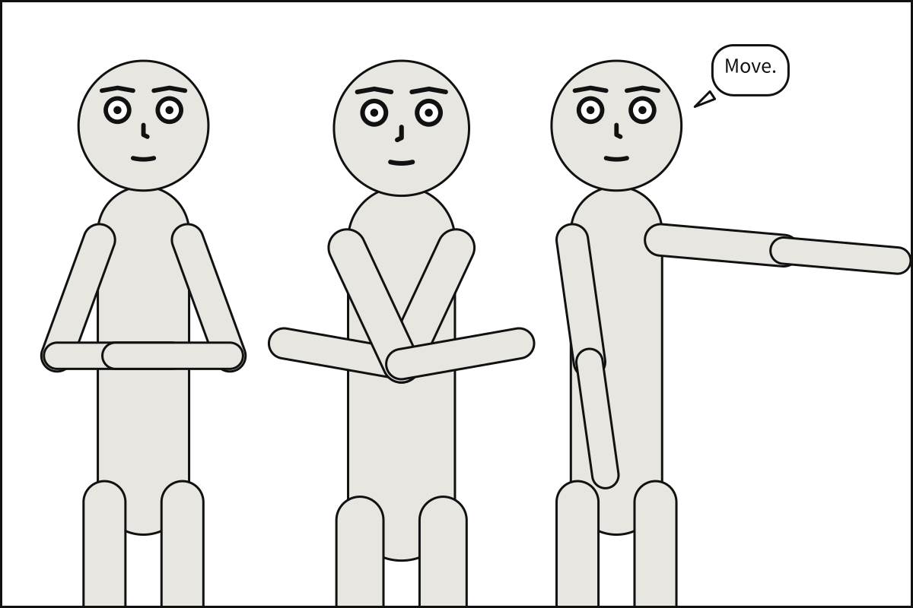
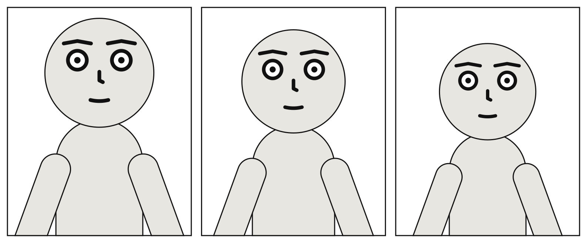
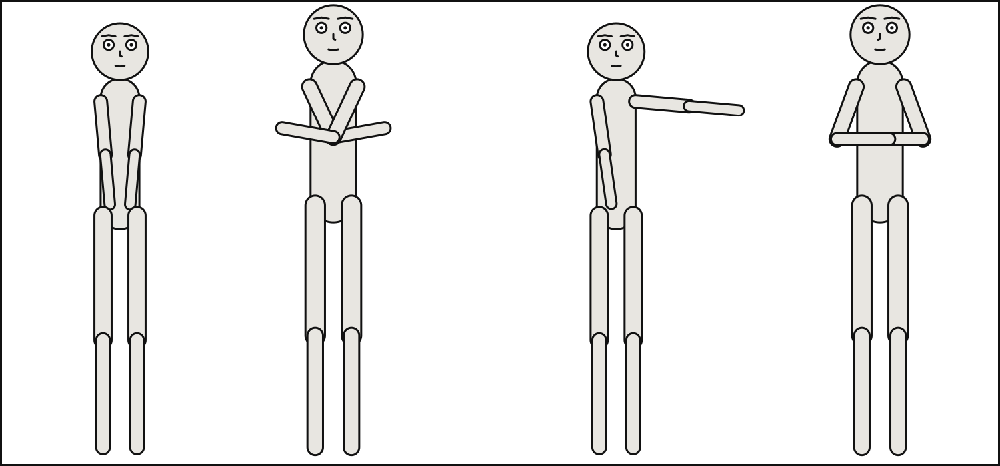

# Camera and staging

The first chapter used a camera and three staging sentences without taking them apart. This
one does: the ten shots and the three angles, the poses and facings a cast takes, and every
relation `staging` can state. It ends on what happens when two of them disagree.

## What you will make



Three figures, two of them overlapping on purpose: the one in the middle stands in front of
the one on the right, and the one on the left behind him. Nothing in the document says
where anybody is drawn.

## The shot

A shot is named by where the frame cuts the body, measured in head heights, not by how much
of the panel a figure fills: `full_shot` shows the feet, `medium_shot` cuts at the waist,
`close_up` at the shoulders. This document draws one figure at every shot there is, widest
first:

```{code-block} yaml
:caption: shots.scene.yaml

# Every shot type, on the same character, from widest to tightest.
#
# A shot type is a crop landmark plus headroom, measured in HEAD-HEIGHTS -- not as a
# fraction of panel height. Watch where the frame cuts the body as you go down: feet,
# feet, knees, mid-thigh, waist, chest, shoulders, chin, eyes.
#
# `wide` and `long_shot` are DELIBERATELY IDENTICAL. They are synonyms -- the literature
# uses them interchangeably -- and the language keeps both because writers reach for
# both. The two panels look the same because they are the same shot, not because
# something is broken.
#
# `medium_full` and `cowboy` are NOT synonyms, though they were briefly implemented as
# though they were. Medium full cuts at the knees; the cowboy shot cuts at mid-thigh,
# a framing that comes from 1930s Westerns needing the holster in frame.
#
# The two widest shots leave ground beneath the feet. That is footroom, and it is not
# decoration: the crop lands the FEET landmark on the frame edge, but the shin is drawn
# as a round-capped stroke that continues past it, so without footroom a long shot
# clipped the feet off.

panel: {size: [420, 560]}

cast:
  alice: {reference: alice, pose: pointing}

panels:
  long_shot:        {camera: {shot: long_shot}}
  wide:             {camera: {shot: wide}}          # same as long_shot, on purpose
  full_shot:        {camera: {shot: full_shot}}
  medium_full:      {camera: {shot: medium_full}}   # knees
  cowboy:           {camera: {shot: cowboy}}        # mid-thigh
  medium_shot:      {camera: {shot: medium_shot}}
  medium_close_up:  {camera: {shot: medium_close_up}}
  close_up:         {camera: {shot: close_up}}
  big_close_up:     {camera: {shot: big_close_up}}
  extreme_close_up: {camera: {shot: extreme_close_up}}
```


It is a document of several panels, a **scene**: what is written beside `panels:` is shared
by each of them, and each panel adds what is its own, here only its camera. [Chapter
7](sequences.md) is about scenes; for now, read each line under `panels:` as one panel.

```bash
scenet build shots.scene.yaml --strip
```

That writes an SVG per panel, `shots.long_shot.svg` to `shots.extreme_close_up.svg`, and,
with `--strip`, `shots.strip.svg`: every panel side by side, as above.

## The angle

[`camera.angle`](../reference/language/camera.md#cameraangle) is the camera's height:
`low`, `eye_level` or `high`. Scenet draws flat, so an angle cannot foreshorten anybody.
What it changes is the air above the head: a low camera looks up, and the figure looms
under the top of the frame; a high camera looks down, and leaves more room above.

```{code-block} yaml
:caption: angles.scene.yaml

# The three camera heights, at one shot type.
#
# This compiler is orthographic, so an angle cannot foreshorten anything. What it
# changes is HEADROOM -- the air above the head -- which is the cue readers actually
# take from an angle, and one that survives being drawn flat.
#
# A low camera looks up and the subject looms, so headroom tightens. A high camera
# looks down and it opens out.

panel: {size: [500, 620]}
camera: {shot: medium_close_up}

cast:
  bob: {reference: bob, pose: hands_on_hips}

panels:
  low:       {camera: {angle: low}}
  eye_level: {camera: {angle: eye_level}}
  high:      {camera: {angle: high}}
```



## Where each one stands, and how

A cast member says three things about itself, all optional:

- [`at`](../reference/language/cast.md#castidat), where along the panel's width it would like
  to stand: `left_edge`, `left_third`, `center`, `right_third` or `right_edge`;
- [`facing`](../reference/language/cast.md#castidfacing), `left` or `right`, gaze and all;
- [`pose`](../reference/language/cast.md#castidpose), a pose its puppet declares, by name.
  A pose is a set of joint angles, not a drawing, which is why one puppet can take every
  pose facing either way.

The shipped puppets have four poses. This panel shows all of them, and casts `alice` twice,
as `a` and `c`:

```{code-block} yaml
:caption: poses.panel.yaml

# A pose is a set of joint angles, not a drawing -- which is what avoids one image
# per pose per expression per facing direction.
#
# All four shipped poses. Note that `a` and `c` use the SAME puppet: the key in `cast`
# is the actor id, `reference` is which character gets drawn, and the two are
# independent. That is what lets one puppet play two parts.

panel:
  size: [1500, 700]

camera:
  shot: full_shot

cast:
  a: {reference: alice, pose: standing_neutral, at: left_edge}
  b: {reference: bob,   pose: arms_crossed,     at: left_third}
  c: {reference: alice, pose: pointing,         at: right_third}
  d: {reference: bob,   pose: hands_on_hips,    at: right_edge, facing: left}

staging:
  - a left_of b
  - b left_of c
  - c left_of d
  - a ground_shared_with b
  - b ground_shared_with c
  - c ground_shared_with d
```



## Staging

[`staging`](../reference/language/staging.md) is a list of sentences, each a subject, a
[predicate](../reference/language/staging.md#stagingpredicate) and an object:

| Predicate | What it says | What it moves |
|---|---|---|
| `left_of`, `right_of` | the order across the panel | positions: required |
| `in_front_of`, `behind` | who is drawn over whom | draw order, and lets two overlap |
| `looking_at` | where the eyes point | nothing: balloons keep out of the look |
| `ground_shared_with` | the feet stand on one line | heights |

Now the panel at the top of this chapter. Save it:

```{code-block} yaml
:caption: depth.panel.yaml

# Depth, and the two ways to say every ordering.
#
# `in_front_of` and `behind` set painter order, so one figure is drawn over another.
# Non-overlap is a REQUIRED constraint and the solver normally pushes actors apart;
# depth is what lets them share space on purpose.
#
# `left_of` and `right_of` are the same relation written from either end. Both are
# resolved into a single linear ordering at parse time, because Cassowary is a linear
# solver and cannot express the disjunction "A left of B OR B left of A". Any construct
# that reintroduces a disjunction has to be resolved in the frontend, not the solver.

panel:
  size: [1200, 800]

camera:
  shot: medium_shot

cast:
  back:  {reference: alice, pose: hands_on_hips, at: left_third}
  near:  {reference: bob,   pose: arms_crossed,  at: center, facing: left}
  far:   {reference: alice, pose: pointing,      at: right_third}

staging:
  - back left_of near
  - far right_of near
  - near in_front_of far
  - back behind near

script:
  - say: {by: far, text: "Move.", prefer: top_right}
```

```bash
scenet build depth.panel.yaml
```

```text
wrote depth.svg
note: camera retreated to 78% of the requested 'medium_shot' framing so the cast would fit across the panel
```

A sentence may also be written out as a mapping, the
[`subject`](../reference/language/staging.md#stagingsubject), the
[`predicate`](../reference/language/staging.md#stagingpredicate) and the
[`object`](../reference/language/staging.md#stagingobject). The two forms mix freely and
mean the same; the mapping is the one a program that writes Scenet finds easiest to
produce.

```{code-block} yaml
:caption: spelled-out.panel.yaml

# Staging, spelled out.
#
# `alice left_of bob` is a convenience. Underneath, every relation is a subject, a
# predicate and an object, and it may be written that way: the form a program that writes
# Scenet finds easiest to produce. The two forms mix freely, and mean the same.

panel:
  size: [1100, 700]

camera:
  shot: full_shot

cast:
  alice: {reference: alice, at: left_third}
  bob:   {reference: bob,   at: right_third, facing: left}

staging:
  - {subject: alice, predicate: left_of, object: bob}
  - {subject: bob, predicate: looking_at, object: alice}
  - alice ground_shared_with bob

script:
  - say: {by: bob, text: "Subject, predicate, object."}
  - say: {by: alice, text: "Like a scene graph."}
```

## What the compiler decided

**The camera stepped back**, as in the first chapter: three people at a medium shot do not
fit across the panel, so every one of them is drawn at 78% of that framing.

**Overlap is allowed only when you say who is in front.** Actors never overlap: that is
required, and the compiler pushes them apart to keep it. `near in_front_of far` is what
lets those two share space, with `near` drawn over `far`.

**`far right_of near` is `near left_of far`.** Every order is turned into one line,
left to right, before anything is placed. That is why an order can never be ambiguous, and
why it must be stated: Scenet never guesses who stands left of whom.

**When an order and a place disagree, the order wins.** `at` is a wish. Put Alice at the
right and order her left of Bob, and she stands on the left:

```{scenet-example}
camera: {shot: full_shot}
cast:
  alice: {reference: alice, at: right_third}
  bob: {reference: bob, at: left_third, facing: left}
staging: [alice left_of bob]
```

**An order that goes round in a circle is an error**, since no line could honour it.
Nothing is drawn; `scenet check` names the
[`ordering-cycle`](../reference/diagnostics.md#ordering-cycle):

```{scenet-example}
:gives: ordering-cycle

cast:
  alice: {reference: alice}
  bob: {reference: bob}
staging:
  - alice left_of bob
  - bob left_of alice
```

A relation of somebody to themselves, `alice left_of alice`, is
[`reflexive-relation`](../reference/diagnostics.md#reflexive-relation), and a name the cast
does not have is [`unknown-actor`](../reference/diagnostics.md#unknown-actor).

## Try it

- [The shot ladder](https://creatoan.github.io/scenet/playground/#example=02-shot-ladder.scene.yaml):
  give the cast `pose: hands_on_hips`, and watch the same crop lines cut a different body.
- [Camera angles](https://creatoan.github.io/scenet/playground/#example=03-camera-angles.scene.yaml):
  set `shot: full_shot`, and see the air above the head change at each angle.
- [Gaze steers balloons](https://creatoan.github.io/scenet/playground/#example=07-gaze.panel.yaml):
  delete the two `looking_at` lines. Nobody moves; the balloons do.
- [Ground and height](https://creatoan.github.io/scenet/playground/#example=08-ground-and-height.panel.yaml):
  delete `ground_shared_with`, and each figure is framed on its own.
- [Depth and overlap](https://creatoan.github.io/scenet/playground/#example=09-depth.panel.yaml):
  the panel you built. Change `near in_front_of far` to `near behind far`.
- [Poses and facing](https://creatoan.github.io/scenet/playground/#example=11-poses.panel.yaml):
  turn everyone `facing: left`.
- [Staging, spelled out](https://creatoan.github.io/scenet/playground/#example=46-staging-spelled-out.panel.yaml):
  write the last sentence as a mapping too.

## Check it

```bash
scenet check depth.panel.yaml spelled-out.panel.yaml
```

```text
depth.panel.yaml: ok
spelled-out.panel.yaml: ok
```

`scenet check` takes several files at once. Misspell a predicate, `left_off`, and it reports
an [`invalid-field`](../reference/diagnostics.md#invalid-field), naming the six it accepts.

## What you learned

- A shot is named by where the frame cuts the body; there are ten, and one camera per
  panel. An angle changes the air above the head.
- `at` and `facing` say where a figure would like to stand and which way it turns; a
  `pose` is a set of joint angles the puppet declares.
- `staging` states orders, depth, looks and a shared ground, as sentences or as mappings.
  Orders are required; places are wishes.
- A circle of orders, a relation to oneself and a name nobody was cast as are errors, each
  with a rule.

## Where to go next

- The next chapter, [Balloons and captions](balloons_and_captions.md).
- [Shot types](../reference/shot_types.md), which defines each shot exactly.
- The cards for [`camera`](../reference/language/camera.md),
  [`camera.shot`](../reference/language/camera.md#camerashot), [`cast`](../reference/language/cast.md)
  and [`staging`](../reference/language/staging.md).
