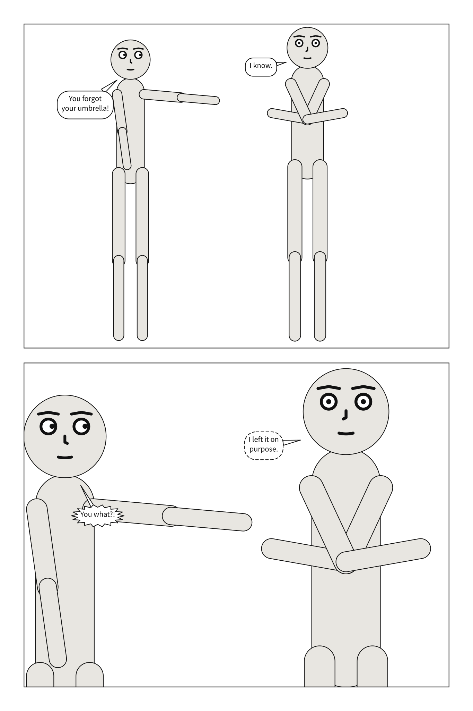

# Comic scripts

Comics are written as scripts before anyone draws them: a page heading, a panel heading, a
line describing the panel for the artist, then who says what. Scenet reads a script written
that way and compiles it as it compiles a scene. This chapter writes the same kind of story
as the last two, as a writer would.

## What you will make



One page, two panels: Alice and Bob on a rainy corner at a full shot, then closer, as Bob
whispers that he left his umbrella on purpose and Alice shouts back.

## A script

Save this as a `.script` file. The part between the two `---` lines is the **front
matter**: YAML, holding what every panel shares, exactly as beside `panels:` in a scene.
Everything after it is the script.

```{code-block} scenet-script
:caption: umbrella.script

---
panel:
  size: [900, 640]
cast:
  ALICE: {reference: alice, pose: pointing,     at: left_third}
  BOB:   {reference: bob,   pose: arms_crossed, at: right_third, facing: left}
staging:
  - ALICE left_of BOB
  - ALICE looking_at BOB
  - ALICE ground_shared_with BOB
---

PAGE ONE

PANEL 1
@shot: full_shot
Alice and Bob face each other on a rainy street corner. She is exasperated.

ALICE
You forgot your umbrella!

BOB
I know.

PANEL 2
@shot: medium_close_up
Closer now. Bob will not meet her eye.

BOB (whisper)
I left it on purpose.

ALICE (shouting)
You what?!
```

```bash
scenet build umbrella.script
```

```text
wrote umbrella.1.svg
wrote umbrella.2.svg
wrote umbrella.page-1.svg
note: 2: camera retreated to 57% of the requested 'medium_close_up' framing so the cast would fit across the panel
```

The panels are named by their numbers, `1` and `2`, and so are their files and notes.

Read it line by line:

| Line | Means |
|---|---|
| `PAGE ONE` | a page: the panels under it are laid out on it |
| `PANEL 1` | a panel, named by its number |
| `@shot: full_shot` | a **directive**: a key of the panel, here its [`camera.shot`](../reference/language/camera.md#camerashot) |
| `Alice and Bob face each other...` | prose, for the artist: never interpreted, and kept as the panel's [`description`](../reference/language/description.md) |
| `ALICE` | a cue, a cast id in capitals alone on its line: the lines under it are what Alice says |
| `BOB (whisper)` | a cue with a parenthetical: the balloon's [`kind`](../reference/language/script.md#saykind) |

A cue is a name in capitals because the cast's ids are, `ALICE` and `BOB`, in the front
matter. That is how Scenet tells a speech from prose without guessing.

## Directives

A line starting with `@` sets a key of the panel it is in. `@shot` and `@angle` set the
camera, as `camera: {shot: ...}` and `camera: {angle: ...}` would. Any other directive sets
the top-level key it names, in YAML: `@setting: {place: shore, time: dusk}`, `@lettering:
{size: 30}`, `@palette: tinted`. A few belong to the script itself:

| Directive | Does |
|---|---|
| `@tiers: 2 1` | right after a PAGE heading: how many panels each tier holds, from the top |
| `@over: 1` | this panel inherits panel 1, as `over:` does in a scene |
| `@cast: {BOB: null}` | change the cast for this panel only: here, take Bob out |

Each key card in [the language reference](../reference/language/index.md) gives its
directive in its "Where" row. The cue forms, captions and sounds are under the rules of
[Write a comic script](../howto/write_a_comic_script.md#the-rules): `CAPTION: Midnight.`
for a caption, `SFX: KRAK` for a sound, `ALICE (OP)` for a voice from off panel, `BOB
(small)` for a muttered line.

## A script as publishers ask for it

Dark Horse's script format numbers each lettered item, puts the panel's description on the
heading's line, and the page's panel count in its heading:

```{code-block} scenet-script
:caption: lighthouse.script

---
panel:
  size: [900, 640]
cast:
  MAYA: {reference: alice, pose: pointing,     at: left_third}
  THEO: {reference: bob,   pose: arms_crossed, at: right_third, facing: left}
staging:
  - MAYA left_of THEO
  - MAYA looking_at THEO
  - MAYA ground_shared_with THEO
---
Margo Wren
14 Harbour Lane, Port Ellis

The Lighthouse, Issue 1

PAGE ONE (three panels)

Panel 1. Dusk on the cliff path. Maya has climbed the last of the steps; Theo waits by the door.
@shot: full_shot
@setting: {place: shore, time: dusk}

CAP:
Port Ellis. The night the lamp went out.

MAYA:
Theo? The lamp is out --

THEO:
-- because somebody forgot the oil.

KEEPER (OP):
Who's up there?

Panel 2. Closer. Maya points back down the path, furious.
@shot: medium_shot

1. MAYA (burst):
Somebody!

2. THEO (whisper): I was going to fetch it.

Panel 3. Inside, the lamp blazes again. Both of them squint into the light.
@shot: medium_close_up

SFX (THEO, large): FWOOMP

CAP/MAYA
“-- and that was how the harbour got its light back.”
```

![A page of 3 panels. Dusk on the cliff path. Maya has climbed the last of the steps; Theo waits by the door. Caption: Port Ellis. The night the lamp went out. MAYA: Theo? The lamp is out -- THEO: -- because somebody forgot the oil. KEEPER, off panel: Who's up there? Closer. Maya points back down the path, furious. MAYA, shouting: Somebody! THEO, whispering: I was going to fetch it. Inside, the lamp blazes again. Both of them squint into the light. Sound effect, from THEO: FWOOMP. MAYA, off panel: -- and that was how the harbour got its light back.](../images/gallery/31-dark-horse.page-1.svg)

The writer's name and the title, before the first PAGE heading, are the title page: kept,
never interpreted. `KEEPER (OP)` speaks from off panel, and `CAP:` is a caption whose text
is on the line under it.

## What the compiler decided

**A script compiles to a scene.** The front matter is what is beside `panels:`; each panel
heading is a panel, named by its number; each page heading is a page. From there, it is the
compiler of the last two chapters, word for word: the same layout, the same lettering.

**Prose is never interpreted.** "She is exasperated" draws nothing. Alice is exasperated
only if you give her an `expression`, with `@cast: {ALICE: {expression: angry}}`. The prose
becomes the panel's description, which a screen reader says.

**A cue must be somebody in the cast.** A name in capitals that the panel does not cast, and
that has no `(OP)`, is set like dialogue but is not read as dialogue:
[`looks-like-dialogue`](../reference/diagnostics.md#looks-like-dialogue) says so, as a note,
and the line is kept as prose.

**A page's count is checked.** `PAGE ONE (three panels)` over two panels is a
[`panel-count`](../reference/diagnostics.md#panel-count) note:

```{scenet-example}
:kind: script
:gives: panel-count

---
cast:
  ALICE: {reference: alice}
---
PAGE ONE (three panels)

PANEL 1
ALICE
One.

PANEL 2
ALICE
Two.
```

## Try it

- [A comic script](https://creatoan.github.io/scenet/playground/#example=13-comic-script.script):
  the script you wrote. Add `@angle: low` under `PANEL 2`.
- [Dark Horse format](https://creatoan.github.io/scenet/playground/#example=31-dark-horse.script):
  change a cue's `(burst)` to `(whisper)`.
- [Une planche](https://creatoan.github.io/scenet/playground/#example=33-planche.script):
  the same story as a French *planche*, with `CASE` panels and French shot names.
- [A script in Markdown](https://creatoan.github.io/scenet/playground/#example=63-a-markdown-script.script):
  headings with `#`, labels in bold, as a notes app keeps a script.
- [A manga script](https://creatoan.github.io/scenet/playground/#example=64-a-manga-script.script):
  read right to left, the subject of [chapter 11](right_to_left.md).
- [French shots, abbreviated](https://creatoan.github.io/scenet/playground/#example=65-french-shots-abbreviated.script):
  PE, PM, PA, and the rest of a French découpage.
- [French shots in full](https://creatoan.github.io/scenet/playground/#example=66-french-shots-in-full.script):
  `VIGNETTE` panels, `CARTOUCHE` captions.
- [Written like a screenplay](https://creatoan.github.io/scenet/playground/#example=67-written-like-a-screenplay.script):
  sluglines, `(V.O.)` and `(O.S.)`.
- [A letterer's script](https://creatoan.github.io/scenet/playground/#example=68-a-letterers-script.script):
  every item numbered in reading order, captions saying what they do.

## Check it

```bash
scenet check umbrella.script lighthouse.script
```

```text
umbrella.script: ok
lighthouse.script: ok
```

A finding in a script points at the line of the script that caused it, a cue or a
directive, not at a line of YAML you never wrote.

## What you learned

- A comic script is front matter, in YAML, then pages, panels, prose and cues.
- A cue is a cast id in capitals; a parenthetical gives the balloon's kind, `(small)` or
  `(OP)`.
- `@` directives set any key of a panel; `@tiers`, `@over` and `@cast` belong to the script.
- Prose is the panel's description, never interpreted.
- Dark Horse, Markdown, French, manga, screenplay and letterer's scripts are all read.

## Where to go next

- The next chapter, [Your own art and characters](your_own_art.md).
- [Write a comic script](../howto/write_a_comic_script.md), every form a script may take.
- The [`script`](../reference/language/script.md) page, whose cards give each line's script
  form.
