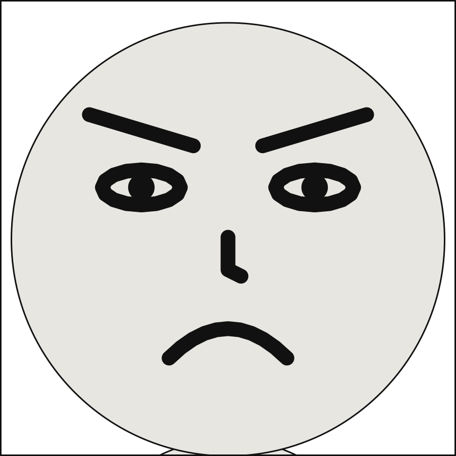

# Faces and marks

A pose moves the body. This chapter is about the face, and about what a comic draws around
a character rather than on them: sweat flying off a head, stars circling a dizzy one, the
scribble that stands in for an oath.

## What you will make

![A strip of 4 panels. Medium shot. Alice, left, scared, sweating, looking at Bob; Bob, right, arms crossed, angry, looking at Alice. Bob: Where is my umbrella? Medium shot. Alice, left, angry, swearing, looking at Bob; Bob, right, arms crossed, angry, looking at Alice. Alice: It was hideous! Medium shot. Alice, left, sad, dizzy, looking at Bob; Bob, right, arms crossed, bored, looking at Alice. Alice: I spun it round. Very fast. Then it was gone. Full shot. Alice, left, surprised; Bob, centre, pointing, shouting, dashing off. Alice: Bob?](../images/gallery/23-emanata.strip.svg)

Four panels of one story: Alice sweats while Bob asks for his umbrella, swears when it comes
up, spins as she explains, and is left surprised when Bob storms off in a cloud of dust.

## Expressions

[`expression`](../reference/language/cast.md#castidexpression) chooses a face the puppet
declares, by name, as `pose` chooses a set of joint angles. The shipped puppets have ten:
`neutral`, `happy`, `laughing`, `sad`, `angry`, `shouting`, `surprise`, `scared`, `coy` and
`bored`. They are a drawing convention, the small closed set of faces comics actually draw.

```{code-block} yaml
:caption: expressions.scene.yaml

# Ten expressions, which is every face the shipped puppets can make.
#
# An expression is to features what a pose is to joints: the puppet declares feature
# points that ride the head, declares named expressions as a state per feature, and the
# panel selects one by name. Nothing here touches the solver -- a face is still one disc
# that balloons may not cover, exactly as it was.
#
# The vocabulary is Comic Chat's emotion wheel plus `surprise`, which is to say it is a
# **drawing convention**: the small closed set of faces comics actually draw. It is not
# a claim that a person feeling anger produces this face.
#
# Watch the pupils. `looking_at` has always turned a figure toward its target and made
# the space in front of them expensive for a balloon; now it aims their eyes as well.

camera:
  shot: medium_shot

cast:
  alice: {reference: alice, pose: arms_crossed, at: left_third}
  bob:   {reference: bob,   pose: hands_on_hips, at: right_third, facing: left}

staging:
  - alice left_of bob
  - alice ground_shared_with bob
  - alice looking_at bob
  - bob looking_at alice

panels:
  confrontation:
    cast:
      alice: {expression: angry}
      bob:   {expression: shouting}

  surprised:
    cast:
      alice: {expression: neutral}
      bob:   {expression: surprise}

  delighted:
    cast:
      alice: {expression: happy}
      bob:   {expression: laughing}

  unimpressed:
    cast:
      alice: {expression: coy}
      bob:   {expression: bored}

  afraid:
    cast:
      alice: {expression: sad}
      bob:   {expression: scared}
```

![A strip of 5 panels. Medium shot. Alice, left, arms crossed, angry, looking at Bob; Bob, right, hands on hips, shouting, looking at Alice. Medium shot. Alice, left, arms crossed, looking at Bob; Bob, right, hands on hips, surprised, looking at Alice. Medium shot. Alice, left, arms crossed, happy, looking at Bob; Bob, right, hands on hips, laughing, looking at Alice. Medium shot. Alice, left, arms crossed, coy, looking at Bob; Bob, right, hands on hips, bored, looking at Alice. Medium shot. Alice, left, arms crossed, sad, looking at Bob; Bob, right, hands on hips, scared, looking at Alice.](../images/gallery/17-expressions.strip.svg)

Each panel under `panels:` changes only the two expressions; the cast, the staging and the
camera are written once, beside `panels:`, for all five. Watch the pupils too:
`looking_at` aims the eyes as well as turning the figure.

A face is worth a big close-up, the framing at which the head fills the panel:

```{code-block} yaml
:caption: face.panel.yaml

# A big close-up, which is the framing that pays for the face rig: the head fills the
# panel, and until expressions existed it was a circle.
#
# One character on purpose. A big close-up of two is not a big close-up for long -- the
# camera retreats to fit them both across the panel, and the note it prints says so.

panel:
  size: [900, 900]

camera:
  shot: big_close_up

cast:
  alice: {reference: alice, expression: angry}

# No lettering. At this framing the head fills the panel and there is nowhere a balloon
# could sit without covering the face, which the compiler refuses to do -- and a silent
# reaction panel is what a letterer would have drawn here anyway.
```



## Marks

[`marks`](../reference/language/cast.md#castidmarks) are emanata: what a comic draws around a
character. Mort Walker named them, and four of his names are the vocabulary:

| Mark | What it shows |
|---|---|
| `plewds` | sweat flying off a head |
| `squeans` | stars circling a dizzy one |
| `grawlixes` | the scribble that stands in for an oath |
| `briffits` | the dust somebody leaves behind |

They are a list, not a second expression, because they compose: Alice can be scared *and*
sweating. Save the scene at the top of this chapter:

```{code-block} yaml
:caption: marks.scene.yaml

# Emanata: what a comic draws around a character, rather than on them.
#
# Mort Walker named them in The Lexicon of Comicana, and four of his names are the
# vocabulary: `plewds` fly off a sweating head, `squeans` circle a dizzy one,
# `grawlixes` stand in for an oath, and `briffits` are the dust somebody leaves behind.
#
# They are a list, not a second `expression:`, because they compose -- Alice is scared
# *and* sweating, angry *and* swearing.
#
# Unlike a face, they are drawn outside the head, in the space balloons go, so they
# matter to the layout. How much is the decision this example shows: a balloon pays to
# cover them, so in `oath` Alice's line settles beside her grawlixes rather than on
# them. But they never move anybody. Strip every mark from this file and both
# characters stand exactly where they stand now.
#
# That cuts both ways. The camera frames by the body and makes no room for marks, so
# over the taller character's head, at this framing, they would run off the top of the
# panel -- which is why they are on Alice. Try them on Bob: `scenet build` says so, as
# the example "Marks cut off" shows.

panel:
  size: [1000, 700]

camera:
  shot: medium_shot

cast:
  alice: {reference: alice, at: left_third}
  bob:   {reference: bob,   pose: arms_crossed, at: right_third, facing: left}

staging:
  - alice left_of bob
  - alice ground_shared_with bob
  - alice looking_at bob
  - bob looking_at alice

panels:
  heat:
    cast:
      alice: {expression: scared, marks: [plewds]}
      bob:   {expression: angry}
    script:
      - say: {by: bob, text: "Where is my umbrella?"}

  oath:
    over: heat
    cast:
      alice: {expression: angry, marks: [grawlixes]}
    script:
      - say: {by: alice, text: "It was hideous!", prefer: top_left}

  dizzy:
    over: heat
    cast:
      alice: {expression: sad, marks: [squeans]}
      bob:   {expression: bored}
    script:
      - say: {by: alice, text: "I spun it round. Very fast. Then it was gone."}

  gone:
    camera: {shot: full_shot}
    cast:
      alice: {expression: surprise}
      bob:   {pose: pointing, expression: shouting, marks: [briffits], facing: right}
    staging:
      - alice left_of bob
      - alice ground_shared_with bob
    script:
      - say: {by: alice, text: "Bob?"}
```

```bash
scenet build marks.scene.yaml --strip
```

```text
wrote marks.heat.svg
wrote marks.oath.svg
wrote marks.dizzy.svg
wrote marks.gone.svg
wrote marks.strip.svg
```

Three of the panels are written `over: heat`: each takes everything from `heat` and states
only what changes. [Chapter 7](sequences.md) is about `over`.

## What the compiler decided

**A face is a disc no balloon covers.** Whatever the expression, the face is the same disc
to the layout, and no balloon, caption or sound may sit on it. That is why the big close-up
has no lettering: at that framing the head fills the panel, and there is nowhere a balloon
could go. A silent reaction panel is what a letterer would draw there anyway.

**Marks matter to the layout, but move nobody.** Marks are drawn outside the head, where
balloons go, so a balloon pays to cover them: in `oath`, Alice's line settles beside her
grawlixes rather than on them. But strip every mark from the file and both characters
stand exactly where they stand now.

**The camera makes no room for marks.** It frames the body. Over the taller character's
head, at this framing, the marks would run off the top of the panel, which is why they are
on Alice. Put them on Bob and `scenet build` says so, in a
[`cropped-marks`](../reference/diagnostics.md#cropped-marks) note. A frame that cuts across
a speaker's mouth gives a [`cropped-mouth`](../reference/diagnostics.md#cropped-mouth) note.

**An expression the puppet does not have is an error.** `smirking` is not one of the ten,
and `scenet check` says
[`unknown-expression`](../reference/diagnostics.md#unknown-expression), with the ones there
are:

```{scenet-example}
:gives: unknown-expression

cast:
  alice: {reference: alice, expression: smirking}
```

## Try it

- [Ten expressions](https://creatoan.github.io/scenet/playground/#example=17-expressions.scene.yaml):
  swap Alice's and Bob's expressions in each panel.
- [A face](https://creatoan.github.io/scenet/playground/#example=18-a-face.panel.yaml):
  try each of the ten expressions at a big close-up.
- [Emanata](https://creatoan.github.io/scenet/playground/#example=23-emanata.scene.yaml):
  the scene you built. Move the `plewds` to Bob, and read the note.

## Check it

```bash
scenet check expressions.scene.yaml marks.scene.yaml
```

```text
expressions.scene.yaml: ok
marks.scene.yaml: ok
```

`check` looks every pose and expression up in the puppet that plays the part, so a face a
puppet lacks is found without drawing anything.

## What you learned

- `expression` chooses one of the faces a puppet declares, by name: the shipped puppets
  have ten.
- `marks` draws emanata round a character, as a list: `plewds`, `squeans`, `grawlixes`,
  `briffits`.
- A face is a disc no lettering may cover, whatever it shows. Marks are avoided, but move
  nobody, and the camera makes no room for them.

## Where to go next

- The next chapter, [Setting and colour](setting_and_colour.md): what is behind the cast.
- [Add your own character](../howto/add_your_own_character.md), for a puppet with faces of
  its own, which [chapter 10](your_own_art.md) builds.
- The cards for [`cast.<id>.expression`](../reference/language/cast.md#castidexpression) and
  [`cast.<id>.marks`](../reference/language/cast.md#castidmarks).
