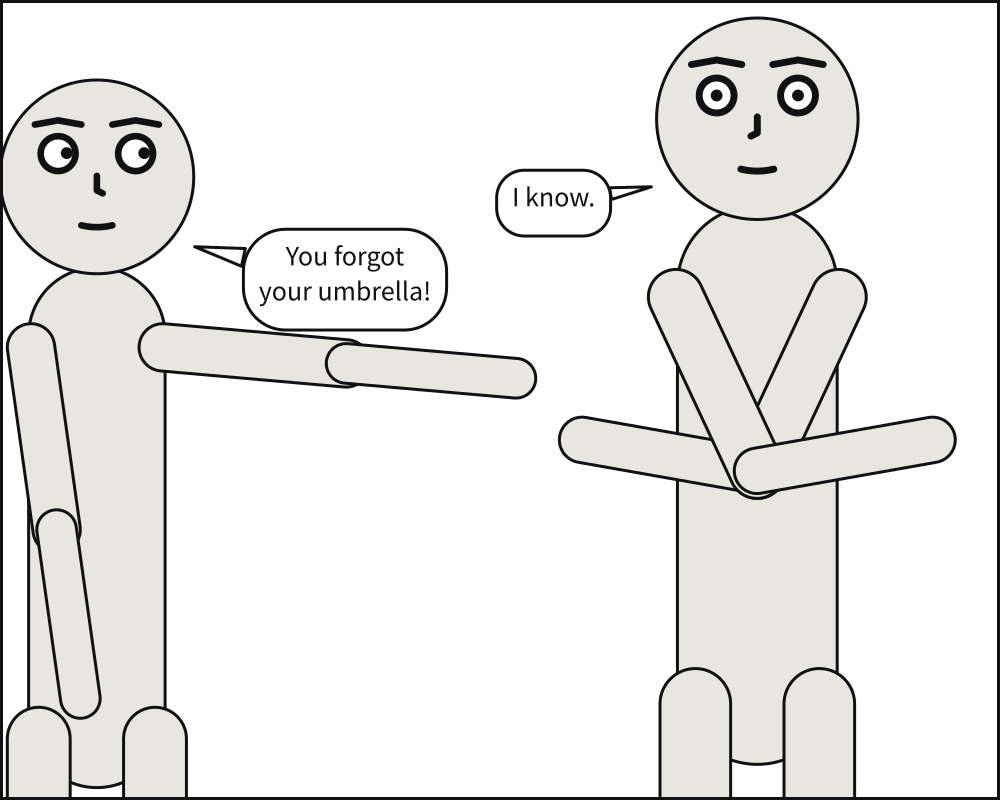

# Your first panel

You will write a panel of two characters with dialogue, build it into a picture, check it,
and read what the compiler decided on your behalf. Allow about fifteen minutes. Nothing is
assumed except that you can type a file and run a command.

## Before you start

You can follow the whole tour in your browser: the
[playground](https://creatoan.github.io/scenet/playground/) runs the real compiler there,
with nothing to install. Paste a document into its editor and the picture appears beside it.

Or install the `scenet` command. It needs Python 3.12 or newer; [Install
Scenet](../howto/install.md) has every way, and this one puts `scenet` on your `PATH`:

```bash
uv tool install scenet
```

Check that it worked:

```bash
scenet --version
```

Work in a folder of your own. Every file this tour writes is saved there, under the name
above its block, and every command runs from there.

## What you will make



Alice points at Bob, who stands with his arms crossed. She tells him he forgot his
umbrella; he knows. Nobody wrote a coordinate to get this: not where they stand, not how big
they are drawn, not where the balloons go.

## The smallest panel

A panel needs a [`cast`](../reference/language/cast.md), the people in it. Nothing else is
required: every other key has a default.

```{code-block} yaml
:caption: hello.panel.yaml

cast:
  alice: {reference: alice}
```

Build it:

```bash
scenet build hello.panel.yaml
```

```text
wrote hello.svg
```

Open `hello.svg` in a browser. One figure, centred, framed as a medium shot in a 1000 by
1000 panel. You asked for none of that and got all of it, because every key has a default.

`alice` appears twice in that line, and the two mean different things. The key, `alice:`,
is an {term}`actor` id: the name this panel uses for this person. `reference: alice` names the
{term}`puppet` that is drawn, one of the two Scenet ships, `alice` and `bob`. They match here
only for convenience. Two actors may be played by one puppet, `guard_left` and
`guard_right` both by `bob`, and the panel still tells them apart.

## The whole panel

Now write the panel at the top of this page. Replace what `hello.panel.yaml` holds with
this:

```{code-block} yaml
:caption: hello.panel.yaml

# The umbrella panel, the example every page of the documentation starts from. Two
# actors, an ordering constraint, a gaze, a shared ground line, and two lines of dialogue.

panel:
  size: [1000, 800]

camera:
  shot: medium_shot

cast:
  alice: {reference: alice, pose: pointing,     at: left_third}
  bob:   {reference: bob,   pose: arms_crossed, at: right_third, facing: left}

staging:
  - alice left_of bob
  - alice looking_at bob
  - alice ground_shared_with bob

script:
  - say: {by: alice, text: "You forgot your umbrella!", prefer: top_left}
  - say: {by: bob,   text: "I know."}
```

Each block is one layer of the panel, and each has a page in the [language
reference](../reference/language/index.md):

- [`panel`](../reference/language/panel.md) is the frame: its
  [`size`](../reference/language/panel.md#panelsize), in panel units.
- [`camera`](../reference/language/camera.md) says how the cast is framed. A
  [`shot`](../reference/language/camera.md#camerashot) is named by where the frame cuts the
  body: `medium_shot` cuts at the waist.
- [`cast`](../reference/language/cast.md) says who is there. Each member names its puppet
  with [`reference`](../reference/language/cast.md#castidreference), may take a
  [`pose`](../reference/language/cast.md#castidpose) the puppet declares, would like to
  stand [`at`](../reference/language/cast.md#castidat) a place along the panel's width, and
  is [`facing`](../reference/language/cast.md#castidfacing) right unless told otherwise.
- [`staging`](../reference/language/staging.md) says how the cast stand to each other, one
  sentence per relation.
- [`script`](../reference/language/script.md) is what is said, in the order it is read. A
  [`say`](../reference/language/script.md#say) is a balloon:
  [`by`](../reference/language/script.md#sayby) whom, its
  [`text`](../reference/language/script.md#saytext), and the corner it would
  [`prefer`](../reference/language/script.md#sayprefer).

Build it again:

```bash
scenet build hello.panel.yaml
```

```text
wrote hello.svg
note: camera retreated to 89% of the requested 'medium_shot' framing so the cast would fit across the panel
```

## What the compiler decided

The picture is the output, but it is not where the interesting information is. Between
your document and the picture sits **Panel Core**: every position the compiler chose, as
numbers, still carrying every name you wrote. Ask for it, and for the debug overlay:

```bash
scenet build hello.panel.yaml --core --debug
```

```text
wrote hello.svg
wrote hello.core.json
wrote hello.debug.svg
note: camera retreated to 89% of the requested 'medium_shot' framing so the cast would fit across the panel
```

`hello.core.json` is readable, and diffable. `hello.debug.svg` draws over the panel the
geometry the compiler worked against: each figure's outline, the disc of each face that no
balloon may cover, each gaze and each tail. When a panel looks wrong, the overlay is nearly
always where the reason shows. Here is what it shows of this one.

**The camera stepped back.** Two people side by side, each at a medium shot, do not fit
across a panel 1000 wide. A camera operator would step back, so the compiler does: everyone
is drawn smaller, by one factor, and a little more of each body is in view. The shot you ask
for is the tightest the camera may go, not a promise. The note says so, and has an entry of
its own in the catalogue,
[`camera-retreated`](../reference/diagnostics.md#camera-retreated).

**One camera, one scale.** Alice and Bob are drawn at the same scale, so Bob, who is
taller, stays taller. Framing each by their own waist would make them the same height and
erase what tells them apart.

**Order is required; place is a wish.** `alice left_of bob` is a hard rule. `at:
left_third` is a preference, and gives way first when the two disagree.

**A gaze moves nobody.** `alice looking_at bob` turns her eyes toward him and makes the
space in front of her expensive for a balloon, since a balloon in somebody's line of sight
reads as an obstruction. Nobody's position changes.

**One ground.** `alice ground_shared_with bob` puts their *feet* on one line. Their heads
are not aligned: they are different heights.

**The lines were broken for you.** You wrote each line as one string. Where it breaks was
measured against the real font, and chosen as a letterer would: "I know." fits on one line,
so it stays on one.

**Script order is reading order**, and that is a rule, not a preference: a balloon never
sits above and to the left of one that comes before it. Swap the two `say` lines and the
balloons swap places.

In full, from the rule that never gives way to the one that gives way first:

| Strength | What | Example |
|---|---|---|
| Required | Actors never overlap; a declared order holds | `alice left_of bob` |
| Required | A balloon never covers a face; reading order holds | |
| Strong | Actors stay inside the panel | |
| Weak | An actor stands at the place it asked for | `at: left_third` |
| Weakest | A balloon sits in the zone it prefers | `prefer: top_left` |

## Try it

Open each example in the playground, change it, and watch what moves.

- [Two characters](https://creatoan.github.io/scenet/playground/#example=01-two-characters.panel.yaml)
  is the panel you just wrote. Change `shot: medium_shot` to `shot: full_shot`: the camera
  no longer needs to step back, and the note goes away.
- [A complete panel](https://creatoan.github.io/scenet/playground/#example=71-a-complete-panel.panel.yaml)
  adds the one layer this chapter left out, a
  [`setting`](../reference/language/setting.md): the docks, at night, in the rain. Try
  `time: day`.
- [A tour](https://creatoan.github.io/scenet/playground/#example=38-tour.scene.yaml) is a
  whole page, and everything the rest of this tour teaches, at once. Read it to see where
  you are going.

## Check it

`scenet check` reads a document and reports everything wrong with it, all at once, without
drawing anything. It is quick, and it is what to run after every change:

```bash
scenet check hello.panel.yaml
```

```text
hello.panel.yaml: ok
```

A note is not a fault: the camera's retreat is a decision, not a mistake, and the document
is still `ok`. Here is a mistake. Save this beside it:

```{scenet-example}
:file: typo.panel.yaml
:gives: unknown-pose

cast:
  alice: {reference: alice, pose: pointng}
```

```bash
scenet check typo.panel.yaml  # exits 1
```

```text
typo.panel.yaml:2:35: unknown-pose: puppet 'alice' has no pose 'pointng'; available: ['arms_crossed', 'hands_on_hips', 'pointing', 'standing_neutral']
```

Each finding gives the file, the line and column, a rule, and what is wrong. The rule is the
finding's name, and never changes: every rule has an entry in the
[diagnostics catalogue](../reference/diagnostics.md) saying why it happens and how to fix
it. This one is [`unknown-pose`](../reference/diagnostics.md#unknown-pose).

## What you learned

- A panel is written in layers: `panel`, `camera`, `cast`, `staging`, `script`. Each has a
  default, so only the cast is required.
- An actor id names a part; `reference` names the puppet who plays it.
- You say who stands where relative to whom, and which way they look. The compiler finds
  the coordinates.
- Some rules are required and some are wishes. When they disagree, the weakest gives way,
  and a note says when that changed what you asked for.
- `scenet build` draws; `--core` and `--debug` show why. `scenet check` reports every
  mistake, by a rule with an entry of its own.

## Where to go next

- The next chapter, [Camera and staging](camera_and_staging.md), takes the camera and the
  staging apart.
- [The language reference](../reference/language/index.md), a page per block, and
  [All keys, A to Z](../reference/language/keys.md).
- [Install Scenet](../howto/install.md), for the editor support and the other ways to run
  it.
- [Debug a layout](../howto/debug_a_layout.md), to read the overlay in depth.
