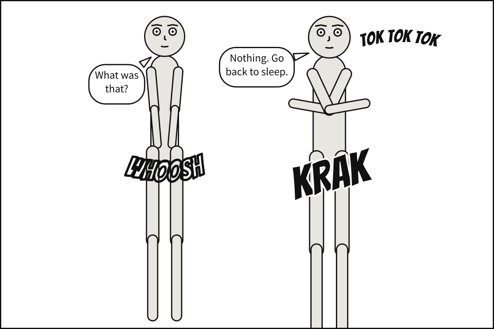
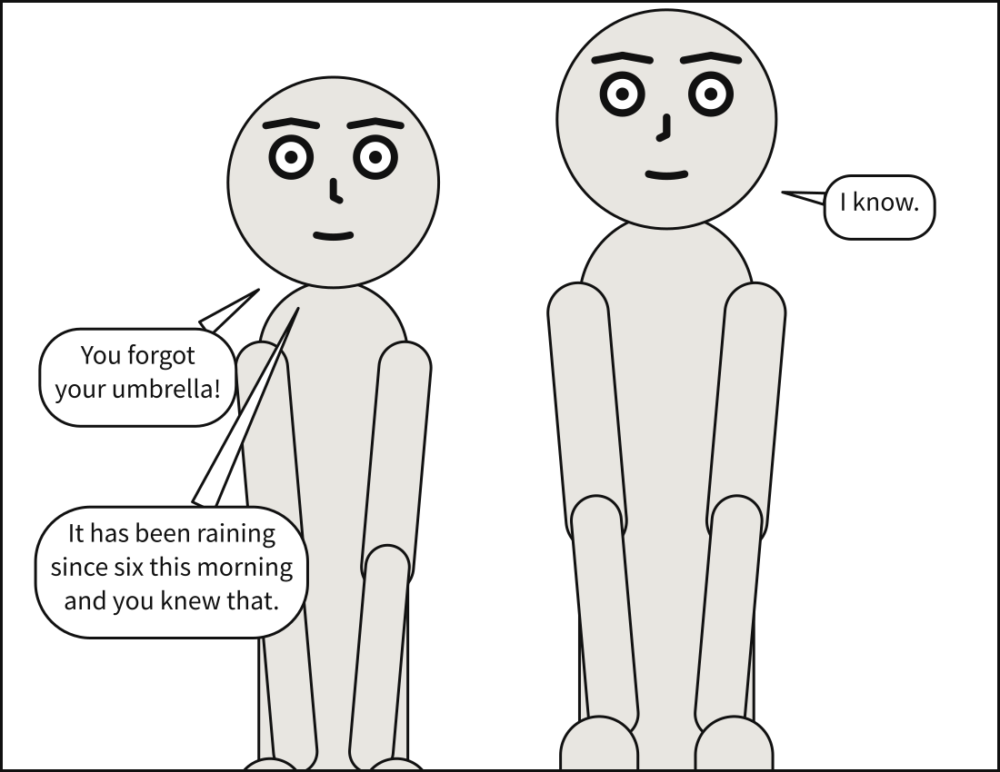
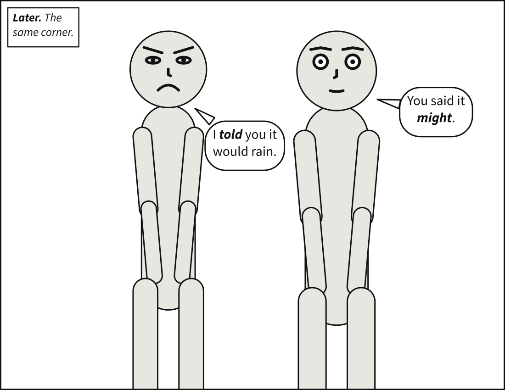
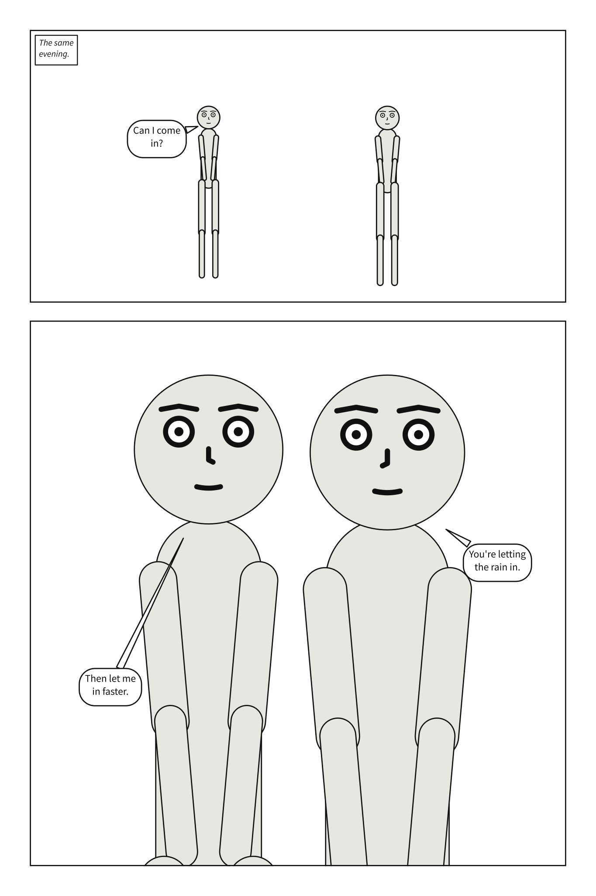

# Lettering and sound

The last chapter decided where words go. This one is about the words themselves: where a
line breaks, a stressed word, the size of the type, a font of your own, capitals, and the
letters that are part of the picture, sound effects.

## What you will make



A crack from Bob's side, a knocking at the top right, a whoosh as Alice turns, each
lettered in the display face and none in a balloon. The balloons settle round them.

## Where a line breaks

You never break a line yourself. Write each line as one string, and the compiler measures it
against the real metrics of the real font, then chooses the breaks a letterer would: a
phrase that fits on one line is not split, and no line is left stranded far shorter than its
neighbours.

```{code-block} yaml
:caption: breaks.panel.yaml

# Never break lines yourself. Where text breaks is decided during compilation,
# measured against the real metrics of the real font, and scored on how close the
# resulting block comes to the shape a letterer would choose.
#
# Two rules the scoring exists to enforce: a phrase that fits on one line is not
# split, even where splitting scores marginally better on aspect ratio; and no line is
# left stranded far shorter than its neighbours.

panel:
  size: [1100, 850]

camera:
  shot: medium_shot

cast:
  alice: {reference: alice, at: left_third}
  bob:   {reference: bob,   at: right_third, facing: left}

staging:
  - alice left_of bob
  - alice ground_shared_with bob

script:
  - say: {by: alice, text: "You forgot your umbrella!", prefer: top_left}
  - say: {by: bob,   text: "I know."}
  - say: {by: alice, text: "It has been raining since six this morning and you knew that."}
```



## A stressed word

A word between underscores, `_word_`, is stressed: lettered in bold italic, the letterers'
convention for emphasis, in balloons and captions alike. It is measured in bold italic too,
so a stressed word widens its balloon by exactly as much as it is drawn wider. An
underscore inside a word, as in `file_name`, is just an underscore.

```{code-block} yaml
:caption: stress.panel.yaml

# A word between underscores is stressed, the way a script underlines it, and lettered
# in bold italic -- the letterers' convention for emphasis, in balloons and captions
# alike.
#
# The stressed word is measured in bold italic as well as drawn in it. Bold italic is
# wider than roman, so a stressed word widens its balloon by exactly as much as it is
# drawn wider. An underscore inside a word, as in file_name, is just an underscore.

panel:
  size: [1100, 850]

camera:
  shot: cowboy

cast:
  alice: {reference: alice, at: left_third, expression: angry}
  bob:   {reference: bob,   at: right_third, facing: left}

staging:
  - alice left_of bob

script:
  - caption: {text: "_Later._ The same corner.", kind: locale}
  - say: {by: alice, text: "I _told_ you it would rain."}
  - say: {by: bob,   text: "You said it _might_."}
```



## The size of the type

[`lettering.size`](../reference/language/lettering.md#letteringsize) is the one lettering
measurement you set: the dialogue type size, in the units of the panel. Captions keep their
proportion to it. Left out, dialogue is lettered at 3.5% of the panel's height, or, on a page,
of one tier of a three-tier page, so that a short panel and a tall one on the same page are
lettered alike.

```{code-block} yaml
:caption: type-size.scene.yaml

# Type size: the one lettering measurement you set.
#
# Left alone, dialogue is lettered at 3.5% of the height a panel letters against -- on a
# page, one tier of a three-tier page. `lettering: {size: N}` chooses instead: the
# dialogue size, in the same units as the page and its panels. Captions keep their
# proportion to it.
#
# Set beside `panels:`, as here, every panel inherits it, so the whole page letters at
# one size: a short tier and a tall one alike. Set on one panel, it letters that panel
# alone.

lettering: {size: 26}

page: {size: [1500, 2250], margin: 75, gutter: 30, tier_gutter: 45}

cast:
  alice: {reference: alice, at: left_third}
  bob:   {reference: bob,   at: right_third, facing: left}

staging:
  - alice left_of bob

pages:
  - tiers:
      - panels: [door]
      - {height: 2, panels: [inside]}

panels:
  door:
    camera: {shot: wide}
    script:
      - caption: {text: "The same evening.", kind: locale}
      - say: {by: alice, text: "Can I come in?"}

  inside:
    camera: {shot: medium_shot}
    script:
      - say: {by: bob, text: "You're letting the rain in."}
      - say: {by: alice, text: "Then let me in faster."}
```



Written beside `panels:`, as here, every panel inherits the size. Written on one panel, it
letters that panel alone. A single line can still be set smaller with `size: small`, as in
the last chapter.

## A font of your own

[`lettering.font`](../reference/language/lettering.md#letteringfont) names the font files to
letter in, relative to the document. A font is always a file you name, never one installed on
the machine, because what the compiler measures must be the same everywhere. Name one file,
which letters every face, or one per face:

| Face | Letters | Left out |
|---|---|---|
| [`regular`](../reference/language/lettering.md#letteringfontregular) | dialogue and `spoken` captions | the shipped face |
| [`italic`](../reference/language/lettering.md#letteringfontitalic) | every other caption | the regular face stands in |
| [`bold_italic`](../reference/language/lettering.md#letteringfontbold_italic) | a stressed word | another face stands in |
| [`display`](../reference/language/lettering.md#letteringfontdisplay) | sound effects | the shipped display face |

This document letters in Comic Neue, under the SIL Open Font License. Its four files are in
[`examples/gallery/fonts/`](https://github.com/creatoan/scenet/tree/main/examples/gallery/fonts);
save them in a folder `fonts/` beside the document. The playground writes them there for you.

```{code-block} yaml
:caption: own-font.scene.yaml

# Your own font: lettering in a face you supply, instead of the one Scenet ships.
#
# A font is always a file you name, never one installed on the machine: what the compiler
# measures has to be the same everywhere. Paths are relative to this document -- these are
# in fonts/, beside it, and the playground writes them there for you.
#
# `font:` may name one file, which then letters every face, as in the first panel. Or it
# names a file for each face, as in the second: `regular` for dialogue, `italic` for
# captions, `bold_italic` for a stressed word, `display` for sound effects. The face is
# Comic Neue, under the SIL Open Font License, which is in fonts/OFL.txt.
#
# The second panel also sets its own type size. Written there, `size` letters that panel
# alone; written beside `panels:`, it would letter every panel.

panel: {size: [1000, 650]}
camera: {shot: full_shot}

cast:
  alice: {reference: alice, at: left_third}
  bob:   {reference: bob,   at: right_third, facing: left}

staging:
  - alice left_of bob
  - alice looking_at bob

panels:
  one-file:
    lettering: {font: fonts/ComicNeue-Regular.ttf}
    script:
      - say: {by: alice, text: "Is that a new font?"}
      - say: {by: bob, text: "One file, for everything I say."}

  four-faces:
    lettering:
      size: 30
      font:
        regular: fonts/ComicNeue-Regular.ttf
        italic: fonts/ComicNeue-Italic.ttf
        bold_italic: fonts/ComicNeue-BoldItalic.ttf
        display: fonts/ComicNeue-Bold.ttf
    script:
      - caption: {text: "Later, at the type foundry.", kind: locale}
      - say: {by: alice, text: "Now every face is _yours_."}
      - sfx: {text: CLUNK, from: bob, size: medium}
```


```bash
scenet build own-font.scene.yaml
```

```text
wrote own-font.one-file.svg
wrote own-font.four-faces.svg
```

## Capitals

Comics are conventionally lettered in capitals, and Scenet sets exactly what you type. It
does not uppercase for you, because doing it well is not a case conversion: the pronoun "I"
takes a crossbar that every other capital I does not. Write in capitals if you want them;
[Capitals are yours to set](../reference/language/lettering.md#capitals-are-yours-to-set)
says why.

## Sound effects

An [`sfx`](../reference/language/script.md#sfx) line letters a sound, exactly as written, in
the display face, with no balloon:

| Key | What it does |
|---|---|
| [`text`](../reference/language/script.md#sfxtext) | the sound, as written: no exclamation mark is added |
| [`from`](../reference/language/script.md#sfxfrom) | the actor it comes from, which it is placed near |
| [`prefer`](../reference/language/script.md#sfxprefer) | a zone, on its own or as a pull on a sound `from` somebody |
| [`size`](../reference/language/script.md#sfxsize) | `small`, `medium` or `large`: how loud |
| [`rotate`](../reference/language/script.md#sfxrotate) | turned clockwise, from -45 to 45 degrees |
| [`arc`](../reference/language/script.md#sfxarc) | the line of letters bent, from -120 to 120 degrees |
| [`hollow`](../reference/language/script.md#sfxhollow) | outline only, so the art shows through |

Save the panel at the top of this chapter:

```{code-block} yaml
:caption: sounds.panel.yaml

# Sound effects: letters that are part of the picture.
#
# `- sfx:` letters a sound in the display face, Bangers, with no balloon. It goes near
# the actor it comes `from:`, or in the zone it prefers, chosen by candidate scoring like
# everything else -- never at a coordinate -- and it never covers a face. It can turn,
# bend along an arc, and be `hollow`: all outline, so the art shows through.
#
# It takes its turn in the script's reading order, but sits where the sound is. Balloons
# pay to cover it, so they settle around it; nobody moves for it. No exclamation mark is
# added: sound effects are not exclamations.

panel:
  size: [1200, 800]
  margin: 20

camera:
  shot: full_shot

cast:
  alice: {reference: alice, at: left_third}
  bob:   {reference: bob,   at: right_third, facing: left, pose: arms_crossed}

staging:
  - alice left_of bob

script:
  - sfx: {text: KRAK, from: bob, size: large, rotate: -14}
  - say: {by: alice, text: "What was that?"}
  - sfx: {text: tok tok tok, prefer: top_right, size: small, arc: 30}
  - sfx: {text: WHOOSH, from: alice, size: medium, arc: -40, hollow: true}
  - say: {by: bob, text: "Nothing. Go back to sleep."}
```

```bash
scenet build sounds.panel.yaml
```

```text
wrote sounds.svg
```

A sound `from` somebody and pulled to a zone sits by its source, on the side you asked for:

```{code-block} yaml
:caption: ringing.panel.yaml

# A sound pulled toward a zone.
#
# A sound effect `from:` somebody is placed near them. Give it a `prefer:` too and the zone
# pulls it: still by its source, but on the side you asked for. With no source at all,
# `prefer:` alone says where it would like to sit.
#
# `rotate` turns it clockwise, in degrees from -45 to 45: positive leans its top to the
# right, negative to the left. Like everything about a sound, it is applied to the letters'
# outlines, so it comes out the same in every viewer.

panel: {size: [1200, 800]}
camera: {shot: full_shot}

cast:
  alice: {reference: alice, at: left_third}
  bob:   {reference: bob,   at: right_third, facing: left, pose: arms_crossed}

staging:
  - alice left_of bob

script:
  - sfx: {text: RING RING, from: bob, prefer: top_right, rotate: 12, size: large}
  - say: {by: alice, text: "Your phone."}
  - sfx: {text: tap tap, from: alice, prefer: bottom_left, rotate: -10, size: small}
  - say: {by: bob, text: "Let it ring."}
```

## What the compiler decided

**The breaks were scored, not just wrapped.** The compiler wrapped each line at every width
a run of its words could measure, and kept the block whose shape came closest to the one a
letterer would choose. It measured with the font that draws the line, so what is measured is
what is drawn.

**Lettering is drawn as outlines.** Every letter is written into the SVG as the shape of its
glyph, so the picture looks the same in every viewer, with or without the font. A sound's
rotation and arc are applied to those outlines too.

**A sound is part of the picture.** It takes its turn in reading order, but sits where the
sound is. Balloons pay to cover it, so they settle round it; nobody moves for it, and it
never covers a face.

**A face left out stands in.** Name a `regular` font and no `italic`, and the captions are
lettered in the regular face: `scenet build` says so, in an
[`italic-stand-in`](../reference/diagnostics.md#italic-stand-in) note. With no `bold_italic`,
the [`bold-italic-stand-in`](../reference/diagnostics.md#bold-italic-stand-in) note says
which face letters a stressed word instead. A font file that is not there is
[`font-file`](../reference/diagnostics.md#font-file).

**An underscore left open is a mistake.** `_told you` stresses nothing, and is
[`unbalanced-emphasis`](../reference/diagnostics.md#unbalanced-emphasis):

```{scenet-example}
:gives: unbalanced-emphasis

cast:
  alice: {reference: alice}
script:
  - say: {by: alice, text: "I _told you it would rain."}
```

## Try it

- [How lines break](https://creatoan.github.io/scenet/playground/#example=14-lettering.panel.yaml):
  make the panel narrower, `size: [700, 850]`, and watch the long line rebreak.
- [Emphasis](https://creatoan.github.io/scenet/playground/#example=28-emphasis.panel.yaml):
  stress every word of a line.
- [Type size](https://creatoan.github.io/scenet/playground/#example=29-type-size.scene.yaml):
  set `lettering: {size: 40}`.
- [Your own font](https://creatoan.github.io/scenet/playground/#example=42-your-own-font.scene.yaml):
  delete the `italic` line, and read the note.
- [Sound effects](https://creatoan.github.io/scenet/playground/#example=30-sound-effects.panel.yaml):
  the panel you built. Make the KRAK `hollow: true`.
- [A sound pulled to a zone](https://creatoan.github.io/scenet/playground/#example=43-sound-pulled-to-a-zone.panel.yaml):
  change `prefer: top_right` to `prefer: bottom_right`.

## Check it

```bash
scenet check sounds.panel.yaml own-font.scene.yaml
```

```text
sounds.panel.yaml: ok
own-font.scene.yaml: ok
```

`check` makes sure every font file a document names is there and is a font, without
lettering anything: a missing one is
[`font-file`](../reference/diagnostics.md#font-file), with the line and column it is named
on. `scenet check --deep` letters every line as `build` would, and reports
a balloon that cannot be placed anywhere as
[`balloon-placement`](../reference/diagnostics.md#balloon-placement).

## What you learned

- Write each line whole: the compiler breaks it, measured against the real font.
- `_word_` stresses a word, in bold italic.
- `lettering.size` sets the type size, for a panel or for every panel beside `panels:`.
- `lettering.font` letters in files you supply, one for every face or one per face.
- Capitals are what you type.
- `sfx` letters a sound into the picture: from somebody or in a zone, sized, turned, bent
  or hollow.

## Where to go next

- The next chapter, [Faces and marks](faces_and_marks.md).
- [Letter in your own font](../howto/letter_in_your_own_font.md).
- The cards for [`lettering`](../reference/language/lettering.md) and
  [`sfx`](../reference/language/script.md#sfx).
