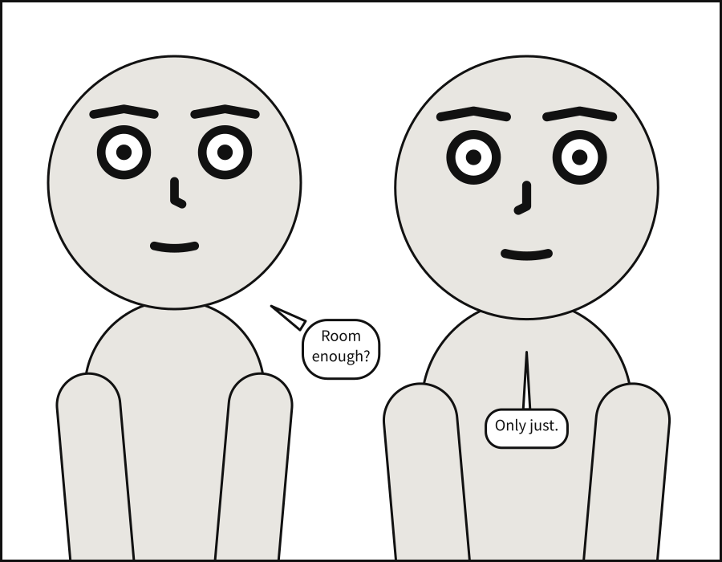

# Pages and print

A strip lays panels side by side. A comic lays them out on a page: in tiers, top to bottom,
each a row of panels; some stacked in columns, some set into a corner of another, some
slanted, some running off the edge of the paper. Then it prints. This chapter does all of
that, and ends on a PDF ready for a printer.

## What you will make

![A page of 5 panels. Long shot. A street at night, in the rain. Alice, left, pointing, looking at Bob; Bob, right, arms crossed. Caption: Midnight. The corner of Fifth. Alice: You forgot your umbrella! Medium close-up. A street at night, in the rain. Bob, centre, arms crossed. Bob, whispering: I know. Full shot. A street at night, in the rain. Alice, left, pointing, looking at Bob; Bob, centre, arms crossed. Alice: You know? Then why did you leave it? Bob: So you would come after me. Close-up. A street at night, in the rain. Alice, centre, surprised. Alice: Oh. Close-up. A street at night, in the rain. Bob, centre, happy. Bob, whispering: Shall we?](../images/gallery/24-page.page-1.svg)

A page of five panels in three tiers: a wide establishing shot beside Bob's reply, a tall
tier in which Alice catches up with him, and two close-ups side by side.

## A page

A scene with [`pages`](../reference/language/page.md#pages) is laid out as a comic page.
[`page`](../reference/language/page.md#page) gives the format every page shares: its
[`size`](../reference/language/page.md#pagesize), the
[`margin`](../reference/language/page.md#pagemargin) inside its edge, the
[`gutter`](../reference/language/page.md#pagegutter) between panels side by side, and the
[`tier_gutter`](../reference/language/page.md#pagetier_gutter) between tiers.

Each page is a list of [`tiers`](../reference/language/page.md#pagestiers), top to bottom.
Each tier holds its [`panels`](../reference/language/page.md#tierspanels) in reading order,
each named from `panels:`, and may take a [`height`](../reference/language/page.md#tiersheight)
relative to the others. A panel placed by name alone, `reply`, may also be written as a
mapping, [`use`](../reference/language/page.md#panelsuse), to give it a
[`width`](../reference/language/page.md#panelswidth) relative to its neighbours.

```{code-block} yaml
:caption: page.scene.yaml

# A page: panels laid out in tiers, read left to right and top to bottom.
#
# `page:` sets the format; `pages:` lays panels out. A panel takes a share of its
# tier's width, and a tier a share of the page's height, by weight -- the way CSS
# Grid's `fr` tracks share a row. A panel named alone has a weight of 1.
#
# Each panel is still compiled on its own, at the size of its frame, so the page
# changes nothing about how a panel is composed -- except that every panel on it
# letters at one type size, as a letterer would.

page: {size: [1500, 2250], margin: 75, gutter: 30, tier_gutter: 45}
setting: {place: street, time: night, weather: rain}

pages:
  - tiers:
      - panels: [{use: establishing, width: 2}, reply]
      - {height: 1.2, panels: [closer]}
      - panels: [her, him]

panels:
  establishing:
    camera: {shot: long_shot}
    cast:
      alice: {reference: alice, pose: pointing, at: left_third}
      bob:   {reference: bob,   pose: arms_crossed, at: right_third, facing: left}
    staging:
      - alice left_of bob
      - alice looking_at bob
      - alice ground_shared_with bob
    script:
      - caption: {text: "Midnight. The corner of Fifth.", kind: locale}
      - say: {by: alice, text: "You forgot your umbrella!"}

  reply:
    camera: {shot: medium_close_up}
    cast:
      bob: {reference: bob, pose: arms_crossed, facing: left}
    script:
      - say: {by: bob, text: "I know.", kind: whisper}

  closer:
    over: establishing
    camera: {shot: full_shot}
    script:
      - say: {by: alice, text: "You know? Then why did you leave it?"}
      - say: {by: bob, text: "So you would come after me."}

  her:
    camera: {shot: close_up}
    cast:
      alice: {reference: alice, expression: surprise, facing: right}
    script:
      - say: {by: alice, text: "Oh."}

  him:
    camera: {shot: close_up}
    cast:
      bob: {reference: bob, expression: happy, facing: left}
    script:
      - say: {by: bob, text: "Shall we?", kind: whisper}
```

```bash
scenet build page.scene.yaml
```

```text
wrote page.establishing.svg
wrote page.reply.svg
wrote page.closer.svg
wrote page.her.svg
wrote page.him.svg
wrote page.page-1.svg
```

A document with pages is drawn as pages, `page.page-1.svg` and on, one file per page, and
each of its panels as a file of its own too.

## A page's panel size is the layout's

No panel on a page writes a `panel: {size: ...}`: the page decides it. Each panel's size is
what its tier's height and its own width make of the page, and the panel is then framed and
lettered like any other. On a page, the default type size is set by one tier of a
three-tier page, so every panel letters alike.

## Margins

A panel standing alone may have a [`margin`](../reference/language/panel.md#panelmargin) of
its own. It keeps the balloons, captions and sound effects in; the figures may still run off
the edge, as figures do in comics.

```{code-block} yaml
:caption: margin.panel.yaml

# `margin` insets the usable area. Balloons are kept inside it; actors may bleed
# past it, which is ordinary comics practice.
#
# That asymmetry is deliberate. Panel bounds are a STRONG constraint on actors rather
# than a required one, so a crowded panel lets a figure run off the edge instead of
# refusing to compile. Lettering has no such licence: text that leaves the panel is
# text nobody can read.

panel:
  size: [900, 700]
  margin: 60

camera:
  shot: medium_close_up

cast:
  alice: {reference: alice, at: left_edge}
  bob:   {reference: bob,   at: right_edge, facing: left}

staging:
  - alice left_of bob

script:
  - say: {by: alice, text: "Room enough?"}
  - say: {by: bob,   text: "Only just."}
```



## Columns

A tier may hold [`columns`](../reference/language/page.md#tierscolumns) in place of panels:
each column a stack of [`panels`](../reference/language/page.md#columnspanels) read top to
bottom before the next column, with a [`width`](../reference/language/page.md#columnswidth)
relative to the other columns, and each panel a
[`height`](../reference/language/page.md#columnspanelsheight) relative to the others in it.

```{code-block} yaml
:caption: columns.scene.yaml

# A page with a tall panel beside a stack: columns.
#
# A tier can hold `columns:` in place of `panels:`. It is split across into columns
# by `width`, and each column down into its panels by `height`. A column of one
# panel spans the tier's whole height.
#
# The stack is read down before across -- `where`, then `behind`, then `turn` --
# because the tall panel beside it blocks the way across. That is what about nine
# readers in ten do with this layout (Cohn, 2013). Two stacks side by side block
# nothing, readers go across them, and they are refused.

page: {size: [1500, 2250], margin: 75, gutter: 30, tier_gutter: 45}
setting: {place: street, time: dusk}

pages:
  - tiers:
      - panels: [spotted]
      - height: 2
        columns:
          - {width: 3, panels: [where, {use: behind, height: 1.5}]}
          - {width: 2, panels: [turn]}
      - panels: [laugh]

panels:
  spotted:
    camera: {shot: long_shot}
    cast:
      alice: {reference: alice, pose: pointing, expression: shouting, at: left_third}
      bob:   {reference: bob,   at: right_third, facing: right}
    staging:
      - alice left_of bob
      - alice ground_shared_with bob
    script:
      - say: {by: alice, text: "Bob! Don't move!"}

  where:
    camera: {shot: close_up}
    cast:
      bob: {reference: bob, expression: scared, facing: left}
    script:
      - say: {by: bob, text: "Why? What is it?"}

  behind:
    camera: {shot: medium_shot}
    cast:
      alice: {reference: alice, pose: pointing, expression: shouting, facing: right}
    script:
      - say: {by: alice, text: "Right behind you!", kind: shout}

  turn:
    camera: {shot: full_shot}
    cast:
      bob: {reference: bob, pose: hands_on_hips, expression: surprise, facing: right}
    script:
      - say: {by: bob, text: "...A puddle?"}

  laugh:
    over: spotted
    camera: {shot: full_shot}
    cast:
      alice: {pose: standing_neutral, expression: laughing, facing: right}
      bob:   {expression: angry, facing: left}
    staging:
      - alice left_of bob
      - alice looking_at bob
      - alice ground_shared_with bob
    script:
      - say: {by: alice, text: "Your new shoes, Bob!"}
      - say: {by: bob, text: "Very funny."}
```

![A page of 5 panels. Long shot. A street at dusk. Alice, left, pointing, shouting; Bob, centre. Alice: Bob! Don't move! Close-up. A street at dusk. Bob, centre, scared. Bob: Why? What is it? Medium shot. A street at dusk. Alice, left, pointing, shouting. Alice, shouting: Right behind you! Full shot. A street at dusk. Bob, centre, hands on hips, surprised. Bob: ...A puddle? Full shot. A street at dusk. Alice, centre, laughing, looking at Bob; Bob, centre, angry. Alice: Your new shoes, Bob! Bob: Very funny.](../images/gallery/25-columns.page-1.svg)

## Insets

A panel on a page may have [`insets`](../reference/language/page.md#panelsinsets): smaller
panels set into its corners and drawn over it. An inset names a panel to
[`use`](../reference/language/page.md#insetsuse), the corner it sits
[`at`](../reference/language/page.md#insetsat), its
[`size`](../reference/language/page.md#insetssize) as a fraction of its parent, and when it
is [`read`](../reference/language/page.md#insetsread): `after` its parent, the default, or
`before`.

```{code-block} yaml
:caption: insets.scene.yaml

# Insets: a small panel set into the corner of another, and drawn over it.
#
# `insets:` on a placement sets panels into its corners, `at` one of top_left,
# top_right, bottom_left or bottom_right, a gutter in from both edges. `size` is the
# inset's width and height as a fraction of its parent's, at most 0.5. A ring of white
# a gutter wide separates it from the art beneath.
#
# Readers split about evenly over whether an inset comes before the panel it sits in
# or after it (Cohn, 2013), so it never guesses: it is read after its parent unless it
# says `read: before`. Here the clock is read first, then the street, then the face,
# and the page is written in that order; the street is cut around the clock, which is
# how the clock stays on top though it comes first.
#
# The street's art is drawn as if the insets were not there. Only its lettering moves:
# the caption would have sat where the clock is.

page: {size: [1500, 2250], margin: 75, gutter: 30, tier_gutter: 45}
setting: {place: street, time: day}

pages:
  - tiers:
      - height: 2
        panels:
          - use: street
            insets:
              - {use: clock, at: top_left, size: 0.22, read: before}
              - {use: worry, at: bottom_right, size: 0.35}
      - panels: [arrive, {use: shrug, width: 1.5}]

panels:
  clock:
    camera: {shot: close_up}
    cast:
      bob: {reference: bob, expression: bored, facing: right}
    script:
      - caption: {text: "9:14.", kind: locale}

  street:
    camera: {shot: long_shot}
    cast:
      alice: {reference: alice, pose: hands_on_hips, at: left_third}
      bob:   {reference: bob,   pose: arms_crossed, at: right_third, facing: left}
    staging:
      - alice left_of bob
      - bob looking_at alice
      - alice ground_shared_with bob
    script:
      - caption: {text: "Outside the cinema."}
      - say: {by: bob, text: "The film started at nine."}

  worry:
    camera: {shot: close_up}
    cast:
      alice: {reference: alice, expression: scared, facing: left}
    script:
      - say: {by: alice, text: "Oops.", kind: whisper}

  arrive:
    over: street
    camera: {shot: medium_shot}
    script:
      - say: {by: alice, text: "I brought popcorn?"}

  shrug:
    over: street
    camera: {shot: full_shot}
    cast:
      bob: {expression: laughing}
    script:
      - say: {by: bob, text: "Then we watch the next one."}
```

![A page of 5 panels. Close-up. A street by day. Bob, centre, bored. Caption: 9:14. Long shot. A street by day. Alice, centre, hands on hips; Bob, centre, arms crossed, looking at Alice. Caption: Outside the cinema. Bob: The film started at nine. Close-up. A street by day. Alice, centre, scared. Alice, whispering: Oops. Medium shot. A street by day. Alice, left, hands on hips; Bob, right, arms crossed, looking at Alice. Alice: I brought popcorn? Full shot. A street by day. Alice, centre, hands on hips; Bob, centre, arms crossed, laughing, looking at Alice. Bob: Then we watch the next one.](../images/gallery/26-insets.page-1.svg)

## Slanted tiers

A tier's [`slant`](../reference/language/page.md#tiersslant) leans the gutters between its
panels, in degrees from -30 to 30, the way an action page leans.

```{code-block} yaml
:caption: slant.scene.yaml

# Slanted tiers: gutters that lean, for a beat that should not sit square.
#
# `slant` on a tier of panels leans every gutter inside it by that many degrees, from
# -30 to 30; positive leans the top to the right. Each gutter tilts about its centre at
# the tier's mid-height, so neighbours share one cut and the weights still share the
# width out as they would upright. A gutter stays a gutter wide measured across the cut,
# and the tier's outer edges stay upright.
#
# A slanted panel is staged in its bounding box and cropped to its outline, like a
# margin; its lettering stays inside the outline. When the cut runs through a face, the
# compiler says so.

page: {size: [1500, 2250], margin: 75, gutter: 30, tier_gutter: 45}
setting: {place: street, time: night}

pages:
  - tiers:
      - panels: [standoff]
      - {height: 1.2, slant: 12, panels: [wind_up, {use: swing, width: 1.3}]}
      - {slant: -8, panels: [miss, {use: splash, width: 1.4}, look]}

panels:
  standoff:
    camera: {shot: long_shot}
    cast:
      alice: {reference: alice, pose: hands_on_hips, at: left_third, expression: angry}
      bob:   {reference: bob,   pose: arms_crossed, at: right_third, facing: left, expression: coy}
    staging:
      - alice left_of bob
      - alice looking_at bob
      - alice ground_shared_with bob
    script:
      - say: {by: bob, text: "You wouldn't dare."}

  wind_up:
    camera: {shot: medium_shot}
    cast:
      alice: {reference: alice, pose: pointing, expression: shouting, facing: right}
    script:
      - say: {by: alice, text: "Watch me!", kind: shout}

  swing:
    camera: {shot: full_shot}
    cast:
      bob: {reference: bob, pose: arms_crossed, expression: surprise, facing: left}

  miss:
    camera: {shot: medium_shot}
    cast:
      alice: {reference: alice, expression: surprise, facing: right}

  splash:
    camera: {shot: full_shot}
    cast:
      bob: {reference: bob, pose: hands_on_hips, expression: laughing, facing: left}
    script:
      - say: {by: bob, text: "Missed."}

  look:
    camera: {shot: medium_shot}
    cast:
      alice: {reference: alice, expression: angry, facing: left}
```

![A page of 6 panels. Long shot. A street at night. Alice, centre, hands on hips, angry, looking at Bob; Bob, centre, arms crossed, coy. Bob: You wouldn't dare. Medium shot. A street at night. Alice, left, pointing, shouting. Alice, shouting: Watch me! Full shot. A street at night. Bob, centre, arms crossed, surprised. Medium shot. A street at night. Alice, centre, surprised. Full shot. A street at night. Bob, centre, hands on hips, laughing. Bob: Missed. Medium shot. A street at night. Alice, centre, angry.](../images/gallery/27-slant.page-1.svg)

## Several pages

`pages` is a list. A document of two pages is drawn as two files, its panels read page by
page:

```{code-block} yaml
:caption: two-pages.scene.yaml

# Two pages: a document longer than one page.
#
# `pages:` is a list, and each page in it is laid out on its own, in the format `page:`
# gives them all. The playground and `scenet build` draw them side by side, in reading
# order: from the left, or from the right in a comic read right to left.
#
# A panel's name is text, so it can say where the panel is: `2-1` is the first panel of
# page two, the name a comic script gives a panel when its numbers start again on each
# page. Quoted, since YAML would read some such names as numbers.
#
# On page two, an inset sits in the top right corner of its panel and says `read: after`,
# which is the default written out: it is read after the panel it is set into.

page: {size: [1500, 2250], margin: 75, gutter: 30, tier_gutter: 45}
setting: {place: street, time: day}

cast:
  alice: {reference: alice, at: left_third}
  bob:   {reference: bob,   at: right_third, facing: left}

pages:
  - tiers:
      - panels: ['1-1', '1-2']
      - {height: 1.3, panels: ['1-3']}
  - tiers:
      - height: 1.5
        panels:
          - use: '2-1'
            insets: [{use: '2-2', at: top_right, size: 0.35, read: after}]
      - panels: ['2-3']

panels:
  '1-1':
    camera: {shot: long_shot}
    script:
      - caption: {text: "Page one.", kind: locale}
      - say: {by: alice, text: "Where does this street go?"}
  '1-2':
    camera: {shot: medium_shot}
    script:
      - say: {by: bob, text: "On to the next page."}
  '1-3':
    camera: {shot: full_shot}
    script:
      - say: {by: alice, text: "Then turn it."}
  '2-1':
    camera: {shot: long_shot}
    setting: {time: dusk}
    cast:
      alice: {at: center}
      bob: {at: left_third, facing: right}
    script:
      - caption: {text: "Page two. Much later."}
      - say: {by: bob, text: "Still walking."}
  '2-2':
    camera: {shot: close_up}
    cast:
      bob: null
    script:
      - say: {by: alice, text: "My feet.", kind: whisper}
  '2-3':
    camera: {shot: full_shot}
    setting: {time: night}
    script:
      - say: {by: alice, text: "Is this the end?"}
      - say: {by: bob, text: "Of the document, yes."}
```


## Bleed

Printed art that should reach the edge of the page is drawn past it, onto a strip of paper
the printer trims away. [`page.bleed`](../reference/language/page.md#pagebleed) is how far the
sheet runs past the trim, and a panel's
[`bleed`](../reference/language/page.md#panelsbleed) runs its frame out to that line, with no
border there: `true` on every side that reaches the page's edge, or the sides you name.

```{code-block} yaml
:caption: bleed.scene.yaml

# Panels that bleed: frames that run past the trim, out to the bleed line.
#
# `bleed: true` on a placement bleeds every side of its frame that reaches the page's margin;
# `bleed: [top, left]` bleeds those sides only. A bleeding side has no border, and the art
# runs on to the bleed line so the cutter has something to spare. The page needs a `bleed`
# of its own for that: here 30 units, 3 mm printed.
#
# The cast is staged and framed in what the reader sees, the frame out to the trim, so the
# trim never cuts a shot. The lettering keeps inside the frame as it was, inside the panel
# margin, where the page margin keeps it safe from the cutter.
#
# `wide` bleeds off the top and left; `look` off the top and right. In the tier below, `dock`
# bleeds off the left alone, `gull` off the left and bottom, and `far`, beside them, keeps its
# border on every side.

page: {size: [1600, 2400], margin: 80, gutter: 30, tier_gutter: 45, bleed: 30}
setting: {place: docks, time: dawn}

cast:
  alice: {reference: alice, at: left_third}
  bob:   {reference: bob,   at: right_third, facing: left}

pages:
  - tiers:
      - panels: [{use: wide, width: 2, bleed: [top, left]}, {use: look, bleed: true}]
      - height: 1.6
        columns:
          - panels: [{use: dock, bleed: [left]}, {use: gull, bleed: true}]
          - {width: 1.2, panels: [far]}

panels:
  wide:
    camera: {shot: long_shot}
    staging: [alice left_of bob]
    script:
      - caption: {text: "The docks, before the first ferry.", kind: locale}
      - say: {by: alice, text: "Nobody here yet."}
  look:
    camera: {shot: medium_close_up}
    cast:
      alice: null
    script:
      - say: {by: bob, text: "Give it a minute."}
  dock:
    camera: {shot: full_shot}
    cast:
      alice: {reference: alice, pose: pointing, at: center}
      bob: null
    script:
      - say: {by: alice, text: "There!"}
  gull:
    camera: {shot: medium_shot}
    setting: {place: shore, time: dawn}
    cast:
      alice: null
      bob: {reference: bob, expression: happy, at: center}
    script:
      - sfx: {text: SKREE, prefer: top_right, size: small}
  far:
    camera: {shot: long_shot}
    setting: {place: docks, time: day}
    staging: [alice left_of bob]
    script:
      - caption: {text: "This one keeps its border.", kind: editorial}
```


## A PDF for print

Here is a page made for a printer: a US comic's trim, with the bleed US printers ask for, in
colour. It is lettered over a picture of a street, `art/street.png`, which is in
[`examples/gallery/art/`](https://github.com/creatoan/scenet/tree/main/examples/gallery/art);
save it in a folder `art/` beside the document. [Chapter 10](your_own_art.md) is about
pictures of your own.

```{code-block} yaml
:caption: for-print.scene.yaml

# A page made for print: `scenet build --pdf`, or the Print tab.
#
# A page unit prints as a tenth of a millimetre, so this is a US comic's 6.625 x 10.25
# inches, and `bleed: 31.75` runs the printed sheet the 0.125 in past the trim that US
# printers ask for. The bleed is paper around the page: nothing on it moves.
#
# Print says everything in inks. Lettering, balloon borders and every line are 100% black
# and overprint, so type stays sharp when the colour plates drift; the paper knocks out;
# greys are black tints. A tinted palette prints in colour, each colour as its CMYK twin
# under GRACoL 2013, the night foreground included; `--mono` prints the greys every colour
# was chosen against. The picture goes in with its pixels unchanged. The notes say what print
# leaves out or changes.

page: {size: [1682.75, 2603.5], bleed: 31.75, margin: 90, gutter: 30, tier_gutter: 45}
palette: tinted

pages:
  - tiers:
      - panels: [{use: arrival, width: 2}, cold]
      - {height: 1.2, panels: [alley]}

panels:
  arrival:
    camera: {shot: long_shot}
    setting: {image: art/street.png, fit: cover, time: dusk}
    cast:
      alice: {reference: alice, pose: pointing, at: left_third}
      bob:   {reference: bob,   pose: arms_crossed, at: right_third, facing: left}
    staging:
      - alice left_of bob
      - alice looking_at bob
      - alice ground_shared_with bob
    script:
      - sfx: {text: HONK, prefer: top_right, size: medium, rotate: -6}
      - say: {by: alice, text: "Is that the press?"}

  cold:
    camera: {shot: medium_close_up}
    setting: {place: street, time: dusk}
    cast:
      bob: {reference: bob, expression: happy, facing: left}
    script:
      - caption: {text: "Printed in black, every word.", kind: editorial, tone: ink}
      - say: {by: bob, text: "The last one tonight."}

  alley:
    camera: {shot: full_shot}
    setting: {place: alley, time: night}
    cast:
      alice: {reference: alice, pose: standing_neutral, at: left_third}
      bob:   {reference: bob,   pose: arms_crossed, at: right_third, facing: left}
    script:
      - sfx: {text: CLANG, prefer: bottom_left, size: medium}
      - say: {by: bob, text: "Then it goes to the binders."}
      - say: {by: alice, text: "And the plates?"}
```


```bash
scenet build for-print.scene.yaml --pdf
```

```text
wrote for-print.arrival.svg
wrote for-print.cold.svg
wrote for-print.alley.svg
wrote for-print.page-1.svg
wrote for-print.pdf
note: the picture 'art/street.png' in panel 'arrival' prints at 112 dpi at its size; printers ask for 300
```

`for-print.pdf` has a page per page of the document, cut to the trim with the bleed around
it, in the inks a press prints with. The note is about print alone: the street was painted
for a screen, and a printer asks for three times as many pixels to the inch. [Print a
comic](../howto/print_a_comic.md) says what the PDF holds, and what a printer may still ask
of it.

## What the compiler decided

**The page first, then each panel.** The page is laid out first: tiers, columns, widths,
gutters. Then each panel is compiled at the size that left it, exactly as a `.panel.yaml` of
that size would be.

**Reading order runs across the page.** A page is read tier by tier, each tier left to right,
and a column top to bottom before the next. An inset is read after its parent unless it says
`before`.

**An inset never covers a face for nothing.** An inset sits over its parent. If it lands on
a face in the panel below, `scenet build` says so in an
[`inset-covers-face`](../reference/diagnostics.md#inset-covers-face) note; a slanted gutter
through a face gives [`slant-cuts-face`](../reference/diagnostics.md#slant-cuts-face).

**Print speaks in inks.** Lettering and every line print in 100% black, so type stays sharp
when the colour plates drift; greys are black tints; a tinted palette prints in colour, each
colour as its CMYK twin. The picture goes in with its pixels unchanged.

**A page names only the panels there are.** A tier naming a panel `panels:` does not define
is [`page-layout`](../reference/diagnostics.md#page-layout):

```{scenet-example}
:gives: page-layout

pages:
  - tiers:
      - panels: [opening, ending]
panels:
  opening: {cast: {alice: {reference: alice}}}
```

## Try it

- [Margins and bleed](https://creatoan.github.io/scenet/playground/#example=15-margin.panel.yaml):
  set `margin: 0`.
- [A page](https://creatoan.github.io/scenet/playground/#example=24-page.scene.yaml):
  the page you built. Give the last tier `height: 2`.
- [Columns](https://creatoan.github.io/scenet/playground/#example=25-columns.scene.yaml):
  swap the two columns' widths.
- [Insets](https://creatoan.github.io/scenet/playground/#example=26-insets.scene.yaml):
  move the clock to `at: top_right`.
- [Slanted tiers](https://creatoan.github.io/scenet/playground/#example=27-slant.scene.yaml):
  set every `slant` to 25.
- [Two pages](https://creatoan.github.io/scenet/playground/#example=48-two-pages.scene.yaml):
  move panel `'1-3'` to the second page.
- [A page for print](https://creatoan.github.io/scenet/playground/#example=70-a-page-for-print.scene.yaml):
  open the Print tab, and download the PDF.
- [Panels that bleed](https://creatoan.github.io/scenet/playground/#example=73-panels-that-bleed.scene.yaml):
  give the last panel `bleed: true`.

## Check it

```bash
scenet check page.scene.yaml insets.scene.yaml for-print.scene.yaml
```

```text
page.scene.yaml: ok
insets.scene.yaml: ok
for-print.scene.yaml: ok
```

## What you learned

- `page` sets the format; `pages` lists the pages, each of `tiers`, each of `panels` or
  `columns`, with relative `height` and `width`.
- A panel on a page takes its size from the layout.
- `insets` set panels into a parent's corners; `slant` leans a tier's gutters.
- `page.bleed` and a panel's `bleed` run art past the trim.
- `scenet build --pdf` writes a PDF for print.

## Where to go next

- The next chapter, [Comic scripts](comic_scripts.md): the same pages, written as a writer
  writes them.
- [Compose a page](../howto/compose_a_page.md) and [Print a comic](../howto/print_a_comic.md).
- The [page](../reference/language/page.md) page, every key of the layout.
