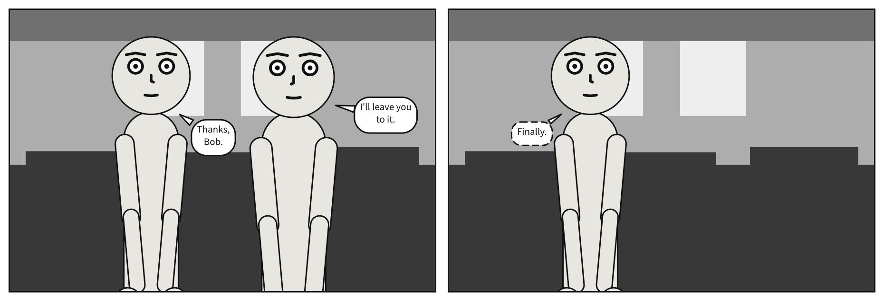

# Sequences

A comic is panels that follow one another, and consecutive panels share nearly everything:
the same people, the same place, the same staging. A **scene** document writes what they
share once and each panel's difference on its own. You have read several scenes already;
this chapter takes one apart.

## What you will make


Three panels, each closer than the one before. Alice says they need to talk; Bob, in a
medium close-up, whispers "Do we."; then, at a close-up from a low angle, his hands on his
hips, he shouts "Fine. Talk."

## A scene, panel by panel

A scene's [`panels`](../reference/language/scene.md#panels) maps a name to each panel, in
reading order. Every key a panel can hold may also be written beside `panels:`, as a default
every panel inherits. A panel may also inherit from another one, by naming it in
[`over`](../reference/language/scene.md#over), and state only what differs.

```{code-block} yaml
:caption: talk.scene.yaml

# Consecutive panels share nearly everything. `over:` names a parent and states only
# the difference -- borrowed from OpenUSD composition arcs, where it means exactly
# this.
#
# Mappings merge recursively; lists replace wholesale. Anything alongside `panels:` is
# a default every panel inherits.

panel: {size: [700, 560]}

cast:
  alice: {reference: alice, pose: pointing,     at: left_third}
  bob:   {reference: bob,   pose: arms_crossed, at: right_third, facing: left}

staging:
  - alice left_of bob
  - alice ground_shared_with bob

panels:
  establishing:
    camera: {shot: full_shot}
    script:
      - say: {by: alice, text: "We need to talk."}

  reaction:
    over: establishing
    camera: {shot: medium_close_up}
    script:
      - say: {by: bob, text: "Do we.", kind: whisper}

  closer:
    over: reaction
    camera: {shot: close_up, angle: low}
    cast:
      bob: {pose: hands_on_hips}
    script:
      - say: {by: bob, text: "Fine. Talk.", kind: shout}
```

```bash
scenet build talk.scene.yaml --strip
```

```text
wrote talk.establishing.svg
wrote talk.reaction.svg
wrote talk.closer.svg
wrote talk.strip.svg
note: reaction: camera retreated to 54% of the requested 'medium_close_up' framing so the cast would fit across the panel
note: closer: camera retreated to 35% of the requested 'close_up' framing so the cast would fit across the panel
```

Each panel is an SVG of its own, named after the document and the panel. `--strip` adds
`talk.strip.svg`, every panel side by side in reading order, as above: a strip.

## What a panel inherits

A panel is built in layers, and the later layer wins:

1. what is written beside `panels:`;
2. the panel it is `over`, which was itself built the same way;
3. what the panel writes itself.

Within that, **mappings merge and lists replace**. `closer` writes `cast: {bob: {pose:
hands_on_hips}}`: Bob keeps his puppet, his place and his facing from `reaction`, and only
his pose changes; Alice is untouched. But a list is replaced whole: a panel that writes
`staging:` or `script:` writes all of it. That is why `reaction` has only Bob's line, not
Alice's as well.

## Leaving something out

`null` takes away something a panel would inherit. Here Bob leaves, and the second panel is
`over` the first with `bob: null`:

```{code-block} yaml
:caption: alone.scene.yaml

# Leaving someone out of a panel that would inherit them.
#
# Everything beside `panels:` is a default every panel takes, and a panel `over:` another
# takes all of it. To take something away, write it as `null`: JSON Merge Patch's rule.
# Here Bob leaves, and `cast: {bob: null}` leaves him out of the last panel.
#
# A staging relation naming him would go with him, and `scenet check` would note it, as
# the example "A relation left out" shows. This scene places its cast with `at:` alone, so
# there is none to lose.

panel: {size: [900, 600]}
camera: {shot: medium_shot}
setting: {place: office, time: day}

cast:
  alice: {reference: alice, at: left_third}
  bob:   {reference: bob,   at: right_third, facing: left}

panels:
  meeting:
    script:
      - say: {by: bob, text: "I'll leave you to it."}
      - say: {by: alice, text: "Thanks, Bob."}

  alone:
    over: meeting
    cast:
      bob: null
    script:
      - say: {by: alice, text: "Finally.", kind: whisper}
```



`null` works on any key: `camera: null` drops an inherited camera, `place: null` an
inherited place. [Chapter 10](your_own_art.md) uses both.

## What the compiler decided

**Each panel has its own camera.** The three panels are framed separately, each at its own
shot. Each asks for a tighter one, but both characters are still in the frame, and two people
do not fit side by side in a close-up: the camera steps back, further each time. A note in
a scene names its panel, so you can tell which camera moved and by how much. Take Alice out
of `reaction`, as the next section shows how, and its camera no longer needs to.

**Inheritance happens before anything is placed.** The compiler first writes out each panel
in full, as if you had typed every key, then compiles each one like a `.panel.yaml`. A
panel cannot tell whether a key was written or inherited.

**A panel can only be over one that exists.** `over: reacton`, misspelled, is
[`composition`](../reference/diagnostics.md#composition), with the panels there are. A panel
that inherits a relation about somebody it took away gives a
[`dropped-relation`](../reference/diagnostics.md#dropped-relation) note, and the relation is
dropped with them:

```{scenet-example}
:gives: composition

cast:
  alice: {reference: alice}
panels:
  first: {}
  second: {over: frist}
```

## Try it

- [A sequence](https://creatoan.github.io/scenet/playground/#example=12-sequence.scene.yaml):
  the scene you built. Add a fourth panel, `over: closer`, at an extreme close-up.
- [Leaving someone out](https://creatoan.github.io/scenet/playground/#example=49-leaving-someone-out.scene.yaml):
  give the second panel `camera: {shot: close_up}` too.

## Check it

```bash
scenet check talk.scene.yaml alone.scene.yaml
```

```text
talk.scene.yaml: ok
alone.scene.yaml: ok
```

`check` resolves every `over` and every inherited key, so a mistake in what a panel inherits
is found there, without building anything.

## What you learned

- A scene's `panels` holds its panels in reading order; what is beside `panels:` is shared.
- `over` makes a panel inherit another: mappings merge, lists replace.
- `null` takes an inherited key away.
- `scenet build` writes a file per panel; `--strip` lays them side by side.

## Where to go next

- The next chapter, [Pages and print](pages_and_print.md): the same panels, laid out on a
  page.
- [Compile a sequence](../howto/compile_a_sequence.md).
- The [scene](../reference/language/scene.md) page, with
  [`panels`](../reference/language/scene.md#panels) and
  [`over`](../reference/language/scene.md#over).
