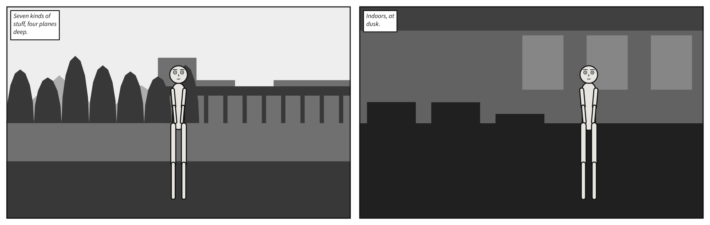
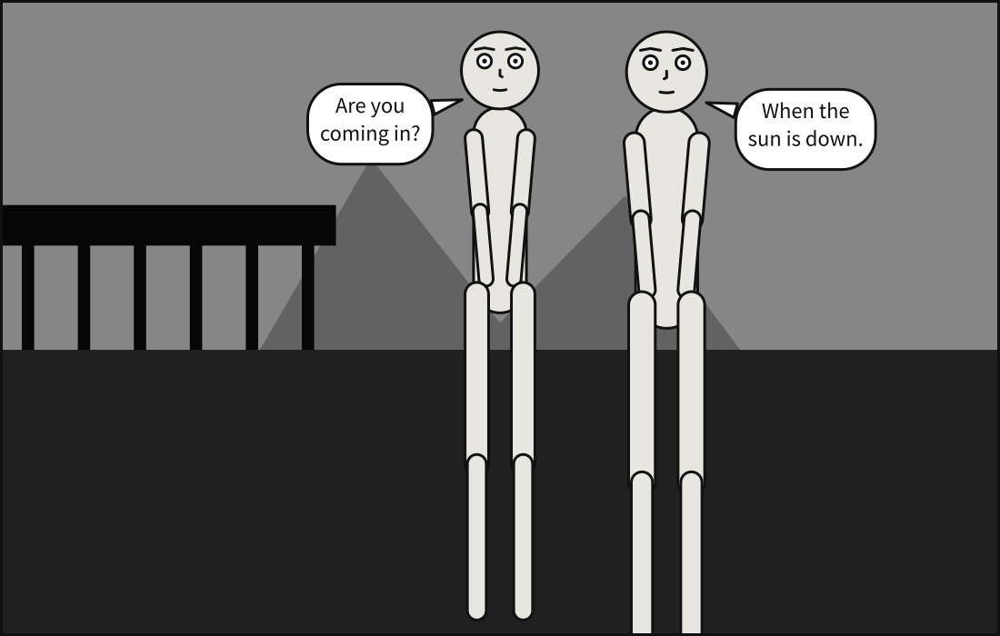

# Setting and colour

So far every panel has been drawn on white. A [`setting`](../reference/language/setting.md)
says where and when a panel happens: a named place, its horizon, the hour and the weather,
or the tonal masses a place is made of, written out by hand. A
[`palette`](../reference/language/palette.md) then says whether it is drawn in grey or in
colour.

## What you will make

![A strip of 4 panels. Long shot. The docks at night, in the rain. Alice, centre, arms crossed, looking at Bob; Bob, centre. Caption: Midnight. The docks. Alice: You said you would be here at ten. Bob, whispering: I was. Long shot. The docks at dawn, in fog. Alice, centre, arms crossed, looking at Bob; Bob, centre. Caption: Six hours later. Long shot. The docks by day. Alice, centre, arms crossed, looking at Bob; Bob, centre. Editor's note: It never rains at noon. Long shot. The docks at dusk, in the snow. Alice, centre, arms crossed, looking at Bob; Bob, centre. Caption: December.](../images/gallery/21-atmosphere.strip.svg)

One place, the docks, at four hours and in four kinds of weather: rain at midnight, fog at
dawn, clear at noon, snow at dusk. Nothing else changes from panel to panel.

## A place

[`place`](../reference/language/setting.md#settingplace) names one of ten places: `alley`,
`desert`, `docks`, `field`, `forest`, `mountain`, `office`, `room`, `shore` and `street`.

```{code-block} yaml
:caption: places.scene.yaml

# The place library: all ten, one panel each.
#
# `place:` is the headline surface, because the thing an author wants to write is where
# the scene is, not a list of shapes. Each of these expands into exactly the mass list
# you could have typed yourself -- 19-setting shows that layer -- which is the rule that
# keeps a preset a library rather than a second, opaque format.
#
# Free prose is deliberately not offered. `setting: "a rainy street corner at midnight"`
# needs language understanding, and guessing produces panels that are confidently wrong.
# A named place is the honest middle: it reads like a description and resolves
# deterministically.

panel:
  size: [900, 560]

camera:
  shot: long_shot

cast:
  alice: {reference: alice, at: center}

panels:
  docks:    {setting: {place: docks,    time: night}}
  street:   {setting: {place: street}}
  alley:    {setting: {place: alley,    time: dusk}}
  room:     {setting: {place: room}}
  office:   {setting: {place: office,   horizon: high}}
  forest:   {setting: {place: forest,   time: dawn}}
  field:    {setting: {place: field,    horizon: low}}
  shore:    {setting: {place: shore,    time: dusk}}
  desert:   {setting: {place: desert}}
  mountain: {setting: {place: mountain, time: dawn}}
```


Free prose is deliberately not offered. "A rainy street corner at midnight" needs language
understanding, and guessing produces panels that are confidently wrong. A named place reads
like a description and resolves the same way every time.

## The horizon

[`horizon`](../reference/language/setting.md#settinghorizon) is where the ground meets what
is behind it, `high`, `mid` or `low`, and every mass is composed against it. A high horizon
puts more ground in view; a low one gives the panel to the sky.

```{code-block} yaml
:caption: horizons.scene.yaml

# The horizon: one line for the whole panel, which every mass is composed against.
#
# Masses of the ground sort -- ground, floor, water -- start at the horizon and run down to
# the bottom edge; masses that stand in the world rise from it. A high horizon sits near the
# top of the frame, so more ground is in view; a low one gives the panel to the sky.
#
# The same shore three times, with nothing changed but `horizon`, which each caption names.
# Alice stands where she stands in each: the camera frames the cast, and the horizon moves
# only the backdrop.

panel:
  size: [900, 560]

camera:
  shot: long_shot

cast:
  alice: {reference: alice, at: left_third, facing: right}

panels:
  high:
    setting: {place: shore, horizon: high}
    script: [caption: {text: "A high horizon: more ground in view.", kind: editorial}]
  mid:
    setting: {place: shore, horizon: mid}
    script: [caption: {text: "A horizon in the middle.", kind: editorial}]
  low:
    setting: {place: shore, horizon: low}
    script: [caption: {text: "A low horizon: the panel is mostly sky.", kind: editorial}]
```


## The hour and the weather

[`time`](../reference/language/setting.md#settingtime) is `dawn`, `day`, `dusk` or `night`,
and [`weather`](../reference/language/setting.md#settingweather) is `clear`, `rain`, `fog` or
`snow`. Save the scene at the top of this chapter:

```{code-block} yaml
:caption: hours.scene.yaml

# Time of day and weather, on one place.
#
# `time` does not tint a daytime panel. It supplies the two ends of the value ladder --
# the foreground and the atmosphere -- and the planes are spaced between them. So night
# is a darker, narrower ladder, which is what night actually does to a drawn scene, and
# the ladder stays monotonic in depth at every hour.
#
# `weather` adds a layer over that. Fog is a turbulence veil tinted with the atmosphere
# itself, because fog *is* the atmosphere arriving in the foreground. Rain and snow carry
# the same veil as cloud -- nearer, and so darker than the sky it covers -- and put
# falling marks over everything, because weather is between the reader and the figures
# rather than behind them. Rain flips to ink over a bright sky and to paper over a dark
# one; snow never flips, because snow is white.
#
# The determinism contract is on the **emitted SVG text**, which stays byte-identical.
# It has never been on pixels: `feTurbulence` is reproducible by specification -- the
# spec ships reference code and the seed is fixed -- and browsers still agree only
# approximately on what to paint from it. See docs/reference/language/index.md.

panel:
  size: [1100, 620]

camera:
  shot: long_shot

cast:
  alice: {reference: alice, at: left_third, pose: arms_crossed}
  bob:   {reference: bob,   at: right_third, facing: left}

staging:
  - alice left_of bob
  - alice looking_at bob
  - alice ground_shared_with bob

panels:
  midnight:
    setting: {place: docks, time: night, weather: rain}
    script:
      - caption: {text: "Midnight. The docks.", kind: locale, prefer: top_left}
      - say: {by: alice, text: "You said you would be here at ten."}
      - say: {by: bob, text: "I was.", kind: whisper}

  morning:
    setting: {place: docks, time: dawn, weather: fog}
    script:
      - caption: {text: "Six hours later.", kind: locale, prefer: top_left}

  noon:
    setting: {place: docks, time: day, weather: clear}
    script:
      - caption: {text: "It never rains at noon.", kind: editorial, prefer: top_right}

  winter:
    setting: {place: docks, time: dusk, weather: snow}
    script:
      - caption: {text: "December.", kind: locale, prefer: top_left}
```

```bash
scenet build hours.scene.yaml --strip
```

```text
wrote hours.midnight.svg
wrote hours.morning.svg
wrote hours.noon.svg
wrote hours.winter.svg
wrote hours.strip.svg
```

## Masses and planes

A place stands for a list of
[`masses`](../reference/language/setting.md#settingmasses): the shapes of tone a backdrop is
made of. Write the list yourself when you want control. Each mass has a
[`kind`](../reference/language/setting.md#settingmasseskind), which decides its silhouette;
a [`plane`](../reference/language/setting.md#settingmassesplane), `foreground`, `near`,
`mid` or `far`, which decides its value and its draw order; and what it
[`spans`](../reference/language/setting.md#settingmassesspans) of the width, `full`, `left`,
`center` or `right`.

```{code-block} yaml
:caption: masses.scene.yaml

# Masses, planes and the notan value ladder -- written out by hand.
#
# `place:` is the headline surface, and 20-places shows it. This is the layer
# underneath: the mass list a place expands into, which stays authorable when you want
# control. Every one of the twelve mass kinds appears across these two panels.
#
# Value comes from the *plane*, never from the kind. Reading front to back a mass never
# gets darker, which is aerial perspective as a parametric rule -- and it is why two
# masses at one distance read as one mass, which is the whole notan argument.

panel:
  size: [1000, 620]

camera:
  shot: long_shot

panels:
  # Outdoors: the seven exterior kinds, stacked back to front.
  outside:
    setting:
      horizon: mid
      masses:
        - {kind: sky,        plane: far}
        - {kind: solid,      plane: far,  spans: left}
        - {kind: building,   plane: mid,  spans: right}
        - {kind: water,      plane: mid}
        - {kind: structural, plane: near, spans: right}
        - {kind: plant,      plane: near, spans: left}
        - {kind: ground,     plane: near}
    cast:
      alice: {reference: alice, at: center}
    script:
      - caption: {text: "Seven kinds of stuff, four planes deep.", kind: editorial}

  # Indoors: the five interior kinds. A `window` is toned one plane *farther* than the
  # wall it is cut into, because a window is a hole showing a more distant plane.
  inside:
    setting:
      horizon: mid
      time: dusk
      masses:
        - {kind: wall,      plane: far}
        - {kind: window,    plane: far,  spans: right}
        - {kind: ceiling,   plane: mid}
        - {kind: floor,     plane: near}
        - {kind: furniture, plane: near, spans: left}
    cast:
      bob: {reference: bob, at: right_third, facing: left}
    script:
      - caption: {text: "Indoors, at dusk.", kind: locale}
```



A mass on the `foreground` plane is drawn over the cast, like the edge of a doorway in
silhouette:

```{code-block} yaml
:caption: doorway.panel.yaml

# In front of the cast: a mass on the `foreground` plane.
#
# Masses on the `near`, `mid` and `far` planes stand behind everybody. One on `foreground`
# is drawn over the cast, the way a doorway in silhouette is, and darkest of all: reading
# front to back, a mass never gets darker. Here it is the edge of the door Alice is looking
# out of.
#
# `spans` says how much of the width a mass covers: `full`, the default, written out here,
# `left`, `right`, or `center` -- the hill in the distance.

panel:
  size: [1100, 700]

camera:
  shot: full_shot

setting:
  horizon: mid
  time: dusk
  masses:
    - {kind: sky,        plane: far,        spans: full}
    - {kind: solid,      plane: far,        spans: center}
    - {kind: ground,     plane: near,       spans: full}
    - {kind: structural, plane: foreground, spans: left}

cast:
  alice: {reference: alice, at: center, facing: right}
  bob:   {reference: bob,   at: right_third, facing: left}

staging:
  - alice left_of bob

script:
  - say: {by: alice, text: "Are you coming in?"}
  - say: {by: bob, text: "When the sun is down."}
```



## Colour

Scenet draws in values: every tone is a rung of one ladder from paper to ink, set by the
hour. [`palette`](../reference/language/palette.md) says what the rungs are drawn in:
`mono`, the default, in grey, or `tinted`, each in a colour with the same lightness.
Written beside `panels:`, it colours every panel.

```{code-block} yaml
:caption: tinted.scene.yaml

# The tinted palette: the value ladder in colour, at every hour.
#
# `palette: tinted`, written beside `panels:`, is a default every panel inherits. Each value
# on the ladder is drawn in its twin: a colour with the same lightness, on the same rung,
# at the same hour. Each hour has a shadow hue at the front and an atmosphere hue at the
# sky -- warm light and cool shadow, as painters put it -- and the planes between move from
# one to the other, so with distance colour drifts toward the colour of the air. Night is
# blue all the way back, and the dark end of the ladder holds almost no colour at all.
#
# Build it with `--mono`, or write `palette: mono`, and every panel is the grey one, value
# for value: colour never changes a value, so nothing moves.

palette: tinted

panel:
  size: [1100, 620]

camera:
  shot: long_shot

cast:
  alice: {reference: alice, at: left_third, pose: arms_crossed}
  bob:   {reference: bob,   at: right_third, facing: left}

staging:
  - alice left_of bob
  - alice looking_at bob
  - alice ground_shared_with bob

pages:
  - tiers:
      - panels: [dawn, noon]
      - panels: [dusk, midnight]

panels:
  dawn:
    setting: {place: docks, time: dawn, weather: fog}
    script:
      - caption: {text: "Dawn.", kind: locale, prefer: top_left}

  noon:
    setting: {place: docks, time: day}
    script:
      - caption: {text: "Noon.", kind: locale, prefer: top_left}

  dusk:
    setting: {place: docks, time: dusk}
    script:
      - caption: {text: "Dusk.", kind: locale, prefer: top_left}

  midnight:
    setting: {place: docks, time: night, weather: rain}
    script:
      - caption: {text: "Midnight.", kind: locale, prefer: top_left}
```


A palette may also be a panel's own. Here the middle panel writes `palette: mono` for
itself, the way a comic drops into grey for a memory:

```{code-block} yaml
:caption: flashback.scene.yaml

# A flashback in grey, on a page in colour.
#
# `palette: tinted` beside `panels:` colours every panel, and the middle one writes
# `palette: mono` for itself: the way a comic drops into grey for a memory. Unlike
# `direction`, which is the whole document's, a palette may be a panel's own. A page read
# two ways has no order a reader could follow; a page in two palettes is a convention.
#
# The yellow `warm` caption says where the story is now. In the grey panel the caption is
# `paper`, because a memory has no hour of its own to name.

palette: tinted

panel:
  size: [1100, 620]

camera:
  shot: medium_shot

setting: {place: street, time: dusk}

cast:
  alice: {reference: alice, at: left_third, facing: right}
  bob:   {reference: bob,   at: right_third, facing: left}

staging:
  - alice left_of bob
  - alice looking_at bob
  - bob looking_at alice

pages:
  - tiers:
      - panels: [now]
      - panels: [then]
      - panels: [again]

panels:
  now:
    script:
      - caption: {text: "The same street, years on.", kind: locale, tone: warm, prefer: top_left}
      - say: {by: alice, text: "You haven't changed."}

  then:
    palette: mono
    setting: {time: day}
    script:
      - caption: {text: "Ten years earlier.", kind: locale, prefer: top_left}
      - say: {by: bob, text: "Promise you'll come back."}

  again:
    script:
      - say: {by: bob, text: "Neither have you."}
```


## What the compiler decided

**Value comes from the plane, never from the kind.** Reading front to back, a mass never
gets darker: the nearer, the darker. Two masses at one distance read as one mass, which is
how a cartoonist plans a panel's darks and lights.

**The hour sets the ends of the ladder.** `time` does not tint a daytime panel. It sets the
value of the foreground and of the air, and the planes are spaced between them, so night is
a darker, narrower ladder.

**Weather is in front of the cast.** Fog is the air arriving in the foreground; rain and
snow add cloud, and fall over everything, figures included, because weather is between the
reader and them.

**Colour never changes a value.** Every decision, including the lettering's contrast
against its box, is made on the grey. A tinted panel is the grey one with each rung in its
twin, so `scenet build --mono` draws the same panel in grey, and nothing moves.

**One way to say where.** A setting is a place, masses or a picture, and only one of them.
`place` and `masses` together are
[`conflicting-setting`](../reference/diagnostics.md#conflicting-setting), and a place that
does not exist is [`unknown-place`](../reference/diagnostics.md#unknown-place):

```{scenet-example}
:gives: unknown-place

setting: {place: harbour}
cast: {alice: {reference: alice}}
```

## Try it

- [Masses and planes](https://creatoan.github.io/scenet/playground/#example=19-setting.scene.yaml):
  move the `water` to the `near` plane.
- [Ten places](https://creatoan.github.io/scenet/playground/#example=20-places.scene.yaml):
  give every panel `time: night`.
- [Time and weather](https://creatoan.github.io/scenet/playground/#example=21-atmosphere.scene.yaml):
  the scene you built. Make it snow at midnight.
- [Tinted hours](https://creatoan.github.io/scenet/playground/#example=40-tinted-hours.scene.yaml):
  write `palette: mono` and compare.
- [A flashback](https://creatoan.github.io/scenet/playground/#example=41-flashback.scene.yaml):
  move `palette: mono` to the last panel.
- [In front of the cast](https://creatoan.github.io/scenet/playground/#example=47-in-front-of-the-cast.panel.yaml):
  change the doorway's `spans: left` to `spans: right`.
- [Three horizons](https://creatoan.github.io/scenet/playground/#example=72-three-horizons.scene.yaml):
  change the place to `desert`.

## Check it

```bash
scenet check hours.scene.yaml masses.scene.yaml flashback.scene.yaml
```

```text
hours.scene.yaml: ok
masses.scene.yaml: ok
flashback.scene.yaml: ok
```

## What you learned

- `place` names one of ten places; `horizon`, `time` and `weather` say how it looks.
- `masses` writes a backdrop out by hand: a `kind`, a `plane` and what it `spans`.
- Value comes from the plane and the hour; weather is drawn in front of the cast.
- `palette: tinted` draws each value in a colour of the same lightness, for a document or
  a panel; `mono` is the default.

## Where to go next

- The next chapter, [Sequences](sequences.md): panels that follow one another.
- The [`setting`](../reference/language/setting.md) page, and
  [`setting.masses[].kind`](../reference/language/setting.md#settingmasseskind) for all
  twelve kinds.
- [`palette`](../reference/language/palette.md#palette), and [Export for image
  models](../howto/export_for_image_models.md) for what the values are for beyond print.
