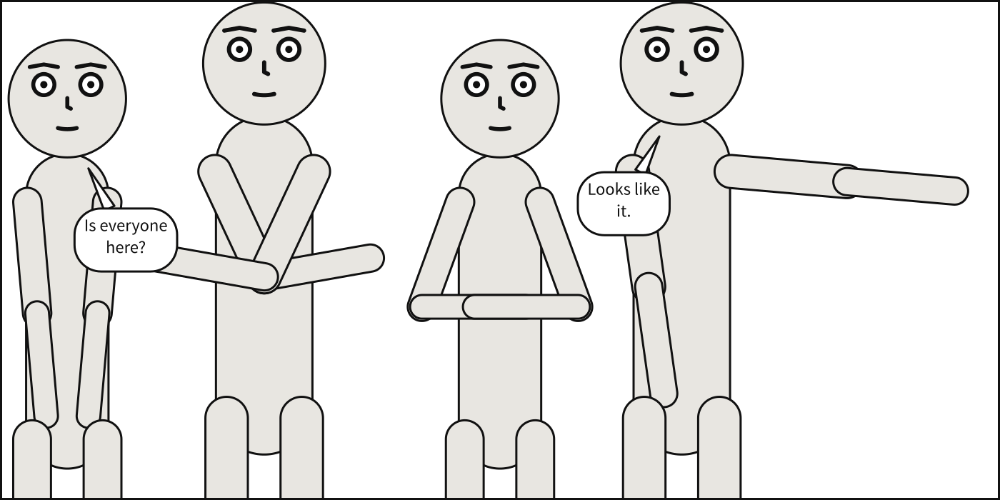

# What Scenet tells you, and publishing

You have met findings and notes in every chapter. This last one takes them together: the
three kinds of thing Scenet tells you, where each is reported, and how to read the panel
behind them. Then it turns to publishing: a picture a screen reader can read, files for an
image model, a check in CI, and a build that follows every save.

## What you will make



Four people asked for in a close-up, across a panel that cannot hold them side by side. The
compiler steps the camera back until it can, and says so.

## Three kinds of thing Scenet tells you

| Kind | Reported by | Stops the build? | Example |
|---|---|---|---|
| An **error** | `scenet check`, and `scenet build`, which stops on the first | yes | [`ordering-cycle`](../reference/diagnostics.md#ordering-cycle) |
| A **note** from the checker: a house limit run past | `scenet check` | no | [`word-limit`](../reference/diagnostics.md#word-limit) |
| A **compile note**: a decision the compiler made | `scenet build` | no | [`camera-retreated`](../reference/diagnostics.md#camera-retreated) |

Every one has a name that never changes, and an entry in the [diagnostics
catalogue](../reference/diagnostics.md): why it happens, how to fix it, and a document that
gives it beside the same document fixed.

Save the panel at the top of this chapter, and a second one, whose Bob talks too long:

```{code-block} yaml
:caption: crowd.panel.yaml

# Four characters at a close-up cannot fit side by side. A real camera operator
# would step backwards, so that is what happens: everybody gets smaller and more of
# the body comes into view.
#
# The requested shot is an UPPER BOUND ON TIGHTNESS, not a promise -- and the retreat
# is reported rather than done silently, because a panel that is quietly not the shot
# you asked for is a panel you cannot debug. Look at the note under the picture:
# `camera-retreated`. To make it go away, widen the panel or ask for a looser shot.
#
# A retreat is a compromise the compiler can make. Constraints that cannot all hold are
# not: the last line shows one.

panel:
  size: [1400, 700]

camera:
  shot: close_up

cast:
  alice: {reference: alice}
  bob:   {reference: bob,   pose: arms_crossed}
  carol: {reference: alice, pose: hands_on_hips}
  dave:  {reference: bob,   pose: pointing}

script:
  - say: {by: alice, text: "Is everyone here?"}
  - say: {by: dave,  text: "Looks like it."}

staging:
  - alice left_of bob
  - bob left_of carol
  - carol left_of dave
  - alice ground_shared_with bob
  - bob ground_shared_with carol
  - carol ground_shared_with dave

# Try this: delete the "# " that starts the last line. Dave left of Alice closes a loop
# that no order can satisfy: the error `ordering-cycle`, on that line.
#   - dave left_of alice
```

```{code-block} yaml
:caption: words.panel.yaml

# Too many words for one balloon: a note, not an error.
#
# Dark Horse's script format asks for "approximately 25 words per balloon, and about 50
# words per panel, max". Bob's answer holds 34, so `scenet check` notes it, on its line,
# under the rule `word-limit`. It is a limit a letterer works to, not a contradiction: the
# panel compiles all the same, and the balloon is lettered as large as it has to be.
#
# Words are counted as they are lettered: `--` and an ellipsis are no words, and the
# underscores around a stressed word add none.
#
# To make the note go away, split the balloon in two -- a second `say:` by Bob, which is
# what a letterer would do -- or carry the rest of the words to the next panel.

panel: {size: [1000, 700]}
camera: {shot: full_shot}

cast:
  alice: {reference: alice, at: left_third}
  bob:   {reference: bob,   pose: arms_crossed, at: right_third, facing: left}

staging:
  - alice left_of bob
  - alice looking_at bob

script:
  - say: {by: alice, text: "So what happened?"}
  - say: {by: bob, text: "Well, I got up late, missed the bus, walked all the way, lost my keys on the way, found them again, and then the door was locked anyway, so I just came back here."}

# Try this: delete the "# " that starts the last line. Alice opens a stressed word with
# an underscore and never closes it: the error `unbalanced-emphasis`, on that line.
#   - say: {by: alice, text: "You _walked?"}
```

## What the compiler decided

**The camera retreated, and said so.** Build the crowd:

```bash
scenet build crowd.panel.yaml
```

```text
wrote crowd.svg
note: camera retreated to 34% of the requested 'close_up' framing so the cast would fit across the panel
```

A shot is the tightest the camera may go. Four people side by side do not fit across this
panel at a close-up, so the camera steps back to a third of it. A retreat is reported, not
done silently, because a panel that is quietly not the shot you asked for is a panel you
cannot debug. To make the note go away, widen the panel or ask for a looser shot.

**A retreat is a compromise; a contradiction is not.** The crowd's last line, commented out,
is `dave left_of alice`. Uncomment it and the four orders go round in a circle, which no
camera can fix: it is the error `ordering-cycle`, on that line.

**A house limit is a note, not a fault.** Bob's answer holds 34 words; Dark Horse asks for
about 25 a balloon. The panel compiles all the same. Split the balloon in two, as a letterer
would, and the note goes away.

The other compile notes are decisions of the same kind, each shown by an example of its own:
a tail that had to bend round a balloon,
[`curved-tail`](../reference/diagnostics.md#curved-tail); a mouth the frame cuts away,
[`cropped-mouth`](../reference/diagnostics.md#cropped-mouth); marks run off the panel,
[`cropped-marks`](../reference/diagnostics.md#cropped-marks); an inset over a face,
[`inset-covers-face`](../reference/diagnostics.md#inset-covers-face); a slant through one,
[`slant-cuts-face`](../reference/diagnostics.md#slant-cuts-face); and a face that stands in
for one you did not name,
[`italic-stand-in`](../reference/diagnostics.md#italic-stand-in).

## Reading the panel behind them

`--debug` writes an overlay of the geometry the compiler worked against: every figure's
outline, the disc of each face, the named anchors, each gaze and each tail. `--core` writes
Panel Core, every number it chose, under the names you wrote. When a panel looks wrong, read
those two before anything else.

```bash
scenet build crowd.panel.yaml --core --debug
```

```text
wrote crowd.svg
wrote crowd.core.json
wrote crowd.debug.svg
note: camera retreated to 34% of the requested 'close_up' framing so the cast would fit across the panel
```

In the core, the camera's `pullback` is the factor it stepped back by. [Debug a
layout](../howto/debug_a_layout.md) reads an overlay piece by piece.

## A picture a screen reader can read

Every SVG Scenet writes is an image with a name: a screen reader says the panel's
[`description`](../reference/language/description.md), or the one Scenet writes from the
shot, the setting and who is where, then every balloon, caption and sound, in reading
order. The pictures in this tour carry exactly that as their alternative text.
[Make accessible output](../howto/make_accessible_output.md) shows how to embed it so the
words reach the reader. `--no-aria` leaves it out, for a pipeline that post-processes the
SVG.

## Files for an image model

Scenet draws no finished art, and does not pretend to. What it does is stage a panel exactly,
and `--conditioning` exports that staging for an image model to draw over:

```bash
scenet build crowd.panel.yaml --conditioning
```

```text
wrote crowd.svg
wrote crowd.pose.json
wrote crowd.boxes.json
wrote crowd.depth.svg
wrote crowd.mask.svg
wrote crowd.semantics.json
note: camera retreated to 34% of the requested 'close_up' framing so the cast would fit across the panel
```

The pose as OpenPose JSON, boxes with phrases, a depth map, a mask with each figure and mass
in a flat colour of its own, and the semantics. No model runs: [Export for image
models](../howto/export_for_image_models.md) says what each is for.

## A check in CI

`scenet check` exits 1 when anything is an error, and 0 otherwise, notes or not, so a CI job
can run it as it is. `--format sarif` writes the findings in SARIF, which GitHub code
scanning reads, so each finding is an annotation on the line of the pull request that
caused it:

```bash
scenet check --format sarif -o findings.sarif words.panel.yaml crowd.panel.yaml
```

[Build and check a comic in CI](../howto/build_in_ci.md) has the whole workflow. [Editor
support](../howto/editor_support.md) shows the same findings in VS Code as you type.

## A build that follows every save

```bash
scenet build crowd.panel.yaml --watch
```

builds once, then again every time the document, or a file it names, changes, until you
press Ctrl-C. Keep the SVG open in a browser beside your editor and reload it. Install the
[`watch` extra](../howto/install.md#extras) for a watcher that does not poll.

## Try it

Each of these examples gives a note on purpose, and ends on a commented line that,
uncommented, makes it an error.

- [The camera retreats](https://creatoan.github.io/scenet/playground/#example=10-crowd-pullback.panel.yaml):
  the panel you built. Uncomment the last line.
- [Too many words](https://creatoan.github.io/scenet/playground/#example=53-too-many-words.panel.yaml):
  split Bob's answer into two `say` lines.
- [A page miscounted](https://creatoan.github.io/scenet/playground/#example=54-a-page-miscounted.script):
  `panel-count`.
- [Not read as dialogue](https://creatoan.github.io/scenet/playground/#example=55-not-read-as-dialogue.script):
  `looks-like-dialogue`.
- [A relation left out](https://creatoan.github.io/scenet/playground/#example=56-a-relation-left-out.scene.yaml):
  [`dropped-relation`](../reference/diagnostics.md#dropped-relation).
- [A tail that bends](https://creatoan.github.io/scenet/playground/#example=57-a-tail-that-bends.panel.yaml):
  `curved-tail`.
- [A mouth cropped away](https://creatoan.github.io/scenet/playground/#example=58-a-mouth-cropped-away.panel.yaml):
  `cropped-mouth`.
- [Marks cut off](https://creatoan.github.io/scenet/playground/#example=59-marks-cut-off.panel.yaml):
  `cropped-marks`.
- [An inset over a face](https://creatoan.github.io/scenet/playground/#example=60-an-inset-over-a-face.scene.yaml):
  `inset-covers-face`.
- [A slant through a face](https://creatoan.github.io/scenet/playground/#example=61-a-slant-through-a-face.scene.yaml):
  `slant-cuts-face`.
- [A face standing in](https://creatoan.github.io/scenet/playground/#example=62-a-face-standing-in.panel.yaml):
  `italic-stand-in` and
  [`bold-italic-stand-in`](../reference/diagnostics.md#bold-italic-stand-in).

## Check it

```bash
scenet check words.panel.yaml crowd.panel.yaml
```

```text
words.panel.yaml:27:26: note: word-limit: this balloon holds 34 words; Dark Horse asks for about 25 a balloon or caption at most
words.panel.yaml: ok
crowd.panel.yaml: ok
```

A note is printed with the word `note:` where an error would have none, and the document is
still `ok`. `scenet check --deep` also runs the whole compiler on each document that passes,
to find the two errors only placement can find,
[`layout`](../reference/diagnostics.md#layout) and
[`balloon-placement`](../reference/diagnostics.md#balloon-placement).

## What you learned

- Scenet tells you three kinds of thing: errors, which stop a build; notes, house limits run
  past; and compile notes, decisions it made. Each has a name and an entry.
- `--debug` and `--core` show the geometry and the numbers behind a panel.
- Every SVG carries what a screen reader says of it.
- `--conditioning` stages a panel for an image model; `--format sarif` puts findings into CI;
  `--watch` rebuilds on every save.

You have toured the whole language. Every example in the [gallery](../gallery.md) is
written with what these twelve chapters taught.

## Where to go next

- [The diagnostics catalogue](../reference/diagnostics.md) and [the command
  line](../reference/cli.md), in full.
- [The language reference](../reference/language/index.md), and
  [All keys, A to Z](../reference/language/keys.md).
- [The how-to guides](../howto/index.md), for a job at a time.
