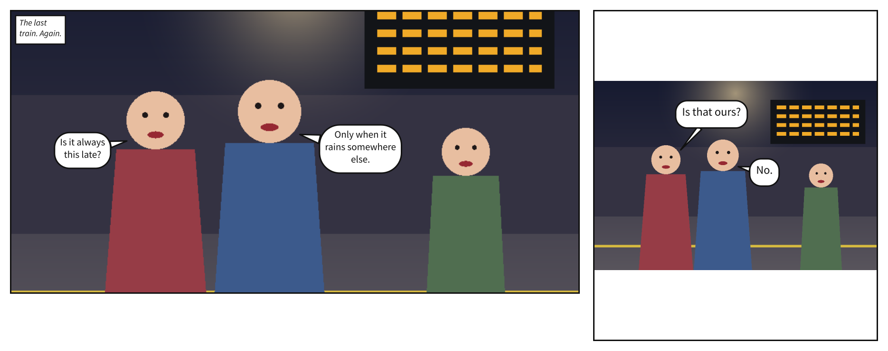
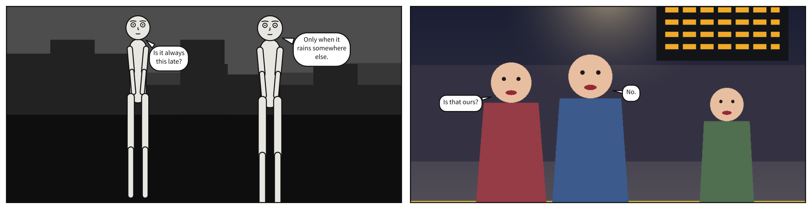

# Your own art and characters

Everything so far was drawn by Scenet: its puppets, its places. This chapter brings in work
of your own. A picture you painted, behind the cast; people your picture already draws,
lettered over; and a character of your own, as a puppet file.

## What you will make


A street at dusk, painted elsewhere, with Alice and Bob in front of it in the rain; then the
same picture framed whole, in a square panel, on a clear evening.

## A picture behind the cast

[`setting.image`](../reference/language/setting.md#settingimage) names a PNG or JPEG file,
relative to the document, and draws it behind the cast in place of a place.
[`fit`](../reference/language/setting.md#settingfit) says how it fills the panel, keeping its
proportions: `cover` fills it and crops what overhangs; `contain` shows the whole picture,
with the panel showing round it.

The picture here is `art/street.png`, in
[`examples/gallery/art/`](https://github.com/creatoan/scenet/tree/main/examples/gallery/art).
Save it in a folder `art/` beside the document, or use a picture of your own.

```{code-block} yaml
:caption: street.scene.yaml

# A picture drawn elsewhere, behind the cast.
#
# `image` names a PNG or JPEG beside this document -- art/street.png, painted by
# scripts/make_gallery_art.py -- and the cast is drawn in front of it and lettered by the
# same rules as on any other backdrop. The compiler reads the picture's size and nothing
# else: it does not know there is a road, so a balloon pays nothing to sit on it.
#
# `fit` says how the picture fills the panel, keeping its proportions: `cover` fills it
# and crops what overhangs, equally top and bottom here; `contain` shows the whole
# picture, and the panel shows round it. Weather is drawn over the picture as over masses.
#
# A link by default -- the SVG names art/street.png, as written -- or the picture's own
# bytes with `scenet build --embed-images`, which the playground always uses.

camera:
  shot: long_shot

cast:
  alice: {reference: alice, at: left_third, pose: pointing}
  bob:   {reference: bob,   at: right_third, facing: left}

staging:
  - alice left_of bob
  - alice looking_at bob
  - alice ground_shared_with bob

setting: {image: art/street.png, time: dusk}

panels:
  arrival:
    panel: {size: [1200, 600]}
    setting: {fit: cover, weather: rain}
    script:
      - caption: {text: "Eight o'clock. Still raining.", kind: locale, prefer: top_left}
      - say: {by: alice, text: "You painted every one of those windows?"}
      - say: {by: bob, text: "Every one. Twice."}

  framed:
    over: arrival
    panel: {size: [700, 700]}
    camera: {shot: full_shot}
    setting: {fit: contain, weather: clear}
    script:
      - say: {by: alice, text: "It looks smaller from here."}
```

```bash
scenet build street.scene.yaml --embed-images
```

```text
wrote street.arrival.svg
wrote street.framed.svg
```

By default the SVG links the picture by the path you wrote, so it shows only beside it.
`--embed-images` writes the picture's bytes into the SVG, which can then go anywhere. A JPEG
works the same way:

```{code-block} yaml
:caption: harbour.panel.yaml

# A JPEG behind the cast.
#
# A supplied picture may be a PNG or a JPEG, the two raster formats every SVG viewer must
# draw. The compiler tells them apart by their first bytes, not by the file's name, and
# reads nothing but the size from either. This one, art/harbour.jpg, was painted and
# encoded by scripts/make_gallery_photo.py.
#
# `time: dawn` changes nothing in the picture, whose values are the artist's: over a
# picture, the hour only tints weather, and there is none.

panel:
  size: [1200, 700]

camera:
  shot: full_shot

setting:
  image: art/harbour.jpg
  fit: cover
  time: dawn

cast:
  alice: {reference: alice, at: left_third, pose: pointing}
  bob:   {reference: bob,   at: center, facing: left}

staging:
  - alice left_of bob
  - alice looking_at bob

script:
  - say: {by: alice, text: "The first boat leaves at six."}
  - say: {by: bob, text: "Then we have time for coffee."}
```

## Figures the picture draws

When the people are in the picture already, nobody needs posing. A cast member names a
[`figure`](../reference/language/cast.md#castidfigure) the picture draws, instead of a puppet,
and the picture's **artwork contract** says where each figure's face, mouth and body are, in
the picture's pixels. The contract is a YAML file beside the picture, named after it:
`figures.png` has `figures.art.yaml`.

```{code-block} yaml
:caption: art/figures.art.yaml

# The artwork contract for figures.png, written by scripts/make_gallery_figures.py
# from the same constants the picture is painted from. Pixels, from the top left.
size: [900, 600]
figures:
  ana:
    face: {center: [230, 250], radius: 56}
    mouth: [230, 273]
    body: [[168, 296], [292, 296], [316, 600], [144, 600]]
  ben:
    face: {center: [410, 236], radius: 60}
    mouth: [410, 261]
    body: [[340, 286], [480, 286], [502, 600], [318, 600]]
  carl:
    face: {center: [720, 300], radius: 46}
    mouth: [720, 319]
    body: [[668, 338], [772, 338], [786, 600], [654, 600]]
keep_out:
  # The timetable board.
  - [[560, 60], [860, 60], [860, 200], [560, 200]]
```

Its [`size`](../reference/language/artwork.md#size) is the picture's, in pixels. Each of its
[`figures`](../reference/language/artwork.md#figures) has a face, a disc no lettering may
cover; a mouth, where a tail ends; and a body, which a balloon pays to cover.
[`keep_out`](../reference/language/artwork.md#keep_out) lists what else the lettering should
stay off: here, a timetable board.

```{code-block} yaml
:caption: platform.scene.yaml

# Figures a picture draws, lettered over (#71).
#
# The people are in the picture -- art/figures.png, painted by
# scripts/make_gallery_figures.py -- so the cast names them with `figure:` instead of
# posing puppets. Where each face, mouth and body is lives in the picture's artwork
# contract, art/figures.art.yaml, beside it and named after it; this document writes no
# coordinate. Balloons keep off every declared face, Carl's too though nobody cast him,
# tails aim at each speaker's mouth, and the timetable board is a keep-out: lettering
# pays to cover it, and does not.
#
# Nobody is posed, placed or framed: the artist did all of that, so there is no camera
# and no staging. `fit` maps the contract through the same transform as the picture.

cast:
  ana: {figure: ana}
  ben: {figure: ben}

setting: {image: art/figures.png, time: night}

panels:
  platform:
    panel: {size: [1200, 600]}
    setting: {fit: cover}
    script:
      - caption: {text: "The last train. Again.", kind: locale}
      - say: {by: ana, text: "Is it always this late?"}
      - say: {by: ben, text: "Only when it rains somewhere else."}

  waiting:
    over: platform
    panel: {size: [600, 700]}
    setting: {fit: contain}
    script:
      - say: {by: ana, text: "Is that ours?"}
      - say: {by: ben, text: "No."}
```



Carl is in the contract and not in the cast: nobody speaks for him, but his face is still
kept clear.

A panel `over` one of puppets can turn them into figures, taking away with `null` what only
a puppet has:

```{code-block} yaml
:caption: to-figures.scene.yaml

# From puppets to figures: the same two people, drawn first by Scenet, then by a picture.
#
# In the first panel Ana and Ben are puppets in a named place. The second is `over:` it, and
# takes everything it does not take away with `null`:
#
# - `place: null` beside its `image`, since a picture is a backdrop of its own;
# - `camera: null`, since the artist already framed the picture;
# - `reference: null` beside each `figure`, and every key that posed the puppet -- `at`,
#   `facing` -- since a member is a puppet or a figure, never both.
#
# The picture's artwork contract, art/figures.art.yaml, says where each face and mouth is.

panels:
  waiting:
    panel: {size: [1200, 600]}
    camera: {shot: full_shot}
    setting: {place: street, time: night}
    cast:
      ana: {reference: alice, at: left_third}
      ben: {reference: bob,   at: right_third, facing: left}
    script:
      - say: {by: ana, text: "Is it always this late?"}
      - say: {by: ben, text: "Only when it rains somewhere else."}

  platform:
    over: waiting
    camera: null
    setting: {place: null, image: art/figures.png, fit: cover}
    cast:
      ana: {reference: null, figure: ana, at: null}
      ben: {reference: null, figure: ben, at: null, facing: null}
    script:
      - say: {by: ana, text: "Is that ours?"}
      - say: {by: ben, text: "No."}
```



## A puppet of your own

Scenet ships two puppets, `alice` and `bob`. A character of your own is a **puppet file**,
`*.puppet.yaml`, which a cast names by its path:
`reference: puppets/pip.puppet.yaml`. This is pip, a child five heads tall:

```{code-block} yaml
:caption: puppets/pip.puppet.yaml

# Pip: a child, five heads tall, and the gallery's own puppet -- Scenet does not ship it.
#
# A document casts it by its path, relative to the document, as it names a font or a
# picture: `reference: puppets/pip.puppet.yaml`. The `name:` below is what a message calls it.
#
# What sets it apart from alice and bob, who are both seven and a half heads tall:
#
# - Five heads, not seven and a half. A head is the same 100 units as alice's, so the body
#   below it is shorter, and the head is big for it -- a child's proportion. At the same
#   shot, a camera that framed by fractions of the panel instead of by landmarks in heads
#   would get pip visibly wrong.
# - Big eyes, set low in the face, a small nose and a small mouth.
# - A knot of hair on top of the head: a blob, as the head is, so pip reads as pip even at
#   a distance, where a face is too small to draw.
#
# Values are native units, one head being 100; landmarks are measured down from the top of
# the head, and each joint's offset from its parent's. The root sits at the waist.

name: pip
units_per_head: 100
root: root
root_landmark: waist

landmarks:
  head_top: 0
  eyes: 50
  chin: 100
  shoulders: 120
  chest: 165
  waist: 245
  mid_thigh: 320
  knees: 375
  feet: 500

joints:
  root: {parent: null, offset: [0, 0]}
  spine: {parent: root, offset: [0, -80]}
  neck: {parent: spine, offset: [0, -45]}
  head: {parent: neck, offset: [0, -70]}

  shoulder_l: {parent: neck, offset: [-26, 4]}
  shoulder_r: {parent: neck, offset: [26, 4]}
  elbow_l: {parent: shoulder_l, offset: [0, 62]}
  elbow_r: {parent: shoulder_r, offset: [0, 62]}
  wrist_l: {parent: elbow_l, offset: [0, 55]}
  wrist_r: {parent: elbow_r, offset: [0, 55]}

  hip_l: {parent: root, offset: [-20, 8]}
  hip_r: {parent: root, offset: [20, 8]}
  knee_l: {parent: hip_l, offset: [0, 122]}
  knee_r: {parent: hip_r, offset: [0, 122]}
  ankle_l: {parent: knee_l, offset: [0, 125]}
  ankle_r: {parent: knee_r, offset: [0, 125]}

parts:
  - {from: neck, to: root, width: 64}
  - {from: shoulder_l, to: elbow_l, width: 22}
  - {from: elbow_l, to: wrist_l, width: 18}
  - {from: shoulder_r, to: elbow_r, width: 22}
  - {from: elbow_r, to: wrist_r, width: 18}
  - {from: hip_l, to: knee_l, width: 28}
  - {from: knee_l, to: ankle_l, width: 24}
  - {from: hip_r, to: knee_r, width: 28}
  - {from: knee_r, to: ankle_r, width: 24}
  - {at: head, radius: 50}
  - {at: head, radius: 16, offset: [0, -56]}   # the knot of hair

anchors:
  head_top: {joint: head, offset: [0, -50]}
  eyes: {joint: head, offset: [0, 0]}
  mouth: {joint: head, offset: [0, 26]}
  feet: {joint: root, offset: [0, 255]}

face:
  joint: head
  radius: 60
  # Feature points ride the head joint, so they mirror and scale with it. `size` means an
  # eye's radius, a brow's or mouth's half-width, a nose's length.
  features:
    brow_l: {offset: [-19, -22], size: 10}
    brow_r: {offset: [19, -22], size: 10}
    eye_l:  {offset: [-19, -2], size: 12}
    eye_r:  {offset: [19, -2], size: 12}
    nose:   {offset: [0, 12], size: 6}
    mouth:  {offset: [0, 26], size: 12}

gaze:
  origin: eyes

poses:
  standing_neutral:
    elbow_l: -5
    elbow_r: 5

  waving:
    elbow_l: -5
    elbow_r: -150
    wrist_r: 35

  arms_up:
    elbow_l: 155
    wrist_l: -20
    elbow_r: -155
    wrist_r: 20

expressions:
  neutral:  {}
  happy:    {mouth: smile}
  surprise: {brow: raised,     eyes: wide, mouth: open}
  scared:   {brow: angled_out, eyes: wide, mouth: small}
  sad:      {brow: angled_out, eyes: half, mouth: frown}
```

A puppet file is the character's geometric contract, nothing more:

- its [`name`](../reference/language/puppet.md#name), and
  [`units_per_head`](../reference/language/puppet.md#units_per_head), the size of a head in
  its own units;
- its [`landmarks`](../reference/language/puppet.md#landmarks), the crop lines a shot frames
  by, measured down from the top of the head;
- its skeleton: a [`root`](../reference/language/puppet.md#root) joint at a
  [`root_landmark`](../reference/language/puppet.md#root_landmark), and the
  [`joints`](../reference/language/puppet.md#joints) that hang from it;
- the [`parts`](../reference/language/puppet.md#parts) its body is drawn from, back to front;
- its [`face`](../reference/language/puppet.md#face), named
  [`anchors`](../reference/language/puppet.md#anchors) such as its mouth, and where its
  [`gaze`](../reference/language/puppet.md#gaze) starts;
- the [`poses`](../reference/language/puppet.md#poses) and
  [`expressions`](../reference/language/puppet.md#expressions) it can take, by name.

Pip's are its own: it waves and throws its arms up, where Alice points.

```{code-block} yaml
:caption: docks.scene.yaml

# A puppet of your own: pip, a child five heads tall, at the docks with alice.
#
# Scenet ships two puppets, alice and bob, and pip is not one of them. Its file,
# pip.puppet.yaml, is in puppets/, beside this document, and the cast names it by that path:
# relative to the folder the document is in, as a font or a picture is named. The
# playground writes it there for you, and Puppet... adds one of your own the same way.
#
# A puppet file says what a character is made of -- landmarks, joints, the parts drawn, a
# face -- and the poses and expressions it can take, by name. Pip's are its own: it waves
# and throws its arms up, where alice points and crosses hers. This page draws every pose
# and every expression pip has.
#
# Pip is five heads tall to alice's seven and a half. The camera frames each shot by the
# landmarks a puppet declares, counted in heads, so pip fills a panel of its own at the
# shot asked for. Beside alice, `ground_shared_with` stands them on one ground, and pip
# comes up to her chest; without it, each would be framed alone, head under the top of the
# panel, and pip would float.

page: {size: [1500, 2100], margin: 60, gutter: 30, tier_gutter: 40}
setting: {place: docks, time: dusk}

cast:
  alice: {reference: alice, at: left_third}
  pip: {reference: puppets/pip.puppet.yaml, at: right_third, facing: left}

pages:
  - tiers:
      - panels: [quay]
      - {height: 1.2, panels: [wave, enormous, loud]}
      - panels: [gone]

panels:
  quay:
    camera: {shot: full_shot}
    staging: [alice left_of pip, pip looking_at alice, alice ground_shared_with pip]
    script:
      - say: {by: pip, text: "Is that our boat?"}
      - say: {by: alice, text: "Not yet."}

  wave:
    camera: {shot: cowboy}
    cast:
      alice: null
      pip: {pose: waving, expression: happy, at: center}
    script:
      - say: {by: pip, text: "Hello, boat!"}

  enormous:
    camera: {shot: cowboy}
    cast:
      alice: null
      pip: {pose: arms_up, expression: surprise, at: center}
    script:
      - say: {by: pip, text: "It's enormous!"}

  loud:
    camera: {shot: cowboy}
    cast:
      alice: null
      pip: {expression: scared, at: center}
    script:
      - say: {by: pip, text: "And so loud.", kind: whisper}

  gone:
    camera: {shot: full_shot}
    cast:
      alice: {expression: happy}
      pip: {expression: sad}
    staging: [alice left_of pip, pip looking_at alice, alice ground_shared_with pip]
    script:
      - say: {by: pip, text: "It's going without us."}
      - say: {by: alice, text: "That one wasn't ours."}
```

![A page of 5 panels. Full shot. The docks at dusk. Alice, centre; Pip, centre, looking at Alice. Pip: Is that our boat? Alice: Not yet. Cowboy shot. The docks at dusk. Pip, centre, waving, happy. Pip: Hello, boat! Cowboy shot. The docks at dusk. Pip, centre, arms up, surprised. Pip: It's enormous! Cowboy shot. The docks at dusk. Pip, centre, scared. Pip, whispering: And so loud. Full shot. The docks at dusk. Alice, centre, happy; Pip, centre, sad, looking at Alice. Pip: It's going without us. Alice: That one wasn't ours.](../images/gallery/69-a-puppet-of-your-own.page-1.svg)

```bash
scenet build docks.scene.yaml
```

## What the compiler decided

**The picture is read for its size, and nothing else.** The compiler does not know there is
a road in the street, so a balloon pays nothing to sit on it. What it knows of a picture is
what a contract tells it: faces, mouths, bodies and what to keep out of.

**A figure is already framed.** The artist posed, placed and framed the people, so a cast of
figures has no camera and no staging. A `camera` beside figures is
[`figure-staging`](../reference/diagnostics.md#figure-staging); a cast member that is a
puppet and a figure at once is
[`conflicting-cast`](../reference/diagnostics.md#conflicting-cast).

**Pip is framed in heads, like anyone.** A shot is a crop landmark in head heights, so the
camera frames pip by the landmarks its file declares. Beside Alice, `ground_shared_with`
stands them on one ground, and pip comes up to her chest.

**A file the document names must be there and be right.** A missing picture is
[`image-file`](../reference/diagnostics.md#image-file), a contract that does not fit its
picture [`artwork-contract`](../reference/diagnostics.md#artwork-contract), a figure the
contract lacks [`unknown-figure`](../reference/diagnostics.md#unknown-figure), and a puppet
file with a mistake in it [`puppet-file`](../reference/diagnostics.md#puppet-file):

```{scenet-example}
:gives: unknown-puppet

cast:
  carol: {reference: carol}
```

A `reference` that is no shipped puppet and no file is
[`unknown-puppet`](../reference/diagnostics.md#unknown-puppet).

## Try it

- [Supplied art](https://creatoan.github.io/scenet/playground/#example=34-supplied-art.scene.yaml):
  the scene you built. Swap `cover` and `contain`.
- [Figures in a picture](https://creatoan.github.io/scenet/playground/#example=35-figures.scene.yaml):
  give Carl a line, `{figure: carl}` in the cast.
- [Puppets to figures](https://creatoan.github.io/scenet/playground/#example=51-puppets-to-figures.scene.yaml):
  delete `camera: null`, and read the finding.
- [A JPEG](https://creatoan.github.io/scenet/playground/#example=52-a-jpeg.panel.yaml):
  set `fit: contain`.
- [A puppet of your own](https://creatoan.github.io/scenet/playground/#example=69-a-puppet-of-your-own.scene.yaml):
  the Puppet… button adds a puppet file of your own, as pip was.

## Check it

```bash
scenet check street.scene.yaml platform.scene.yaml docks.scene.yaml
```

```text
street.scene.yaml: ok
platform.scene.yaml: ok
docks.scene.yaml: ok
```

`check` reads every file a document names: the picture's size, its contract, the puppet
file, and every pose and expression the cast asks of it.

## What you learned

- `setting.image` draws a PNG or JPEG behind the cast; `fit` is `cover` or `contain`.
- `figure` casts somebody the picture draws, from its artwork contract: faces, mouths,
  bodies, and what to keep out of.
- A puppet file is a character of your own: landmarks, a skeleton, parts, a face, and the
  poses and expressions it can take.
- Pictures, contracts and puppets are files beside the document, named by relative paths.

## Where to go next

- The next chapter, [Right to left](right_to_left.md).
- [Letter over your own art](../howto/letter_over_your_own_art.md), [Letter the figures in
  your art](../howto/letter_the_figures_in_your_art.md) and [Add your own
  character](../howto/add_your_own_character.md).
- The [artwork contract](../reference/language/artwork.md) and
  [puppet file](../reference/language/puppet.md) pages, and the normative
  [asset contract](../reference/asset_contract.md).
